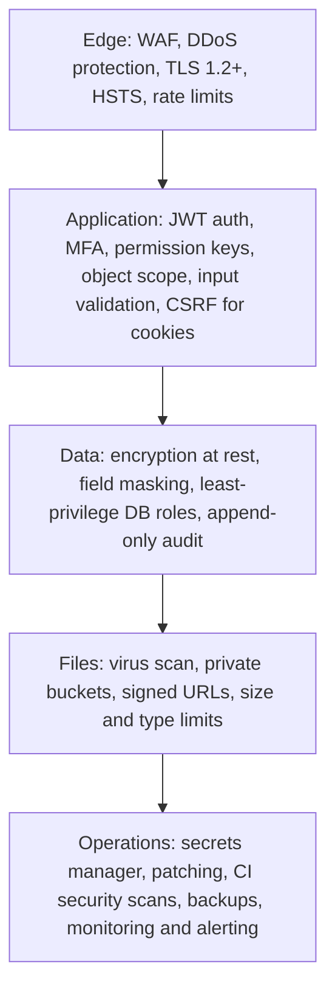

## 1. Layers

## 2. API security — PROPOSED

| Control | Design |
|---|---|
| Authentication | Bearer JWT (15 min), refresh rotation, revocation list in Redis |
| Authorisation | DRF permission class per view mapped to permission keys; queryset scoped by role data scope |
| Input validation | Serializers with the prototype's rules; reject unknown fields |
| Output filtering | Never return password hashes, OTP values, secrets; mask phone / tax IDs for roles that do not need them |
| Rate limiting | Login 5/min/IP, OTP verify 5 per OTP, regenerate 3/10 min, general 600/min/user |
| CORS | Allow-list of web origins only |
| Idempotency | Keys on state-changing workflow endpoints |
| Error handling | No stack traces; correlation ID in responses |
| Webhooks | HMAC signature + timestamp tolerance |

## 3. Encryption

| Data | In transit | At rest |
|---|---|---|
| API / WebSocket | TLS 1.2+ | — |
| PostgreSQL | TLS between app and DB | Storage encryption (provider KMS / LUKS on-premises) |
| Object storage | TLS | Server-side encryption (KMS) |
| Backups | TLS | Encrypted with separate key |
| Secrets | TLS | Secrets manager (KMS) |
| Mobile app | TLS with certificate validation | Tokens in Keychain / Keystore |

## 4. Monitoring

Security events (failed logins, lockouts, permission changes, role grants, exports, OTP lock-outs, webhook failures)
forwarded to the central log platform with alerts — see {{ref:BM-SEC-008}}.

## 5. Prototype comparison

None of these controls exist in the prototype except the permission model, lockout / idle-timeout logic and the audit log
— all running client-side (PROTOTYPE).
