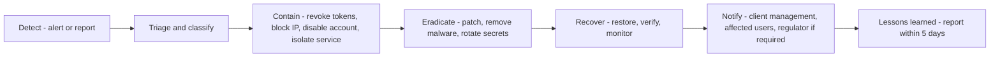

## 1. Severity

| Severity | Example | Response time |
|---|---|---|
| S1 Critical | Data breach, ransomware, production down | 15 min, 24×7 |
| S2 High | Account takeover of privileged user, OTP abuse, provider compromise | 1 h |
| S3 Medium | Malware upload blocked, suspicious login pattern | 1 working day |
| S4 Low | Policy violation, false positive | 3 working days |

## 2. Process

## 3. Roles (to be named)

Incident manager · technical lead · client IT contact · data protection officer · communications.

## 4. Playbooks (summary)

- **Credential compromise:** force logout of all sessions of the user, reset password, review audit trail.
- **OTP abuse:** lock deliveries, review driver and customer accounts, rotate pepper if needed.
- **Data exposure:** identify records, contain access, legal assessment of notification duty (72 h where applicable).
- **Provider outage:** switch messaging to fallback provider / manual OTP exception process.
