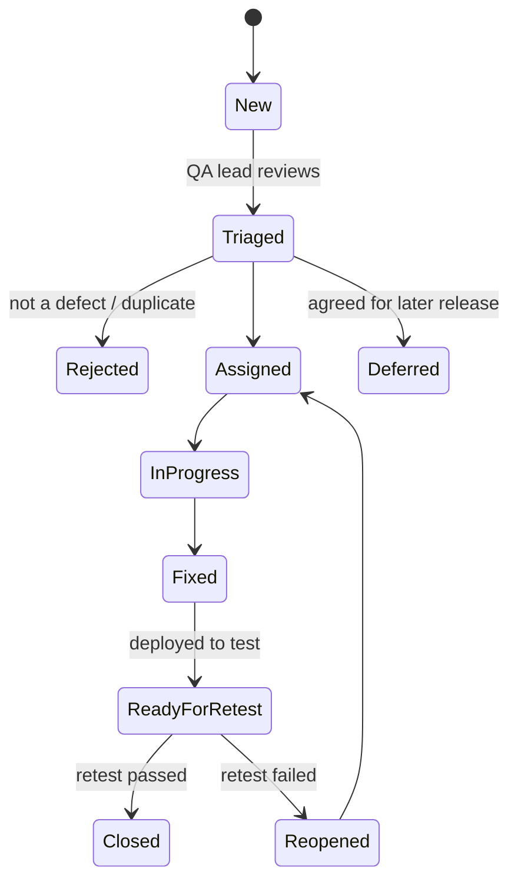

## 1. Severity

| Severity | Definition | Example |
|---|---|---|
| Critical | System unusable, data loss / corruption, security breach, no workaround | Dispatch confirm deducts stock twice |
| High | Major function fails, workaround difficult | OTP cannot be verified |
| Medium | Function partly fails, workaround exists | Report filter wrong |
| Low | Cosmetic / text | Label misspelt |

## 2. Priority

P1 fix immediately · P2 fix in current cycle · P3 fix in next release · P4 backlog.

## 3. Workflow

## 4. Bug report template

| Field | Content |
|---|---|
| Defect ID | BUG-#### (tool generated) |
| Title | Short description: what fails where |
| Module / screen | e.g. Dispatch — Confirm dispatch (`/dispatch/:id`) |
| Environment / build | Test / staging, build version |
| Role used | e.g. Dispatcher |
| Preconditions / data | Order number, dispatch number |
| Steps to reproduce | Numbered |
| Expected result | From test case / FRD |
| Actual result | What happened |
| Evidence | Screenshot, video, log, request id |
| Severity / priority | As above |
| Related test case / requirement | TC-…, FR-… |
| Reported by / date |  |
| Assigned to |  |
| Fix version / resolution |  |
| Retest result / date |  |

## 5. Tooling

Jira, Azure Boards or GitHub Issues (client choice — PENDING CONFIRMATION). Daily triage during test cycles.
