## 1. Catalogue

Editable sources are Mermaid (`.mmd`) files; previews are exported as SVG and PNG in this folder. Diagrams never show a production component as existing: labels state VERIFIED (prototype) or PROPOSED (target).

| ID | Diagram | Label | Files | Source |
|---|---|---|---|---|
| DGM-01 | Overall System Architecture (prototype and target) | VERIFIED (prototype) / PROPOSED (target) | `mermaid/DGM-01_Overall_System_Architecture_prototype_and_target.mmd` · `svg/DGM-01_Overall_System_Architecture_prototype_and_target.svg` · `png/DGM-01_Overall_System_Architecture_prototype_and_target.png` | this catalogue |
| DGM-02 | Business Process Architecture | VERIFIED | `mermaid/DGM-02_Business_Process_Architecture.mmd` · `svg/DGM-02_Business_Process_Architecture.svg` · `png/DGM-02_Business_Process_Architecture.png` | this catalogue |
| DGM-03 | Order-to-Delivery Flowchart | VERIFIED | `mermaid/DGM-03_Order_to_Delivery_Flowchart.mmd` · `svg/DGM-03_Order_to_Delivery_Flowchart.svg` · `png/DGM-03_Order_to_Delivery_Flowchart.png` | docs/workflow chapter 06 |
| DGM-04 | Order Status Lifecycle | VERIFIED | `mermaid/DGM-04_Order_Status_Lifecycle.mmd` · `svg/DGM-04_Order_Status_Lifecycle.svg` · `png/DGM-04_Order_Status_Lifecycle.png` | docs/workflow chapter 17 |
| DGM-05 | Approval Workflow | VERIFIED | `mermaid/DGM-05_Approval_Workflow.mmd` · `svg/DGM-05_Approval_Workflow.svg` · `png/DGM-05_Approval_Workflow.png` | docs/workflow chapter 07 |
| DGM-06 | Dispatch Workflow | VERIFIED | `mermaid/DGM-06_Dispatch_Workflow.mmd` · `svg/DGM-06_Dispatch_Workflow.svg` · `png/DGM-06_Dispatch_Workflow.png` | docs/workflow chapter 11 |
| DGM-07 | Driver Delivery Workflow | VERIFIED (GPS / OTP delivery simulated) | `mermaid/DGM-07_Driver_Delivery_Workflow.mmd` · `svg/DGM-07_Driver_Delivery_Workflow.svg` · `png/DGM-07_Driver_Delivery_Workflow.png` | docs/workflow chapter 08 |
| DGM-08 | Customer Order Workflow | VERIFIED (customer app scope PENDING CONFIRMATION) | `mermaid/DGM-08_Customer_Order_Workflow.mmd` · `svg/DGM-08_Customer_Order_Workflow.svg` · `png/DGM-08_Customer_Order_Workflow.png` | docs/workflow chapter 09 |
| DGM-09 | Role Interaction Diagram | VERIFIED | `mermaid/DGM-09_Role_Interaction_Diagram.mmd` · `svg/DGM-09_Role_Interaction_Diagram.svg` · `png/DGM-09_Role_Interaction_Diagram.png` | docs/workflow chapter 04 |
| DGM-10 | RBAC Diagram | VERIFIED (prototype) / PROPOSED (server enforcement) | `mermaid/DGM-10_RBAC_Diagram.mmd` · `svg/DGM-10_RBAC_Diagram.svg` · `png/DGM-10_RBAC_Diagram.png` | this catalogue |
| DGM-11 | ER Diagram (overview) | PROPOSED | `mermaid/DGM-11_ER_Diagram_overview.mmd` · `svg/DGM-11_ER_Diagram_overview.svg` · `png/DGM-11_ER_Diagram_overview.png` | this catalogue |
| DGM-12 | Data Flow Diagram | PROPOSED | `mermaid/DGM-12_Data_Flow_Diagram.mmd` · `svg/DGM-12_Data_Flow_Diagram.svg` · `png/DGM-12_Data_Flow_Diagram.png` | this catalogue |
| DGM-13 | Deployment Architecture | PROPOSED | `mermaid/DGM-13_Deployment_Architecture.mmd` · `svg/DGM-13_Deployment_Architecture.svg` · `png/DGM-13_Deployment_Architecture.png` | this catalogue |
| DGM-14 | Network Architecture | PROPOSED | `mermaid/DGM-14_Network_Architecture.mmd` · `svg/DGM-14_Network_Architecture.svg` · `png/DGM-14_Network_Architecture.png` | this catalogue |
| DGM-15 | Authentication Flow (production) | PROPOSED | `mermaid/DGM-15_Authentication_Flow_production.mmd` · `svg/DGM-15_Authentication_Flow_production.svg` · `png/DGM-15_Authentication_Flow_production.png` | this catalogue |
| DGM-16 | Integration Architecture | PROPOSED | `mermaid/DGM-16_Integration_Architecture.mmd` · `svg/DGM-16_Integration_Architecture.svg` · `png/DGM-16_Integration_Architecture.png` | this catalogue |
| DGM-17 | CI/CD Pipeline | PROPOSED | `mermaid/DGM-17_CI_CD_Pipeline.mmd` · `svg/DGM-17_CI_CD_Pipeline.svg` · `png/DGM-17_CI_CD_Pipeline.png` | this catalogue |
| DGM-18 | Backup and Recovery Architecture | PROPOSED | `mermaid/DGM-18_Backup_and_Recovery_Architecture.mmd` · `svg/DGM-18_Backup_and_Recovery_Architecture.svg` · `png/DGM-18_Backup_and_Recovery_Architecture.png` | this catalogue |
| DGM-19 | System Context Diagram | VERIFIED (actors) / PROPOSED (external systems) | `mermaid/DGM-19_System_Context_Diagram.mmd` · `svg/DGM-19_System_Context_Diagram.svg` · `png/DGM-19_System_Context_Diagram.png` | this catalogue |
| DGM-20 | Component Diagram (prototype) | VERIFIED | `mermaid/DGM-20_Component_Diagram_prototype.mmd` · `svg/DGM-20_Component_Diagram_prototype.svg` · `png/DGM-20_Component_Diagram_prototype.png` | this catalogue |
| DGM-21 | Driver Delivery Architecture (production) | PROPOSED | `mermaid/DGM-21_Driver_Delivery_Architecture_production.mmd` · `svg/DGM-21_Driver_Delivery_Architecture_production.svg` · `png/DGM-21_Driver_Delivery_Architecture_production.png` | this catalogue |
| DGM-22 | Customer Application Architecture | VERIFIED (prototype) / PROPOSED (production) | `mermaid/DGM-22_Customer_Application_Architecture.mmd` · `svg/DGM-22_Customer_Application_Architecture.svg` · `png/DGM-22_Customer_Application_Architecture.png` | this catalogue |
| DGM-23 | Order Processing Architecture | VERIFIED (logic) / PROPOSED (server) | `mermaid/DGM-23_Order_Processing_Architecture.mmd` · `svg/DGM-23_Order_Processing_Architecture.svg` · `png/DGM-23_Order_Processing_Architecture.png` | this catalogue |

## 2. Editing

Edit the `.mmd` file and re-render with Mermaid CLI: `mmdc -i mermaid/<file>.mmd -o svg/<file>.svg`. The workflow diagrams (DGM-03 … DGM-09) are maintained in `docs/workflow/` and copied here.

## DGM-01 — Overall System Architecture (prototype and target)

Label: **VERIFIED (prototype) / PROPOSED (target)**

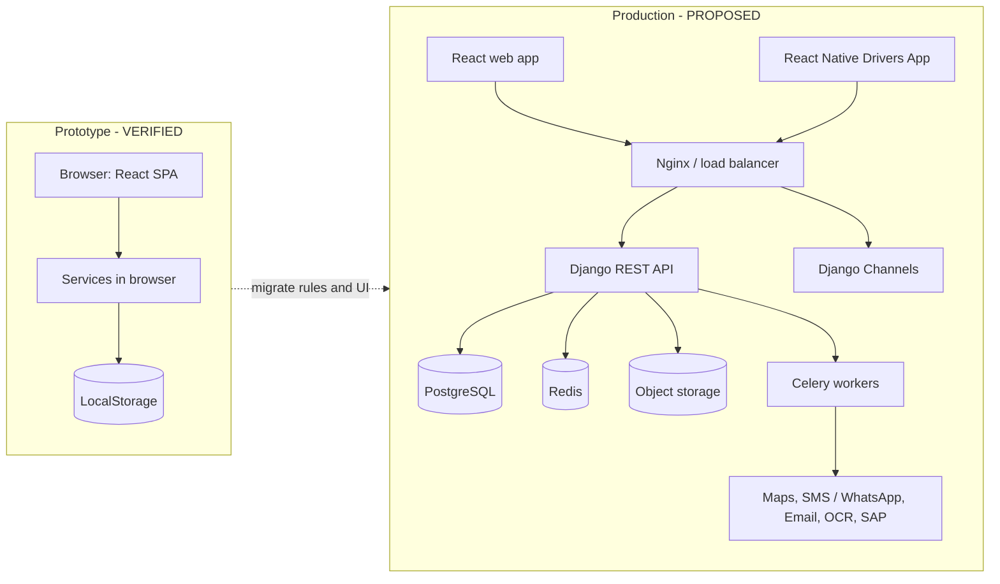

## DGM-02 — Business Process Architecture

Label: **VERIFIED**

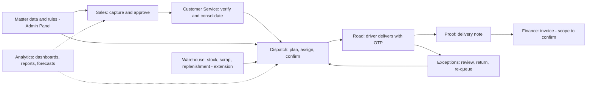

## DGM-03 — Order-to-Delivery Flowchart

Label: **VERIFIED**

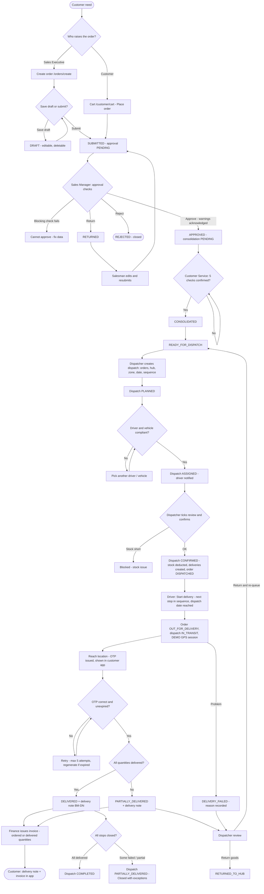

## DGM-04 — Order Status Lifecycle

Label: **VERIFIED**

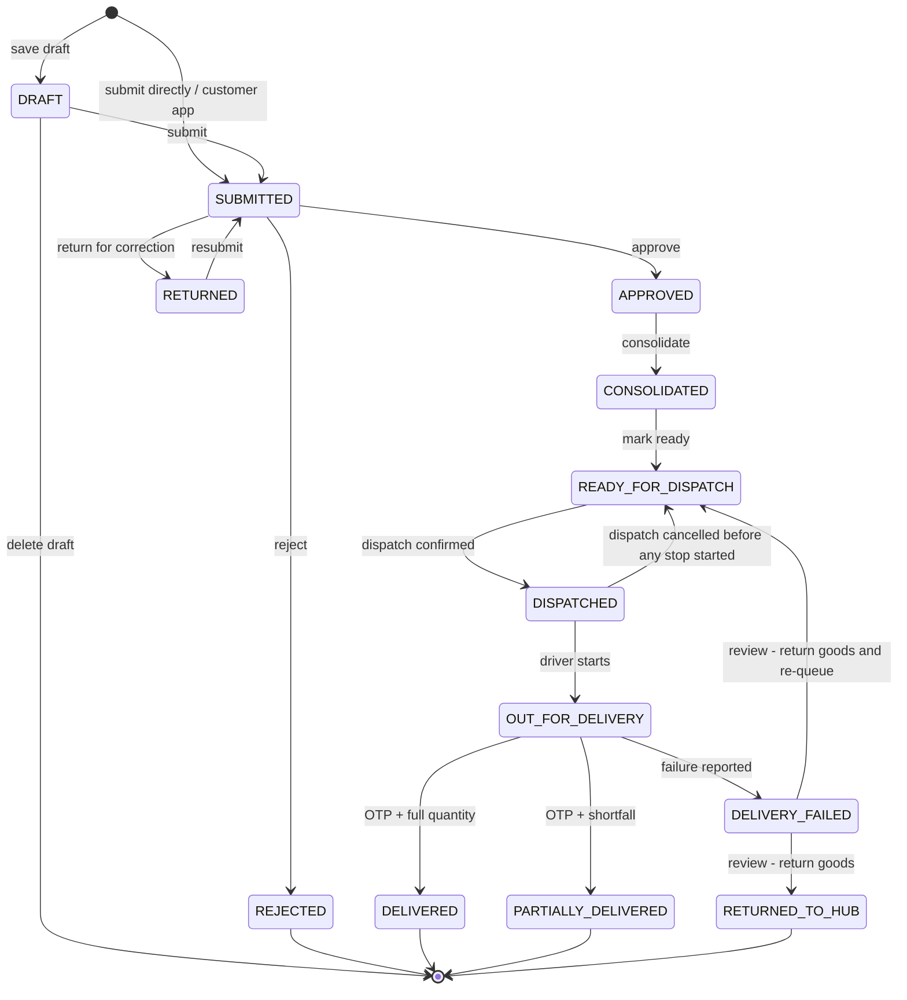

## DGM-05 — Approval Workflow

Label: **VERIFIED**

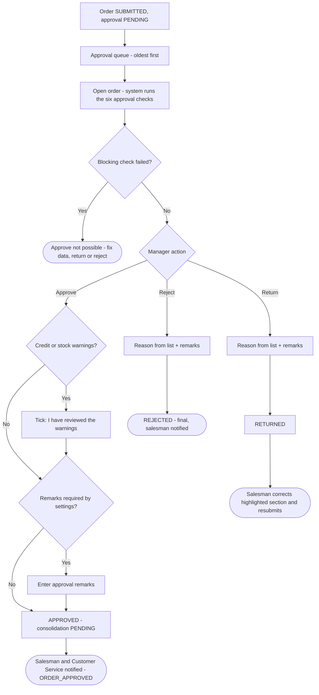

## DGM-06 — Dispatch Workflow

Label: **VERIFIED**

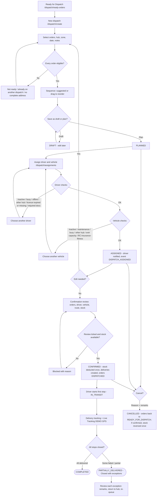

## DGM-07 — Driver Delivery Workflow

Label: **VERIFIED (GPS / OTP delivery simulated)**

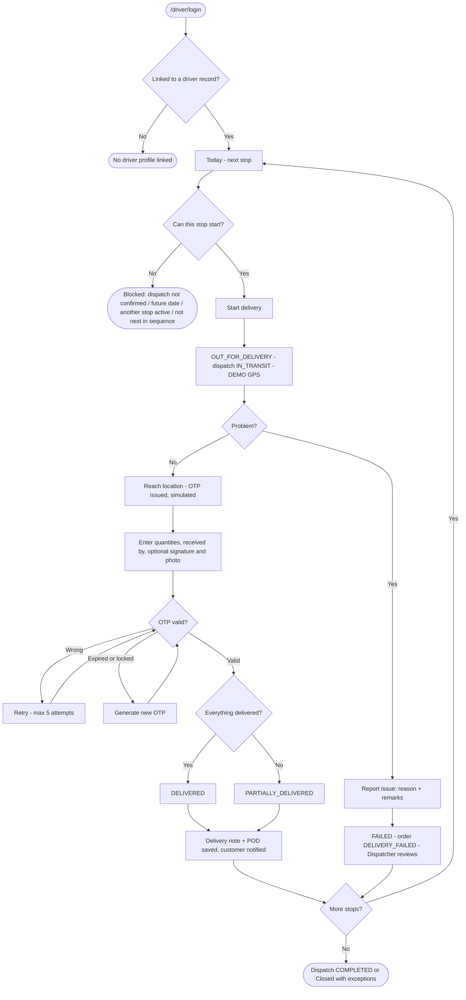

## DGM-08 — Customer Order Workflow

Label: **VERIFIED (customer app scope PENDING CONFIRMATION)**

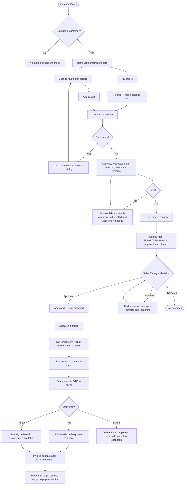

## DGM-09 — Role Interaction Diagram

Label: **VERIFIED**

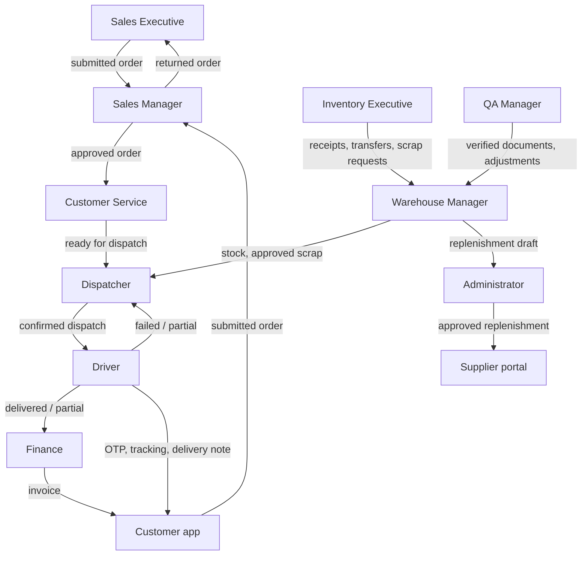

## DGM-10 — RBAC Diagram

Label: **VERIFIED (prototype) / PROPOSED (server enforcement)**

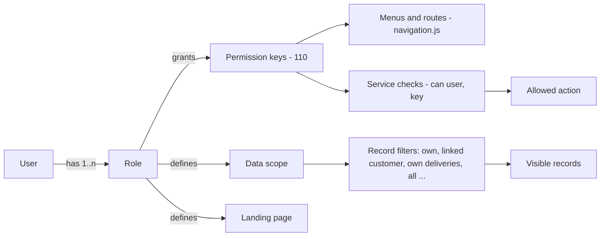

## DGM-11 — ER Diagram (overview)

Label: **PROPOSED**

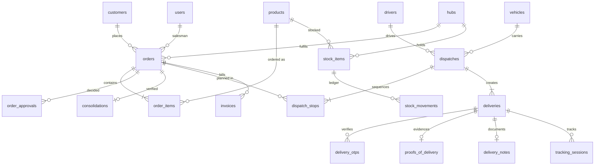

## DGM-12 — Data Flow Diagram

Label: **PROPOSED**

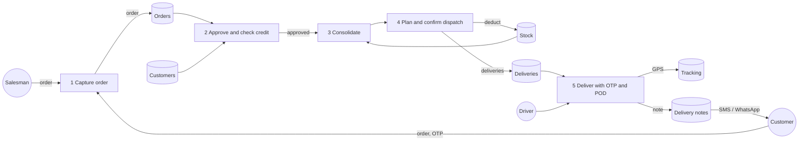

## DGM-13 — Deployment Architecture

Label: **PROPOSED**

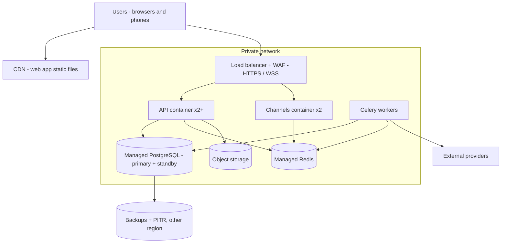

## DGM-14 — Network Architecture

Label: **PROPOSED**

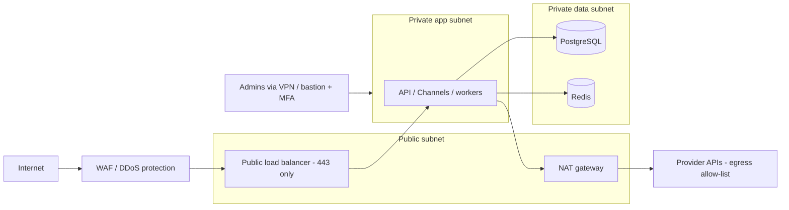

## DGM-15 — Authentication Flow (production)

Label: **PROPOSED**

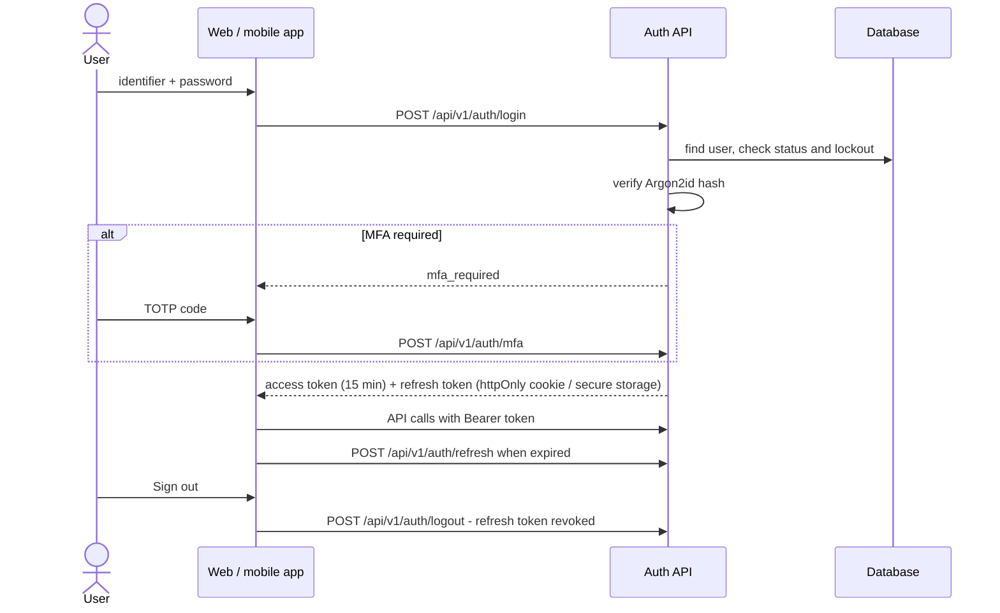

## DGM-16 — Integration Architecture

Label: **PROPOSED**

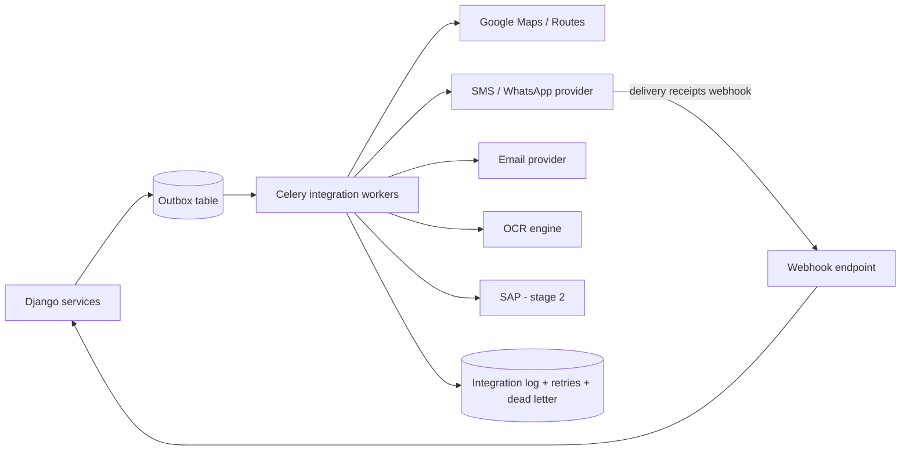

## DGM-17 — CI/CD Pipeline

Label: **PROPOSED**

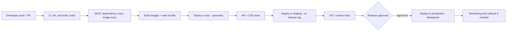

## DGM-18 — Backup and Recovery Architecture

Label: **PROPOSED**

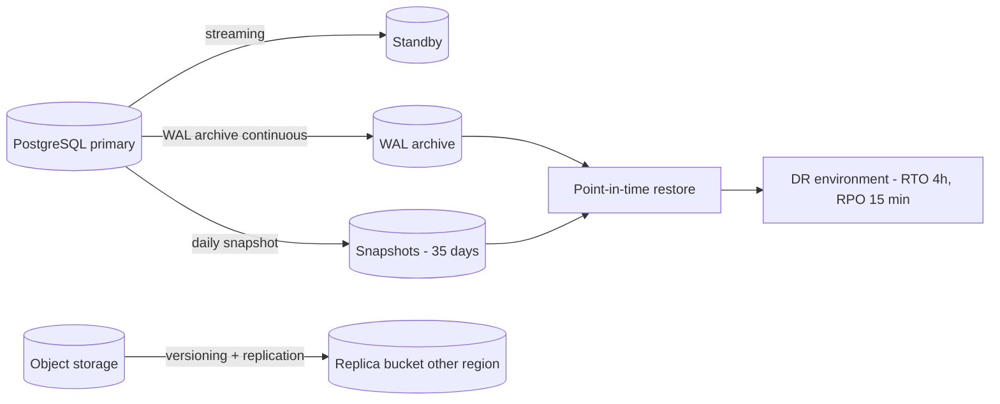

## DGM-19 — System Context Diagram

Label: **VERIFIED (actors) / PROPOSED (external systems)**

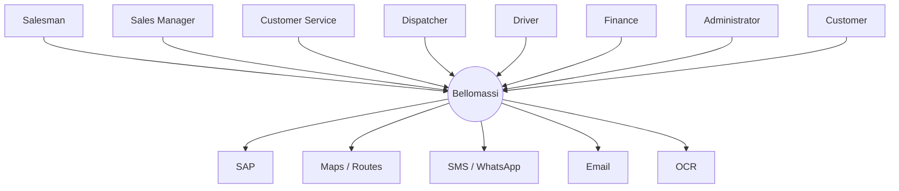

## DGM-20 — Component Diagram (prototype)

Label: **VERIFIED**

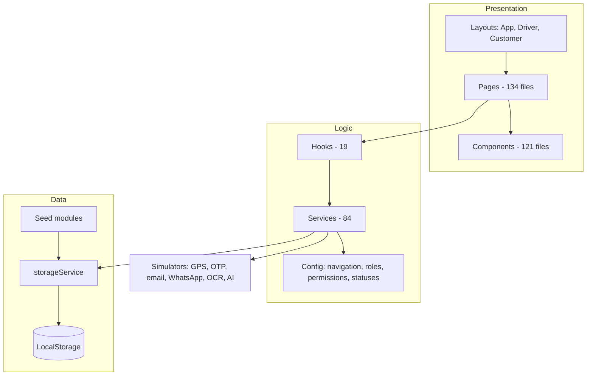

## DGM-21 — Driver Delivery Architecture (production)

Label: **PROPOSED**

```mermaid
flowchart LR
    APP[React Native Drivers App] -->|HTTPS| API[Delivery API]
    APP -->|GPS every 10-15 s while active| TRK[Tracking API]
    TRK --> RD[(Redis channel layer)]
    TRK --> PG[(location_points)]
    RD --> WSA[Admin map - all vehicles]
    RD --> WSC[Customer map - own order only]
    API --> OTP[OTP service - hashed, rate limited]
    OTP --> MSG[SMS / WhatsApp]
    API --> POD[(Object storage - photo, signature)]
    API --> DN[Delivery note PDF worker] --> MSG
```

## DGM-22 — Customer Application Architecture

Label: **VERIFIED (prototype) / PROPOSED (production)**

```mermaid
flowchart LR
    CUA[Customer app - /customer] --> CAS[customerAppService]
    CAS --> ORD[orderService.submitOrder - source customer_app]
    CAS --> CART[(customer_carts)]
    CUA --> TRK[Tracking - own order only]
    CUA --> DOCS[Delivery notes and invoices - linked customer]
    ORD --> APR[Sales Manager approval]
```

## DGM-23 — Order Processing Architecture

Label: **VERIFIED (logic) / PROPOSED (server)**

```mermaid
flowchart LR
    IN[Order input: office or customer app] --> VAL[validateOrder]
    VAL --> SUB[submitOrder: number, warnings, timeline]
    SUB --> CHK[getApprovalChecks: 6 checks]
    CHK --> DEC[approve / return / reject]
    DEC --> CON[consolidateOrder: 5 checks]
    CON --> RDY[markReadyForDispatch]
    RDY --> DSP[dispatch: create, assign, confirm - stock deducted]
    DSP --> DEL[deliveries]
```
