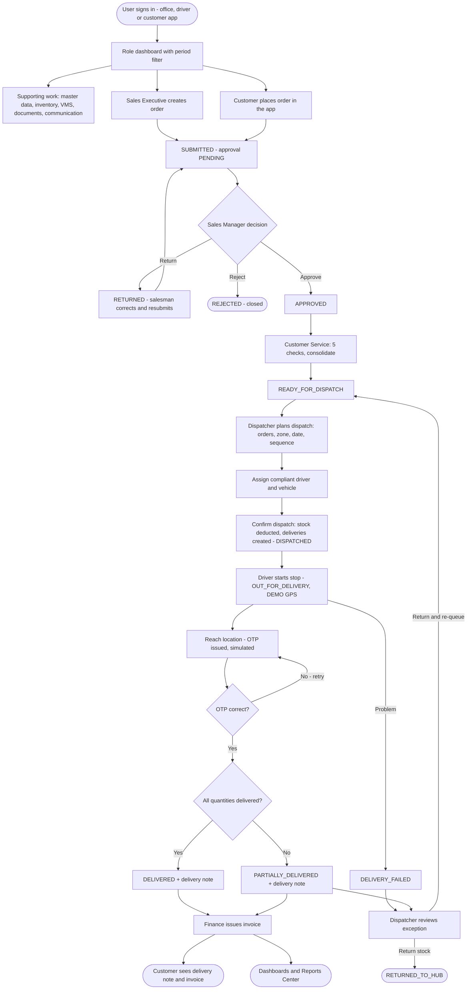
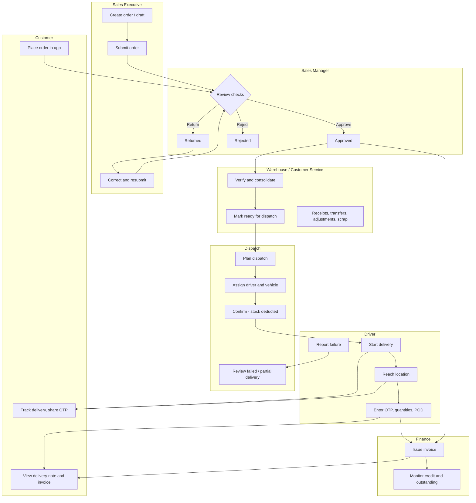

# 02 · Overall Workflow

## 2.1 The business in one paragraph

A **Sales Executive** (or the **customer** in the customer app) raises an order for a customer and a fulfilment hub.
The **Sales Manager** checks credit, stock and data quality and approves, returns or rejects it. **Customer Service**
verifies the approved order against the warehouse and consolidates it, then marks it ready for dispatch. The
**Dispatcher** groups ready orders into a dispatch, assigns a compliant driver and vehicle, and confirms the dispatch —
at that moment hub stock is deducted and a delivery record is created for each order. The **Driver** starts each stop in
sequence, records arrival, collects the customer's OTP, captures quantities and proof of delivery, and completes or fails
the stop. Completing a stop generates a **delivery note**. **Finance** issues the invoice from the order (on ordered or
delivered quantities). Failed and partial deliveries go back to the Dispatcher for review. Around this flow, the
warehouse roles keep stock accurate (receipts, transfers, adjustments, scrap), the QA Manager verifies documents and
watches expiry, and every step raises in-app notifications and optional email / WhatsApp messages.

## 2.2 Master flowchart 1 — Complete application workflow

## 2.3 Swimlane — who does what

## 2.4 Stages, owners and system effects

| # | Stage | Owner role | Route | Service function | Resulting order status | Notifications |
|---|---|---|---|---|---|---|
| 1 | Create / save draft | Sales Executive, Administrator | `/orders/create` | `orderService.createOrder` | DRAFT | — |
| 2 | Submit | Sales Executive, Administrator, Customer (app) | `/orders/create`, `/customer/cart` | `orderService.submitOrder`, `customerAppService.placeCustomerOrder` | SUBMITTED (approval PENDING) | Sales Manager; event ORDER_CREATED |
| 3a | Approve | Sales Manager | `/orders/approval/:id` | `approvalService.approveOrder` | APPROVED (consolidation PENDING) | Customer Service, salesman; event ORDER_APPROVED |
| 3b | Return for correction | Sales Manager | `/orders/approval/:id` | `approvalService.returnOrderForCorrection` | RETURNED | Salesman (link to edit) |
| 3c | Reject | Sales Manager | `/orders/approval/:id` | `approvalService.rejectOrder` | REJECTED | Salesman; event ORDER_REJECTED |
| 4 | Consolidate | Customer Service | `/orders/consolidation/:id` | `consolidationService.consolidateOrder` | CONSOLIDATED | Dispatcher |
| 5 | Ready for dispatch | Customer Service | `/orders/consolidation/:id` | `consolidationService.markReadyForDispatch` | READY_FOR_DISPATCH | Dispatcher; event ORDER_READY |
| 6 | Plan dispatch | Dispatcher, Administrator | `/dispatch/create` | `dispatchService.createDispatch` | (order linked to dispatch) | — |
| 7 | Assign driver & vehicle | Dispatcher, Administrator | `/dispatch/assignments`, `/dispatch/:id` | `dispatchService.assignDispatch` | — | Driver; event DISPATCH_ASSIGNED |
| 8 | Confirm dispatch | Dispatcher, Administrator | `/dispatch/:id` | `dispatchService.confirmDispatch` | DISPATCHED | Driver, Administrator |
| 9 | Start delivery | Driver | `/driver/deliveries/:id` | `deliveryService.startDelivery` | OUT_FOR_DELIVERY | Customer, Dispatcher; event DELIVERY_STARTED |
| 10 | Reach location | Driver | `/driver/deliveries/:id` | `deliveryService.markArrived` | OUT_FOR_DELIVERY (arrivedAt set, OTP issued) | Customer sees OTP |
| 11a | Complete | Driver | `/driver/deliveries/:id/confirm` | `deliveryService.confirmDelivery` | DELIVERED or PARTIALLY_DELIVERED | Customer, Dispatcher; event DELIVERY_COMPLETED |
| 11b | Fail | Driver | `/driver/deliveries/:id` | `deliveryService.failDelivery` | DELIVERY_FAILED | Administrator, Dispatcher, customer; event DELIVERY_FAILED |
| 12 | Review exception | Dispatcher, Administrator | `/dispatch/deliveries/:id` | `deliveryService.reviewDelivery` | RETURNED_TO_HUB or READY_FOR_DISPATCH (re-queue) | — |
| 13 | Invoice | Finance, Administrator | `/invoices/create` | `invoiceService.generateInvoice` | (order unchanged; invoice ISSUED) | event INVOICE_GENERATED |

## 2.5 Supporting workflows

| Workflow | Owner | Chapter |
|---|---|---|
| Stock receipt, transfer, adjustment, movement ledger | Warehouse Manager, Inventory Executive, QA Manager (adjustments) | 10 |
| Scrap request → approval → write-off | Warehouse roles / Dispatcher (request); Warehouse Manager / Administrator (approve) | 07, 10 |
| Replenishment draft → approval → goods receipt | Warehouse / Inventory / Dispatcher (draft); Administrator (approve) | 07, 10 |
| Vehicle and driver compliance (VMS) | Administrator; Dispatcher views | 11 |
| Documents and OCR review | Uploaders; Customer Service, QA Manager, Administrator review | 13 |
| Email, WhatsApp, automated notifications, call log | Sales, CS, Dispatch, Finance, Administrator | 13 |
| Dashboards, reports, forecasting, AI assistant | All office roles (by permission) | 14 |
| Users, roles, permissions, settings, audit | Super Admin, Administrator | 04, 05 |

## 2.6 Key rules that hold across the whole flow

- **One step at a time.** Each service refuses an action when the record is not in the expected status (for example,
  a dispatch can only be confirmed when it is `ASSIGNED`; a delivery can only be completed when it is
  `OUT_FOR_DELIVERY`).
- **Permissions are checked twice** — the route (`ProtectedRoute` + `navigation.js` permission) and the service
  (`can(user, key)`), so a hidden button cannot be bypassed.
- **Stock moves exactly once.** Dispatch confirmation deducts stock once (`stockDeducted` flag); cancellation reverses
  it once (`stockReversed`); a reviewed exception returns stock once (`returnedToHub`); a scrap request writes off once.
- **Everything is traceable.** Orders have a timeline (`bellomassi_order_timeline`), dispatches have a timeline
  (`bellomassi_dispatch_timeline`), administrative changes go to the audit log (`bellomassi_audit_logs`) and user
  activity to `bellomassi_activities`.
- **Nothing is deleted after submission.** Only draft orders can be deleted; submitted orders are kept for the audit
  trail.
