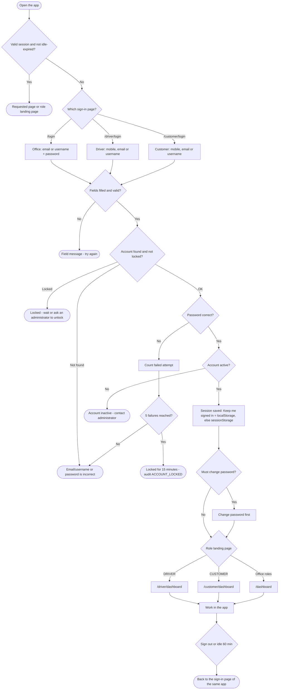
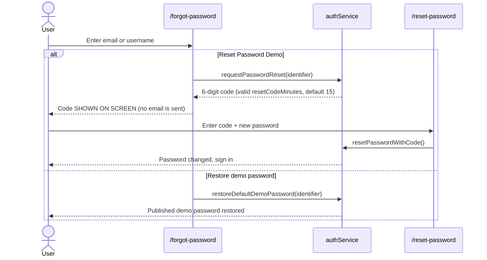

# 03 · Login-Wise Workflow

**Status:** Implemented as a **browser-session simulation**. Passwords are stored as a demo FNV-1a hash in
`bellomassi_demo_users`; this is not production authentication.

## 3.1 Sign-in pages

| Page | Route | Component | Identifier accepted | Intended for |
|---|---|---|---|---|
| Office sign-in | `/login` | `pages/auth/Login.jsx` | Email or username | All office roles (any account works) |
| Driver app sign-in | `/driver/login` | `pages/auth/AppLogin.jsx` (driver variant) | Mobile number, email or username | Driver |
| Customer app sign-in | `/customer/login` | `pages/auth/AppLogin.jsx` (customer variant) | Mobile number, email or username | Customer |
| Forgot password | `/forgot-password` | `pages/auth/ForgotPassword.jsx` | Email or username | Everyone |
| Reset password | `/reset-password` | `pages/auth/ResetPassword.jsx` | 6-digit demo code | Everyone |
| Sign out | `/logout` | `logoutConfirm` page | — | Everyone |
| Unauthorized | `/unauthorized` | `Unauthorized` | — | Shown when a role opens a route it may not use |

If a non-driver signs in on `/driver/login` (or a non-customer on `/customer/login`), sign-in still succeeds; a toast
says *"This account is not a driver account — opening your own workspace"* and the user goes to their own landing page.

## 3.2 Demo accounts

All accounts are listed on the office login screen. Email = `<username>@bellomassi.demo`.

| Role | Username | Password | Landing page after sign-in |
|---|---|---|---|
| Super Admin | superadmin | Super@123 | `/dashboard` (Admin dashboard) |
| Administrator | admin | Admin@123 | `/dashboard` (Admin dashboard) |
| Sales Manager | manager | Manager@123 | `/dashboard` (Sales Manager dashboard) |
| Sales Executive | salesman | Sales@123 | `/dashboard` (Salesman dashboard) |
| Customer Service | cs | Cs@123 | `/dashboard` (Customer Service dashboard) |
| Warehouse Manager | warehouse | Warehouse@123 | `/dashboard` (Warehouse dashboard) |
| Inventory Executive | inventory | Inventory@123 | `/dashboard` (Inventory variant of Warehouse dashboard) |
| Dispatcher | dispatcher | Dispatch@123 | `/dashboard` (Dispatcher dashboard) |
| Driver | driver | Driver@123 (or mobile `+91 98400 11206`) | `/driver/dashboard` |
| Finance Executive | finance | Finance@123 | `/dashboard` (Finance dashboard) |
| QA Manager | qa | Quality@123 | `/dashboard` (QA dashboard) |
| Customer (portal) | customer | Customer@123 (or mobile `+91 98410 22310`) | `/customer/dashboard` |
| Supplier (portal) | supplier | Supplier@123 | `/dashboard` (Supplier portal dashboard) |

Landing pages come from the role record (`landingPath` in `bellomassi_roles`, seeded by `services/seed/adminSeed.js`:
DRIVER → `/driver/dashboard`, CUSTOMER → `/customer/dashboard`, all others → `/dashboard`). An Administrator can change a
role's landing page in Role Management to one of: Dashboard, Driver app — Today, Order list, Order approval, Dispatch
dashboard, Inventory dashboard, Notification center, Customer app — Home, Reports center (`LANDING_PAGES` in
`rbacCatalog.js`). A customer who opens `/dashboard` is redirected to `/customer/dashboard`.

## 3.3 Master flowchart 2 — Login-wise workflow

## 3.4 Sign-in rules (from `services/authService.js`)

| Rule | Behaviour | Message |
|---|---|---|
| Empty identifier | Blocked | "Enter your email address or username." |
| Malformed email | Blocked | "Enter a valid email address." |
| Empty password | Blocked | "Enter your password." |
| Unknown account / wrong password | Blocked; failed attempt counted | "The email/username or password is incorrect. Use one of the demo accounts below." |
| Too many failures | Account locked (`maxFailedAttempts` 5, `lockoutMinutes` 15 by default — Application Settings › Security) | "Too many failed attempts. This account is locked for N minutes." |
| Locked account | Blocked until the lock expires or an administrator unlocks the user (`userService.unlockUser`) | "This account is temporarily locked after too many failed attempts…" |
| Inactive account | Blocked | "This account is inactive. Contact your administrator to reactivate it." |
| Forced password change | After an administrator reset (`forcePasswordChangeAfterReset`) the user must change password before any other page | Redirect to `/account/change-password?required=1` |
| Idle timeout | `components/layout/SessionWatcher.jsx` signs out after `sessionTimeoutMinutes` (default 60) of inactivity | Signed out (reason "timeout") |
| Remember me | "Keep me signed in" stores the session in localStorage; otherwise sessionStorage (closes with the tab). The last username can be remembered. | — |

Session data is stored under `bellomassi_session`; failed-attempt counters under `bellomassi_auth`.

## 3.5 Forgot / reset password (Simulated)

Errors: "No demo account uses that email address or username.", "This account is inactive. Contact your administrator.",
"Enter the 6-digit code.", "This code is not valid. Request a new code.", "This code has expired. Request a new code.",
and for accounts created inside the app: "This account was created in the app and has no published demo password. Use a
reset code instead."

New passwords must follow the policy in Application Settings › Security (minimum length 8, mixed characters by default;
`authService.passwordPolicy`).

## 3.6 Sign-out

1. The user chooses **Sign Out** (header menu, sidebar, driver profile or customer profile) → `/logout` confirmation.
2. On confirm, the session is cleared and the user returns to the sign-in page of the app they were using
   (`signOutTarget`: driver pages → `/driver/login`, customer pages → `/customer/login`, otherwise `/login`).

## 3.7 Route protection

- `src/routes/ProtectedRoute.jsx` sends signed-out visitors to the right sign-in page and checks the page's permission
  from `navigation.js`. A signed-in user without the permission sees `/unauthorized`.
- Menus only show items the user's role may open (`SidebarNav` filters by permission), so most users never see the
  Unauthorized page.
