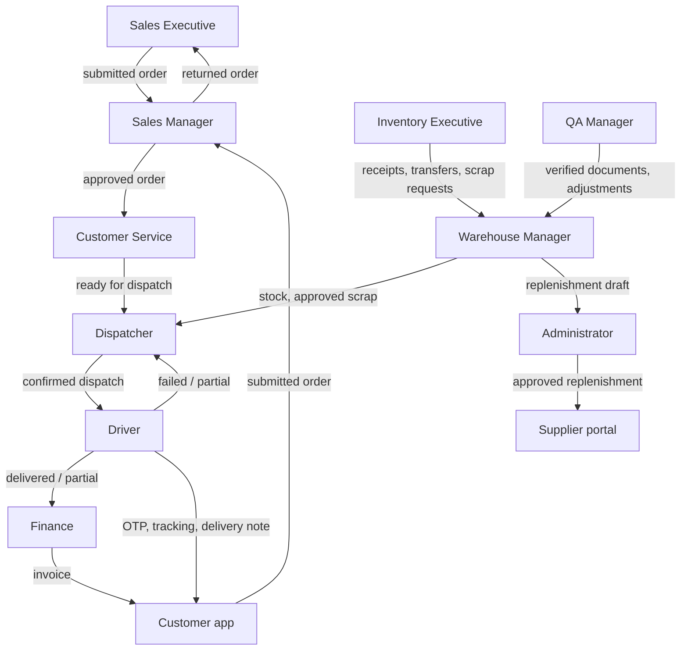

# 04 · Role-Wise Workflow

This chapter describes each of the 13 system roles. Menus were generated from `src/config/navigation.js` filtered by
each role's default permissions in `src/config/permissions.js` — they are exactly what the sidebar shows for the seeded
role. (An Administrator can change any non-locked role's permissions in Role Management; the menus then change too.)

Every office role also has: **Dashboard**, and under **My Account** — My Profile (`/profile`), Notification Center
(`/notifications`), Change Password (`/account/change-password`), Preferences (`/settings`) and Sign Out (`/logout`).
Every office dashboard has the **period filter** (chapter 14).

The flowchart below shows how work passes between roles.

---

## 4.1 Super Admin

| Topic | Details |
|---|---|
| Purpose | Owner of the platform: every module, every role and setting. The only role that can grant, change, reset or delete Super Admin accounts. |
| Login | `/login` · **superadmin / Super@123** |
| Dashboard | `/dashboard` → `AdminDashboard` (Operations overview) |
| Menus | Everything the Administrator sees (4.2). Because Super Admin holds every permission key, the **My Deliveries** (driver app) and **My Account (Customer)** groups also appear; those pages show "No driver profile linked" / "No customer account linked" unless the user is linked to a driver or customer record. |
| KPIs | Total orders, Pending approval, Approved, Rejected, Consolidated, Ready for dispatch, Order pipeline; Operations overview: Sales (delivered, 30 days), Delivery (7 days), Inventory value, Finance — invoiced, Purchase (replenishment), AI insights |
| CRUD | All master data, users, roles, permissions, settings, organization, templates |
| Approvals | Orders, scrap, replenishment, documents (all permissions) |
| Reports | All 118 reports in the Reports Center; every module report |
| Notifications | Administrative and operational notifications addressed to ADMIN / SUPER_ADMIN |
| Daily workflow | Review dashboard → user and role administration → audit log → settings |
| Cannot do | Delete or deactivate their **own** account; remove their own access to user management |
| Next responsible user | Administrator (day-to-day administration) |
| Logout | Header menu › Sign Out → `/logout` → `/login` |

## 4.2 Administrator

| Topic | Details |
|---|---|
| Purpose | Runs the system day to day: administers users, roles and settings and can perform most business steps (create orders, plan and confirm dispatches, issue invoices, approve scrap and replenishment). |
| Login | `/login` · **admin / Admin@123** |
| Dashboard | `/dashboard` → `AdminDashboard` (same KPIs as Super Admin) |
| Menus | **Order Management:** Create Order, My Orders, Order List, Order Approval, Order Consolidation, Returned Orders, Rejected Orders, Order Reports · **Customers:** Customer List, Customer Credit · Products, Suppliers, Hubs · **Inventory:** Inventory Dashboard, Warehouse Dashboard, QA & Cold Chain, Stock Overview, Low Stock, Stock Receipts, Stock Transfers, Stock Adjustments, Stock Movements, Scrap Management · **Dispatch:** Dispatch Dashboard, Ready for Dispatch, Dispatch Planning, Driver Assignment, Delivery Tracking, Delivery History, Dispatch Zones, Drivers, Vehicles, Delivery Reports, Live Tracking (Demo GPS) · **Vehicle Management:** VMS Dashboard, Vehicles, Driver Documents, Document Expiry, VMS Reports, Compliance Rules · **Documents:** Document Repository, Upload Documents, OCR Queue, Verified, Rejected, Document Types, Document Reports · **Invoices:** Invoice Dashboard, Invoices, New Invoice, Invoice Templates, Invoice Reports · **Communication:** Communication Center, Email, WhatsApp, Automated Notifications, Call History, Call Follow-ups · **Administration:** User Management, Role Management, Permission Matrix, User Role Assignment, Audit Log, Application Settings · **Organization:** Company, Branches, Business Units, Departments, Designations, Employee Master, Warehouse Master · **AI & Intelligence:** AI Overview, AI Assistant, Jarvis, Forecasting, Predictive Inventory, Replenishment, AI Insights, Model Management, AI Settings · **Reports:** Reports Center |
| CRUD | Customers, products, suppliers, hubs, zones, drivers, vehicles, document types, invoice templates, email/WhatsApp templates, users, roles, organization records |
| Approvals | Scrap (`scrap.approve`), replenishment (`procurement.approve` / `procurement.reject` — **only** Administrator and Super Admin hold these), documents (`documents.review`, `documents.reject`). **Not** order approval or consolidation: the Administrator can open the Order Approval and Consolidation queues but `orders.approve`, `orders.reject` and `orders.consolidate` are not granted by default (Super Admin holds them). |
| Reports | All report categories |
| Notifications | Failed deliveries, dispatch confirmations, document expiry, low stock, purchase approvals |
| Daily workflow | Check dashboard → approve replenishment drafts → handle user requests (unlock, reset password) → review audit log → adjust settings |
| Cannot do | Change or delete a Super Admin account; change the Administrator role unless they are Administrator or Super Admin |
| Next responsible user | Depends on the module (e.g. approved replenishment → Supplier / warehouse goods receipt) |
| Logout | `/logout` → `/login` |

## 4.3 Sales Executive (SALESMAN)

| Topic | Details |
|---|---|
| Purpose | Takes orders for the customers assigned to them and keeps them moving through approval. |
| Login | `/login` · **salesman / Sales@123** |
| Dashboard | `SalesmanDashboard`: My orders, Draft orders, Pending approval, Approved orders, Returned orders, Rejected orders, Needs your action, My order trend, My recent orders |
| Menus | **Order Management:** Create Order, My Orders, Order List, Returned Orders, Rejected Orders · **Customers:** Customer List · Products · **Inventory:** Stock Overview · **Documents:** Repository, Upload, OCR Queue, Verified, Rejected · **Communication:** Communication Center, Email, WhatsApp, Call History, Call Follow-ups · **AI:** AI Overview, AI Assistant, Jarvis · Reports Center |
| Data scope | Own records only (orders where `salesmanId` or `createdBy` is the user) |
| CRUD | Create, edit and delete **draft** orders; duplicate an order; edit and resubmit **returned** orders; log, edit and delete own calls; upload documents for own records |
| Approvals | None (submits for approval) |
| Reports | Reports Center — only categories their permissions allow (Customer reports via `customers.view`, Communication reports via `communication.calls`) |
| Notifications | Order submitted / approved / returned (with link to edit) / rejected / ready for dispatch |
| Daily workflow | Dashboard "Needs your action" → fix returned orders → create today's orders (or from a call) → submit → follow up calls → check approvals |
| Cannot do | Approve or reject orders; consolidate; dispatch; invoice; see other salesmen's orders; delete a submitted order ("Only draft orders can be deleted") |
| Next responsible user | **Sales Manager** (approval) |
| Logout | `/logout` → `/login` |

## 4.4 Sales Manager

| Topic | Details |
|---|---|
| Purpose | Approves, returns or rejects submitted orders after checking credit, stock and data quality; watches sales performance. |
| Login | `/login` · **manager / Manager@123** |
| Dashboard | `SalesManagerDashboard`: Pending approvals, Returned orders, Recent pending orders (oldest first), Active accounts and credit position |
| Menus | **Order Management:** Order List, Order Approval, Returned Orders, Rejected Orders, Order Reports · **Customers:** Customer List, Customer Credit · Products, Suppliers, Hubs · **Inventory:** Stock Overview, Low Stock · **Dispatch:** Dispatch Dashboard, Dispatch Planning, Delivery Tracking, Delivery History · **Documents** (5 pages) · **Invoices:** Invoice Dashboard, Invoices · **Communication:** Center, Email, WhatsApp, Call History, Call Follow-ups · **AI:** AI Overview, AI Assistant, Jarvis, Forecasting, Predictive Inventory, Replenishment, AI Insights, Model Management · Reports Center |
| Data scope | All submitted and later orders (not other users' drafts) |
| CRUD | Sales targets (`sales.targets.manage`); calls; documents upload; forecasts (generate / export) |
| Approvals | **Order approval** — Approve (`orders.approve`), Return for correction and Reject (`orders.reject`) |
| Reports | Sales, Inventory, Procurement, Dispatch & Delivery (history), Customer, Supplier, Communication, AI categories |
| Notifications | "New order for approval", "Order resubmitted" (with credit / stock warning flags) |
| Daily workflow | Order Approval queue (oldest first) → open each order → read approval checks → approve / return / reject → check returned orders → review credit position and reports |
| Cannot do | Create orders; consolidate; plan or confirm dispatches; issue invoices; manage master data |
| Next responsible user | **Customer Service** (approved) or **Sales Executive** (returned) |
| Logout | `/logout` → `/login` |

## 4.5 Customer Service

| Topic | Details |
|---|---|
| Purpose | Verifies approved orders against the warehouse, consolidates them and releases them to dispatch; reviews documents. |
| Login | `/login` · **cs / Cs@123** |
| Dashboard | `CustomerServiceDashboard`: Approved orders, Awaiting consolidation, Consolidated orders, Ready for dispatch, Approved orders by stage, Queue by salesman, Consolidation queue (oldest approval first), Recent approved orders |
| Menus | **Order Management:** Order List, Order Consolidation · Customer List · Products, Hubs · **Inventory:** Stock Overview, Low Stock · **Dispatch:** Dispatch Dashboard, Ready for Dispatch, Dispatch Planning, Delivery Tracking, Delivery History · **Documents:** Repository, Upload, OCR Queue, Verified, Rejected, Document Reports · **Communication:** Center, Email, WhatsApp, Call History, Call Follow-ups · **AI:** AI Overview, AI Assistant, Jarvis, AI Insights · Reports Center |
| Data scope | Orders from approval onwards; all documents |
| CRUD | Consolidation records; calls; documents (upload, review, reject); VMS document upload |
| Approvals | Consolidation (5-point verification); **document review** (verify / reject) |
| Reports | Customer, Communication, Dispatch & Delivery (where permitted) |
| Notifications | "Order awaiting consolidation" after each approval |
| Daily workflow | Consolidation queue → open order → tick the 5 checks, review hub stock → Consolidate → Mark ready for dispatch → OCR queue / document review → customer calls |
| Cannot do | Approve or reject orders; create dispatches; assign drivers; confirm dispatch; issue invoices |
| Next responsible user | **Dispatcher** |
| Logout | `/logout` → `/login` |

## 4.6 Dispatcher

| Topic | Details |
|---|---|
| Purpose | Plans dispatches from ready orders, assigns compliant drivers and vehicles, confirms loading (stock deduction), follows deliveries and resolves exceptions. |
| Login | `/login` · **dispatcher / Dispatch@123** |
| Dashboard | `DispatcherDashboard` / `DispatchOverview`: Ready for dispatch, Planned dispatches, Assigned dispatches, Confirmed dispatches, In transit, Completed deliveries, Failed deliveries, Partial deliveries, Active drivers, Available vehicles; charts: Dispatch trend, Delivery completion trend, Delivery status distribution, Driver performance, Zone delivery performance; tables: Recent dispatches, In-transit deliveries |
| Menus | Order List · Products, Suppliers, Hubs · **Inventory:** Inventory Dashboard, Stock Overview, Low Stock, Stock Receipts, Stock Transfers, Stock Adjustments, Stock Movements, Scrap Management · **Dispatch:** all 11 pages including Live Tracking (Demo GPS) · **VMS:** Dashboard, Vehicles, Driver Documents, Document Expiry, VMS Reports · **Documents** (5) · **Communication:** Center, Email, WhatsApp · **AI:** AI Overview, Assistant, Jarvis, Forecasting, Predictive Inventory, Replenishment, AI Insights, Model Management · Reports Center |
| Data scope | Orders from consolidation onwards; fleet and hub documents |
| CRUD | Dispatches (create, edit while DRAFT/PLANNED/ASSIGNED, cancel), delivery sequence; scrap requests (create); replenishment drafts (create); documents upload. Drivers, vehicles and zones are **view-only** for the Dispatcher (`fleet.manage` is Administrator only). |
| Approvals | Confirms dispatch (loading check); reviews failed / partial deliveries; can inspect delivery OTPs (`dispatch.otp.inspect`) |
| Reports | Dispatch & Delivery, Fleet, Inventory-related (where permitted), Procurement, AI |
| Notifications | "Ready for dispatch: …", "Delivery failed: … Review required", dispatch confirmations, document expiry |
| Daily workflow | Ready for Dispatch → New Dispatch (orders, zone, date, sequence) → assign driver & vehicle → confirm (tick review) → Live Tracking → review failed / partial stops → re-queue or return stock |
| Cannot do | Approve orders; consolidate; issue invoices; create or edit drivers / vehicles / zones; approve scrap or replenishment |
| Next responsible user | **Driver**; for exceptions, the Dispatcher again |
| Logout | `/logout` → `/login` |

## 4.7 Driver

| Topic | Details |
|---|---|
| Purpose | Delivers the stops of their confirmed dispatch in sequence and records proof of delivery. |
| Login | `/driver/login` · **driver / Driver@123** or mobile **+91 98400 11206** (also works on `/login`) |
| Dashboard | `/driver/dashboard` (Today) — period filter defaults to **Today**; Pending / Completed stops, Today / Tomorrow plan ("Published by the Dispatcher"), next stop, driver performance |
| Menus (bottom bar) | Today, My Deliveries, Route, Completed, My Delivery Notes, Driver Profile, My Documents |
| Data scope | Own dispatches, deliveries and documents only — another driver's delivery shows "Access denied" |
| CRUD | Upload own documents (`documents.upload`); delivery notes are generated automatically |
| Approvals | None |
| Actions | Start delivery → Reach location → Enter OTP & complete (quantities, receiver, photo/signature) → or Report issue / mark failed |
| Reports | Driver performance on the Today screen only |
| Notifications | New dispatch assigned, dispatch confirmed ("Start your first delivery when you leave the hub"), sequence updated, removed from dispatch, dispatch cancelled |
| Daily workflow | See chapter 08 |
| Cannot do | Start a stop out of sequence, start a future-dated dispatch, start before the Dispatcher confirms, complete without the correct OTP, restart a closed stop, see office modules |
| Next responsible user | **Customer** (receives goods), **Finance** (invoice), **Dispatcher** (exceptions) |
| Logout | Driver Profile › Sign Out → `/driver/login` |

## 4.8 Finance Executive

| Topic | Details |
|---|---|
| Purpose | Issues and cancels customer invoices, manages invoice templates and numbering, watches credit exposure. |
| Login | `/login` · **finance / Finance@123** |
| Dashboard | `FinanceDashboard`: Order value (submitted), Approved order value, Delivered to invoice, Invoices issued, Collections, Outstanding (customer balances), Credit exposure, Credit utilisation, Over credit limit, Order value overview |
| Menus | Order List, Order Reports · Customer Credit · Products, Suppliers · Inventory Dashboard, Stock Overview · **Dispatch:** Dispatch Dashboard, Dispatch Planning, Delivery History, Delivery Reports · **Documents** (5) · **Invoices:** Invoice Dashboard, Invoices, New Invoice, Invoice Templates, Invoice Reports · **Communication:** Center, Email, WhatsApp · **AI:** AI Overview, Assistant, Jarvis, Forecasting, Predictive Inventory, Replenishment, AI Insights, Model Management · Reports Center |
| Data scope | All non-draft orders; invoices, customers, vendor documents |
| CRUD | Invoices (issue, cancel), invoice templates, invoice numbering settings; email invoice (demo) |
| Approvals | None in the order flow; replenishment approval is **not** granted to Finance by default |
| Reports | Finance, Sales, Dispatch & Delivery, Inventory, Procurement, Supplier, AI |
| Notifications | Invoice generated; purchase approval information |
| Daily workflow | Invoice Dashboard → New Invoice for delivered / approved orders → print or email → review outstanding and credit utilisation → reports |
| Cannot do | Record payments, credit notes or refunds (**Not Implemented**); change a customer's credit balance (Customer master is Administrator only); approve orders |
| Next responsible user | **Customer** (receives invoice) |
| Logout | `/logout` → `/login` |

## 4.9 Warehouse Manager

| Topic | Details |
|---|---|
| Purpose | Owns hub stock: receipts, transfers, adjustments, scrap approval, picking & loading view, document expiry. |
| Login | `/login` · **warehouse / Warehouse@123** |
| Dashboard | `WarehouseDashboard`: Stock value, Low / out of stock, Damaged / held, Expiry, Inventory alerts, Picking & loading (consolidated and ready orders at the hub), Current stock (lowest available first), vehicle & driver documents expired or due |
| Menus | Order List · Products, Suppliers, Hubs · **Inventory:** all 10 pages incl. Warehouse Dashboard and QA & Cold Chain · **Dispatch:** Dashboard, Ready for Dispatch, Dispatch Planning, Delivery History · **Documents** (5) · **AI:** Overview, Assistant, Jarvis, Forecasting, Predictive Inventory, Replenishment, AI Insights, Model Management · Reports Center |
| CRUD | Stock receipts, transfers, adjustments, min/max/reorder levels, scrap requests, replenishment drafts |
| Approvals | **Scrap requests** (approve / reject / post write-off) — not their own requests |
| Reports | Inventory, Procurement, Scrap, Dispatch & Delivery history, Supplier, AI |
| Notifications | Low stock alert, scrap requests pending approval, purchase approval information |
| Daily workflow | Inventory alerts → receive goods (Stock Receipt, incl. replenishment receipts) → transfers between hubs → approve scrap → check picking list for today's dispatches |
| Cannot do | Approve orders; dispatch; approve replenishment (Administrator only); manage products or hubs master data |
| Next responsible user | **Dispatcher** (stock ready for loading); **Administrator** (replenishment approval) |
| Logout | `/logout` → `/login` |

## 4.10 Inventory Executive

| Topic | Details |
|---|---|
| Purpose | Day-to-day stock transactions at the hub. |
| Login | `/login` · **inventory / Inventory@123** |
| Dashboard | Warehouse dashboard in **inventory** variant (`InventoryDashboardForRole`) |
| Menus | Products, Hubs · **Inventory:** Inventory Dashboard, Warehouse Dashboard, Stock Overview, Low Stock, Stock Receipts, Stock Transfers, Stock Adjustments (view), Stock Movements, Scrap Management · **Documents** (5) · **AI:** AI Overview, AI Assistant, Replenishment · Reports Center |
| CRUD | Stock receipts, stock transfers, scrap requests, replenishment drafts. **No** stock adjustments (`inventory.adjustments.manage` not granted). |
| Approvals | None |
| Reports | Reports Center categories allowed by permissions (Procurement, Scrap) |
| Daily workflow | Receive goods → complete transfers → raise scrap requests with photos → draft replenishment from low stock |
| Cannot do | Approve scrap; post adjustments; approve replenishment; see orders or dispatch |
| Next responsible user | **Warehouse Manager** (scrap approval), **Administrator** (replenishment) |
| Logout | `/logout` → `/login` |

## 4.11 QA Manager

| Topic | Details |
|---|---|
| Purpose | Quality and cold chain: document verification, expiry, quarantine (damaged stock), adjustments. |
| Login | `/login` · **qa / Quality@123** |
| Dashboard | `QaDashboard`: Inspections pending, Inspection queue (documents waiting for OCR review and verification), Quarantine (damaged stock), Expired documents, Expiry (vehicle & driver documents), **Cold chain & temperature alerts — "No sensor integration", "No live readings"** |
| Menus | Products, Hubs · **Inventory:** Warehouse Dashboard, QA & Cold Chain, Stock Overview, Low Stock, Stock Receipts, Stock Transfers, Stock Adjustments, Stock Movements, Scrap Management · **VMS:** Dashboard, Vehicles, Driver Documents, Document Expiry, VMS Reports · **Documents:** 5 pages + Document Reports · **AI:** Overview, Assistant, AI Insights · Reports Center |
| CRUD | Stock adjustments (e.g. damaged, expired), scrap requests, documents (upload, review, reject) |
| Approvals | Document verification / rejection |
| Reports | Scrap, AI, Fleet (via `vms.view`) |
| Daily workflow | Inspection queue → verify / reject documents → check expiries → adjust damaged stock → raise scrap |
| Cannot do | Approve scrap (unless granted); create receipts or transfers; dispatch; invoice |
| Next responsible user | **Warehouse Manager** (scrap approval) |
| Logout | `/logout` → `/login` |

## 4.12 Customer (portal / customer app)

| Topic | Details |
|---|---|
| Purpose | A customer's staff orders products, tracks deliveries, shares the OTP and downloads delivery notes and invoices. |
| Login | `/customer/login` · **customer / Customer@123** or mobile **+91 98410 22310** |
| Dashboard | `/customer/dashboard` (Home): Active orders, Pending approval, Delivered, Outstanding (current); "Your delivery is on the way" card with DEMO GPS; recent orders, delivery notes, notifications |
| Menus (bottom bar) | Home, Catalog, Cart, My Orders, Delivery Notes, Invoices, Payments, Profile |
| Data scope | One linked customer (`user.customerId`) |
| CRUD | Cart (add, change quantity, remove); place order; re-order to cart |
| Approvals | None — orders go to the Sales Manager |
| Reports | None |
| Notifications | Order placed, approved, out for delivery, delivered, delivery not completed |
| Daily workflow | See chapter 09 |
| Cannot do | Cancel a placed order (Not Implemented); pay online or see payment history (Not Implemented — "No payments recorded in this prototype"); see other customers' data |
| Next responsible user | **Sales Manager** |
| Logout | Profile › Sign Out → `/customer/login` |

## 4.13 Supplier (portal)

| Topic | Details |
|---|---|
| Purpose | Shows a supplier the replenishment (purchase) requests Bellomassi has approved for them and the goods receipts posted. |
| Login | `/login` · **supplier / Supplier@123** |
| Dashboard | `SupplierPortalDashboard`: Open purchase requests, Approved replenishment (newest first), Lines requested, Lead time, Goods receipts |
| Menus | Dashboard and My Account only (permission `dashboard.view` only) |
| Data scope | One linked supplier |
| CRUD / approvals | None — **read-only** |
| Cannot do | Accept or reject requests, submit invoices, update delivery dates (**Not Implemented**) |
| Next responsible user | Warehouse Manager / Inventory Executive (goods receipt) |
| Logout | `/logout` → `/login` |

## 4.14 Custom roles

Administrators can create roles in **Role Management** (`/admin/roles/create`, `rbacService`). A custom role gets a
name, data scope, landing page and any set of permission keys. Its dashboard is the permission-driven
**workspace launcher** (`GenericDashboard` — "Your workspace" / "No modules assigned yet"), never another role's KPIs.
Status: **Implemented**.
