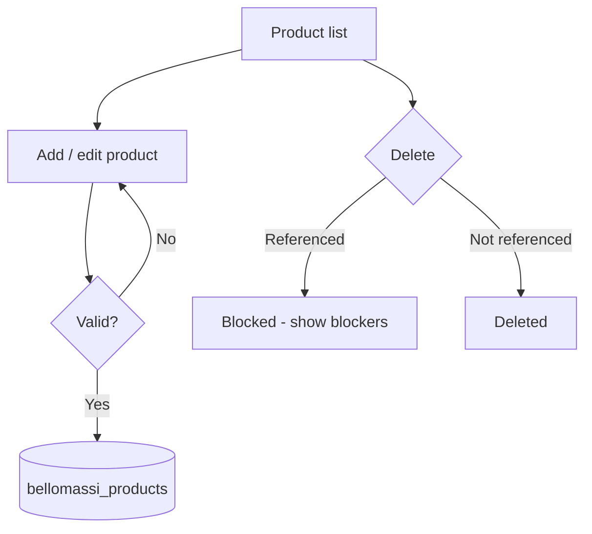
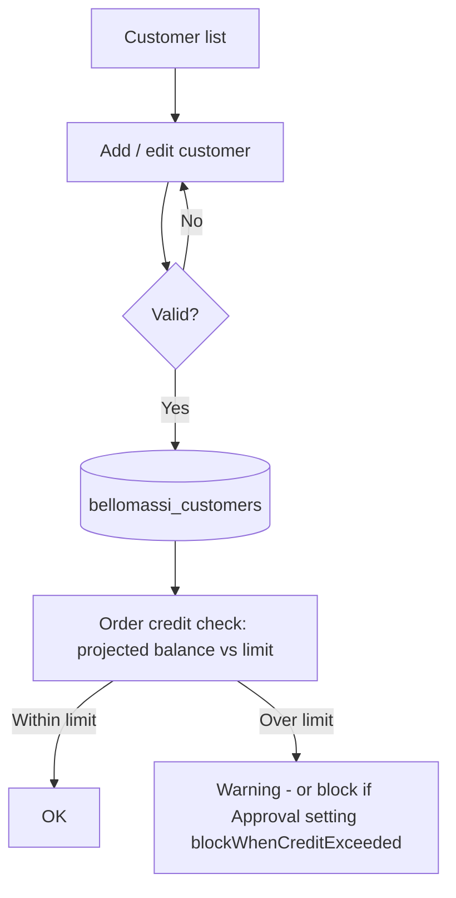
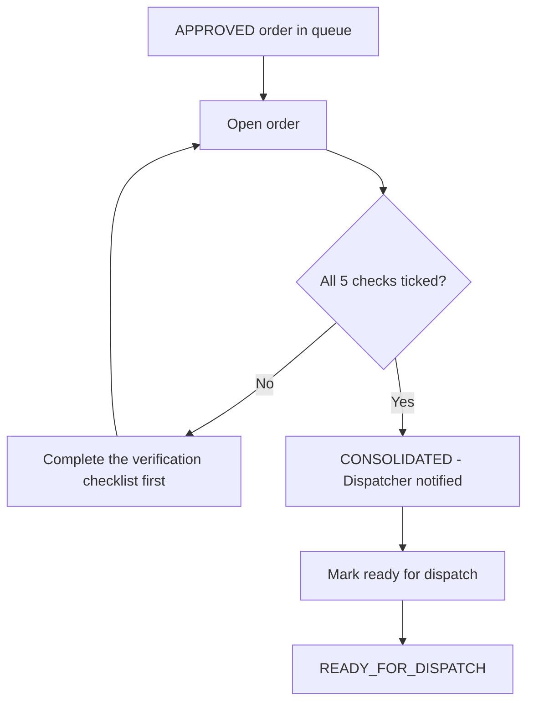

# 05 · Module-Wise Workflow

Each module is described with the same 17 headings: **Purpose · Roles · Entry point · Screens · Preconditions · Steps ·
Actions · System behaviour · Validation · Decisions · Approval · Rejection · Status transitions · Related modules ·
Output · Exceptions · Flowchart.** "—" means the heading does not apply to that module.

Status labels follow the legend in the README.

## Module index

| # | Module | Status |
|---|---|---|
| 5.1 | Authentication & session | Implemented (simulated security) |
| 5.2 | Role dashboards | Implemented |
| 5.3 | Products | Implemented |
| 5.4 | Customers & credit | Implemented / credit Partially Implemented |
| 5.5 | Hubs | Implemented |
| 5.6 | Suppliers | Implemented |
| 5.7 | Order capture (create, draft, submit, resubmit) | Implemented |
| 5.8 | Order approval | Implemented |
| 5.9 | Order consolidation | Implemented |
| 5.10 | Inventory (stock, receipts, transfers, adjustments, movements, low stock) | Implemented |
| 5.11 | Scrap management | Implemented |
| 5.12 | Warehouse dashboard and QA & cold chain | Implemented (temperature monitoring Not Implemented) |
| 5.13 | Dispatch planning, assignment and confirmation | Implemented |
| 5.14 | Delivery tracking, live tracking and exception review | Implemented / GPS Simulated |
| 5.15 | Driver app | Implemented (GPS and OTP Simulated) |
| 5.16 | Delivery notes, OTP and proof of delivery | Implemented / OTP Simulated |
| 5.17 | Customer app | Implemented (payments Not Implemented) |
| 5.18 | Fleet master — zones, drivers, vehicles | Implemented |
| 5.19 | Vehicle Management System (VMS) | Implemented |
| 5.20 | Documents and OCR | Implemented / OCR Simulated |
| 5.21 | Invoices and invoice templates | Implemented (demo tax) |
| 5.22 | Email | Simulated (gateway Not Verified) |
| 5.23 | WhatsApp (OpenWA) | Simulated (gateway Not Verified) |
| 5.24 | Automated notifications | Implemented over simulated channels |
| 5.25 | Call history | Implemented (no telephony) |
| 5.26 | Notification center | Implemented |
| 5.27 | Reports Center | Implemented (24 of 118 reports have no source data) |
| 5.28 | AI Assistant and Jarvis | Simulated |
| 5.29 | Forecasting, predictive inventory and model management | Implemented (in-browser models) |
| 5.30 | Replenishment | Implemented (ends at goods receipt) |
| 5.31 | AI insights | Implemented (rule-based) |
| 5.32 | Users, roles and permissions | Implemented |
| 5.33 | Audit log | Implemented |
| 5.34 | Application settings | Implemented |
| 5.35 | Organization | Implemented |
| 5.36 | My account (profile, password, preferences) | Implemented |

---

## 5.1 Authentication & session

| Heading | Details |
|---|---|
| Purpose | Identify the user, open their workspace and protect pages by permission. |
| Roles | All |
| Entry point | `/login`, `/driver/login`, `/customer/login` |
| Screens | Login, Driver login, Customer login, Forgot password, Reset password, Change password, Sign out, Unauthorized |
| Preconditions | Account exists in `bellomassi_demo_users` and is active |
| Steps | Enter identifier and password → sign in → (change password if required) → landing page |
| Actions | Sign in, Keep me signed in, Remember username, Forgot password, Reset with code, Restore demo password, Sign out |
| System behaviour | `authService.login` checks lock, password hash, status; writes `bellomassi_session`; `SessionWatcher` signs out after idle timeout |
| Validation | Identifier and password required; valid email format; password policy on change |
| Decisions | Locked? Active? Must change password? Which landing page? |
| Approval | — |
| Rejection | Wrong credentials, locked, inactive (messages in chapter 03) |
| Status transitions | Signed out → Signed in → (Idle-expired / Signed out) |
| Related modules | Users (unlock, reset password), Application settings › Security, Audit log (ACCOUNT_LOCKED) |
| Output | Session; landing page |
| Exceptions | Lockout after 5 failures for 15 minutes (defaults) |
| Flowchart | Chapter 03, master flowchart 2 |

## 5.2 Role dashboards

| Heading | Details |
|---|---|
| Purpose | One screen per role with the KPIs and queues that role acts on. |
| Roles | All (`dashboard.view`) |
| Entry point | `/dashboard` (`pages/dashboard/Dashboard.jsx` → `RoleDashboard.jsx`), `/driver/dashboard`, `/customer/dashboard` |
| Screens | Admin, Salesman, Sales Manager, Customer Service, Dispatcher, Finance, Warehouse (and Inventory variant), QA, Customer portal, Supplier portal, Driver Today, Customer Home, Generic workspace launcher |
| Preconditions | Signed in |
| Steps | Open dashboard → choose period → (optional) Compare → click a KPI or queue row to drill into the module |
| Actions | Period select, custom date range, specific period, compare toggle, reset |
| System behaviour | Dated collections are narrowed to the period on their business date (`utils/dashboardFilter.js`) and passed to the existing calculations; current positions are labelled **Current** |
| Validation | Custom range: start after end / missing / invalid dates show a message |
| Decisions | — |
| Approval / Rejection | — |
| Status transitions | — |
| Related modules | Every module (drill-down links) |
| Output | KPIs, charts, queues |
| Exceptions | Custom roles without dated data show the launcher without a filter |
| Flowchart | Chapter 14 |

## 5.3 Products

| Heading | Details |
|---|---|
| Purpose | Product master: code, SKU, barcode, category, unit, price, tax, discount limit, storage condition (Frozen / Chilled / Ambient), stock levels, batch control. |
| Roles | View: most office roles (`products.view`); manage: Administrator (`products.manage`) |
| Entry point | `/products` |
| Screens | Product list, Add product (`/products/create`), Product details (`/products/:id`), Edit product |
| Preconditions | — |
| Steps | Add product → fill sections → save; edit or delete later |
| Actions | Create, edit, delete, search, filter, export |
| System behaviour | `productService.createProduct/updateProduct/deleteProduct` → `bellomassi_products` |
| Validation | Code 3–20 letters/numbers/hyphens, unique; unique SKU and barcode (8–14 digits); category, status, unit, product type required; tax 0–100; max discount 0–100%; maximum stock greater than minimum |
| Decisions | Track inventory? Allow negative stock? Batch-controlled? |
| Approval / Rejection | — |
| Status transitions | Active ↔ Inactive (inactive products block order approval: "Products active" check) |
| Related modules | Orders, inventory, invoices, customer catalog, forecasting |
| Output | Product record |
| Exceptions | Delete is blocked when the product is referenced (`getProductDeleteBlockers`) |
| Flowchart | see below |

## 5.4 Customers & credit

| Heading | Details |
|---|---|
| Purpose | Customer master (type, contacts, address, GST/PAN, hub, zone, sales rep, VIP) and credit settings (enabled, limit, balance, days). |
| Roles | View: Administrator, Sales Executive (own), Sales Manager, Customer Service; manage: Administrator; Customer Credit: Administrator, Sales Manager, Finance |
| Entry point | `/customers`, `/customers/credit` |
| Screens | Customer list, Add / Edit customer, Customer details (orders, documents, credit), Customer Credit |
| Preconditions | Hub and zone exist |
| Steps | Add customer → save → (optional) link a portal user to the customer in User Management |
| Actions | Create, edit, delete, search, view credit position |
| System behaviour | `customerService` → `bellomassi_customers`; `getOrderCreditPosition` calculates projected balance for each order |
| Validation | Code 3–20 characters, unique; type and status required; 10-digit Indian mobile; email; PAN `AAAAA9999A`; GSTIN 15 characters containing the PAN; 6-digit pincode; customer-since not in future; credit days whole number; credit balance non-negative |
| Decisions | Credit enabled? Credit limit exceeded (warning or block per settings)? |
| Approval / Rejection | — |
| Status transitions | Active / Inactive / other statuses from `CUSTOMER_STATUSES`; only **Active** customers pass order approval |
| Related modules | Orders, approval (credit check), invoices, customer app, reports |
| Output | Customer record, credit position |
| Exceptions | **Partially Implemented:** the credit balance is a field maintained on the customer record; issuing invoices and recording deliveries do **not** change it, and payments cannot be recorded |
| Flowchart | see below |

## 5.5 Hubs

| Heading | Details |
|---|---|
| Purpose | Fulfilment locations (Main, Regional, Branch, Distribution hub, Warehouse) that hold stock and run dispatches. |
| Roles | View: most office roles; manage: Administrator |
| Entry point | `/hubs` (also `/admin/organization/hubs`) |
| Screens | Hub list, Add / Edit hub, Hub details (stock, zones, vehicles) |
| Preconditions | — |
| Steps | Add hub → save |
| Actions | Create, edit, delete |
| System behaviour | `hubService` → `bellomassi_hubs` |
| Validation | Code 2–6 letters/numbers, unique; unique name; type and status required; phone, email, 6-digit pincode |
| Decisions | Active or Inactive |
| Approval / Rejection | — |
| Status transitions | Active ↔ Inactive (inactive hubs cannot receive stock and block order approval) |
| Related modules | Inventory, orders, dispatch, zones, drivers, vehicles |
| Output | Hub record |
| Exceptions | Delete blocked when referenced (`getHubDeleteBlockers`) |
| Flowchart | `Hub list → Add/Edit → validate → bellomassi_hubs` (same pattern as 5.3) |

## 5.6 Suppliers

| Heading | Details |
|---|---|
| Purpose | Suppliers used in replenishment (lead time, products) and the supplier portal. |
| Roles | View: Administrator, Sales Manager, Dispatcher, Finance, Warehouse Manager; manage: Administrator |
| Entry point | `/suppliers` |
| Screens | Supplier list (create / edit in place) |
| Preconditions | — |
| Steps | Add or edit supplier → save |
| Actions | Create, edit |
| System behaviour | `supplierService.saveSupplier` → stored inside `bellomassi_forecast_settings.suppliers` |
| Validation | Required fields on the supplier form |
| Decisions / Approval / Rejection | — |
| Status transitions | — |
| Related modules | Replenishment, supplier portal, procurement reports |
| Output | Supplier record |
| Exceptions | Supplier invoices and payments are **Not Implemented** |
| Flowchart | `Supplier list → edit → bellomassi_forecast_settings` |

## 5.7 Order capture (create, draft, submit, resubmit)

| Heading | Details |
|---|---|
| Purpose | Record what a customer wants, priced with tax and discounts, and send it for approval. |
| Roles | Sales Executive, Administrator (`orders.create`); Customer via customer app |
| Entry point | `/orders/create`; `/orders/:id/edit`; `/orders/my-orders`; `/orders/returned` |
| Screens | Create / Edit order form (customer, hub, type, priority, payment terms, dates, address, lines), My Orders, Order List, Order Details (timeline), Returned Orders, Rejected Orders |
| Preconditions | Active customer, active hub, active products |
| Steps | Choose customer (address and hub default from customer) → add lines → review totals and warnings → **Save draft** or **Submit** |
| Actions | Save draft, submit, edit draft, delete draft, duplicate, resubmit after return |
| System behaviour | `orderService.createOrder` (DRAFT), `submitOrder` (number assigned from `bellomassi_order_sequence`, SUBMITTED + approval PENDING, credit/stock warning flags, timeline event, notifications to Sales Manager and salesman, event ORDER_CREATED); `resubmitOrder` after a return |
| Validation | "Select a customer.", "Assign a salesman.", "Select the fulfilment hub.", order type, priority, payment terms; order date valid and not in future; requested delivery date required and not before order date; address, city, state required; 6-digit pincode; "Add at least one product."; "Order total must be greater than zero." |
| Decisions | Save as draft or submit; credit / stock warnings are shown but do not block submission |
| Approval | Goes to 5.8 |
| Rejection | — (see 5.8) |
| Status transitions | (new) → DRAFT → SUBMITTED; RETURNED → SUBMITTED (resubmit) |
| Related modules | Customers, products, inventory (stock check), approval, call history (link order to call), customer app |
| Output | Order record in `bellomassi_orders`, timeline in `bellomassi_order_timeline` |
| Exceptions | "Only draft orders can be deleted. Submitted orders are kept for the audit trail."; "You can only delete your own drafts." Cancelling a submitted order is **Not Implemented** |
| Flowchart | see chapter 06 |

## 5.8 Order approval

| Heading | Details |
|---|---|
| Purpose | Sales Manager decides each submitted order. |
| Roles | Sales Manager (`orders.approve`, `orders.reject`); Super Admin (all keys). Administrator can view the queue (`orders.approval.view`) but not decide by default |
| Entry point | `/orders/approval` → `/orders/approval/:id` |
| Screens | Approval queue (oldest first), Review order (checks, lines, credit, history, decision panel) |
| Preconditions | Order SUBMITTED with approval PENDING |
| Steps | Open order → read the six checks → approve (with remarks and warning acknowledgement), or return / reject with reason and remarks |
| Actions | Approve, Return for correction, Reject |
| System behaviour | `approvalService.approveOrder / returnOrderForCorrection / rejectOrder` write the order, an approval record (`bellomassi_approvals`) and a timeline event in one transaction; notifications and automation events |
| Validation | Blocking checks (customer active, hub active, order total valid, products active, credit when `blockWhenCreditExceeded` is on); warnings (stock, credit) need acknowledgement; remarks required if setting `requireApprovalRemarks`; reject / return need a reason from the list and remarks |
| Decisions | Approve / Return / Reject |
| Approval | APPROVED, consolidation PENDING |
| Rejection | REJECTED (final) or RETURNED (back to the salesman) |
| Status transitions | SUBMITTED → APPROVED / RETURNED / REJECTED |
| Related modules | Order capture, consolidation, customers (credit), inventory (stock) |
| Output | Decision record, notifications |
| Exceptions | Draft orders cannot be decided; already-decided orders show "has already been approved / rejected / returned. No change was made." |
| Flowchart | Chapter 07, master flowchart 4 |

## 5.9 Order consolidation

| Heading | Details |
|---|---|
| Purpose | Customer Service verifies an approved order against the hub and releases it to dispatch. |
| Roles | Customer Service (`orders.consolidate`); view queue: Administrator, Customer Service |
| Entry point | `/orders/consolidation` → `/orders/consolidation/:id` |
| Screens | Consolidation queue, Consolidate order (verification checklist, stock review, notes) |
| Preconditions | Order APPROVED and not yet consolidated |
| Steps | Tick five checks — customer and delivery address verified; fulfilment hub confirmed; products and units checked; quantities match the approved order; hub stock availability reviewed → Consolidate → Mark ready for dispatch |
| Actions | Consolidate, Mark ready for dispatch |
| System behaviour | `consolidateOrder` writes `bellomassi_consolidations`, order CONSOLIDATED (consolidation COMPLETED), notifies Dispatcher; `markReadyForDispatch` → READY_FOR_DISPATCH, notifies Dispatcher and salesman, event ORDER_READY. The stock review is information only — nothing is deducted. |
| Validation | "Confirm every check before consolidating (N left)." |
| Decisions | All checks confirmed? |
| Approval | — |
| Rejection | — (Customer Service cannot reject; an issue must be resolved outside the system or by the Administrator) |
| Status transitions | APPROVED → CONSOLIDATED → READY_FOR_DISPATCH |
| Related modules | Approval, inventory, dispatch |
| Output | Consolidation record |
| Exceptions | "Only approved orders can be consolidated.", "has already been consolidated. No change was made.", "Only consolidated orders can be marked ready for dispatch." |
| Flowchart | see below |

## 5.10 Inventory

| Heading | Details |
|---|---|
| Purpose | Keep stock per product per hub accurate; every change is a stock movement. |
| Roles | Receipts & transfers: Administrator, Warehouse Manager, Inventory Executive; adjustments: Administrator, Warehouse Manager, QA Manager; view: Dispatcher, Finance, Sales roles (stock overview) |
| Entry point | `/inventory`, `/inventory/stock`, `/inventory/low-stock`, `/inventory/stock-receipts`, `/inventory/stock-transfers`, `/inventory/stock-adjustments`, `/inventory/movements` |
| Screens | Inventory dashboard, Stock overview, Stock details (min / reorder / max levels), Low stock, Receipt list / New receipt, Transfer list / New transfer, Adjustment list / New adjustment, Stock movements |
| Preconditions | Product tracks inventory; hub active (for stock coming in) |
| Steps | See chapter 10 |
| Actions | Create receipt; create transfer (draft or complete), complete or cancel draft transfer; create adjustment (Increase, Decrease, Damaged, Lost, Correction); update stock levels |
| System behaviour | `inventoryService` updates `bellomassi_inventory` and appends `bellomassi_stock_movements` (Stock Receipt, Transfer In/Out, Adjustment Increase/Decrease, Damage, Lost Stock, Stock Dispatch, Dispatch Reversal, Delivery Return, Scrap Write-off) |
| Validation | Hub selected and active; product valid; quantity valid; date valid; reference ≤ 40 characters; transfer hubs must differ and source must hold the quantity; adjustment needs type, reason (notes for "Other"), cannot remove more than available unless the product allows negative stock; minimum, reorder, maximum non-negative and reorder ≤ maximum |
| Decisions | Transfer: save draft or complete now |
| Approval / Rejection | — (adjustments post immediately; no approval step) |
| Status transitions | Transfer: Draft → Completed / Cancelled |
| Related modules | Dispatch (deduction / reversal / return), scrap, replenishment, orders (stock warnings), reports |
| Output | Stock rows and movement ledger |
| Exceptions | "…is already completed — stock was not changed again."; "Only draft transfers can be cancelled." |
| Flowchart | Chapter 10, master flowchart 7 |

## 5.11 Scrap management

| Heading | Details |
|---|---|
| Purpose | Write off expired, damaged or rejected stock with approval and evidence. |
| Roles | Create: Administrator, Dispatcher, Warehouse Manager, Inventory Executive, QA Manager (`scrap.create`); approve / reject / write off: Administrator, Warehouse Manager (`scrap.approve`, `scrap.reject`) |
| Entry point | `/inventory/scrap` |
| Screens | Scrap dashboard, Scrap requests, New / Edit request, Scrap request detail, Scrap note (print) |
| Preconditions | Stock exists at the hub (available or damaged source) |
| Steps | Create draft → submit → approver approves or rejects → approver posts write-off |
| Actions | Save draft, edit draft, submit, approve, reject, post write-off, cancel, print scrap note |
| System behaviour | `scrapService` → `bellomassi_scrap_requests`; write-off posts a **Scrap Write-off** movement once (`inventoryService.postScrapWriteOff`) |
| Validation | Reason from list (Expired, Damaged, Quality Rejected, Temperature Excursion, Contamination, Packaging Damage, Other); quantity ≤ eligible stock (minus other open requests); no duplicate open request; photo proof required for Damaged, Packaging Damage, Contamination; batch number required for batch-controlled products; rejection reason ≥ 5 characters |
| Decisions | Approve or reject |
| Approval | Approver cannot be the requester ("You cannot approve your own scrap request.") |
| Rejection | REJECTED with reason |
| Status transitions | DRAFT → PENDING_APPROVAL → APPROVED → COMPLETED; PENDING_APPROVAL → REJECTED; DRAFT / PENDING_APPROVAL / APPROVED → CANCELLED |
| Related modules | Inventory, QA, reports (Scrap category) |
| Output | Scrap note; stock reduced |
| Exceptions | "Only an approved scrap request can create a stock write-off.", "The write-off would make stock negative." |
| Flowchart | Chapter 07 §7.3 |

## 5.12 Warehouse dashboard and QA & cold chain

| Heading | Details |
|---|---|
| Purpose | Warehouse view of picking/loading, alerts and expiry; QA view of inspections, quarantine and document expiry. |
| Roles | Warehouse dashboard: Administrator, Warehouse Manager, Inventory Executive, QA Manager; QA & Cold Chain: Administrator, Warehouse Manager, QA Manager |
| Entry point | `/warehouse`, `/quality` |
| Screens | Warehouse dashboard, QA dashboard |
| Preconditions | — |
| Steps | Review alerts → open the linked record (stock line, document, order) |
| Actions | Navigation only |
| System behaviour | Read-only aggregation of inventory, orders, documents, vehicles and drivers |
| Validation / Decisions / Approval / Rejection | — |
| Status transitions | — |
| Related modules | Inventory, documents, VMS, dispatch |
| Output | Alerts and queues |
| Exceptions | **Cold-chain temperature monitoring is Not Implemented** — the card shows the configured ranges (frozen −25 to −18 °C, chilled 0 to 4 °C) with "No sensor integration" / "No live readings". Picking strategy (FEFO) and QA hold on receipt are settings only — **UI Only**. |
| Flowchart | `Dashboard → alert → module record` |

## 5.13 Dispatch planning, assignment and confirmation

| Heading | Details |
|---|---|
| Purpose | Turn ready orders into a vehicle run with a driver, a stop sequence and a stock deduction. |
| Roles | Manage: Administrator, Dispatcher (`dispatch.manage`); view: Sales Manager, Customer Service, Finance, Warehouse Manager |
| Entry point | `/dispatch`, `/dispatch/ready-orders`, `/dispatch/planning`, `/dispatch/create`, `/dispatch/assignments`, `/dispatch/:id` |
| Screens | Dispatch dashboard, Ready for dispatch, Dispatch planning, New / Edit dispatch (orders, zone, date, sequence editor), Driver assignment, Dispatch details (timeline, confirmation review, cancel) |
| Preconditions | Orders READY_FOR_DISPATCH with a complete delivery address, not on another active dispatch |
| Steps | Select orders → set hub, zone, date → sequence (suggested or manual) → save as draft or plan → assign driver and vehicle → review and confirm |
| Actions | Create, edit (DRAFT / PLANNED / ASSIGNED), assign / reassign, change sequence, confirm, cancel |
| System behaviour | `dispatchService` → `bellomassi_dispatches`, `bellomassi_dispatch_timeline`; confirmation deducts stock once (`stockDeducted`), creates one delivery per order (`bellomassi_deliveries`), sets orders DISPATCHED, notifies driver and Administrator |
| Validation | Order eligibility; neighbouring-zone warning; driver issues (inactive, busy on another active dispatch, offline, other hub, licence expired / missing, required documents); vehicle issues (inactive, maintenance, busy, other hub, load over capacity, insurance / RC / fitness documents); confirmation tick required |
| Decisions | Which orders, sequence, driver, vehicle; cancel reason (Vehicle breakdown, Driver unavailable, Customer requested reschedule, Stock issue at hub, Planning error, Other) |
| Approval | Dispatcher's own confirmation |
| Rejection | Cancellation (reason + remarks) — orders return to READY_FOR_DISPATCH; if confirmed, stock is reversed once |
| Status transitions | DRAFT → PLANNED → ASSIGNED → CONFIRMED → IN_TRANSIT → COMPLETED / PARTIALLY_DELIVERED ("Closed with exceptions"); → CANCELLED |
| Related modules | Consolidation, inventory, fleet, VMS, driver app, delivery tracking |
| Output | Dispatch, deliveries, stock movements (Stock Dispatch) |
| Exceptions | "Assign a driver and vehicle before confirming.", "…is already confirmed. Stock was deducted once and was not deducted again.", "Invalid delivery sequence: every stop must appear exactly once." |
| Flowchart | Chapter 11, master flowchart 8 |

## 5.14 Delivery tracking, live tracking and exception review

| Heading | Details |
|---|---|
| Purpose | Follow every stop and resolve failed and partial deliveries. |
| Roles | Delivery tracking: Administrator, Sales Manager, Customer Service, Dispatcher; Live tracking: Administrator, Dispatcher (`tracking.fleet`); review: Administrator, Dispatcher |
| Entry point | `/dispatch/delivery-tracking`, `/dispatch/live-tracking`, `/dispatch/delivery-history`, `/dispatch/deliveries/:id` |
| Screens | Delivery tracking, Live Tracking (Demo GPS map), Delivery history, Delivery details (items, OTP inspector, POD, review panel), Delivery reports |
| Preconditions | Dispatch confirmed |
| Steps | Monitor → open failed / partial delivery → review with remarks → optionally return goods to hub → optionally re-queue (failed only) |
| Actions | Review, return to hub, re-queue, inspect OTP |
| System behaviour | `deliveryService.reviewDelivery`: review status REVIEWED; return to hub books undelivered (not damaged) quantity back once (Delivery Return movement); failed + returned → delivery RETURNED, order RETURNED_TO_HUB; re-queue → order READY_FOR_DISPATCH |
| Validation | "Add review remarks."; re-queue only for a failed delivery whose goods are returned; goods can be returned only once |
| Decisions | Return stock? Re-queue? |
| Approval / Rejection | — |
| Status transitions | Delivery FAILED → RETURNED; order DELIVERY_FAILED → RETURNED_TO_HUB or READY_FOR_DISPATCH |
| Related modules | Driver app, dispatch, inventory |
| Output | Reviewed delivery, return movements |
| Exceptions | "Only failed or partial deliveries need review.", "was already reviewed… No change was made." |
| Flowchart | Chapter 15 |

## 5.15 Driver app

| Heading | Details |
|---|---|
| Purpose | Mobile workflow for the driver's stops. |
| Roles | Driver (`driver.app`) |
| Entry point | `/driver/login` → `/driver/dashboard` |
| Screens | Today, My deliveries, Delivery (stop detail), Confirm delivery, Route, Completed, My delivery notes, Delivery note, Driver profile, My documents, Document |
| Preconditions | User linked to a driver record (`drivers.userId`); dispatch CONFIRMED or IN_TRANSIT; dispatch date not in the future |
| Steps | Chapter 08 |
| Actions | Start delivery, Reach location, Enter OTP & complete, Report issue / mark failed, Call / WhatsApp / navigate (contact actions), view route, view notes, upload documents |
| System behaviour | `deliveryService.startDelivery / markArrived / confirmDelivery / failDelivery`, `trackingService` (DEMO GPS), `otpService` |
| Validation | Sequence order, one stop out at a time, OTP, quantities, receiver name, POD size limit (350 KB) |
| Decisions | Deliver all, part, or fail |
| Approval / Rejection | — |
| Status transitions | Delivery DISPATCHED → OUT_FOR_DELIVERY → DELIVERED / PARTIALLY_DELIVERED / FAILED |
| Related modules | Dispatch, customer app, delivery notes, invoices |
| Output | Delivery note, POD, tracking session |
| Exceptions | Chapter 15 |
| Flowchart | Chapter 08, master flowchart 5 |

## 5.16 Delivery notes, OTP and proof of delivery

| Heading | Details |
|---|---|
| Purpose | Evidence that goods were handed over. |
| Roles | Generated by the driver's completion; viewed by Administrator, Sales roles, Customer Service, Dispatcher, Finance, Warehouse Manager (`deliveryNotes.view`), driver and customer |
| Entry point | `/dispatch/delivery-notes/:id`, `/driver/delivery-notes/:id`, `/customer/delivery-notes/:id` |
| Screens | Delivery note (printable) |
| Preconditions | Delivery completed (full or partial) |
| Steps | Driver completes → note created automatically |
| Actions | View, print |
| System behaviour | `deliveryNoteService` builds BM-DN numbered notes in `bellomassi_delivery_notes`; OTP records in `bellomassi_delivery_otps` (6 digits, default 10-minute expiry, 5 attempts, statuses ACTIVE / VERIFIED / EXPIRED / INVALIDATED / LOCKED); POD in `bellomassi_delivery_pod` |
| Validation | OTP must match, be active and unexpired; attempts limited |
| Decisions / Approval / Rejection | — |
| Status transitions | OTP: ACTIVE → VERIFIED / EXPIRED / LOCKED / INVALIDATED (regenerated) |
| Related modules | Driver app, customer app, invoices (delivered-quantity basis) |
| Output | Delivery note |
| Exceptions | **Simulated:** no SMS is sent; the customer reads the OTP in the customer app |
| Flowchart | Chapter 08 |

## 5.17 Customer app

| Heading | Details |
|---|---|
| Purpose | Self-service ordering and visibility for a customer. |
| Roles | Customer (`customer.app`, `customer.order`) |
| Entry point | `/customer/login` → `/customer/dashboard` |
| Screens | Home, Catalog, Cart, My orders, Order, Track delivery, Delivery notes, Delivery note, Invoices, Invoice, Payments, Profile |
| Preconditions | User linked to a customer (`user.customerId`) |
| Steps | Chapter 09 |
| Actions | Add to cart, change quantity, remove, place order, re-order, track, view OTP, view / print notes and invoices |
| System behaviour | `customerAppService` (cart in `bellomassi_customer_carts`, `placeCustomerOrder` → normal submit with source customer app) |
| Validation | Cart not empty; delivery address, city, state, 6-digit pincode; requested date (tomorrow onwards in the picker) |
| Decisions | Delivery address (registered or other), preferred time slot |
| Approval / Rejection | Handled by the Sales Manager |
| Status transitions | Same as order statuses; customer labels: Pending approval, Under review (returned), Approved, Rejected |
| Related modules | Orders, approval, delivery, invoices |
| Output | Submitted order |
| Exceptions | Payments: **Not Implemented** ("No payments recorded in this prototype"); cancelling an order: **Not Implemented** |
| Flowchart | Chapter 09, master flowchart 6 |

## 5.18 Fleet master — zones, drivers, vehicles

| Heading | Details |
|---|---|
| Purpose | Delivery zones (pincode groups per hub), driver master (licence, hub, zone, vehicle, availability) and vehicle master (type, capacity, hub, documents). |
| Roles | View: Administrator, Dispatcher (`fleet.view`); manage: Administrator (`fleet.manage`) |
| Entry point | `/dispatch/zones`, `/dispatch/drivers`, `/dispatch/vehicles` |
| Screens | Zone list / form, Driver list / form / details (performance), Vehicle list / form |
| Preconditions | Hub exists |
| Steps | Create zone → create vehicle → create driver (link to hub, zone, vehicle, and a user for the driver app) |
| Actions | Create, edit, delete |
| System behaviour | `zoneService`, `driverService`, `vehicleService`; driver availability and vehicle status are recomputed from active dispatches (`syncFleet`) |
| Validation | Zone code 2–12 characters, unique, name unique per hub, at least one pincode; driver code 3–12 characters, unique employee number and licence, 10-digit mobile, zone must belong to the driver's hub, vehicle must operate from that hub; vehicle number in Indian format (e.g. TN 01 BX 4521), unique, capacity > 0, type, unit, hub, fuel type, category, ownership |
| Decisions | Active / Inactive; availability (Available, Assigned, On Delivery, Offline); vehicle status (Available, Assigned, In Transit, Maintenance, Inactive) |
| Approval / Rejection | — |
| Status transitions | Vehicle: Available ↔ Assigned ↔ In Transit (derived), Maintenance / Inactive (manual); driver availability derived from dispatches |
| Related modules | Dispatch (assignment checks), VMS, driver app |
| Output | Master records |
| Exceptions | Delete blocked when referenced (`getDriverDeleteBlockers`, `getVehicleDeleteBlockers`) |
| Flowchart | `Zone → Vehicle → Driver (+ user link) → available for assignment` |

## 5.19 Vehicle Management System (VMS)

| Heading | Details |
|---|---|
| Purpose | Compliance of vehicles and drivers: document expiry tracking and assignment blocking. |
| Roles | View: Administrator, Dispatcher, QA Manager (`vms.view`); manage vehicles: Administrator (`vms.manage`); upload VMS documents: Administrator, Customer Service, Dispatcher; rules: Administrator (`vms.settings`) |
| Entry point | `/vms` |
| Screens | VMS dashboard, Vehicles, Vehicle details / documents, Driver documents, Document expiry register, VMS reports, Compliance rules |
| Preconditions | Vehicles and drivers exist |
| Steps | Record expiry dates and upload documents → register shows expiry state → rules decide whether assignment is blocked |
| Actions | Upload / replace documents, edit expiry dates, change compliance rules, scan expiries |
| System behaviour | `complianceService.vehicleCompliance / driverCompliance / expiryRegister`; opening the expiry page runs `automationService.scanDocumentExpiries` (events DOCUMENT_EXPIRING / DOCUMENT_EXPIRED) |
| Validation | Rule ranges on the settings form |
| Decisions | Default rules (`DEFAULT_VMS_SETTINGS`): required vehicle documents RC, Insurance, Fitness; required driver document Licence; expired required document **always blocks**; block on warning (within 7 days) off; block on missing off |
| Approval / Rejection | Document verification (5.20) |
| Status transitions | Expiry state: Valid → Within 30 days → Within 7 days → Expires today → Expired; Not on record |
| Related modules | Dispatch assignment, documents, automation, QA dashboard |
| Output | Compliance state per vehicle and driver |
| Exceptions | Assignment blocked with the specific message (e.g. "…'s driving licence expired on …") |
| Flowchart | Chapter 11 §11.6 |

## 5.20 Documents and OCR

| Heading | Details |
|---|---|
| Purpose | Central repository of business documents (licences, RC, insurance, customer KYC, invoices, etc.) with OCR field capture and review. |
| Roles | View / upload: most office roles and Driver (upload own); review & reject: Administrator, Customer Service, QA Manager; document types: Administrator |
| Entry point | `/documents` |
| Screens | Repository, Upload, OCR queue, OCR review, Document details, Verified, Rejected, Document types / form, Document reports |
| Preconditions | Active document type; user may upload for the chosen record |
| Steps | Upload (type, entity, record, file, fields) → Run OCR → review / correct fields → Verify or Reject |
| Actions | Upload, replace file, run / re-run OCR, save review, verify, reject |
| System behaviour | `documentService`, `documentStorageService` (file in browser storage), `ocrService` (providers MOCK / BROWSER / BACKEND) → `bellomassi_documents`, `bellomassi_ocr_results` |
| Validation | "Choose an active document type.", "Choose what this document belongs to.", "Select the related record.", "Choose a file to upload.", "You can only upload documents for your own records."; verify requires OCR or manually saved fields; reject needs a reason |
| Decisions | Verify or reject |
| Approval | VERIFIED (locked — replace the file to start a new review) |
| Rejection | REJECTED with reason for the uploader |
| Status transitions | PENDING_OCR → OCR_COMPLETED → PENDING_REVIEW → VERIFIED / REJECTED; EXPIRED (derived from expiry date) |
| Related modules | VMS, customers, drivers, QA dashboard, automation |
| Output | Verified document with extracted fields |
| Exceptions | MOCK OCR does not read the image (Simulated); BROWSER provider reports itself unavailable; BACKEND requires the gateway (Not Verified); "The file is not stored in this browser, so it cannot be sent for OCR." |
| Flowchart | Chapter 13 §13.6 |

## 5.21 Invoices and invoice templates

| Heading | Details |
|---|---|
| Purpose | Issue customer invoices from orders using a branded template and numbering scheme. |
| Roles | View: Administrator, Sales Manager, Finance; issue / cancel: Administrator, Finance (`invoices.manage`); templates: Administrator, Finance |
| Entry point | `/invoices/dashboard`, `/invoices`, `/invoices/create`, `/invoices/templates` |
| Screens | Invoice dashboard, Invoice list, New invoice (live preview), Invoice detail, Print invoice, Templates list / form / preview, Invoice reports |
| Preconditions | Order in an invoiceable status (APPROVED … RETURNED_TO_HUB); no active invoice for the order; an active template |
| Steps | Chapter 12 |
| Actions | Generate, preview, print, email (demo), cancel, manage templates and numbering |
| System behaviour | `invoiceService.generateInvoice` snapshots order, customer, hub, delivery note and template into `bellomassi_invoices`; number from `bellomassi_invoice_settings` (prefix BM-INV, year, 5 digits); event INVOICE_GENERATED |
| Validation | Eligibility messages; template active; option validation; "The invoice total must be greater than zero (check delivered quantities and discounts)."; cancel requires a reason |
| Decisions | Quantity basis: ORDERED or DELIVERED (delivered requires a delivery note); discounts and charges |
| Approval | — |
| Rejection | Cancellation → CANCELLED (then a new invoice can be issued) |
| Status transitions | ISSUED → CANCELLED |
| Related modules | Orders, delivery notes, customers, email, customer app, finance reports |
| Output | Invoice (printable) |
| Exceptions | Tax is a configurable **demo** calculation — not GST-compliant e-invoicing; payments, credit notes and refunds are **Not Implemented** |
| Flowchart | Chapter 12, master flowchart 9 |

## 5.22 Email

| Heading | Details |
|---|---|
| Purpose | Compose and track emails (orders, invoices, documents) and read the mailbox. |
| Roles | View / send: Administrator, Sales roles, Customer Service, Dispatcher, Finance; inbox: Administrator, Sales Manager, Customer Service; templates and settings: Administrator |
| Entry point | `/communication/email` |
| Screens | Email home, Compose, Inbox, Sent, Drafts, History, Templates (list / form), Settings |
| Preconditions | Demo mode (default) or gateway configured |
| Steps | Compose (to, subject, body, template, attachments) → send → status recorded |
| Actions | Send, save draft, use template, sync inbox |
| System behaviour | `emailService`: demo mode records QUEUED_DEMO → SENT_DEMO ("Sent · demo (not sent)"); backend mode posts to the gateway (SENT = accepted by SMTP, DELIVERED only if the provider reports it). Inbox: seeded demo mailbox; sync may add a simulated message |
| Validation | Recipient and subject required; settings validated |
| Decisions | Template or free text |
| Approval / Rejection | — |
| Status transitions | DRAFT → QUEUED → SENDING → SENT → DELIVERED / FAILED; demo: QUEUED_DEMO → SENT_DEMO / FAILED_DEMO |
| Related modules | Automation, invoices, documents |
| Output | Email history (`bellomassi_email_history`) |
| Exceptions | **Simulated** in demo mode; gateway mode **Not Verified** |
| Flowchart | Chapter 13 |

## 5.23 WhatsApp (OpenWA)

| Heading | Details |
|---|---|
| Purpose | Send WhatsApp messages to customers and drivers. |
| Roles | View / send: Administrator, Sales roles, Customer Service, Dispatcher, Finance; templates / settings: Administrator |
| Entry point | `/communication/whatsapp` |
| Screens | WhatsApp home, Compose, History, Templates, OpenWA settings (session, QR) |
| Preconditions | Mock session (demo) or OpenWA session `ready` through the gateway |
| Steps | Compose → send → history |
| Actions | Send, use template, start / stop session (settings) |
| System behaviour | `openWAService` / `whatsappMessageService`: Mock provider records "Sent · demo"; gateway proxies OpenWA REST (201 = handed to WhatsApp, not delivered) |
| Validation | Recipient number with country code (default 91); message body |
| Decisions / Approval / Rejection | — |
| Status transitions | As email (demo statuses) |
| Related modules | Automation, call history |
| Output | `bellomassi_whatsapp_messages` |
| Exceptions | **Simulated**; live **Not Verified** |
| Flowchart | Chapter 13 |

## 5.24 Automated notifications

| Heading | Details |
|---|---|
| Purpose | Send email / WhatsApp automatically when workflow events happen. |
| Roles | Administrator (`communication.automation`) |
| Entry point | `/communication/automation` |
| Screens | Automated notifications (rules per event, master switch, history) |
| Preconditions | Automation switched on; an enabled rule with a template for the event |
| Steps | Event fires in a service → rule found → recipients resolved → messages sent → history logged |
| Actions | Enable / disable automation, edit rule (channel, recipient rule, templates) |
| System behaviour | `automationService.fireEvent` with de-duplication; events ORDER_CREATED, ORDER_APPROVED, ORDER_REJECTED, ORDER_READY, DISPATCH_ASSIGNED, DELIVERY_STARTED, DELIVERY_COMPLETED, DELIVERY_FAILED, INVOICE_GENERATED, DOCUMENT_EXPIRING, DOCUMENT_EXPIRED; channels Email, WhatsApp, Both; recipients Customer contact, Order salesman, Operations team (Admin / Dispatcher), Document owner |
| Validation | "Only the Admin can switch automation." |
| Decisions | Skipped when switched off, no enabled rule, missing template, or missing address |
| Approval / Rejection | — |
| Status transitions | History status: SKIPPED / SENT_DEMO / SENT / PARTIAL / FAILED |
| Related modules | Email, WhatsApp, every workflow service |
| Output | `bellomassi_notification_history` |
| Exceptions | Messages go through the simulated channels in demo mode |
| Flowchart | Chapter 13, master flowchart 10 |

## 5.25 Call history

| Heading | Details |
|---|---|
| Purpose | Manual log of customer calls with outcomes and follow-ups. |
| Roles | View: Administrator, Sales Executive (own), Sales Manager, Customer Service (`communication.calls`); manage: same (`calls.manage`) |
| Entry point | `/communication/calls` |
| Screens | Call dashboard, All calls, Log a call, Edit call, Call details, Follow-ups |
| Preconditions | Customer exists |
| Steps | Log call (direction, status, outcome, duration, notes) → schedule follow-up → complete follow-up → link an order |
| Actions | Create, edit, delete, add note, schedule / complete follow-up, link order |
| System behaviour | `callService` → `bellomassi_call_history`; salesmen see only their calls |
| Validation | "Choose the follow-up date.", "Follow-up cannot be before the call.", note ≤ 500 characters |
| Decisions | Directions: Incoming, Outgoing; statuses: Connected, Missed, Busy, No Answer, Voicemail; outcomes: Order Received, Interested, Follow-up Required, No Response, Busy, Not Interested, Complaint, Payment Follow-up, Other |
| Approval / Rejection | — |
| Status transitions | Follow-up: open → completed (buckets overdue / today / upcoming) |
| Related modules | Orders, customers, communication reports |
| Output | Call record |
| Exceptions | No telephony — nothing is dialled (**Simulated / manual**) |
| Flowchart | Chapter 13 |

## 5.26 Notification center

| Heading | Details |
|---|---|
| Purpose | In-app inbox of notifications for the signed-in user. |
| Roles | All |
| Entry point | `/notifications`; bell icon in the header |
| Screens | Notification center (filter by category, read / unread), preferences |
| Preconditions | — |
| Steps | Open → read → follow link |
| Actions | Mark read, mark all read, mute categories, toggle toasts |
| System behaviour | `notificationService` (`bellomassi_notifications`, preferences in `bellomassi_notification_preferences`); notifications target roles, users or a driver / customer |
| Validation / Decisions / Approval / Rejection | — |
| Status transitions | Unread → Read (per user) |
| Related modules | All workflow services |
| Output | — |
| Exceptions | Browser push notifications are not used (in-app only) |
| Flowchart | `Service event → pushNotification → bell / Notification center → link to record` |

## 5.27 Reports Center

| Heading | Details |
|---|---|
| Purpose | One catalogue of 118 reports in 11 categories with filters, export and favourites. |
| Roles | Office roles with `reports.center`; categories filtered by permission |
| Entry point | `/reports/center` → `/reports/view/:id` |
| Screens | Reports Center, Report viewer |
| Steps | Chapter 14 |
| Preconditions | Category permission |
| Actions | Search, filter, favourite, run, export CSV, print |
| System behaviour | `reportService.runReport` builds rows from LocalStorage with the user's data scope; favourites / recent in `bellomassi_report_prefs` |
| Validation | — |
| Decisions | — |
| Approval / Rejection | — |
| Status transitions | — |
| Related modules | All |
| Output | Tables, CSV |
| Exceptions | 24 reports show "no source data" with the reason (payments, credit notes, expenses, batches, cycle counts, fuel, supplier invoices, returns) |
| Flowchart | Chapter 14, master flowchart 11 |

## 5.28 AI Assistant and Jarvis

| Heading | Details |
|---|---|
| Purpose | Ask business questions in natural language (typed or voice) and get answers built from the user's own data. |
| Roles | View / use: most office roles (`ai.assistant.*`, `jarvis.*`); settings: Administrator |
| Entry point | `/ai`, `/ai/assistant`, `/ai/jarvis`, `/ai/activity`, `/ai/settings` |
| Screens | AI overview, Assistant (conversations), Jarvis (voice / wake word), AI activity, AI settings |
| Preconditions | — |
| Steps | Ask → intent engine picks a permission-checked tool → result blocks (KPIs, table, chart) → write actions shown as a confirmation card → confirm or cancel |
| Actions | Ask, confirm / cancel proposal, rename / delete conversation, clear Jarvis history |
| System behaviour | `aiChatService`, `aiIntentService`, `aiToolRegistry`; conversations private per user (`bellomassi_ai_conversations`, `bellomassi_ai_messages`, `bellomassi_jarvis_history`); activity in `bellomassi_ai_activity` |
| Validation | Tools respect the user's permissions and data scope |
| Decisions | Confirm a proposed write action |
| Approval / Rejection | User confirmation of proposals |
| Status transitions | — |
| Related modules | All data modules |
| Output | Answers, executed actions |
| Exceptions | Provider DEMO is the default (**Simulated**); OpenJarvis, Ollama, Gemini, OpenAI-compatible and custom providers are configurable but **Not Verified** |
| Flowchart | Chapter 14 |

## 5.29 Forecasting, predictive inventory and model management

| Heading | Details |
|---|---|
| Purpose | Demand forecasts and reorder recommendations computed in the browser. |
| Roles | View: Administrator, Sales Manager, Dispatcher, Finance, Warehouse Manager; generate: Administrator, Sales Manager; planning parameters: Administrator |
| Entry point | `/ai/forecasting`, `/ai/predictive-inventory`, `/ai/models` |
| Screens | Forecast dashboard, New forecast, History, Compare, Forecast detail / print; Predictive dashboard, Reorder recommendations, Risk analysis, Demand forecasting, Planning parameters, Prediction detail; Model management |
| Preconditions | Sales history (`bellomassi_sales_history`) |
| Steps | Choose target, scope and horizon → generate → review accuracy → export CSV |
| Actions | Generate, delete, compare, export, enable / disable models |
| System behaviour | `forecastService`, `services/ml/*` — models Auto (best backtest), Moving average, Weighted moving average, Exponential smoothing, Holt, Seasonal |
| Validation | Permission checks ("Only an Administrator can change inventory planning parameters.") |
| Decisions | Model choice |
| Approval / Rejection | — |
| Status transitions | Recommendation: OPEN → IN_DRAFT (added to replenishment) / DISMISSED |
| Related modules | Replenishment, inventory |
| Output | `bellomassi_forecasts`, `bellomassi_inventory_predictions`, `bellomassi_reorder_recommendations` |
| Exceptions | Backend model registration requires a gateway (**Not Verified**) |
| Flowchart | Chapter 10 §10.8 |

## 5.30 Replenishment

| Heading | Details |
|---|---|
| Purpose | Purchase requests to suppliers, from draft to goods receipt. |
| Roles | Create: Administrator, Dispatcher, Warehouse Manager, Inventory Executive; approve / reject / convert: Administrator (`procurement.approve`, `procurement.reject`); view: roles with `procurement.view`; Supplier portal (read-only) |
| Entry point | `/ai/replenishment` |
| Screens | Replenishment list, New draft, Draft detail |
| Preconditions | Hub, products, supplier |
| Steps | Draft → submit → approve or reject → convert ("Awaiting goods receipt") → receive via Stock Receipt links → Received |
| Actions | Create, edit (creator / admin), submit, approve, reject, convert, cancel, open receipt link |
| System behaviour | `replenishmentService` → `bellomassi_replenishment_drafts`; RECEIVED is derived when stock receipts referencing the draft cover all lines |
| Validation | Field validation; "A reason is required." to reject |
| Decisions | Approve / reject |
| Approval | APPROVED → CONVERTED |
| Rejection | REJECTED |
| Status transitions | DRAFT → SUBMITTED → APPROVED → CONVERTED → RECEIVED; SUBMITTED → REJECTED; DRAFT / SUBMITTED / APPROVED → CANCELLED |
| Related modules | Predictive inventory, stock receipts, supplier portal |
| Output | Purchase request; stock receipts |
| Exceptions | Supplier invoices, purchase returns and supplier payments **Not Implemented** |
| Flowchart | Chapter 07 §7.4 |

## 5.31 AI insights

| Heading | Details |
|---|---|
| Purpose | Automatically generated observations (stock-out risk, demand spikes, delivery issues). |
| Roles | View: Administrator, Sales Manager, Customer Service, Dispatcher, Finance, Warehouse Manager, QA Manager; manage: Administrator, Sales Manager, Dispatcher |
| Entry point | `/ai/insights` |
| Screens | AI insights |
| Steps | Refresh → review → mark Reviewed / Resolved |
| Actions | Refresh, change status |
| System behaviour | `insightService.refreshInsights` (rule-based `ml/insightsEngine`) → `bellomassi_ai_insights` |
| Preconditions / Validation / Decisions / Approval / Rejection | — |
| Status transitions | NEW → REVIEWED → RESOLVED |
| Related modules | Dashboards (OpsOverview), inventory, dispatch |
| Output | Insight records |
| Exceptions | Rule-based, not a trained model |
| Flowchart | `Refresh → NEW → REVIEWED → RESOLVED` |

## 5.32 Users, roles and permissions

| Heading | Details |
|---|---|
| Purpose | Who can sign in, with which role(s), hub and data scope. |
| Roles | Super Admin, Administrator (`users.*`, `roles.*`) |
| Entry point | `/admin/users`, `/admin/roles`, `/admin/permissions`, `/admin/role-assignment` |
| Screens | User list / form / details, Role list / form / details, Permission matrix, User role assignment |
| Preconditions | — |
| Steps | Create user (role, hub, customer / driver link) → user signs in; create custom role → assign permissions → assign users |
| Actions | Create, edit, activate / deactivate, delete, reset password, unlock, assign roles, assign hub; create / edit / clone / delete roles |
| System behaviour | `userService`, `rbacService` → `bellomassi_demo_users`, `bellomassi_roles`; audit entries |
| Validation | Passwords match; "You cannot deactivate your own account."; "Only a Super Admin can change a Super Admin account."; "Drivers need a home hub."; "This change would remove your own access to user management."; role landing page required |
| Decisions | Role, data scope, landing page |
| Approval / Rejection | — |
| Status transitions | User active ↔ inactive; locked → unlocked |
| Related modules | Authentication, every module |
| Output | Users, roles |
| Exceptions | Protected / locked system roles cannot be deleted |
| Flowchart | `Create role → set permissions → create user → assign role and hub → user signs in` |

## 5.33 Audit log

| Heading | Details |
|---|---|
| Purpose | History of administrative and security events (who changed what, when). |
| Roles | Administrator, Super Admin (`audit.view`) |
| Entry point | `/admin/audit-logs` |
| Screens | Audit log (filters, details) |
| System behaviour | `auditService.logAudit` → `bellomassi_audit_logs` (user, role, settings, account lock, etc.) |
| Preconditions / Steps / Actions | View and filter |
| Validation / Decisions / Approval / Rejection / Status transitions | — |
| Related modules | Users, roles, settings, authentication |
| Output | Audit trail |
| Exceptions | Business record history is in the order and dispatch timelines, not in the audit log |
| Flowchart | `Admin action → logAudit → Audit log` |

## 5.34 Application settings

| Heading | Details |
|---|---|
| Purpose | Company-wide configuration. |
| Roles | View: Administrator (`settings.view`); change: Administrator (`settings.manage`) |
| Entry point | `/admin/settings` |
| Screens | Tabs including Localization / numbering, Security (session timeout 60, failed attempts 5, lockout 15, password length 8, mixed password, reset code 15 min, force change after reset), Approval (require remarks, block when credit exceeded, rejection remarks minimum 5), Inventory defaults, Warehouse (FEFO, putaway, QA hold), Cold Chain ranges |
| Steps | Edit tab → save |
| System behaviour | `appSettingsService` → `bellomassi_settings`; values feed `runtimeConfig` |
| Validation | Ranges (e.g. session timeout 5–1440, failed attempts 3–20, lockout 1–1440) |
| Preconditions / Decisions / Approval / Rejection / Status transitions | — |
| Related modules | Authentication, approval, inventory, QA |
| Output | Settings |
| Exceptions | Warehouse picking strategy and QA hold are stored but not enforced (**UI Only**) |
| Flowchart | `Settings tab → validate → save → used by services` |

## 5.35 Organization

| Heading | Details |
|---|---|
| Purpose | Company profile and organisation structure. |
| Roles | View: Administrator (`organization.view`); manage: Administrator |
| Entry point | `/admin/organization/company` |
| Screens | Company, Branches, Business units, Departments, Designations, Employee master, Hub master, Warehouse master |
| System behaviour | `organizationService` → `bellomassi_company`, `bellomassi_organization` |
| Steps / Actions | Create, edit records |
| Preconditions / Validation / Decisions / Approval / Rejection / Status transitions | Standard form validation |
| Related modules | Users (employee master), invoices (company details), hubs |
| Output | Organisation records |
| Exceptions | — |
| Flowchart | `Company → Branches → Business units → Departments → Designations → Employees` |

## 5.36 My account

| Heading | Details |
|---|---|
| Purpose | The user's own profile, password, notification and display preferences. |
| Roles | All |
| Entry point | `/profile`, `/account/change-password`, `/settings`, `/driver/profile`, `/customer/profile` |
| Screens | My profile, Change password, Preferences (theme light / dark, notifications) |
| System behaviour | `authService.updateUserProfile`, `changeDemoPassword`; theme in `bellomassi_theme` |
| Validation | Name 2–60 characters; phone format; password policy |
| Steps / Actions | Edit and save |
| Preconditions / Decisions / Approval / Rejection / Status transitions | — |
| Related modules | Authentication |
| Output | Updated profile |
| Exceptions | — |
| Flowchart | `Profile → edit → validate → save` |
