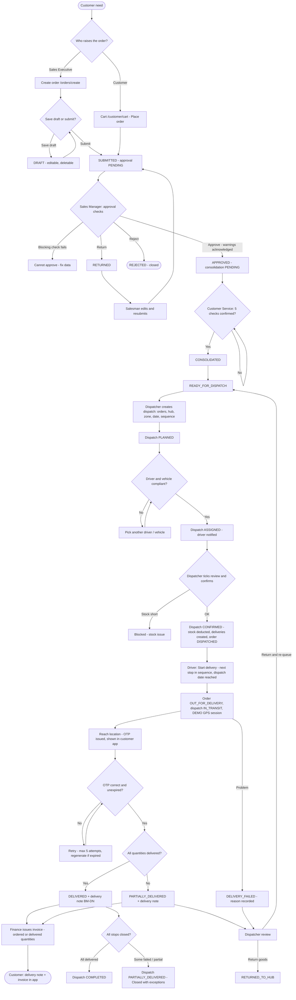
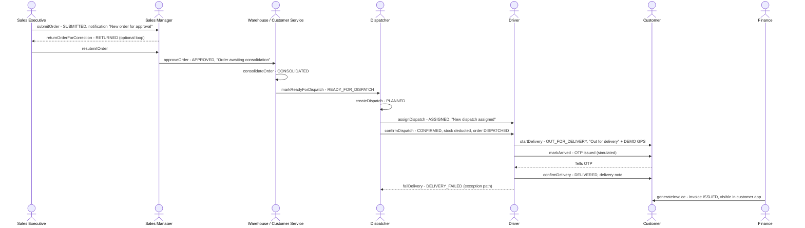

# 06 · Order-to-Delivery Workflow

**Status:** Implemented end to end. GPS tracking and the delivery OTP are **Simulated** (no GPS device, no SMS).

## 6.1 Business summary

1. An order is raised by a **Sales Executive** (`/orders/create`) or by the **customer** (`/customer/cart`).
2. The **Sales Manager** approves it (or returns / rejects it).
3. **Customer Service** consolidates it after a five-point verification and marks it ready for dispatch.
4. The **Dispatcher** puts it on a dispatch with other orders for the same hub and date, assigns a compliant driver and
   vehicle, and confirms the dispatch. Stock leaves the hub at this moment.
5. The **Driver** delivers it in sequence: start → reach location → OTP → quantities and proof → complete (or fail).
6. A **delivery note** is generated; **Finance** issues the **invoice**; the **customer** sees both in the customer app.

## 6.2 Master flowchart 3 — Order-to-delivery

## 6.3 Swimlane — order lifecycle

## 6.4 Step reference

| Step | Screen / route | Component | Service function | Permission | LocalStorage written |
|---|---|---|---|---|---|
| Create / draft | `/orders/create`, `/orders/:id/edit` | `orderForm` | `createOrder`, `updateOrder` | `orders.create` | `bellomassi_orders` |
| Submit | same | `orderForm` | `submitOrder` | `orders.create` | `orders`, `order_sequence`, `order_timeline`, `notifications`, `activities` |
| Customer order | `/customer/cart` | `CustomerCart` | `placeCustomerOrder` → submit | `customer.order` | as above + `customer_carts` cleared |
| Approve / return / reject | `/orders/approval/:id` | `approvalDetail` | `approveOrder`, `returnOrderForCorrection`, `rejectOrder` | `orders.approve`, `orders.reject` | `orders`, `approvals`, `order_timeline` |
| Resubmit | `/orders/:id/edit` | `orderForm` | `resubmitOrder` | `orders.create` | `orders`, `order_timeline` |
| Consolidate | `/orders/consolidation/:id` | `consolidationDetail` | `consolidateOrder` | `orders.consolidate` | `orders`, `consolidations`, `order_timeline` |
| Ready for dispatch | same | same | `markReadyForDispatch` | `orders.consolidate` | `orders`, `order_timeline` |
| Plan dispatch | `/dispatch/create` | `dispatchForm` | `createDispatch` | `dispatch.manage` | `dispatches`, `dispatch_sequence`, `dispatch_timeline`, `orders` (dispatchId) |
| Assign | `/dispatch/assignments`, `/dispatch/:id` | `dispatchAssignments`, `dispatchDetail` | `assignDispatch` | `dispatch.manage` | `dispatches`, `dispatch_timeline` |
| Confirm | `/dispatch/:id` | `dispatchDetail` | `confirmDispatch` | `dispatch.manage` | `dispatches`, `deliveries`, `inventory`, `stock_movements`, `orders`, timelines |
| Start | `/driver/deliveries/:id` | `DriverDeliveryDetail` | `startDelivery` | `driver.app` | `deliveries`, `dispatches`, `orders`, `driver_tracking` |
| Arrive | same | same | `markArrived` | `driver.app` | `deliveries`, `delivery_otps` |
| Complete | `/driver/deliveries/:id/confirm` | `DriverConfirmDelivery` | `confirmDelivery` | `driver.app` | `deliveries`, `delivery_notes`, `delivery_pod`, `orders`, `dispatches`, `delivery_otps` |
| Fail | `/driver/deliveries/:id` | `FailDeliveryDialog` | `failDelivery` | `driver.app` | `deliveries`, `orders`, `dispatches` |
| Review exception | `/dispatch/deliveries/:id` | `deliveryDetail` | `reviewDelivery` | `dispatch.manage` | `deliveries`, `orders`, `inventory`, `stock_movements` |
| Invoice | `/invoices/create` | `invoiceCreate` | `generateInvoice` | `invoices.manage` | `invoices`, `invoice_settings` |

## 6.5 Stock effect along the flow

| Moment | Stock effect | Movement type |
|---|---|---|
| Submit / approve | None — a **warning** is shown if hub stock is short | — |
| Consolidate | None — stock review is information only | — |
| Confirm dispatch | Hub stock reduced for every line, exactly once (`stockDeducted`) | Stock Dispatch |
| Cancel a confirmed dispatch | Stock restored once (`stockReversed`) | Stock Dispatch Reversal |
| Partial / failed delivery reviewed with "return to hub" | Undelivered (not damaged) quantity booked back once (`returnedToHub`) | Delivery Return |

## 6.6 Rules that stop the flow

| Where | Rule | Message (from code) |
|---|---|---|
| Submit | Required data | "Select a customer.", "Add at least one product.", "Delivery date cannot be before the order date." … |
| Approval | Blocking checks | "Cannot approve: …" (customer inactive, hub inactive, products inactive, total invalid, credit when blocking enabled) |
| Approval | Warnings | "Confirm that you have reviewed the credit and stock warnings." |
| Consolidation | Checklist | "Complete the verification checklist first." |
| Dispatch planning | Eligibility | "Only orders ready for dispatch can be dispatched.", "…is already on BM-DSP-…", "…has no complete delivery address." |
| Assignment | Compliance | Driver / vehicle issues (chapter 11) |
| Confirmation | Review | "Review the orders, driver, vehicle, route and stock, then tick the confirmation." |
| Start | Sequence / date / confirmation | "Stop N (…) comes first in the sequence.", "Waiting for the Dispatcher to confirm the dispatch.", "Planned for … — Start is available on that day.", "Finish your current delivery first." |
| Complete | OTP | Wrong / expired / locked OTP blocks completion |
| Complete | State | "Start the delivery before confirming it.", "…is already delivered. It was not confirmed again." |
| Invoice | Eligibility | "Draft orders cannot be invoiced.", "…already has invoice … Cancel it first to issue a new one." |
