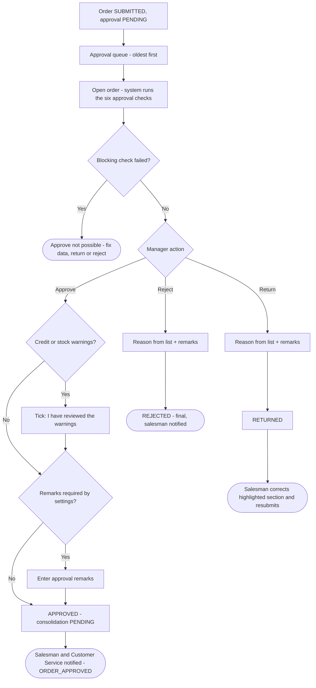
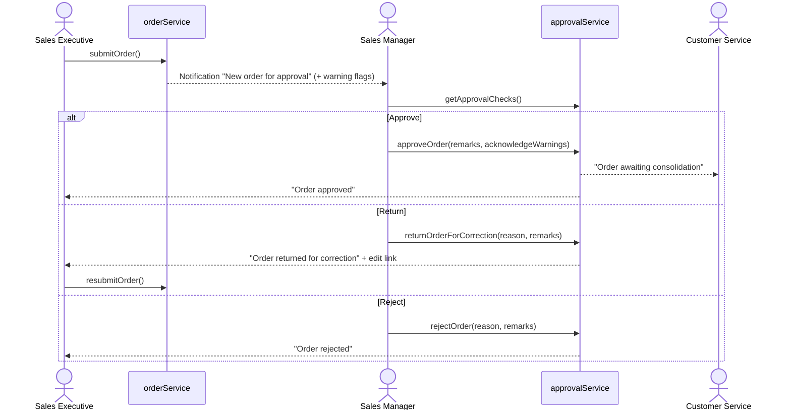
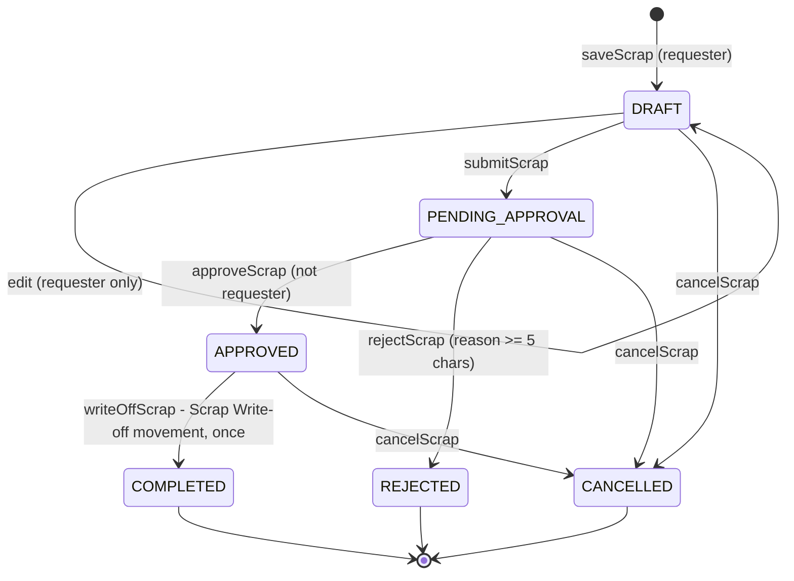
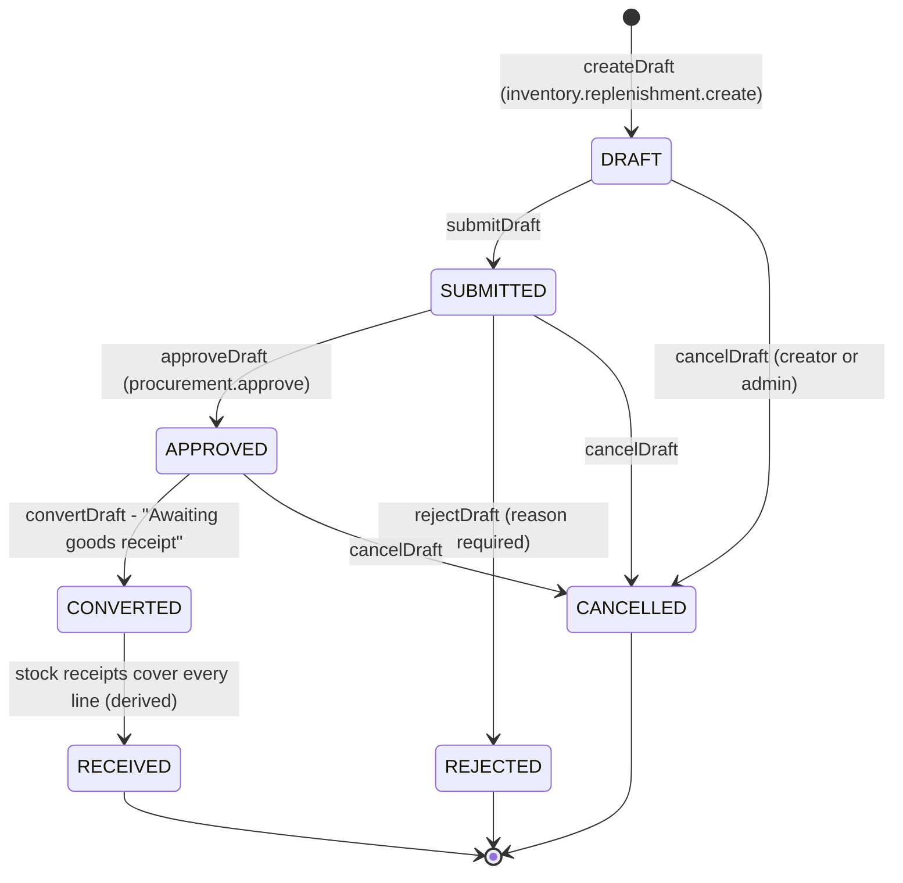
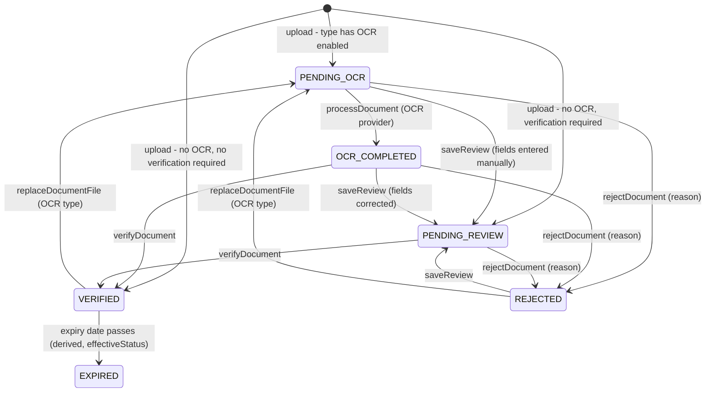

# 07 · Approval Workflow

Bellomassi has four approval processes in which one person decides on another person's request, plus two
**self-confirmation** steps (dispatch confirmation and delivery exception review) that work like approvals.

| Approval | Requester | Approver | Service | Status |
|---|---|---|---|---|
| Order approval | Sales Executive, Customer (app), Administrator | Sales Manager (Super Admin holds all keys; Administrator views only) | `approvalService` | Implemented |
| Scrap approval | Administrator, Dispatcher, Warehouse Manager, Inventory Executive, QA Manager | Warehouse Manager, Administrator (never the requester) | `scrapService` | Implemented |
| Replenishment approval | Administrator, Dispatcher, Warehouse Manager, Inventory Executive | Administrator (`procurement.approve`) | `services/ai/replenishmentService` | Implemented |
| Document verification | Any uploader (incl. Driver) | Administrator, Customer Service, QA Manager | `documentService` | Implemented |
| Dispatch confirmation | Dispatcher | Dispatcher (review tick) | `dispatchService.confirmDispatch` | Implemented |
| Delivery exception review | Driver (reports failure / partial) | Dispatcher, Administrator | `deliveryService.reviewDelivery` | Implemented |

## 7.1 Master flowchart 4 — Order approval

### Approval checks (`approvalService.getApprovalChecks`)

| Check | Severity | Passes when |
|---|---|---|
| Customer active | Block | Customer exists and status is Active |
| Hub active | Block | Hub exists and status is Active |
| Credit within limit | **Warn** (Block if Application Settings › Approval › *Block when credit exceeded* is on) | Credit enabled and the order does not take the balance over the limit |
| Stock available | Warn | Every inventory-tracked line is covered by hub stock |
| Order total valid | Block | Total > 0 and at least one line |
| Products active | Block | Every product is Active |

### Reasons

- **Rejection reasons** (`REJECTION_REASONS`): Credit limit exceeded, Duplicate order, Customer cancelled, Pricing not
  approved, Stock not available, Other.
- **Return reasons** (`RETURN_REASONS`): Quantity needs confirmation, Pricing or discount correction, Reduce order value
  (credit), Delivery details incomplete, Wrong product selected, Other. Each return reason highlights the matching
  section on the salesman's edit screen (`RETURN_REASON_SECTIONS`).

### What the system records

One transaction writes the updated order, an approval record in `bellomassi_approvals` (decision, reason, remarks,
decided by, order total, credit and stock warning flags) and a timeline event in `bellomassi_order_timeline`.

### Edge cases

- A draft cannot be decided: "Draft orders cannot be decided — the salesman has not submitted it."
- A second decision is refused: "BM-ORD-… has already been approved. No change was made."
- Only `orders.approve` may approve; only `orders.reject` may return or reject.

## 7.2 Order approval — swimlane

## 7.3 Scrap approval

| Rule | Message |
|---|---|
| Requester cannot approve own request | "You cannot approve your own scrap request." |
| Only drafts can be edited, only by the requester | "Only draft requests can be edited.", "Only the requester can edit this draft." |
| Rejection needs a reason | "Enter a rejection reason (at least 5 characters)." |
| Write-off only after approval, by an approver | "Only an approved scrap request can create a stock write-off.", "Only an approver can post a stock write-off." |
| Stock cannot go negative | "The write-off would make stock negative." |

Screens: `/inventory/scrap` (dashboard), `/inventory/scrap/requests`, `/inventory/scrap/requests/:id`, print
`/inventory/scrap/requests/:id/print`. Storage: `bellomassi_scrap_requests`, write-off in `bellomassi_stock_movements`.

## 7.4 Replenishment approval

- Only the creator or an Administrator can edit or cancel a draft.
- After conversion, each line has a link to **New Stock Receipt** pre-filled with hub, product, outstanding quantity
  and the request number as reference (`receiptLink`). When receipts referencing the request cover all lines, the status
  shows **Received**.
- The Supplier portal shows approved / converted requests for the linked supplier (read-only).

## 7.5 Document verification

The initial status depends on the document type (`ocrEnabled`, `verificationRequired`). Replacing the file restarts the
review (PENDING_OCR for OCR types, otherwise PENDING_REVIEW). "Verified documents are locked. Replace the file to start a
new review." Verifying an OCR-type document needs OCR or manually saved fields first ("Run OCR (or enter the fields
manually and save) before verifying."). Rejection requires a reason "so the uploader knows what to fix." EXPIRED is not
stored — it is derived from the expiry date for any non-rejected document.

## 7.6 Dispatch confirmation and exception review

These are covered in chapters 11 and 15. Both require an explicit tick or remarks from the Dispatcher and are refused
when repeated ("…is already confirmed. Stock was deducted once and was not deducted again.", "…was already reviewed…
No change was made.").

## 7.7 Approval responsibilities

| Approval | Approve | Return | Reject | Who is notified |
|---|---|---|---|---|
| Order | Sales Manager | Sales Manager | Sales Manager | Salesman; Customer Service on approval |
| Scrap | Warehouse Manager / Administrator | — | Warehouse Manager / Administrator | (in-app list / dashboard) |
| Replenishment | Administrator | — | Administrator | (in-app list); Supplier portal shows approved requests |
| Document | Administrator / Customer Service / QA Manager | — | same | Uploader sees status and reason |
