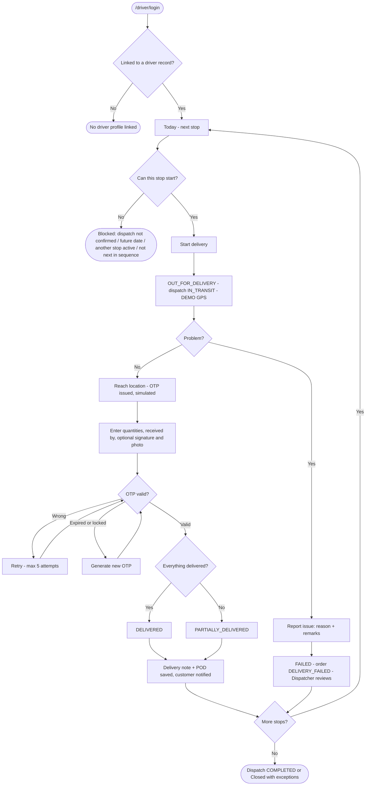
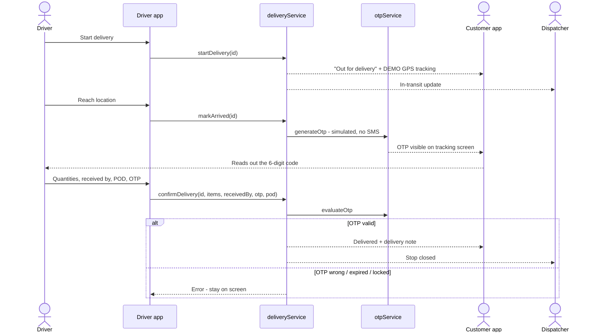

# 08 · Driver Workflow

**Status:** Implemented. GPS tracking is **Simulated** (DEMO GPS badge), the delivery OTP is **Simulated** (no SMS — the
customer reads the code in the customer app). Photo and signature proof of delivery are **Implemented** and stored in
the browser (`bellomassi_delivery_pod`, max 350 KB each).

## 8.1 The driver's day in plain English

1. Sign in on the phone at `/driver/login` (mobile number, email or username).
2. **Today** shows today's and tomorrow's stops "published by the Dispatcher", the next stop, an ETA plan and personal
   performance for the selected period (default **Today**).
3. Nothing can start until the Dispatcher **confirms** the dispatch (vehicle loaded, stock deducted).
4. Open the first stop → **Start delivery**. The order becomes *Out for delivery*, a DEMO GPS session starts and the
   customer and Dispatcher are notified.
5. At the customer → **Reach location**. Arrival time is recorded and a 6-digit OTP is issued to the customer (shown in
   their app, valid 10 minutes by default).
6. **Enter OTP & complete**: enter delivered and damaged quantities per line, who received the goods, remarks, optional
   rejected quantities and shortfall reason, optional signature and photo, the customer's remarks, then the OTP.
7. If everything was delivered → *Delivered*; otherwise → *Partially delivered*. A delivery note (BM-DN-YYYY-NNNNN) is
   generated and can be shown to the customer.
8. If the delivery cannot happen → **Report issue / mark failed** with a reason. The Dispatcher reviews it.
9. Move to the next stop. When every stop is closed, the dispatch closes as *Completed* or *Closed with exceptions*.
10. Sign out from **Driver Profile**.

## 8.2 Master flowchart 5 — Driver workflow

## 8.3 Driver app screens

| Screen | Route | Component | What the driver does |
|---|---|---|---|
| Sign in | `/driver/login` | `AppLogin` (driver) | Mobile / email / username + password |
| Today | `/driver/dashboard` | `DriverHome` | See today / tomorrow plan, next stop, period performance |
| My deliveries | `/driver/deliveries` | `DriverDeliveries` | List of own stops |
| Delivery (stop) | `/driver/deliveries/:id` | `DriverDeliveryDetail` | Address, contact actions, requested time, ETA, items, Start / Reach location / Complete / Report issue |
| Confirm delivery | `/driver/deliveries/:id/confirm` | `DriverConfirmDelivery` | Quantities, received by, proof of delivery, OTP |
| Route | `/driver/route` | `DriverRoute` | DEMO route map of the dispatch's stops |
| Completed | `/driver/completed` | `DriverCompleted` | Closed stops |
| My delivery notes | `/driver/delivery-notes` (+ `/:id`) | `DriverNotes` | View / show delivery notes |
| Driver profile | `/driver/profile` | `DriverProfile` | Profile, vehicle, sign out |
| My documents | `/driver/documents` (+ `/:id`) | `DriverDocuments` | Licence, medical and other documents, upload |

## 8.4 Rules enforced by `deliveryService`

| Action | Allowed when | Refusal message |
|---|---|---|
| `startDelivery` | Delivery DISPATCHED; dispatch CONFIRMED or IN_TRANSIT; dispatch date not in the future; it is the next stop in sequence; no other stop of this dispatch is out | "…is already out for delivery.", "…is already delivered and cannot be restarted." and the blockers shown in 8.2 |
| `markArrived` | Delivery OUT_FOR_DELIVERY | "Start the delivery first.", "…is already closed." |
| `confirmDelivery` | Delivery OUT_FOR_DELIVERY; OTP valid | "Start the delivery before confirming it.", "…is already delivered. It was not confirmed again.", "…was already marked failed." |
| `failDelivery` | Delivery OUT_FOR_DELIVERY | "Start the delivery before reporting a failure.", "…is already delivered and cannot be marked failed.", "…is already marked failed." |

### Quantity and POD validation

| Field | Rule |
|---|---|
| Delivered | Required, not negative, whole units, not more than the dispatched quantity |
| Damaged / rejected | 0 or more; rejected cannot exceed what was not delivered |
| Received by | "Enter the name of the person who received the goods." |
| Signature / photo | Optional; each ≤ 350 KB ("The photo is too large — retake it.") |
| Customer remarks | ≤ 300 characters |

### OTP (`otpService`, `OTP_CONFIG`)

| Setting | Value |
|---|---|
| Length | 6 digits |
| Default expiry | 10 minutes (allowed 1–60) |
| Maximum attempts | 5 → status LOCKED ("Too many incorrect attempts. Generate a new OTP.") |
| Statuses | ACTIVE (Awaiting entry), VERIFIED, EXPIRED, INVALIDATED (replaced by a new code), LOCKED |
| Delivery | Shown in the customer app tracking screen; the Dispatcher can inspect it (`dispatch.otp.inspect`). **No SMS.** |

### Failure reasons (`FAILURE_REASONS`)

Customer Not Available · Customer Refused · Customer Requested Reschedule · Incorrect Address · Damaged Goods · Partial
Delivery · Other.

## 8.5 What happens in the data

| Action | Delivery | Order | Dispatch | Other |
|---|---|---|---|---|
| Start | OUT_FOR_DELIVERY, `startedAt` | OUT_FOR_DELIVERY | IN_TRANSIT (first start) | Tracking session in `bellomassi_driver_tracking`; event DELIVERY_STARTED |
| Reach location | `arrivedAt` | — | — | OTP in `bellomassi_delivery_otps` |
| Complete (full) | DELIVERED | DELIVERED | COMPLETED when all stops delivered | Delivery note, POD, OTP VERIFIED, tracking stopped, event DELIVERY_COMPLETED |
| Complete (short) | PARTIALLY_DELIVERED | PARTIALLY_DELIVERED | PARTIALLY_DELIVERED when all stops closed | Same; Dispatcher review needed |
| Fail | FAILED, review PENDING | DELIVERY_FAILED | Closes when all stops closed | Notifications; event DELIVERY_FAILED |

## 8.6 Sequence — one stop

## 8.7 What the driver cannot do

- See or act on another driver's deliveries ("Access denied").
- Change the stop sequence (Dispatcher only), reassign the vehicle, or edit a closed stop.
- Complete without the customer's OTP.
- Use office modules (the Driver role has only `dashboard.view`, `driver.app`, `documents.upload`).
