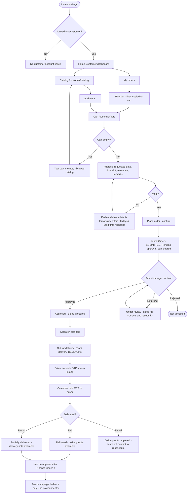

# 09 · Customer Workflow

**Status:** Implemented for ordering, tracking and documents. Delivery tracking uses **DEMO GPS** (Simulated); the
OTP is shown in the app instead of being sent by SMS (Simulated). **Payments are Not Implemented** and **order
cancellation by the customer is Not Implemented**.

## 9.1 The customer's journey in plain English

1. Sign in at `/customer/login` with mobile number, email or username (demo: `customer` / `Customer@123` or
   `+91 98410 22310`). The login must be linked to a customer account; otherwise the app shows "No customer account
   linked".
2. **Home** shows Active orders, Pending approval, Delivered (period filter) and the Outstanding balance (current), a
   card for any delivery on the road, recent orders, delivery notes and notifications.
3. **Catalog** lists active products with a selling price, searchable by name / code / SKU / brand and filterable by
   category. Availability at the customer's hub is shown; limited stock does not stop ordering.
4. **Cart**: change quantities, remove lines, see subtotal, discount, tax and total. A credit warning appears if the
   order takes the account over its limit — the order can still be placed and the Sales Manager reviews it.
5. Choose **delivery address** (registered or another), **requested date** (tomorrow up to 60 days ahead), optional
   **preferred time** slot, PO / reference and remarks → **Place order** → confirm.
6. The order is submitted exactly like a salesman's order (source `customer_app`, salesman = the customer's sales rep,
   priority High for VIP customers, payment terms Credit or Cash on Delivery from the customer record). Status:
   **Pending approval**.
7. The customer follows the order on **My orders** / **Order** with a 9-stage tracker: Order placed → Pending approval →
   Approved → Prepared → Dispatch planned → Out for delivery → Driver arrived → OTP verified → Delivered.
8. When the driver is on the way, **Track delivery** shows the driver, vehicle and a DEMO GPS map. When the driver
   arrives, the **OTP** appears in large digits with its expiry time — the customer reads it to the driver.
9. After delivery, the **delivery note** is available under Delivery notes; once Finance issues the invoice it appears
   under **Invoices**.
10. **Reorder** on a past order copies its still-orderable lines into the cart.

## 9.2 Master flowchart 6 — Customer workflow

## 9.3 Screens

| Screen | Route | Component | Purpose |
|---|---|---|---|
| Sign in | `/customer/login` | `AppLogin` (customer) | Mobile / email / username |
| Home | `/customer/dashboard` | `CustomerHome` | KPIs, on-the-road card, quick actions, recent items |
| Catalog | `/customer/catalog` | `CustomerCatalog` | Search, category chips, quantity stepper, add to cart |
| Cart | `/customer/cart` | `CustomerCart` | Lines, totals, delivery details, place order (sticky button) |
| My orders | `/customer/orders` | `CustomerOrders` | Filters: active, pending, delivered |
| Order | `/customer/orders/:id` | `CustomerOrderDetail` | Stage tracker, lines, approval / delivery labels, Reorder |
| Track delivery | `/customer/tracking/:id` | `CustomerTracking` | DEMO GPS map, driver, vehicle, OTP when arrived |
| Delivery notes | `/customer/delivery-notes` (+ `/:id`) | `CustomerDocuments` | List and view notes |
| Invoices | `/customer/invoices` (+ `/:id`) | `CustomerDocuments` | List and view invoices |
| Payments | `/customer/payments` | `CustomerPayments` | Account balance; "No payments recorded in this prototype" |
| Profile | `/customer/profile` | `CustomerProfile` | Account details, sign out |

## 9.4 Customer-facing labels

| Internal status | What the customer sees |
|---|---|
| SUBMITTED | Pending approval |
| RETURNED | Under review |
| REJECTED | Not accepted |
| APPROVED | Approved / Not scheduled |
| CONSOLIDATED, READY_FOR_DISPATCH | Being prepared, or Dispatch planned once on a dispatch |
| OUT_FOR_DELIVERY | Out for delivery, or Driver arrived |
| DELIVERED / PARTIALLY_DELIVERED | Delivered / Partially delivered |
| DELIVERY_FAILED | Delivery failed |

## 9.5 Validation (`customerAppService.placeCustomerOrder`)

| Rule | Message |
|---|---|
| Login linked to a customer | "Your login is not linked to a customer account." |
| Cart has items | "Your cart is empty." |
| Requested date | "Choose a delivery date.", "The earliest delivery date is tomorrow.", "Choose a date within the next 60 days." |
| Time | "Enter a valid time." |
| Remarks | "Use 300 characters or fewer." |
| Order rules | All order validation from `orderService.validateOrder` (address, pincode, products, total) |
| Reorder | "This order belongs to another account.", "None of the products on this order can be ordered now." |

## 9.6 Notifications the customer receives

| When | Title |
|---|---|
| Driver starts the stop | "Out for delivery: BM-ORD-…" (track in the app, DEMO GPS) |
| Driver reaches the address | "Driver arrived: …" — share the delivery OTP shown in the app (demo OTP — no SMS) |
| Delivery completed | "Delivered: …" or "Partially delivered: …" — OTP verified, delivery note available |
| Delivery failed | "Delivery not completed: …" — "Our team will contact you to reschedule." |
| Automation (if rules enabled) | Email / WhatsApp per rule for ORDER_CREATED, ORDER_APPROVED, ORDER_REJECTED, ORDER_READY, DISPATCH_ASSIGNED, DELIVERY_STARTED, DELIVERY_COMPLETED, DELIVERY_FAILED, INVOICE_GENERATED (demo channels) |

## 9.7 What the customer cannot do

- Cancel or edit an order after placing it (**Not Implemented**).
- Pay online or see a payment history (**Not Implemented**).
- See other customers' orders, notes or invoices.
- Approve anything.

## 9.8 Customer portal on the office web app

The CUSTOMER role's office dashboard (`CustomerPortalDashboard`: My orders, Open orders, Deliveries, Deliveries on the
way, Invoices, Credit available, Account) exists, but a customer who opens `/dashboard` is redirected to
`/customer/dashboard`, so in practice the customer always uses the customer app.
