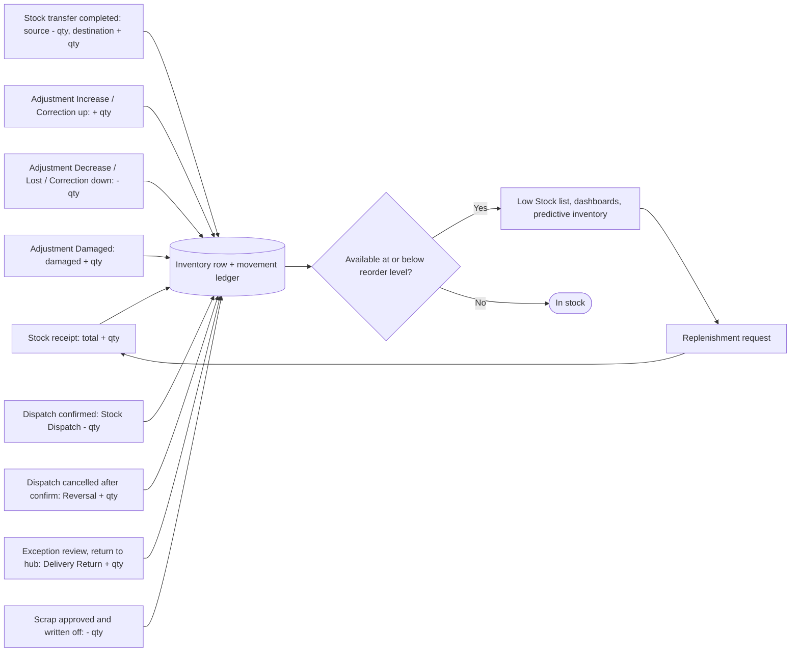
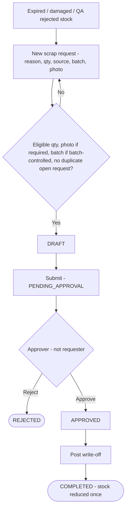
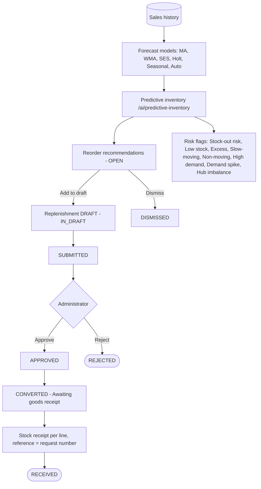

# 10 · Inventory Workflow

**Status:** Implemented. All stock lives in `bellomassi_inventory` (one row per product per hub) and every change is
written to the movement ledger `bellomassi_stock_movements`. Batch and expiry tracking on stock rows is **Not
Implemented** (only scrap requests carry a batch reference); cycle counting is **Not Implemented** (use adjustments).

## 10.1 Stock figures

| Figure | Formula / meaning |
|---|---|
| Total quantity | Physical quantity at the hub |
| Damaged quantity | Part of total held as damaged (quarantine) |
| Reserved quantity | Part of total reserved |
| **Available** | Total − Reserved − Damaged (`utils/stock.getAvailable`) |
| Minimum / Reorder level / Maximum | Set per row on Stock details (`updateStockLevels`; button shown to holders of `inventory.receipts.manage`) |
| Stock status | Out of Stock (available ≤ 0) → Low Stock (available ≤ reorder level) → Overstock (total > maximum) → In Stock |

## 10.2 Master flowchart 7 — Inventory workflow

## 10.3 Stock receipt

| Item | Details |
|---|---|
| Who | Administrator, Warehouse Manager, Inventory Executive (`inventory.receipts.manage`) |
| Screens | `/inventory/stock-receipts` (list), `/inventory/stock-receipts/create` |
| Steps | Choose hub, product, quantity, receipt date, reference (e.g. supplier invoice or replenishment number) → save |
| Validation | "Select a hub."; inactive hub "…is inactive and cannot receive stock."; product must track inventory; valid quantity (whole units for whole-unit products); valid date; reference ≤ 40 characters |
| Effect | Total quantity increases; movement **Stock Receipt**; receipt numbered GRN-… in `bellomassi_stock_receipts` |
| Approval | None — posted immediately |

## 10.4 Stock transfer

| Item | Details |
|---|---|
| Who | Administrator, Warehouse Manager, Inventory Executive (`inventory.transfers.manage`) |
| Screens | `/inventory/stock-transfers`, `/inventory/stock-transfers/create` |
| Steps | Source hub, destination hub, product, quantity, date, notes → **Save draft** or **Complete** |
| Validation | Both hubs required and different; destination active; at completion the quantity must be available at the source ("Only N … available at …") |
| Effect | On completion: source total − qty (**Stock Transfer Out**), destination total + qty (**Stock Transfer In**) |
| Statuses | Draft → Completed / Cancelled (`TRANSFER_STATUS`) |
| Guards | "…is already completed — stock was not changed again."; "Only draft transfers can be cancelled." |

## 10.5 Stock adjustment

| Item | Details |
|---|---|
| Who | Administrator, Warehouse Manager, QA Manager (`inventory.adjustments.manage`) |
| Screens | `/inventory/stock-adjustments`, `/inventory/stock-adjustments/create` |
| Types | Increase, Decrease, Damaged, Lost, Correction (with direction increase / decrease) |
| Reasons | Physical Stock Correction, Damaged Stock, Lost Stock, Expired Stock, Data Correction, Other (notes required) |
| Validation | Product must track inventory; cannot remove more than available unless the product allows negative stock; cannot mark more than available as damaged; stock can only be reduced at an inactive hub |
| Effect | Movement Stock Adjustment Increase / Decrease, Lost Stock or Damage |
| Approval | None — posted immediately (**no adjustment approval exists**) |

## 10.6 Movements, stock overview and low stock

| Screen | Route | Purpose |
|---|---|---|
| Inventory dashboard | `/inventory` | Stock value, status mix, alerts (period filter on dated documents) |
| Stock overview | `/inventory/stock` | All rows by product and hub with status; filters |
| Stock details | `/inventory/stock/:id` | Row history and min / reorder / max levels |
| Low stock | `/inventory/low-stock` | Rows that are Low or Out |
| Stock movements | `/inventory/movements` | Full ledger with type, sign, reference |

Movement types (`MOVEMENT_TYPES`): Stock Receipt, Stock Transfer In, Stock Transfer Out, Stock Adjustment Increase,
Stock Adjustment Decrease, Damage, Lost Stock, Stock Dispatch, Stock Dispatch Reversal, Delivery Return, Scrap
Write-off.

## 10.7 Scrap

Scrap takes stock from the **available** or **damaged** source. Eligible quantity = on-hand in that source minus the
quantity already in other open requests. Full lifecycle and approval rules are in chapter 07 §7.3. Write-off posts a
single **Scrap Write-off** movement (`inventoryService.postScrapWriteOff`).

## 10.8 Predictive inventory and replenishment

| Step | Who | Route |
|---|---|---|
| Review predictions and risks | Roles with `inventory.predictions.view` | `/ai/predictive-inventory`, `/risks`, `/reorder`, `/demand` |
| Change planning parameters | Administrator (`inventory.predictions.manage`) | `/ai/predictive-inventory/settings` |
| Create replenishment draft | Administrator, Dispatcher, Warehouse Manager, Inventory Executive | `/ai/replenishment/create` |
| Approve / reject / convert | Administrator | `/ai/replenishment/:id` |
| Receive goods | Administrator, Warehouse Manager, Inventory Executive | Stock receipt link from the request |
| See approved requests | Supplier | Supplier portal dashboard |

## 10.9 Inventory responsibilities

| Activity | Inventory Executive | Warehouse Manager | QA Manager | Dispatcher | Administrator |
|---|---|---|---|---|---|
| Stock receipt | ✓ | ✓ | view | view | ✓ |
| Stock transfer | ✓ | ✓ | view | view | ✓ |
| Stock adjustment | view | ✓ | ✓ | view | ✓ |
| Stock levels (min / reorder / max) | ✓ | ✓ | — | — | ✓ |
| Scrap request | ✓ | ✓ | ✓ | ✓ | ✓ |
| Scrap approval / write-off | — | ✓ | — | — | ✓ |
| Replenishment draft | ✓ | ✓ | — | ✓ | ✓ |
| Replenishment approval | — | — | — | — | ✓ |
| Dispatch stock deduction | — | — | — | ✓ (by confirming) | ✓ |
