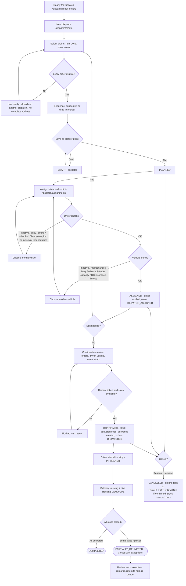
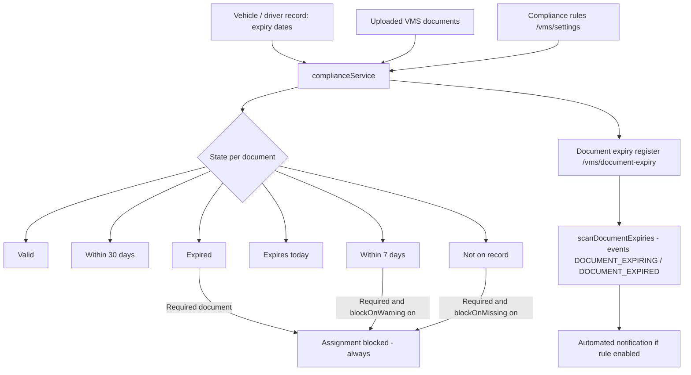
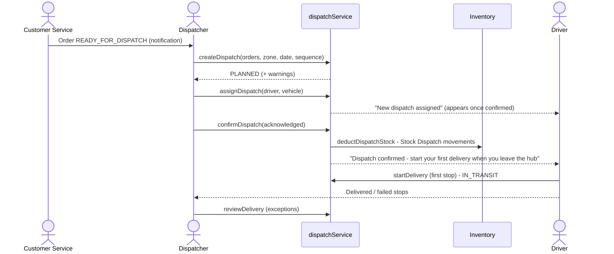

# 11 · Dispatch & VMS Workflow

**Status:** Dispatch planning, assignment, confirmation, cancellation, sequencing, delivery review and VMS compliance are
**Implemented**. Live tracking is **Simulated** (DEMO GPS). Route optimisation is a suggested sequence, not a road
routing engine.

## 11.1 Business summary

The Dispatcher works from the **Ready for Dispatch** queue. A dispatch is one vehicle run from one hub on one date. It
holds a set of orders in a delivery sequence, one driver and one vehicle. Before anything leaves the hub, the system
checks that every order is still ready, that the driver and vehicle are free, from the same hub, legally compliant and
that the load fits the vehicle. **Confirming** the dispatch is the loading sign-off: hub stock is deducted and the
driver can start. The Dispatcher then follows the run on Delivery Tracking / Live Tracking and resolves failed and
partial stops.

## 11.2 Master flowchart 8 — Dispatch / VMS workflow

## 11.3 Dispatch statuses (`DISPATCH_STATUS_META`)

| Status | Label | Meaning | Editable? |
|---|---|---|---|
| DRAFT | Draft | Saved, incomplete plan | Yes |
| PLANNED | Planned | Orders and sequence set | Yes |
| ASSIGNED | Assigned | Driver and vehicle assigned | Yes |
| CONFIRMED | Confirmed | Loaded; stock deducted; deliveries created | No (cancel only while no stop has started) |
| IN_TRANSIT | In transit | First stop started | No |
| PARTIALLY_DELIVERED | Closed with exceptions | All stops closed; at least one failed / partial | No |
| COMPLETED | Completed | All stops delivered | No |
| CANCELLED | Cancelled | Cancelled with reason | No |

Resource-holding statuses (driver / vehicle busy): ASSIGNED, CONFIRMED, IN_TRANSIT.

## 11.4 Step reference

| Step | Route | Service | Rules and messages |
|---|---|---|---|
| Create | `/dispatch/create` | `createDispatch` | "Only the Dispatcher or Admin can create dispatches."; orders must be READY_FOR_DISPATCH, not on another active dispatch, with a complete address; neighbouring-zone **warning** |
| Edit | `/dispatch/:id/edit` | `updateDispatch` | Only DRAFT / PLANNED / ASSIGNED: "…is confirmed and can no longer be edited." |
| Assign / reassign | `/dispatch/assignments`, `/dispatch/:id` | `assignDispatch` | Only PLANNED / ASSIGNED: "Complete the draft plan before assigning a driver."; driver and vehicle issue checks; previous driver notified "Removed from …" |
| Change sequence | `/dispatch/:id` (sequence editor) | `updateSequence` | "Invalid delivery sequence: every stop must appear exactly once.", "The sequence has not changed."; driver notified |
| Confirm | `/dispatch/:id` | `confirmDispatch` | Must be ASSIGNED; review tick required; stock checked per line ("…needs N, only M available at the hub."); stock deducted once |
| Cancel | `/dispatch/:id` | `cancelDispatch` | Reason from list + remarks; not after a stop has started; confirmed dispatch → stock reversed once; orders back to READY_FOR_DISPATCH |
| Review exception | `/dispatch/deliveries/:id` | `reviewDelivery` | Chapter 15 |

**Cancel reasons** (`CANCEL_REASONS`): Vehicle breakdown, Driver unavailable, Customer requested reschedule, Stock issue
at hub, Planning error, Other.

## 11.5 Driver and vehicle assignment checks

| Resource | Check | Message |
|---|---|---|
| Driver | Selected | "Select a driver." |
| Driver | Active | "… is inactive." |
| Driver | Not on another active dispatch | "… already has an active dispatch (BM-DSP-…)." |
| Driver | Not offline | "… is offline." |
| Driver | Same hub | "… works from another hub." |
| Driver | Licence | "…'s driving licence expired on …", "… has no valid licence expiry on record." |
| Driver | VMS required documents | From `driverComplianceIssues` (default: licence) |
| Vehicle | Selected | "Select a vehicle." |
| Vehicle | Not inactive / maintenance | "… is inactive.", "… is under maintenance." |
| Vehicle | Not on another active dispatch | "… is already on BM-DSP-…." |
| Vehicle | Same hub | "… belongs to another hub." |
| Vehicle | Capacity | "Load of N exceeds …'s capacity of C …" |
| Vehicle | VMS required documents | From `vehicleComplianceIssues` (default: RC, insurance, fitness) |

## 11.6 VMS compliance

| Setting (`DEFAULT_VMS_SETTINGS`) | Default |
|---|---|
| Required vehicle documents | Registration (RC), Insurance, Fitness certificate |
| Required driver documents | Driving licence |
| Block on expired required document | Always on |
| Block when expiring within warning days | Off (warning days 7) |
| Block when not on record | Off |

Tracked expiry fields — vehicle: Registration (RC), Insurance, Pollution (PUC), Fitness certificate, Permit; driver:
Driving licence, Medical certificate.

VMS screens: VMS dashboard `/vms`, Vehicles `/vms/vehicles` (details and documents), Driver documents `/vms/drivers`,
Document expiry `/vms/document-expiry`, VMS reports `/vms/reports`, Compliance rules `/vms/settings` (Administrator).

## 11.7 Tracking

| Screen | Route | Who | What it shows |
|---|---|---|---|
| Dispatch dashboard | `/dispatch` | Dispatch viewers | KPIs and charts (chapter 04 §4.6) |
| Delivery tracking | `/dispatch/delivery-tracking` | Administrator, Sales Manager, Customer Service, Dispatcher | Every stop with status, driver, time |
| Live Tracking (Demo GPS) | `/dispatch/live-tracking` | Administrator, Dispatcher | Map with simulated vehicle positions from `bellomassi_driver_tracking` |
| Delivery history | `/dispatch/delivery-history` | Dispatch viewers, Finance, Warehouse Manager | Closed stops, exceptions to review |
| Delivery details | `/dispatch/deliveries/:id` | `deliveries.view` | Items, POD, OTP inspector (Dispatcher / Admin), review panel |
| Delivery reports | `/dispatch/reports` | Administrator, Dispatcher, Finance | Delivery performance |

## 11.8 Dispatch — swimlane

