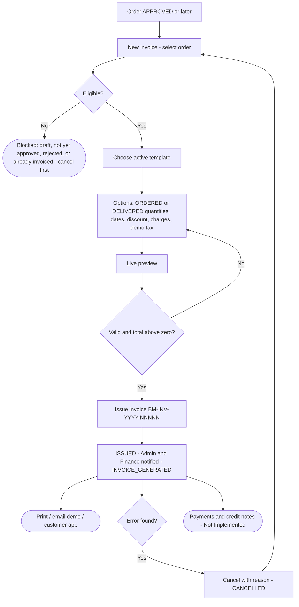
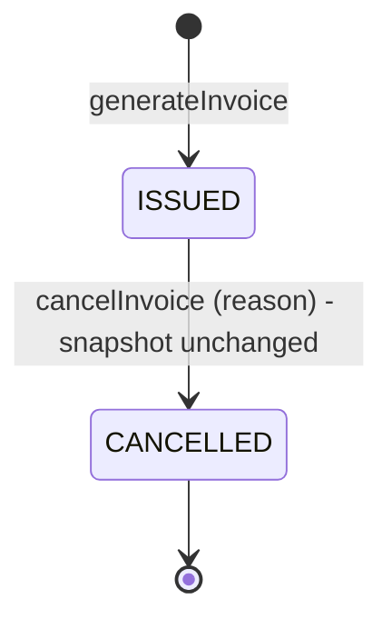
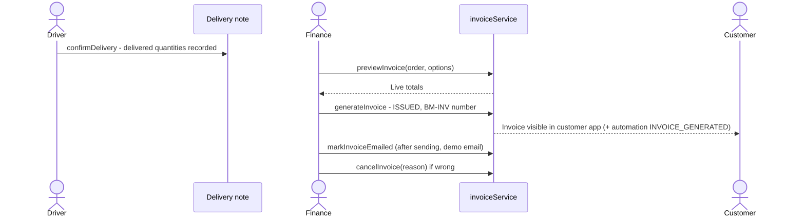

# 12 · Finance & Invoice Workflow

**Status:** Invoice templates, numbering, generation, printing and cancellation are **Implemented**. Tax is a configurable
**demo** calculation (not GST-compliant e-invoicing). Emailing an invoice uses the email module (**Simulated** in demo
mode). **Payments, receipts, credit notes, refunds, collections posting and expenses are Not Implemented.** The
customer's credit balance is a field on the customer record and is **not** updated by invoices.

## 12.1 Business summary

Finance (or an Administrator) picks an approved-or-later order and issues one invoice for it. The invoice is a frozen
snapshot of the order, customer, hub, template and — when available — the delivery note, so later changes to master
data never change an issued invoice. Finance chooses whether to bill **ordered** quantities or **delivered**
quantities (from the delivery note), can add an order discount, shipping and additional charges, and sets invoice and
due dates. An invoice that is wrong is **cancelled** with a reason; a new one can then be issued.

## 12.2 Master flowchart 9 — Finance / invoice workflow

## 12.3 Templates and numbering

| Item | Details |
|---|---|
| Templates | `/invoices/templates` — code, company details (GSTIN, PAN, email), page format (A4 portrait, A4 landscape, custom 100–500 mm), font (Inter, Georgia, Helvetica, Courier), font size 8–14 pt, primary / accent colours, header and footer layouts, sections (e.g. signature, QR code placeholder), active flag, default flag. Preview at `/invoices/templates/:id/preview`. |
| Who | Administrator, Finance (`invoices.templates`) |
| Numbering | `bellomassi_invoice_settings`: prefix **BM-INV**, include year, starting number, 5 digits → e.g. BM-INV-2026-00001. Only Administrator or Finance can change numbering. |

## 12.4 Calculation (`services/invoiceCalculationService.js`)

| Line | Formula |
|---|---|
| Line subtotal | quantity × unit price |
| Item discount | line subtotal × item discount % |
| Order discount | NONE, flat AMOUNT or PERCENT of (Σ subtotal − Σ item discount), allocated to lines by value |
| Taxable amount | line subtotal − item discount − allocated order discount |
| Tax | taxable × tax % (product rate from the order, or a flat demo rate ≤ 40%) |
| Charges | shipping + additional charges, taxed at charges tax % (default 0, ≤ 40%) |
| Grand total | Σ taxable + Σ tax + charges + charges tax |

Quantity basis: **DELIVERED** bills what the delivery note recorded as delivered; it falls back to **ORDERED** when there
is no delivery note (`utils/invoiceSnapshot.js`).

## 12.5 Validation and messages

| Rule | Message |
|---|---|
| Permission | "Only Finance or Admin can issue invoices." / "…cancel invoices." |
| Template | "Create an invoice template first.", "… is inactive." |
| Customer | "The order's customer record no longer exists." |
| Dates | "Enter a valid date.", "Due date cannot be before the invoice date." |
| Charges / tax | "Enter 0 or more.", "Demo tax rate cannot exceed 40%." |
| Discount | "Discount must be 0–100%.", "Discount cannot be negative." |
| Total | "The invoice total must be greater than zero (check delivered quantities and discounts)." |
| Cancel | "Give a reason for cancelling.", "… is already cancelled." |

## 12.6 Statuses

Invoiceable order statuses (`INVOICEABLE_ORDER_STATUSES`): APPROVED, CONSOLIDATED, READY_FOR_DISPATCH, DISPATCHED,
OUT_FOR_DELIVERY, PARTIALLY_DELIVERED, DELIVERED, DELIVERY_FAILED, RETURNED_TO_HUB.

## 12.7 Credit and outstanding

| Topic | How it works today |
|---|---|
| Credit limit, days, enabled | Customer master (Administrator) |
| Credit balance | Customer master field; seeded demo values; **not** changed by invoices or deliveries |
| Order credit check | `getOrderCreditPosition`: projected balance = balance + order total; warning (or block, if configured) at approval |
| Customer Credit page | `/customers/credit` — limits, balances, utilisation (Administrator, Sales Manager, Finance) |
| Finance dashboard | Outstanding (customer balances), Credit utilisation, Over credit limit, Collections |
| Customer app | Outstanding balance on Home and Payments; "No payments recorded in this prototype" |
| Payments, receipts, allocation, credit notes, refunds | **Not Implemented** — the related Finance reports show "no source data" |

## 12.8 Finance — swimlane

