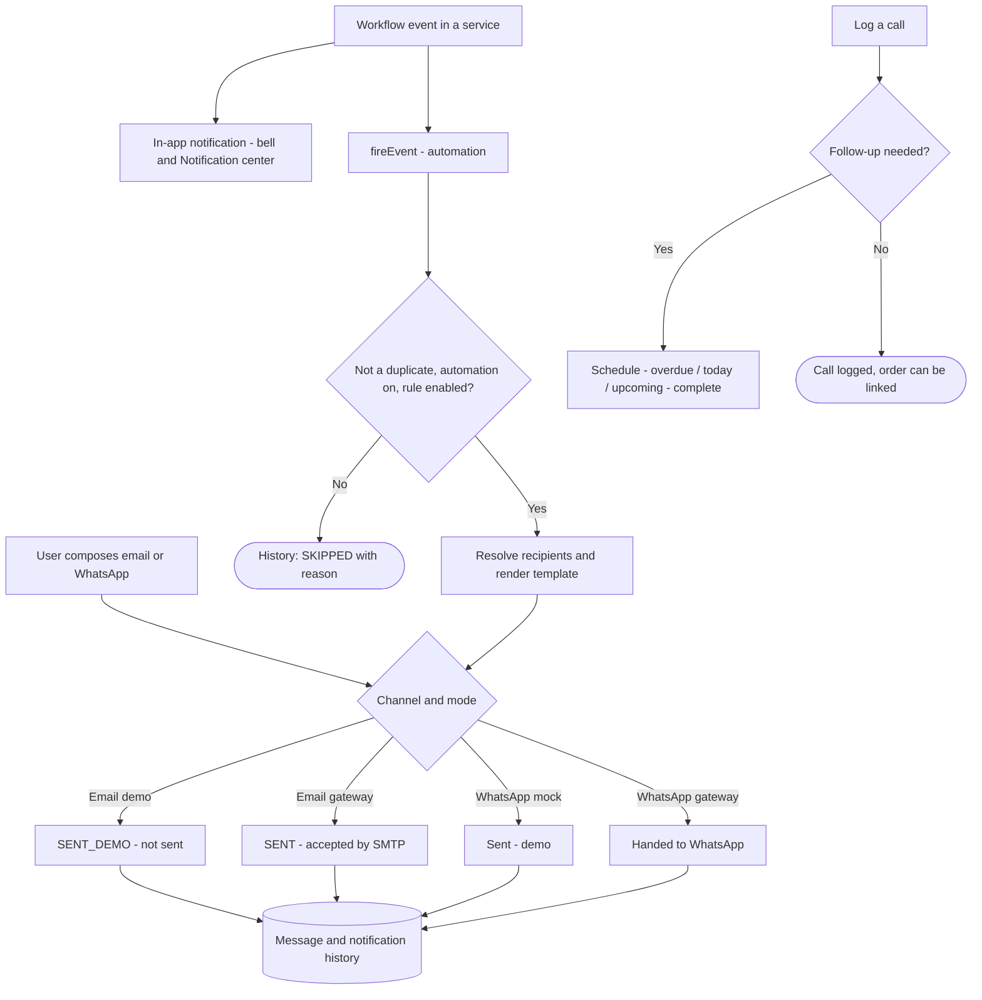
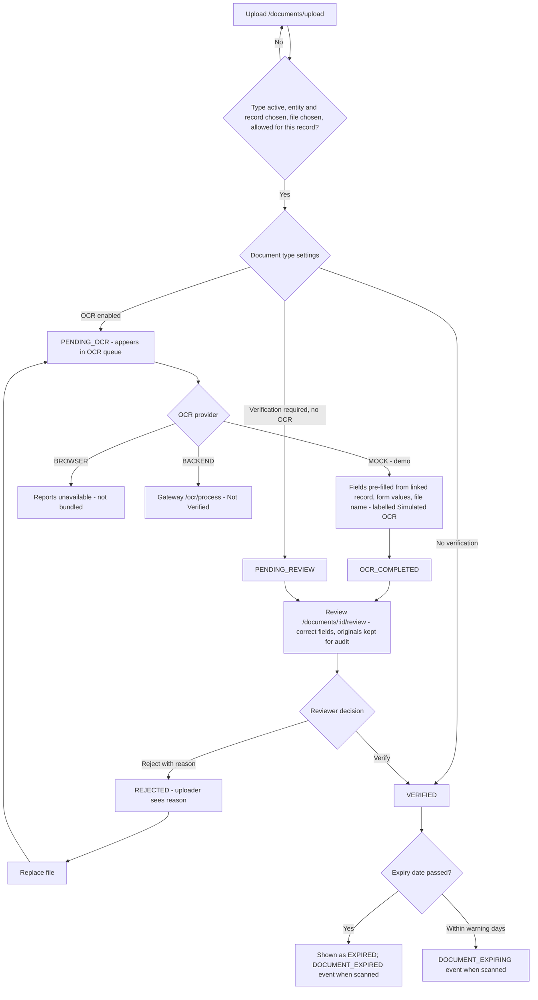
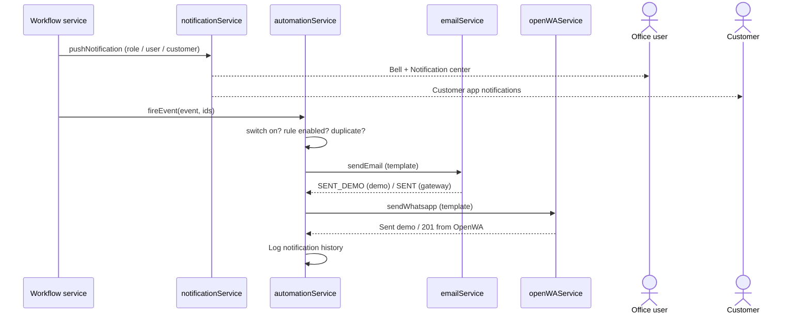

# 13 · Communication & Documents Workflow

| Feature | Status |
|---|---|
| In-app notifications | Implemented |
| Automated notifications (rules per event) | Implemented — delivered through the simulated channels in demo mode |
| Email (compose, drafts, sent, history, templates, inbox) | **Simulated** in demo mode ("Sent · demo (not sent)"); gateway SMTP / IMAP mode **Not Verified** |
| WhatsApp via OpenWA | **Simulated** (mock session); gateway mode **Not Verified** |
| Call history and follow-ups | Implemented as a manual log (no telephony) |
| Documents repository, upload, review, verify, reject | Implemented |
| OCR | **Simulated** (MOCK provider); browser OCR unavailable; backend OCR **Not Verified** |

## 13.1 Master flowchart 10 — Communication workflow

## 13.2 In-app notifications

| Item | Details |
|---|---|
| Created by | Workflow services (`notifyOrder`, `notifyDispatch`, `notifyCustomer`, `pushNotification`) |
| Addressed to | Roles, a specific user (e.g. the order's salesman), a driver, or a customer |
| Storage | `bellomassi_notifications`; preferences `bellomassi_notification_preferences` (muted categories, toasts, digest) |
| Screens | Header bell dropdown; `/notifications` (Notification Center) |
| Actions | Mark read, mark all read, filter by category, open linked record |

Key notifications by event:

| Event | Recipients |
|---|---|
| Order submitted / resubmitted | Sales Manager ("New order for approval"), salesman |
| Order approved | Salesman, Customer Service ("Order awaiting consolidation") |
| Order returned / rejected | Salesman |
| Order consolidated / ready for dispatch | Dispatcher; salesman on ready |
| Dispatch assigned / changed / sequence updated / cancelled | Driver; Administrator / Dispatcher |
| Dispatch confirmed | Driver; Administrator |
| Out for delivery / driver arrived / delivered / not completed | Customer; Dispatcher |
| Delivery failed | Administrator, Dispatcher ("Review required"), customer |
| Invoice issued | Administrator, Finance |

## 13.3 Email

| Step | Route | Notes |
|---|---|---|
| Home | `/communication/email` | Counts, mode (Demo / Live) |
| Compose | `/communication/email/compose` | To, CC, subject, body, template, attachments from documents |
| Drafts | `/communication/email/drafts` | `bellomassi_email_drafts` |
| Sent / History | `/communication/email/sent`, `/history` | `bellomassi_email_history` with status |
| Inbox | `/communication/email/inbox` | Seeded demo mailbox; "sync" may add a simulated message (`bellomassi_email_inbox`) |
| Templates | `/communication/email/templates` | Variables such as customer, order, invoice fields |
| Settings | `/communication/email/settings` | SMTP / IMAP settings, encryption; credentials are only used by the gateway |

## 13.4 WhatsApp (OpenWA)

| Step | Route | Notes |
|---|---|---|
| Home | `/communication/whatsapp` | Session state; "Connected" only when OpenWA reports `ready` |
| Compose | `/communication/whatsapp/compose` | Recipient (country code default 91), message, template |
| History | `/communication/whatsapp/history` | `bellomassi_whatsapp_messages` |
| Templates | `/communication/whatsapp/templates` | `bellomassi_whatsapp_templates` |
| OpenWA settings | `/communication/whatsapp/settings` | Session start / stop / QR through the gateway; mock in demo |

## 13.5 Call history

| Step | Details |
|---|---|
| Log a call | Customer, direction (Incoming / Outgoing), status (Connected, Missed, Busy, No Answer, Voicemail), outcome, duration, notes |
| Outcomes | Order Received, Interested, Follow-up Required, No Response, Busy, Not Interested, Complaint, Payment Follow-up, Other |
| Follow-up | Suggested for Follow-up Required, Interested, Complaint, Payment Follow-up, No Response; date must not be before the call |
| Notes | Add notes (≤ 500 characters) |
| Order link | Link an order created from the call |
| Visibility | Salesmen see only their own calls; Sales Manager, Customer Service and Administrator see all |
| Storage | `bellomassi_call_history` |

## 13.6 Documents and OCR

| Item | Details |
|---|---|
| Who uploads | Most office roles and the Driver (own records only for scoped roles) |
| Who reviews | Administrator, Customer Service, QA Manager (`documents.review`, `documents.reject`) |
| Document types | `/documents/types` (Administrator): code, name, entity, fields to capture, expiry required, warning days, OCR enabled, verification required. Built-in codes (e.g. VEH_RC, VEH_INSURANCE, DRV_LICENSE) cannot change because VMS rules refer to them. |
| Storage | `bellomassi_documents`, files via `documentStorageService`, OCR results `bellomassi_ocr_results`, types `bellomassi_document_types` |
| Lists | Repository, OCR queue (PENDING_OCR, OCR_COMPLETED, PENDING_REVIEW), Verified, Rejected, Document reports |

## 13.7 Communication — swimlane

