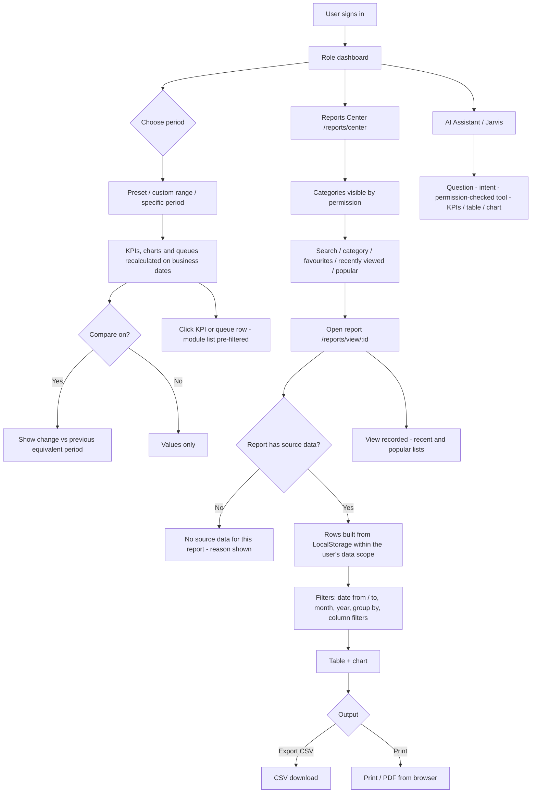
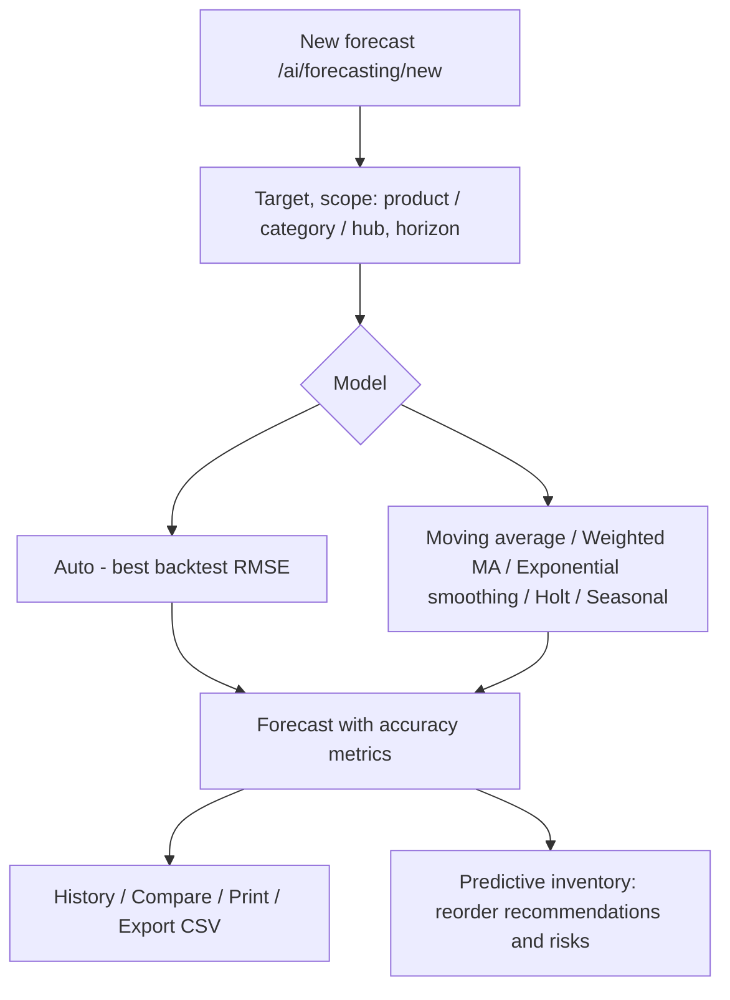
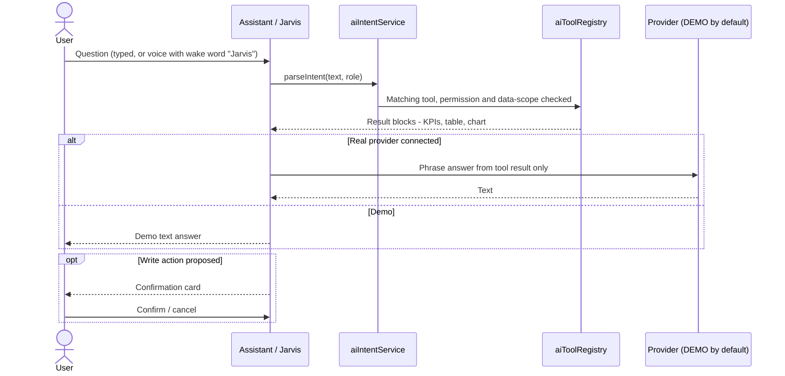

# 14 · Reports & Dashboard Workflow

| Feature | Status |
|---|---|
| Role dashboards (12 dashboards + generic launcher) | Implemented |
| Universal dashboard period filter with comparison | Implemented (selection kept in memory, not stored) |
| Reports Center — 118 reports in 11 categories | Implemented; **24 reports have no source data** in the prototype and say so |
| Module report pages (orders, delivery, invoices, documents, VMS) | Implemented |
| CSV export, print | Implemented |
| Forecasting and predictive inventory | Implemented (in-browser statistical models) |
| AI Assistant / Jarvis | **Simulated** (demo intent engine; external providers Not Verified) |
| AI insights | Implemented (rule-based) |

## 14.1 Dashboards

| Role | Dashboard component | Main KPIs / queues |
|---|---|---|
| Super Admin, Administrator | `AdminDashboard` + `OpsOverview` | Total orders, Pending approval, Approved, Rejected, Consolidated, Ready for dispatch, Order pipeline; Sales (delivered), Delivery, Inventory value, Finance — invoiced, Purchase (replenishment), AI insights |
| Sales Executive | `SalesmanDashboard` | My orders, Draft, Pending approval, Approved, Returned, Rejected, Needs your action, My order trend |
| Sales Manager | `SalesManagerDashboard` | Pending approvals, Returned orders, Recent pending orders, Active accounts and credit position |
| Customer Service | `CustomerServiceDashboard` | Approved orders, Awaiting consolidation, Consolidated, Ready for dispatch, Queue by salesman, Consolidation queue |
| Dispatcher | `DispatcherDashboard` / `DispatchOverview` | Ready for dispatch, Planned, Assigned, Confirmed, In transit, Completed, Failed, Partial deliveries, Active drivers, Available vehicles; trends; driver and zone performance |
| Finance | `FinanceDashboard` | Order value (submitted), Approved order value, Delivered to invoice, Invoices, Collections, Outstanding, Credit exposure / utilisation, Over credit limit |
| Warehouse Manager / Inventory Executive | `WarehouseDashboard` (inventory variant) | Stock value, Low / out of stock, Damaged / held, Expiry, Inventory alerts, Picking & loading |
| QA Manager | `QaDashboard` | Inspections pending, Quarantine, Expired documents, Expiry, Cold chain card ("No sensor integration") |
| Supplier | `SupplierPortalDashboard` | Open purchase requests, Approved replenishment, Lines requested, Lead time, Goods receipts |
| Customer | Customer app Home | Active orders, Pending approval, Delivered, Outstanding |
| Driver | Driver app Today | Today / tomorrow stops, next stop, performance |
| Custom role | `GenericDashboard` | Workspace launcher (permission-driven) |

### Period filter

Options: Today, Yesterday, This Week, Last Week, Last 7 Days, Last 30 Days, This Month, Last Month, Month to Date, This
Quarter, Last Quarter, Quarter to Date, This Half-Year, Last Half-Year, Half-Year to Date, This Year, Last Year, Year to
Date, Custom Date Range, All Time, plus **Specific period** (day, week, month, quarter, half-year, calendar year,
financial year; financial year starts in April by default). **Compare** shows % change, difference and previous value
against the previous equivalent period. Defaults: office and customer dashboards **All Time**; driver **Today**.

Each dated collection is filtered on its own business date: orders (order date), approvals (decision date), dispatches
(dispatch date), deliveries (completion / failure date), invoices (invoice date), receipts / transfers / adjustments
(their dates), replenishment (created date), documents (upload date), delivery notes (delivery date), AI insights
(generated date). Stock, inventory value, credit balances, customers, products, vehicles and drivers are **Current**
positions. Source: `utils/dashboardFilter.js`, `context/DashboardPeriodContext.jsx`.

## 14.2 Master flowchart 11 — Reports workflow

## 14.3 Reports Center catalogue

Entries marked * have **no source data** in this prototype; the report opens and states why (payments, credit notes,
refunds, expenses, supplier invoices, purchase / customer returns, batch / expiry on stock, cycle counts, fuel and
maintenance are not captured).

| Category | Reports | Visible with | Report titles |
|---|---|---|---|
| Sales | 14 | `orders.reports` | Sales Order Register, Sales Order Summary, Sales by Customer, Sales by Salesman, Sales by Product, Sales by Category, Sales by Month, Sales Order Status, Pending Approval, Rejected Orders, Credit Limit Exceptions, Order Conversion, Customer Sales Analysis, VIP Orders |
| Inventory | 18 | `reports.inventory` | Stock Overview, Stock Valuation, Stock Movement, Stock Ageing*, Batch Inventory*, Expiry Report*, Near Expiry*, Expired Stock, Slow Moving Stock, Non Moving Stock, Stock-Out Report, Stock Transfer, Stock Adjustment, Scrap Register, Scrap Valuation, Warehouse Utilization, Cycle Count Variance*, Inventory Transaction History |
| Procurement | 10 | `procurement.view` | Purchase Order Register, Purchase Order Status, Purchase by Supplier, Purchase by Product, Goods Receipt Register, Pending Goods Receipts, Purchase Return*, Supplier Invoice Register*, Supplier Outstanding*, Procurement Performance |
| Dispatch & Delivery | 19 | `dispatch.reports or dispatch.history` | Dispatch Register, Dispatch Summary, Dispatch by Zone, Dispatch by Driver, Dispatch by Vehicle, Delivery Register, Delivered Orders, Pending Deliveries, Failed Deliveries, Partial Deliveries, Delivery Performance, On-Time Delivery, VIP Delivery Performance, Delivery Proof Report, OTP Verification Report, Delivery Note Register, Driver Performance, Route Performance, Customer Delivery History |
| Finance | 14 | `finance.view or invoices.reports` | Customer Outstanding, Customer Ageing, Receivable Summary, Invoice Register, Payment Register*, Payment Allocation*, Credit Note Register*, Refund Register*, Supplier Outstanding*, Supplier Ageing*, Supplier Payment Register*, Expense Register*, Expense Category Report*, Finance Summary |
| Customer | 8 | `customers.view` | Customer Master, Customer Sales, Customer Outstanding, Customer Order History, Customer Delivery History, Customer Payment History*, Customer Return History*, Customer Performance |
| Supplier | 5 | `suppliers.view` | Supplier Master, Supplier Purchase, Supplier Outstanding*, Supplier Payment*, Supplier Performance |
| Fleet | 9 | `fleet.view or vms.view` | Vehicle Register, Driver Register, Vehicle Utilization, Vehicle Maintenance*, Vehicle Expenses*, Fuel Register*, Vehicle Document Expiry, Driver Performance, Delivery per Vehicle |
| Communication | 7 | `communication.calls` | Call History, Calls by Salesman, Calls by Customer, Call Outcome, Follow-up Pending, Overdue Follow-ups, Call-to-Order Conversion |
| Scrap | 7 | `inventory.scrap.view` | Scrap Register, Scrap by Product, Scrap by Batch, Scrap by Hub, Scrap by Reason, Scrap Valuation, Scrap Approval History |
| AI | 7 | `ai.insights.view` | Sales Insights, Inventory Insights, Demand Forecast, Expiry Risk, Slow-Moving Products, Delivery Insights, Business Summary |

Total: 118 reports; 94 with data, 24 marked *.

Module report pages also exist: Order Reports `/orders/reports`, Delivery Reports `/dispatch/reports`, Invoice
Reports `/invoices/reports`, Document Reports `/documents/reports`, VMS Reports `/vms/reports`. Legacy routes
`/reports`, `/reports/deliveries`, `/reports/inventory`, `/reports/invoices` redirect to the current pages.

## 14.4 Forecasting

## 14.5 AI Assistant and Jarvis

Conversations are private to each user. Every assistant action is logged in AI Activity (`/ai/activity`). AI Settings
(`/ai/settings`, Administrator) choose the provider: Demo, OpenJarvis, Ollama, Gemini, OpenAI-compatible or Custom —
only Demo was verified.
