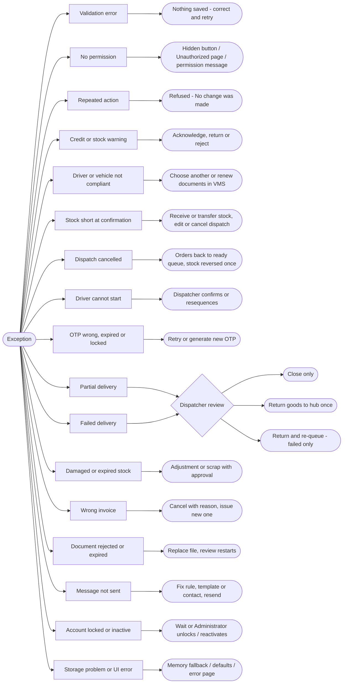
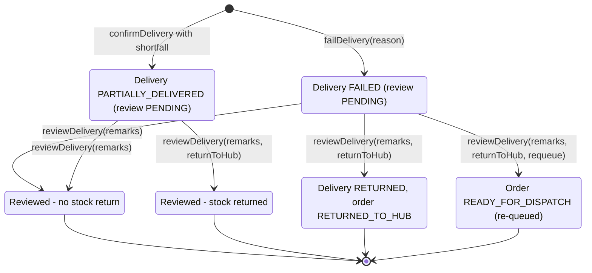

# 15 · Exception Workflow

An exception is anything that stops the normal path. In Bellomassi every exception is handled by the service that owns
the record: the action is refused with a message and nothing is saved, or the record moves to an exception status that
a named role must resolve. Repeating an action that already happened never changes data twice ("No change was made.").

## 15.1 Master flowchart 12 — Exception workflow

## 15.2 Exception register

| # | Exception | Detected in | What the user sees | Who resolves | Resolution | Status |
|---|---|---|---|---|---|---|
| 1 | Wrong password | `authService.login` | "The email/username or password is incorrect…" | User | Retry; reset password | Implemented |
| 2 | Account locked (5 failures) | `authService` | "Too many failed attempts. This account is locked for N minutes." | User / Administrator | Wait, or **Unlock** in User Management | Implemented |
| 3 | Inactive account | `authService` | "This account is inactive…" | Administrator | Reactivate user | Implemented |
| 4 | Idle session | `SessionWatcher` | Signed out | User | Sign in again | Implemented |
| 5 | No permission | `ProtectedRoute`, services | `/unauthorized` or "You do not have permission to…" | Administrator | Grant permission / role | Implemented |
| 6 | Order data invalid | `orderService.validateOrder` | Field messages | Sales Executive | Correct and submit | Implemented |
| 7 | Credit limit exceeded | `getApprovalChecks` | Warning (or block if configured) | Sales Manager | Acknowledge, return ("Reduce order value (credit)") or reject | Implemented |
| 8 | Stock short at approval | `getApprovalChecks` | Warning | Sales Manager | Acknowledge or return / reject ("Stock not available") | Implemented |
| 9 | Inactive customer / hub / product | `getApprovalChecks` | "Cannot approve: …" | Administrator / Sales Manager | Fix master data, or reject | Implemented |
| 10 | Order returned | `returnOrderForCorrection` | Salesman notification with edit link, highlighted section | Sales Executive | Correct and resubmit | Implemented |
| 11 | Order rejected | `rejectOrder` | Rejected Orders list, notification | — | Final; a new order can be created (or duplicated) | Implemented |
| 12 | Customer wants to cancel a submitted order | — | — | — | **Not Implemented** (Sales Manager may reject with "Customer cancelled") | Not Implemented |
| 13 | Consolidation checklist incomplete | `consolidateOrder` | "Complete the verification checklist first." | Customer Service | Tick all checks | Implemented |
| 14 | Order not eligible for dispatch | `orderIneligibility` | "Only orders ready for dispatch can be dispatched." / already on another dispatch / no complete address | Dispatcher / Customer Service | Wait for release, fix address | Implemented |
| 15 | Driver / vehicle not compliant or busy | `driverAssignmentIssues`, `vehicleAssignmentIssues` | Specific issue messages | Dispatcher / Administrator | Choose another, renew documents, maintenance | Implemented |
| 16 | Load exceeds capacity | `vehicleAssignmentIssues` | "Load of N exceeds … capacity" | Dispatcher | Bigger vehicle or split dispatch | Implemented |
| 17 | Stock short at confirmation | `deductDispatchStock` | "…needs N, only M available at the hub." | Warehouse / Dispatcher | Receive or transfer stock; edit dispatch | Implemented |
| 18 | Dispatch cancelled | `cancelDispatch` | Driver and Admin notified; orders back in ready queue | Dispatcher | Re-plan; stock reversed if it was deducted | Implemented |
| 19 | Driver starts out of order / too early | `startDelivery` | Blocker text under the Start button | Driver / Dispatcher | Follow sequence; Dispatcher resequences or confirms | Implemented |
| 20 | Wrong OTP | `otpService.evaluateOtp` | Error on confirm screen; attempt counted | Driver / customer | Re-enter | Simulated OTP |
| 21 | OTP expired / locked | `otpService` | "This OTP has expired. Generate a new one." / "Too many incorrect attempts. Generate a new OTP." | Driver | Generate a new OTP | Simulated OTP |
| 22 | Partial delivery | `confirmDelivery` | PARTIALLY_DELIVERED; remaining stays with Dispatcher | Dispatcher | Review; return undelivered stock to hub | Implemented |
| 23 | Failed delivery | `failDelivery` | FAILED; reasons list; customer told "Our team will contact you to reschedule." | Dispatcher | Review; return to hub; re-queue | Implemented |
| 24 | Damaged goods at delivery | `confirmDelivery` (damaged qty) | Recorded on the delivery and note | Dispatcher / Warehouse | Damaged quantity is not returned to available stock by review; use adjustment / scrap | Implemented |
| 25 | Transfer more than available | `validateTransfer` | "Only N … available at …" | Inventory staff | Reduce quantity | Implemented |
| 26 | Adjustment would go negative | `validateAdjustment` | "Cannot remove more than the N available…" | Inventory staff | Correct quantity | Implemented |
| 27 | Scrap exceeds eligible / duplicate / missing photo or batch | `validateScrap` | "Only N eligible…", photo / batch messages | Requester | Correct request | Implemented |
| 28 | Scrap rejected | `rejectScrap` | Rejection reason | Requester | New request if needed | Implemented |
| 29 | Invoice wrong | `cancelInvoice` | CANCELLED with reason | Finance | Issue a new invoice | Implemented |
| 30 | Invoice for ineligible / already invoiced order | `invoiceEligibility` | Eligibility message | Finance | Wait or cancel existing invoice | Implemented |
| 31 | Document rejected | `rejectDocument` | Reason shown to uploader | Uploader | Replace file | Implemented |
| 32 | Document expired | `effectiveStatus`, VMS | EXPIRED badge; assignment blocked for required VMS documents | Administrator / Dispatcher / QA | Upload renewed document, update expiry | Implemented |
| 33 | OCR not possible | `ocrService` | "The file is not stored in this browser…", provider unavailable | Reviewer | Enter fields manually | Implemented |
| 34 | Automated message skipped / failed | `automationService` | History entry with note | Administrator | Enable automation / rule, add template or contact | Implemented |
| 35 | Cold-chain temperature excursion | — | "No sensor integration" | — | Record a scrap request with reason "Temperature Excursion" | Not Implemented (monitoring) |
| 36 | Browser storage blocked or corrupted | `storageService` | App keeps working in memory; corrupted key falls back to defaults | User / Administrator | Allow storage; reset demo data if needed | Implemented |
| 37 | Unknown page | Router | Not Found page | User | Use the menu | Implemented |

## 15.3 Delivery exception review — detail

Rules (`deliveryService.reviewDelivery`): only Dispatcher / Administrator; only FAILED or PARTIALLY_DELIVERED; remarks
required; goods can be returned once; re-queue only for a failed delivery whose goods are returned; a second review is
refused.
