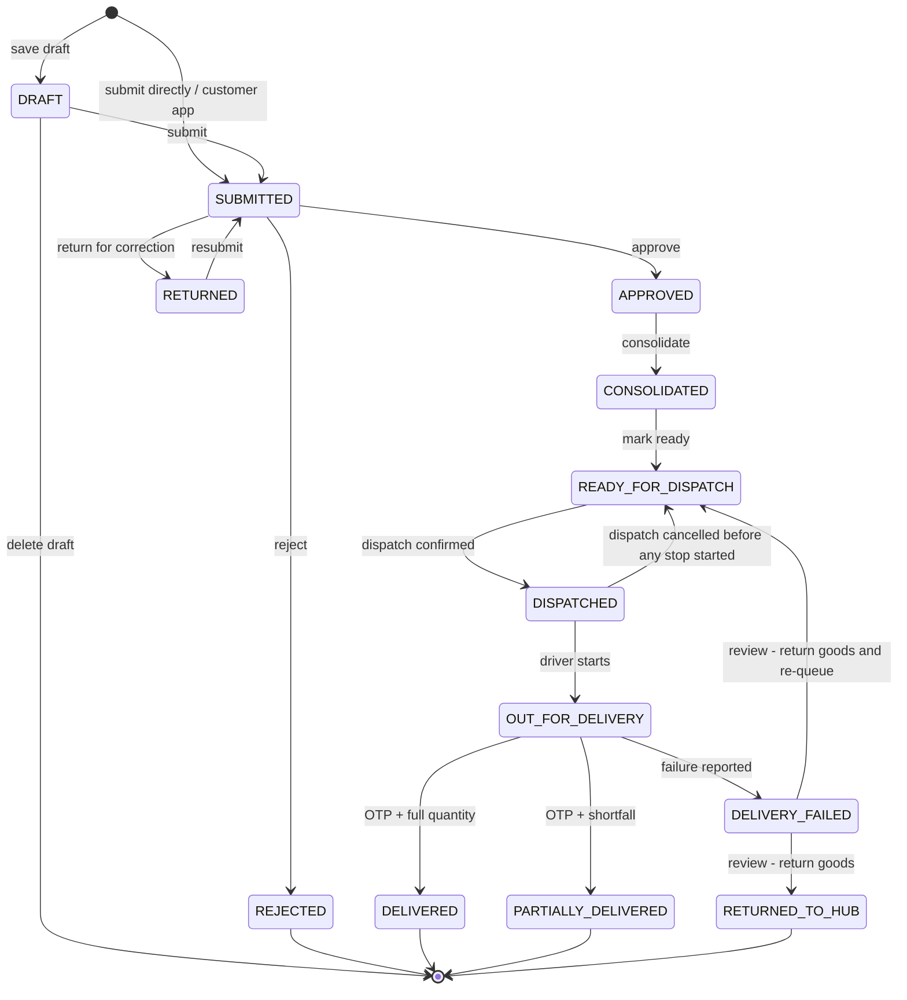
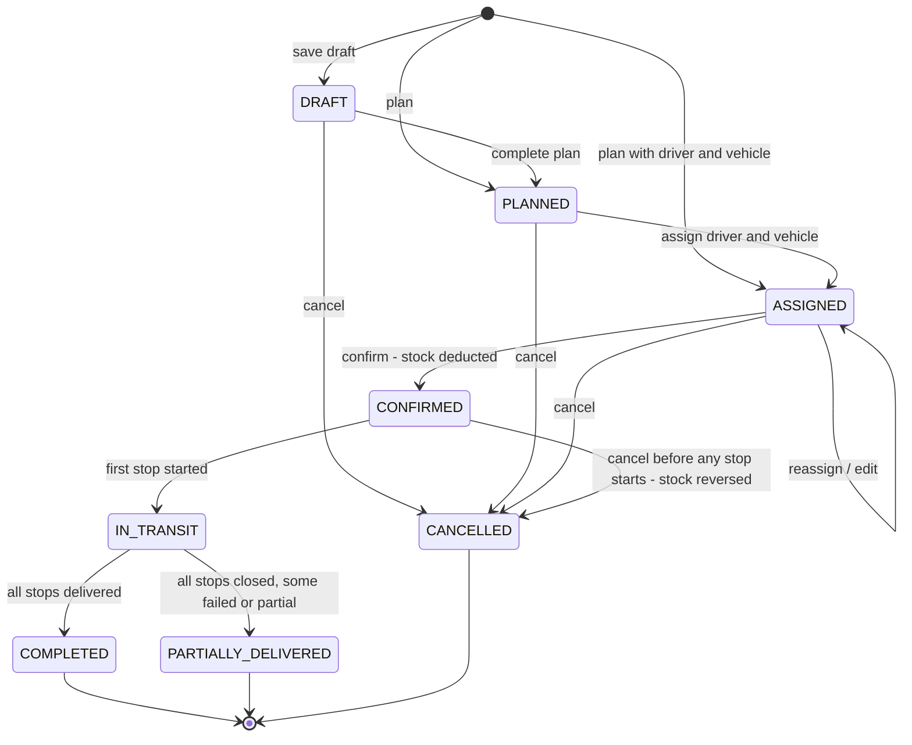
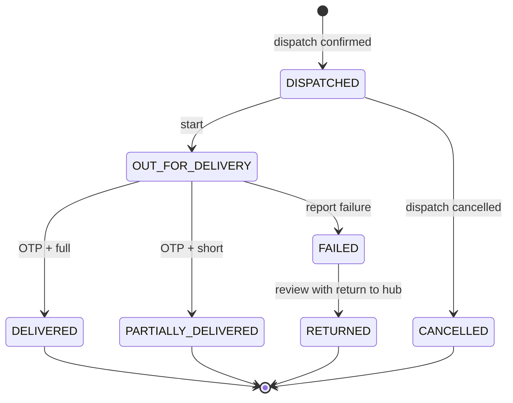

# 17 · Status Lifecycle

All values below are the exact codes stored in LocalStorage, with the label the UI shows. Sources are given for each
set.

## 17.1 Order status (`orderStatus`, `ORDER_STATUS_META` in `src/config/orderConfig.js`)

| Code | Label | Step | Set by |
|---|---|---|---|
| DRAFT | Draft | 1 | `createOrder`, `updateOrder` |
| SUBMITTED | Submitted | 2 | `submitOrder`, `resubmitOrder`, `placeCustomerOrder` |
| RETURNED | Returned for correction | 2 | `returnOrderForCorrection` |
| REJECTED | Rejected | 0 | `rejectOrder` |
| APPROVED | Approved | 3 | `approveOrder` |
| CONSOLIDATED | Consolidated | 4 | `consolidateOrder` |
| READY_FOR_DISPATCH | Ready for dispatch | 5 | `markReadyForDispatch`; `cancelDispatch`; `reviewDelivery` (re-queue) |
| DISPATCHED | Dispatched | 6 | `confirmDispatch` |
| OUT_FOR_DELIVERY | Out for delivery | 7 | `startDelivery` |
| PARTIALLY_DELIVERED | Partially delivered | 8 | `confirmDelivery` (shortfall) |
| DELIVERED | Delivered | 8 | `confirmDelivery` (full) |
| DELIVERY_FAILED | Delivery failed | 7 | `failDelivery` |
| RETURNED_TO_HUB | Returned to hub | 7 | `reviewDelivery` (failed + return to hub, no re-queue) |

Notes: while an order sits on a DRAFT / PLANNED / ASSIGNED dispatch it stays READY_FOR_DISPATCH (with `dispatchId`
set). Cancelling a dispatch that was never confirmed also leaves orders READY_FOR_DISPATCH.

### Companion fields

| Field | Values | Meaning |
|---|---|---|
| `approvalStatus` | NOT_SUBMITTED, PENDING, APPROVED, REJECTED, RETURNED | Sales Manager decision |
| `consolidationStatus` | NOT_STARTED, PENDING, COMPLETED | PENDING after approval; COMPLETED after consolidation |
| `orderSource` | e.g. `customer_app` for customer orders | Where the order came from |
| `creditWarning`, `stockWarning` | true / false | Flags shown to the approver |

## 17.2 Dispatch status (`DISPATCH_STATUS_META`, `src/config/dispatchConfig.js`)

| Code | Label | Step |
|---|---|---|
| DRAFT | Draft | 0 |
| PLANNED | Planned | 1 |
| ASSIGNED | Assigned | 2 |
| CONFIRMED | Confirmed | 3 |
| IN_TRANSIT | In transit | 4 |
| PARTIALLY_DELIVERED | Closed with exceptions | 5 |
| COMPLETED | Completed | 5 |
| CANCELLED | Cancelled | −1 |

## 17.3 Delivery status (`DELIVERY_STATUS`)

| Code | Label | Set by |
|---|---|---|
| DISPATCHED | Dispatched | `confirmDispatch` (one delivery per order) |
| OUT_FOR_DELIVERY | Out for delivery | `startDelivery` |
| DELIVERED | Delivered | `confirmDelivery` |
| PARTIALLY_DELIVERED | Partially delivered | `confirmDelivery` |
| FAILED | Failed | `failDelivery` |
| RETURNED | Returned | `reviewDelivery` (failed + return to hub) |
| CANCELLED | Cancelled | `cancelDispatch` (confirmed dispatch) |

Review status on failed / partial deliveries: `PENDING` → `REVIEWED`. Terminal delivery statuses
(`TERMINAL_DELIVERY_STATUSES`) cannot be restarted.

## 17.4 Delivery OTP (`OTP_STATUS`)

| Code | Label |
|---|---|
| ACTIVE | Awaiting entry |
| VERIFIED | Verified |
| EXPIRED | Expired (derived when `expiresAt` passes) |
| INVALIDATED | Replaced by a newer OTP |
| LOCKED | Too many attempts (5) |

## 17.5 Scrap request (`SCRAP_STATUS`, `scrapService`)

DRAFT → PENDING_APPROVAL → APPROVED → COMPLETED; PENDING_APPROVAL → REJECTED; DRAFT / PENDING_APPROVAL / APPROVED →
CANCELLED. Diagram: chapter 07 §7.3.

## 17.6 Replenishment (`REPLENISHMENT_META`, `src/config/aiConfig.js`)

| Code | Label |
|---|---|
| DRAFT | Draft |
| SUBMITTED | Submitted for approval |
| APPROVED | Approved |
| REJECTED | Rejected |
| CONVERTED | Awaiting goods receipt |
| RECEIVED | Received (derived from stock receipts) |
| CANCELLED | Cancelled |

Reorder recommendation (`RECOMMENDATION_STATUS`): OPEN, IN_DRAFT, DISMISSED. Diagram: chapter 07 §7.4.

## 17.7 Document (`DOCUMENT_STATUS_META`, `src/config/documentConfig.js`)

| Code | Label |
|---|---|
| PENDING_OCR | Pending OCR |
| OCR_COMPLETED | OCR completed |
| PENDING_REVIEW | Pending review |
| VERIFIED | Verified |
| REJECTED | Rejected |
| EXPIRED | Expired (derived from expiry date) |

Diagram: chapter 07 §7.5.

## 17.8 Invoice (`INVOICE_STATUS_META`, `src/config/invoiceConfig.js`)

| Code | Label |
|---|---|
| ISSUED | Issued |
| CANCELLED | Cancelled |

## 17.9 Stock transfer (`TRANSFER_STATUS`, `src/config/masterData.js`)

Draft → Completed; Draft → Cancelled.

## 17.10 Stock status (`STOCK_STATUS`, `utils/stock.getStockStatus`)

In Stock · Low Stock · Out of Stock · Overstock (first match: Out → Low → Over → In).

## 17.11 Messages — email and WhatsApp (`MESSAGE_STATUS_META`, `src/config/communicationConfig.js`)

| Code | Label |
|---|---|
| DRAFT | Draft |
| QUEUED | Queued |
| SENDING | Sending |
| SENT | Sent (accepted by provider) |
| DELIVERED | Delivered (provider confirmed) |
| FAILED | Failed |
| QUEUED_DEMO | Queued · demo |
| SENT_DEMO | Sent · demo (not sent) |
| FAILED_DEMO | Failed · demo |

Automation history status: SKIPPED, SENT_DEMO / SENT / DELIVERED, PARTIAL, FAILED.

## 17.12 VMS expiry state (`EXPIRY_META`, `src/config/vmsConfig.js`)

| Code | Label |
|---|---|
| EXPIRED | Expired |
| TODAY | Expires today |
| WEEK | Within 7 days |
| MONTH | Within 30 days |
| VALID | Valid |
| MISSING | Not on record |

## 17.13 Fleet

| Set | Values |
|---|---|
| Vehicle status | Available, Assigned, In Transit (derived from dispatches), Maintenance, Inactive |
| Driver status | Active, Inactive |
| Driver availability | Available, Assigned, On Delivery, Offline |

## 17.14 Master data and users

| Set | Values |
|---|---|
| Customer status | Active, Inactive, Blocked |
| Hub status | Active, Inactive |
| Product status | Active, Inactive, Discontinued (only Active products can be ordered and approved) |
| Zone status | Active, Inactive |
| User status | active / inactive; temporary lock after failed sign-ins |
| Role status | active / inactive; system, protected and locked flags |

## 17.15 AI and calls

| Set | Values |
|---|---|
| AI insight | NEW (New), REVIEWED (Reviewed), RESOLVED (Resolved) |
| Call status | Connected, Missed, Busy, No Answer, Voicemail |
| Call outcome | Order Received, Interested, Follow-up Required, No Response, Busy, Not Interested, Complaint, Payment Follow-up, Other |
| Call follow-up | Open (overdue / today / upcoming) → Completed |
