# About this document {#about}

| | |
|---|---|
| **Product** | Bellomassi Order-to-Delivery Platform (frozen & chilled food distribution) |
| **Document set** | Complete Application Workflow Documentation |
| **Version** | 1.0 · prepared from the source code of `bellomassi-premium-ui` (application data version 8) |
| **Audience** | Business users, client stakeholders, trainers, testers and developers |

This folder documents how the application **actually works today**. Every workflow, status, rule and message was taken
from the source code (`src/config`, `src/services`, `src/pages`, `src/routes`). Nothing in these documents changes the
application — no code, route, UI or LocalStorage structure was modified to produce them.

## How to read these documents

Each chapter has two layers:

- **Business explanation** — plain English: who does what, in which order, and why.
- **Technical reference** — the route, page component, service function, permission key and LocalStorage key behind
  each step, so a developer or tester can find it in the code.

## Implementation status legend

Every feature is classified with one of these labels. The label describes what the code really does, not what a menu
item suggests.

| Label | Meaning |
|---|---|
| **Implemented** | Works end to end in the browser; data is saved to LocalStorage and the rules are enforced by a service. |
| **Partially Implemented** | The main flow works but part of the business process is not built (the gap is named). |
| **Simulated** | Behaves realistically for a demo but no external system is involved (e.g. DEMO GPS, demo OTP, demo email). |
| **UI Only** | A screen or control exists but it does not change any data. |
| **Coming Soon** | Shown in the app as a placeholder for a later phase. |
| **Not Implemented** | The business step does not exist in the application. |
| **Not Verified** | Exists in code but its behaviour could not be confirmed with a live provider (e.g. backend gateway mode). |

## Chapters

| # | File | What it covers |
|---|---|---|
| 01 | [Application Overview](#ch-01) | Purpose, apps, roles, modules, technology, data storage, simulations |
| 02 | [Overall Workflow](#ch-02) | End-to-end business flow with the master flowchart and swimlane |
| 03 | [Login-Wise Workflow](#ch-03) | Sign-in pages, demo accounts, landing pages, session, lockout, password reset, sign-out |
| 04 | [Role-Wise Workflow](#ch-04) | All 13 roles: dashboard, menus, KPIs, actions, daily routine, limits, hand-offs |
| 05 | [Module-Wise Workflow](#ch-05) | Every module with the 17 standard headings |
| 06 | [Order-to-Delivery Workflow](#ch-06) | The core process from order capture to delivery note and invoice |
| 07 | [Approval Workflow](#ch-07) | Order approval, return and rejection; scrap and replenishment approvals; document review |
| 08 | [Driver Workflow](#ch-08) | Driver app: today, start, arrive, OTP, proof of delivery, failure |
| 09 | [Customer Workflow](#ch-09) | Customer app: catalog, cart, order, tracking, OTP, notes, invoices |
| 10 | [Inventory Workflow](#ch-10) | Receipts, transfers, adjustments, movements, low stock, scrap, replenishment |
| 11 | [Dispatch & VMS Workflow](#ch-11) | Dispatch planning, assignment, confirmation, tracking, exceptions, vehicle/driver compliance |
| 12 | [Finance & Invoice Workflow](#ch-12) | Invoice templates, numbering, generation, cancellation, credit |
| 13 | [Communication & Documents Workflow](#ch-13) | Email, WhatsApp, automation, call history, notifications, documents and OCR |
| 14 | [Reports & Dashboard Workflow](#ch-14) | Role dashboards, period filter, Reports Center (118 reports), AI & Jarvis |
| 15 | [Exception Workflow](#ch-15) | Every exception path and how it is resolved |
| 16 | [Role Responsibility Matrix](#ch-16) | Who creates, approves, views each record; permission matrix |
| 17 | [Status Lifecycle](#ch-17) | Every status set with its exact values and state diagrams |
| 18 | [Screen-Wise User Guide](#ch-18) | Every screen in simple English |
| 19 | [Glossary](#ch-19) | Business and technical terms |

## Master flowcharts

The twelve master flowcharts are located as follows:

| # | Flowchart | Chapter |
|---|---|---|
| 1 | Complete application workflow | 02 |
| 2 | Login-wise workflow | 03 |
| 3 | Order-to-delivery workflow | 06 |
| 4 | Approval workflow | 07 |
| 5 | Driver workflow | 08 |
| 6 | Customer workflow | 09 |
| 7 | Inventory workflow | 10 |
| 8 | Dispatch / VMS workflow | 11 |
| 9 | Finance / invoice workflow | 12 |
| 10 | Communication workflow | 13 |
| 11 | Reports workflow | 14 |
| 12 | Exception workflow | 15 |

The swimlane diagram for Sales, Sales Manager, Warehouse/Customer Service, Dispatch, Driver, Customer and Finance is in
chapter 02 (section 2.3) and repeated for the order lifecycle in chapter 06.

## Consolidated editions

The same content is published as one document in three formats, in `docs/workflow/dist/`:

- `Bellomassi-Workflow-Documentation.html` — single page, diagrams rendered, printable
- `Bellomassi-Workflow-Documentation.pdf` — cover page, table of contents, headers, footers and page numbers
- `Bellomassi-Workflow-Documentation.docx` — Word edition with the same structure

The diagrams are written in Mermaid. They render directly on GitHub, GitLab and in VS Code's Markdown preview, and are
pre-rendered as images in the consolidated editions.

# 01 · Application Overview {#ch-01}

## 1.1 What Bellomassi is

Bellomassi is an **order-to-delivery management system** for a frozen and chilled food distributor. It covers the full
chain from a salesman (or the customer) placing an order, through sales approval, warehouse preparation, dispatch
planning and the driver's doorstep delivery, to the delivery note and the customer invoice. Around this core it provides
inventory control, vehicle and driver compliance, document management with OCR, communication (email, WhatsApp, call
log), reporting, forecasting and an AI assistant.

The application in this repository is a **client-demo prototype**:

- It is a single React web application. There is **no backend server and no database**.
- All data lives in the **browser's LocalStorage** (application data version 8). Each browser has its own copy of the
  data; clearing site data resets it to the seeded demo data.
- Sign-in is a **browser-session simulation** with published demo passwords. It is not production authentication.
- Integrations (SMTP email, OpenWA WhatsApp, OCR, AI providers) have a **demo mode** that is active by default and an
  optional **backend gateway mode** that is only used when `VITE_INTEGRATION_GATEWAY_URL` is configured. Gateway mode is
  **Not Verified** in this document because no gateway was available.

## 1.2 The three user-facing apps

One code base serves three experiences. They share the same data and the same accounts.

| App | Entry | Who uses it | Layout |
|---|---|---|---|
| **Office web app** | `/login` → `/dashboard` | Super Admin, Administrator, Sales Executive, Sales Manager, Customer Service, Dispatcher, Finance, Warehouse Manager, Inventory Executive, QA Manager, Supplier | Sidebar + header (`components/layout/AppLayout`) |
| **Driver app** (mobile-first) | `/driver/login` → `/driver/dashboard` | Driver | Bottom tab bar (`DriverLayout`) |
| **Customer app** (mobile-first) | `/customer/login` → `/customer/dashboard` | Customer (portal user) | Bottom tab bar (`CustomerLayout`) |

## 1.3 Roles at a glance

Thirteen system roles are defined in `src/config/roles.js`. Administrators can also create **custom roles** (Role
Management) by choosing permissions from the catalog in `src/config/rbacCatalog.js`.

| Role code | Label | Workspace | Data scope (what records they see) |
|---|---|---|---|
| SUPER_ADMIN | Super Admin | Admin Panel | All records; can grant the Super Admin role |
| ADMIN | Administrator | Admin Panel | All records |
| SALESMAN | Sales Executive | Order Taking App | Own orders, own customers' documents and deliveries |
| SALES_MANAGER | Sales Manager | Order Taking App | All non-draft orders; customer and order documents |
| CUSTOMER_SERVICE | Customer Service | Order Taking App | Orders from approval onwards; all documents |
| DISPATCHER | Dispatcher | Order Taking App | Orders from consolidation onwards; fleet and hub documents |
| DRIVER | Driver | Drivers App | Own dispatches, deliveries and documents |
| FINANCE | Finance Executive | Notifications & Reports | All non-draft orders; invoices, customers, vendor documents |
| WAREHOUSE_MANAGER | Warehouse Manager | Warehouse | Dispatch & warehouse scope |
| INVENTORY_EXECUTIVE | Inventory Executive | Warehouse | Dispatch & warehouse scope |
| QA_MANAGER | QA Manager | Quality & Cold Chain | Dispatch & warehouse scope |
| CUSTOMER | Customer (Portal) | Customer Portal | One linked customer's orders, deliveries and invoices |
| SUPPLIER | Supplier (Portal) | Supplier Portal | One linked supplier's approved replenishment |

> Note: the role description of CUSTOMER in `roles.js` still says "read-only portal". In the current code the customer
> can **place orders** from the customer app (permission `customer.order`). This document follows the code.

## 1.4 Modules and implementation status

| Module | Main routes | Status |
|---|---|---|
| Authentication & session | `/login`, `/driver/login`, `/customer/login`, `/forgot-password`, `/reset-password`, `/logout` | Implemented (simulated security) |
| Role dashboards + period filter | `/dashboard`, `/driver/dashboard`, `/customer/dashboard` | Implemented |
| Master data — products, customers, hubs, suppliers, zones | `/products`, `/customers`, `/hubs`, `/suppliers`, `/dispatch/zones` | Implemented |
| Customer credit | `/customers/credit` | Partially Implemented (balance is maintained on the customer record; no payment entry) |
| Order management | `/orders/*` | Implemented |
| Order approval | `/orders/approval` | Implemented |
| Order consolidation | `/orders/consolidation` | Implemented |
| Inventory — stock, receipts, transfers, adjustments, movements, low stock | `/inventory/*` | Implemented |
| Scrap management | `/inventory/scrap/*` | Implemented |
| Warehouse dashboard / QA & cold chain | `/warehouse`, `/quality` | Implemented (temperature monitoring: Not Implemented — "No sensor integration") |
| Dispatch planning, assignment, confirmation | `/dispatch/*` | Implemented |
| Delivery tracking & live tracking | `/dispatch/delivery-tracking`, `/dispatch/live-tracking` | Simulated (DEMO GPS) |
| Driver app | `/driver/*` | Implemented (GPS and OTP simulated) |
| Delivery OTP | driver confirm screen, customer tracking | Simulated (no SMS) |
| Proof of delivery (photo / signature) | driver confirm screen | Implemented (stored in browser) |
| Delivery notes | `/dispatch/delivery-notes/:id` | Implemented |
| Customer app | `/customer/*` | Implemented (payments: Not Implemented) |
| Vehicle Management System (VMS) | `/vms/*` | Implemented |
| Documents & OCR | `/documents/*` | Implemented; OCR is Simulated in demo mode |
| Invoices & templates | `/invoices/*` | Implemented (demo tax, not GST-compliant) |
| Payments, credit notes, refunds, expenses | — | Not Implemented |
| Email | `/communication/email/*` | Simulated (demo mode); gateway mode Not Verified |
| WhatsApp (OpenWA) | `/communication/whatsapp/*` | Simulated (mock session); gateway mode Not Verified |
| Automated notifications | `/communication/automation` | Implemented (sends through the simulated channels) |
| Call history | `/communication/calls/*` | Implemented (manual call log; no telephony) |
| In-app notifications | `/notifications` | Implemented |
| Reports Center | `/reports/center` | Implemented — 118 reports, 24 have no source data in the prototype |
| AI Assistant, Jarvis, Insights | `/ai`, `/ai/assistant`, `/ai/jarvis`, `/ai/insights` | Simulated (rule-based intent engine; external AI provider Not Verified) |
| Forecasting, predictive inventory, model management | `/ai/forecasting`, `/ai/predictive-inventory`, `/ai/models` | Implemented (in-browser statistical models) |
| Replenishment (purchase requests) | `/ai/replenishment` | Implemented (stops at goods receipt; supplier invoicing Not Implemented) |
| Administration — users, roles, permissions, audit, settings, organization | `/admin/*` | Implemented |

## 1.5 Technology

| Layer | Technology |
|---|---|
| UI | React 19, React Router 7, Tailwind CSS v4, Lucide icons, Recharts 3, sonner (toasts) |
| Build | Vite 8 |
| Dates | dayjs with UTC and time-zone plugins (organisation time zone from Application Settings) |
| Persistence | `src/services/storageService.js` — the only module that reads or writes browser storage |
| Access control | `src/config/permissions.js` (`can(user, key)`), `src/services/rbacService.js`, `src/routes/ProtectedRoute.jsx` |
| Navigation | `src/config/navigation.js` — one list of 206 entries that drives routes, menus, breadcrumbs, search and access |

Architecture: **page → hook → service → storageService → LocalStorage.** Pages never write storage directly; every
business rule (who may do what, which status may move where) lives in a service function that returns
`{ ok: true, record }` or `{ ok: false, error, errors }`.

## 1.6 Data storage (LocalStorage)

All keys are prefixed `bellomassi_`. The full list from `src/utils/constants.js` (`STORAGE_KEYS`):

| Area | Keys |
|---|---|
| App & session | `app_version`, `demo_users`, `session`, `settings`, `demo_data`, `activities`, `theme`, `notifications`, `notification_preferences`, `auth` |
| Master data | `customers`, `products`, `hubs`, `dispatch_zones`, `drivers`, `vehicles`, `company`, `organization` |
| Inventory | `inventory`, `stock_receipts`, `stock_transfers`, `stock_adjustments`, `stock_movements`, `scrap_requests` |
| Orders | `orders`, `order_sequence`, `approvals`, `consolidations`, `order_timeline` |
| Dispatch & delivery | `dispatches`, `dispatch_sequence`, `deliveries`, `delivery_sequence`, `delivery_otps`, `delivery_notes`, `dispatch_timeline`, `driver_tracking`, `delivery_pod` |
| VMS & documents | `vms_settings`, `document_types`, `documents`, `ocr_results` |
| Invoices | `invoice_templates`, `invoices`, `invoice_settings` |
| Communication | `email_templates`, `email_drafts`, `email_history`, `email_inbox`, `email_settings`, `whatsapp_templates`, `whatsapp_messages`, `openwa_settings`, `communication_settings`, `notification_templates`, `notification_history`, `call_history` |
| AI & planning | `ai_settings`, `ai_conversations`, `ai_messages`, `ai_insights`, `ai_activity`, `jarvis_settings`, `jarvis_history`, `forecasts`, `forecast_settings`, `inventory_predictions`, `reorder_recommendations`, `ai_models`, `replenishment_drafts`, `sales_history` |
| Administration | `roles`, `permissions`, `audit_logs` |
| Customer app & reports | `customer_carts`, `report_prefs` |

Suppliers are stored inside `bellomassi_forecast_settings` (`suppliers` array), not in a key of their own.

## 1.7 What is simulated

These behaviours look real in a demo but no external system is involved. The UI labels each of them.

| Behaviour | Where | How it is simulated |
|---|---|---|
| GPS tracking | Driver app, customer tracking, Live Tracking | `utils/demoGeo` + `trackingService` move a marker along a straight-line route over time. Badge: **DEMO GPS**. |
| Delivery OTP | Driver confirm, customer tracking | `otpService` generates a 6-digit code stored in `bellomassi_delivery_otps`; it is shown in the customer app. **No SMS is sent.** |
| Email | Communication › Email, automation | Demo mode records `QUEUED_DEMO` → `SENT_DEMO` ("Sent · demo (not sent)"). |
| WhatsApp | Communication › WhatsApp, automation | Mock OpenWA session; messages recorded as "Sent · demo". |
| OCR | Documents › OCR Queue | MOCK provider pre-fills fields from the linked record, form values and file name; results are labelled "Simulated OCR". |
| AI Assistant / Jarvis | AI & Intelligence | A demo intent engine maps questions to permission-checked tools; voice uses the browser's speech API. |
| Phone calls | Call History | A manual call log — nothing is dialled. |
| Cold-chain temperatures | QA dashboard | No readings: "No sensor integration". |
| Password reset code | Forgot password | The 6-digit code is shown on screen (no email is sent). |

## 1.8 Coming Soon and placeholder items

| Item | Where | What the user sees | Classification |
|---|---|---|---|
| Credit history | Customer details (`/customers/:id`) | Panel with a "Later phase" badge: "Credit movements (invoices, payments and limit changes over time) arrive with invoicing." | Coming Soon |
| Credit limits / Invoices / Order reports panels | Finance dashboard | Three information panels with a "Later phase" badge. Each has a working button to an implemented module (Customer Credit, Invoices, Order Reports); the badge text is older than the invoice module. | UI Only (links work) |
| Coming Soon page | `src/pages/ComingSoon.jsx` | Generic page for modules of later phases. No route in `navigation.js` currently uses it. | Not used |
| Warehouse settings — picking strategy (FEFO), putaway confirmation, QA hold on receipt | Application Settings › Warehouse | Saved, but no workflow reads them | UI Only |

## 1.9 How the documentation was verified

- Roles, menus, permissions, routes and status values were exported directly from the source (`navigation.js`,
  `roles.js`, `permissions.js`, `rbacCatalog.js`, `orderConfig.js`, `dispatchConfig.js`, `reportService.js`) with a
  small read-only script (`scripts/dump-inventory.mjs`), so lists in this document match the code exactly.
- Business rules and messages were read from the service functions named in each chapter.
- Behaviour of the main flows was previously exercised with browser test suites (order-to-delivery, approval, dispatch,
  driver app, customer app, scrap, reports, dashboards for all 13 roles).

# 02 · Overall Workflow {#ch-02}

## 2.1 The business in one paragraph

A **Sales Executive** (or the **customer** in the customer app) raises an order for a customer and a fulfilment hub.
The **Sales Manager** checks credit, stock and data quality and approves, returns or rejects it. **Customer Service**
verifies the approved order against the warehouse and consolidates it, then marks it ready for dispatch. The
**Dispatcher** groups ready orders into a dispatch, assigns a compliant driver and vehicle, and confirms the dispatch —
at that moment hub stock is deducted and a delivery record is created for each order. The **Driver** starts each stop in
sequence, records arrival, collects the customer's OTP, captures quantities and proof of delivery, and completes or fails
the stop. Completing a stop generates a **delivery note**. **Finance** issues the invoice from the order (on ordered or
delivered quantities). Failed and partial deliveries go back to the Dispatcher for review. Around this flow, the
warehouse roles keep stock accurate (receipts, transfers, adjustments, scrap), the QA Manager verifies documents and
watches expiry, and every step raises in-app notifications and optional email / WhatsApp messages.

## 2.2 Master flowchart 1 — Complete application workflow

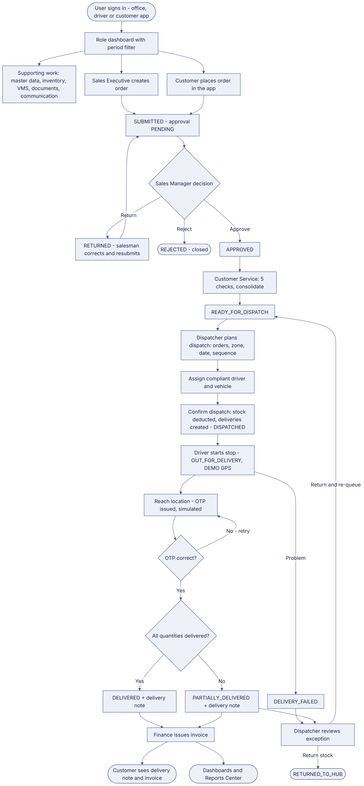{.diagram data-h="8d0ce67e1cd3"}

## 2.3 Swimlane — who does what

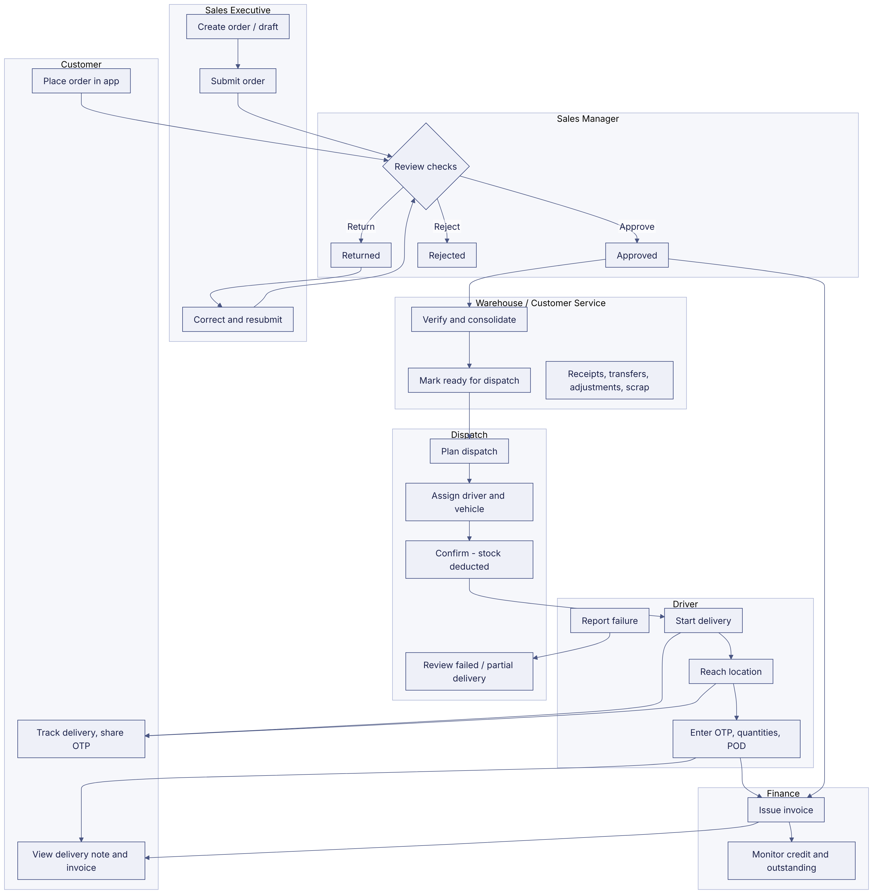{.diagram data-h="ce50f6c30a77"}

## 2.4 Stages, owners and system effects

| # | Stage | Owner role | Route | Service function | Resulting order status | Notifications |
|---|---|---|---|---|---|---|
| 1 | Create / save draft | Sales Executive, Administrator | `/orders/create` | `orderService.createOrder` | DRAFT | — |
| 2 | Submit | Sales Executive, Administrator, Customer (app) | `/orders/create`, `/customer/cart` | `orderService.submitOrder`, `customerAppService.placeCustomerOrder` | SUBMITTED (approval PENDING) | Sales Manager; event ORDER_CREATED |
| 3a | Approve | Sales Manager | `/orders/approval/:id` | `approvalService.approveOrder` | APPROVED (consolidation PENDING) | Customer Service, salesman; event ORDER_APPROVED |
| 3b | Return for correction | Sales Manager | `/orders/approval/:id` | `approvalService.returnOrderForCorrection` | RETURNED | Salesman (link to edit) |
| 3c | Reject | Sales Manager | `/orders/approval/:id` | `approvalService.rejectOrder` | REJECTED | Salesman; event ORDER_REJECTED |
| 4 | Consolidate | Customer Service | `/orders/consolidation/:id` | `consolidationService.consolidateOrder` | CONSOLIDATED | Dispatcher |
| 5 | Ready for dispatch | Customer Service | `/orders/consolidation/:id` | `consolidationService.markReadyForDispatch` | READY_FOR_DISPATCH | Dispatcher; event ORDER_READY |
| 6 | Plan dispatch | Dispatcher, Administrator | `/dispatch/create` | `dispatchService.createDispatch` | (order linked to dispatch) | — |
| 7 | Assign driver & vehicle | Dispatcher, Administrator | `/dispatch/assignments`, `/dispatch/:id` | `dispatchService.assignDispatch` | — | Driver; event DISPATCH_ASSIGNED |
| 8 | Confirm dispatch | Dispatcher, Administrator | `/dispatch/:id` | `dispatchService.confirmDispatch` | DISPATCHED | Driver, Administrator |
| 9 | Start delivery | Driver | `/driver/deliveries/:id` | `deliveryService.startDelivery` | OUT_FOR_DELIVERY | Customer, Dispatcher; event DELIVERY_STARTED |
| 10 | Reach location | Driver | `/driver/deliveries/:id` | `deliveryService.markArrived` | OUT_FOR_DELIVERY (arrivedAt set, OTP issued) | Customer sees OTP |
| 11a | Complete | Driver | `/driver/deliveries/:id/confirm` | `deliveryService.confirmDelivery` | DELIVERED or PARTIALLY_DELIVERED | Customer, Dispatcher; event DELIVERY_COMPLETED |
| 11b | Fail | Driver | `/driver/deliveries/:id` | `deliveryService.failDelivery` | DELIVERY_FAILED | Administrator, Dispatcher, customer; event DELIVERY_FAILED |
| 12 | Review exception | Dispatcher, Administrator | `/dispatch/deliveries/:id` | `deliveryService.reviewDelivery` | RETURNED_TO_HUB or READY_FOR_DISPATCH (re-queue) | — |
| 13 | Invoice | Finance, Administrator | `/invoices/create` | `invoiceService.generateInvoice` | (order unchanged; invoice ISSUED) | event INVOICE_GENERATED |

## 2.5 Supporting workflows

| Workflow | Owner | Chapter |
|---|---|---|
| Stock receipt, transfer, adjustment, movement ledger | Warehouse Manager, Inventory Executive, QA Manager (adjustments) | 10 |
| Scrap request → approval → write-off | Warehouse roles / Dispatcher (request); Warehouse Manager / Administrator (approve) | 07, 10 |
| Replenishment draft → approval → goods receipt | Warehouse / Inventory / Dispatcher (draft); Administrator (approve) | 07, 10 |
| Vehicle and driver compliance (VMS) | Administrator; Dispatcher views | 11 |
| Documents and OCR review | Uploaders; Customer Service, QA Manager, Administrator review | 13 |
| Email, WhatsApp, automated notifications, call log | Sales, CS, Dispatch, Finance, Administrator | 13 |
| Dashboards, reports, forecasting, AI assistant | All office roles (by permission) | 14 |
| Users, roles, permissions, settings, audit | Super Admin, Administrator | 04, 05 |

## 2.6 Key rules that hold across the whole flow

- **One step at a time.** Each service refuses an action when the record is not in the expected status (for example,
  a dispatch can only be confirmed when it is `ASSIGNED`; a delivery can only be completed when it is
  `OUT_FOR_DELIVERY`).
- **Permissions are checked twice** — the route (`ProtectedRoute` + `navigation.js` permission) and the service
  (`can(user, key)`), so a hidden button cannot be bypassed.
- **Stock moves exactly once.** Dispatch confirmation deducts stock once (`stockDeducted` flag); cancellation reverses
  it once (`stockReversed`); a reviewed exception returns stock once (`returnedToHub`); a scrap request writes off once.
- **Everything is traceable.** Orders have a timeline (`bellomassi_order_timeline`), dispatches have a timeline
  (`bellomassi_dispatch_timeline`), administrative changes go to the audit log (`bellomassi_audit_logs`) and user
  activity to `bellomassi_activities`.
- **Nothing is deleted after submission.** Only draft orders can be deleted; submitted orders are kept for the audit
  trail.

# 03 · Login-Wise Workflow {#ch-03}

**Status:** Implemented as a **browser-session simulation**. Passwords are stored as a demo FNV-1a hash in
`bellomassi_demo_users`; this is not production authentication.

## 3.1 Sign-in pages

| Page | Route | Component | Identifier accepted | Intended for |
|---|---|---|---|---|
| Office sign-in | `/login` | `pages/auth/Login.jsx` | Email or username | All office roles (any account works) |
| Driver app sign-in | `/driver/login` | `pages/auth/AppLogin.jsx` (driver variant) | Mobile number, email or username | Driver |
| Customer app sign-in | `/customer/login` | `pages/auth/AppLogin.jsx` (customer variant) | Mobile number, email or username | Customer |
| Forgot password | `/forgot-password` | `pages/auth/ForgotPassword.jsx` | Email or username | Everyone |
| Reset password | `/reset-password` | `pages/auth/ResetPassword.jsx` | 6-digit demo code | Everyone |
| Sign out | `/logout` | `logoutConfirm` page | — | Everyone |
| Unauthorized | `/unauthorized` | `Unauthorized` | — | Shown when a role opens a route it may not use |

If a non-driver signs in on `/driver/login` (or a non-customer on `/customer/login`), sign-in still succeeds; a toast
says *"This account is not a driver account — opening your own workspace"* and the user goes to their own landing page.

## 3.2 Demo accounts

All accounts are listed on the office login screen. Email = `<username>@bellomassi.demo`.

| Role | Username | Password | Landing page after sign-in |
|---|---|---|---|
| Super Admin | superadmin | Super@123 | `/dashboard` (Admin dashboard) |
| Administrator | admin | Admin@123 | `/dashboard` (Admin dashboard) |
| Sales Manager | manager | Manager@123 | `/dashboard` (Sales Manager dashboard) |
| Sales Executive | salesman | Sales@123 | `/dashboard` (Salesman dashboard) |
| Customer Service | cs | Cs@123 | `/dashboard` (Customer Service dashboard) |
| Warehouse Manager | warehouse | Warehouse@123 | `/dashboard` (Warehouse dashboard) |
| Inventory Executive | inventory | Inventory@123 | `/dashboard` (Inventory variant of Warehouse dashboard) |
| Dispatcher | dispatcher | Dispatch@123 | `/dashboard` (Dispatcher dashboard) |
| Driver | driver | Driver@123 (or mobile `+91 98400 11206`) | `/driver/dashboard` |
| Finance Executive | finance | Finance@123 | `/dashboard` (Finance dashboard) |
| QA Manager | qa | Quality@123 | `/dashboard` (QA dashboard) |
| Customer (portal) | customer | Customer@123 (or mobile `+91 98410 22310`) | `/customer/dashboard` |
| Supplier (portal) | supplier | Supplier@123 | `/dashboard` (Supplier portal dashboard) |

Landing pages come from the role record (`landingPath` in `bellomassi_roles`, seeded by `services/seed/adminSeed.js`:
DRIVER → `/driver/dashboard`, CUSTOMER → `/customer/dashboard`, all others → `/dashboard`). An Administrator can change a
role's landing page in Role Management to one of: Dashboard, Driver app — Today, Order list, Order approval, Dispatch
dashboard, Inventory dashboard, Notification center, Customer app — Home, Reports center (`LANDING_PAGES` in
`rbacCatalog.js`). A customer who opens `/dashboard` is redirected to `/customer/dashboard`.

## 3.3 Master flowchart 2 — Login-wise workflow

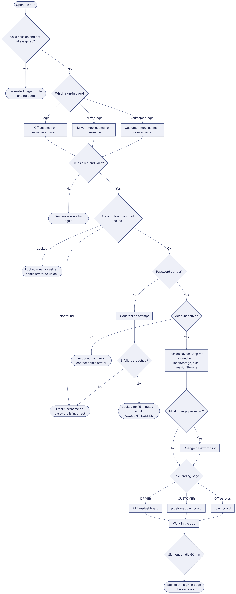{.diagram data-h="5bcc2e6598f6"}

## 3.4 Sign-in rules (from `services/authService.js`)

| Rule | Behaviour | Message |
|---|---|---|
| Empty identifier | Blocked | "Enter your email address or username." |
| Malformed email | Blocked | "Enter a valid email address." |
| Empty password | Blocked | "Enter your password." |
| Unknown account / wrong password | Blocked; failed attempt counted | "The email/username or password is incorrect. Use one of the demo accounts below." |
| Too many failures | Account locked (`maxFailedAttempts` 5, `lockoutMinutes` 15 by default — Application Settings › Security) | "Too many failed attempts. This account is locked for N minutes." |
| Locked account | Blocked until the lock expires or an administrator unlocks the user (`userService.unlockUser`) | "This account is temporarily locked after too many failed attempts…" |
| Inactive account | Blocked | "This account is inactive. Contact your administrator to reactivate it." |
| Forced password change | After an administrator reset (`forcePasswordChangeAfterReset`) the user must change password before any other page | Redirect to `/account/change-password?required=1` |
| Idle timeout | `components/layout/SessionWatcher.jsx` signs out after `sessionTimeoutMinutes` (default 60) of inactivity | Signed out (reason "timeout") |
| Remember me | "Keep me signed in" stores the session in localStorage; otherwise sessionStorage (closes with the tab). The last username can be remembered. | — |

Session data is stored under `bellomassi_session`; failed-attempt counters under `bellomassi_auth`.

## 3.5 Forgot / reset password (Simulated)

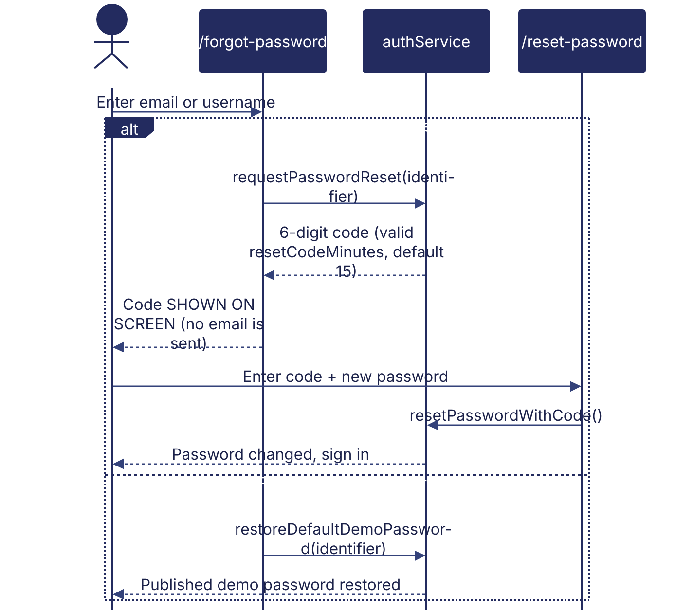{.diagram data-h="4ea6186fa308"}

Errors: "No demo account uses that email address or username.", "This account is inactive. Contact your administrator.",
"Enter the 6-digit code.", "This code is not valid. Request a new code.", "This code has expired. Request a new code.",
and for accounts created inside the app: "This account was created in the app and has no published demo password. Use a
reset code instead."

New passwords must follow the policy in Application Settings › Security (minimum length 8, mixed characters by default;
`authService.passwordPolicy`).

## 3.6 Sign-out

1. The user chooses **Sign Out** (header menu, sidebar, driver profile or customer profile) → `/logout` confirmation.
2. On confirm, the session is cleared and the user returns to the sign-in page of the app they were using
   (`signOutTarget`: driver pages → `/driver/login`, customer pages → `/customer/login`, otherwise `/login`).

## 3.7 Route protection

- `src/routes/ProtectedRoute.jsx` sends signed-out visitors to the right sign-in page and checks the page's permission
  from `navigation.js`. A signed-in user without the permission sees `/unauthorized`.
- Menus only show items the user's role may open (`SidebarNav` filters by permission), so most users never see the
  Unauthorized page.

# 04 · Role-Wise Workflow {#ch-04}

This chapter describes each of the 13 system roles. Menus were generated from `src/config/navigation.js` filtered by
each role's default permissions in `src/config/permissions.js` — they are exactly what the sidebar shows for the seeded
role. (An Administrator can change any non-locked role's permissions in Role Management; the menus then change too.)

Every office role also has: **Dashboard**, and under **My Account** — My Profile (`/profile`), Notification Center
(`/notifications`), Change Password (`/account/change-password`), Preferences (`/settings`) and Sign Out (`/logout`).
Every office dashboard has the **period filter** (chapter 14).

The flowchart below shows how work passes between roles.

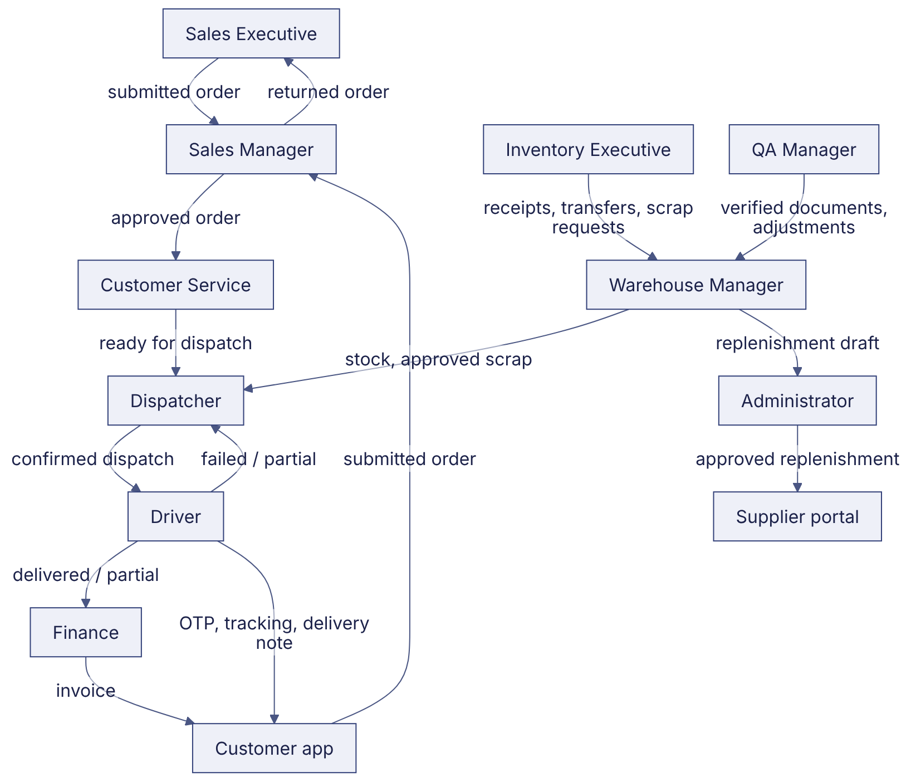{.diagram data-h="ceb83cfefe36"}

---

## 4.1 Super Admin

| Topic | Details |
|---|---|
| Purpose | Owner of the platform: every module, every role and setting. The only role that can grant, change, reset or delete Super Admin accounts. |
| Login | `/login` · **superadmin / Super@123** |
| Dashboard | `/dashboard` → `AdminDashboard` (Operations overview) |
| Menus | Everything the Administrator sees (4.2). Because Super Admin holds every permission key, the **My Deliveries** (driver app) and **My Account (Customer)** groups also appear; those pages show "No driver profile linked" / "No customer account linked" unless the user is linked to a driver or customer record. |
| KPIs | Total orders, Pending approval, Approved, Rejected, Consolidated, Ready for dispatch, Order pipeline; Operations overview: Sales (delivered, 30 days), Delivery (7 days), Inventory value, Finance — invoiced, Purchase (replenishment), AI insights |
| CRUD | All master data, users, roles, permissions, settings, organization, templates |
| Approvals | Orders, scrap, replenishment, documents (all permissions) |
| Reports | All 118 reports in the Reports Center; every module report |
| Notifications | Administrative and operational notifications addressed to ADMIN / SUPER_ADMIN |
| Daily workflow | Review dashboard → user and role administration → audit log → settings |
| Cannot do | Delete or deactivate their **own** account; remove their own access to user management |
| Next responsible user | Administrator (day-to-day administration) |
| Logout | Header menu › Sign Out → `/logout` → `/login` |

## 4.2 Administrator

| Topic | Details |
|---|---|
| Purpose | Runs the system day to day: administers users, roles and settings and can perform most business steps (create orders, plan and confirm dispatches, issue invoices, approve scrap and replenishment). |
| Login | `/login` · **admin / Admin@123** |
| Dashboard | `/dashboard` → `AdminDashboard` (same KPIs as Super Admin) |
| Menus | **Order Management:** Create Order, My Orders, Order List, Order Approval, Order Consolidation, Returned Orders, Rejected Orders, Order Reports · **Customers:** Customer List, Customer Credit · Products, Suppliers, Hubs · **Inventory:** Inventory Dashboard, Warehouse Dashboard, QA & Cold Chain, Stock Overview, Low Stock, Stock Receipts, Stock Transfers, Stock Adjustments, Stock Movements, Scrap Management · **Dispatch:** Dispatch Dashboard, Ready for Dispatch, Dispatch Planning, Driver Assignment, Delivery Tracking, Delivery History, Dispatch Zones, Drivers, Vehicles, Delivery Reports, Live Tracking (Demo GPS) · **Vehicle Management:** VMS Dashboard, Vehicles, Driver Documents, Document Expiry, VMS Reports, Compliance Rules · **Documents:** Document Repository, Upload Documents, OCR Queue, Verified, Rejected, Document Types, Document Reports · **Invoices:** Invoice Dashboard, Invoices, New Invoice, Invoice Templates, Invoice Reports · **Communication:** Communication Center, Email, WhatsApp, Automated Notifications, Call History, Call Follow-ups · **Administration:** User Management, Role Management, Permission Matrix, User Role Assignment, Audit Log, Application Settings · **Organization:** Company, Branches, Business Units, Departments, Designations, Employee Master, Warehouse Master · **AI & Intelligence:** AI Overview, AI Assistant, Jarvis, Forecasting, Predictive Inventory, Replenishment, AI Insights, Model Management, AI Settings · **Reports:** Reports Center |
| CRUD | Customers, products, suppliers, hubs, zones, drivers, vehicles, document types, invoice templates, email/WhatsApp templates, users, roles, organization records |
| Approvals | Scrap (`scrap.approve`), replenishment (`procurement.approve` / `procurement.reject` — **only** Administrator and Super Admin hold these), documents (`documents.review`, `documents.reject`). **Not** order approval or consolidation: the Administrator can open the Order Approval and Consolidation queues but `orders.approve`, `orders.reject` and `orders.consolidate` are not granted by default (Super Admin holds them). |
| Reports | All report categories |
| Notifications | Failed deliveries, dispatch confirmations, document expiry, low stock, purchase approvals |
| Daily workflow | Check dashboard → approve replenishment drafts → handle user requests (unlock, reset password) → review audit log → adjust settings |
| Cannot do | Change or delete a Super Admin account; change the Administrator role unless they are Administrator or Super Admin |
| Next responsible user | Depends on the module (e.g. approved replenishment → Supplier / warehouse goods receipt) |
| Logout | `/logout` → `/login` |

## 4.3 Sales Executive (SALESMAN)

| Topic | Details |
|---|---|
| Purpose | Takes orders for the customers assigned to them and keeps them moving through approval. |
| Login | `/login` · **salesman / Sales@123** |
| Dashboard | `SalesmanDashboard`: My orders, Draft orders, Pending approval, Approved orders, Returned orders, Rejected orders, Needs your action, My order trend, My recent orders |
| Menus | **Order Management:** Create Order, My Orders, Order List, Returned Orders, Rejected Orders · **Customers:** Customer List · Products · **Inventory:** Stock Overview · **Documents:** Repository, Upload, OCR Queue, Verified, Rejected · **Communication:** Communication Center, Email, WhatsApp, Call History, Call Follow-ups · **AI:** AI Overview, AI Assistant, Jarvis · Reports Center |
| Data scope | Own records only (orders where `salesmanId` or `createdBy` is the user) |
| CRUD | Create, edit and delete **draft** orders; duplicate an order; edit and resubmit **returned** orders; log, edit and delete own calls; upload documents for own records |
| Approvals | None (submits for approval) |
| Reports | Reports Center — only categories their permissions allow (Customer reports via `customers.view`, Communication reports via `communication.calls`) |
| Notifications | Order submitted / approved / returned (with link to edit) / rejected / ready for dispatch |
| Daily workflow | Dashboard "Needs your action" → fix returned orders → create today's orders (or from a call) → submit → follow up calls → check approvals |
| Cannot do | Approve or reject orders; consolidate; dispatch; invoice; see other salesmen's orders; delete a submitted order ("Only draft orders can be deleted") |
| Next responsible user | **Sales Manager** (approval) |
| Logout | `/logout` → `/login` |

## 4.4 Sales Manager

| Topic | Details |
|---|---|
| Purpose | Approves, returns or rejects submitted orders after checking credit, stock and data quality; watches sales performance. |
| Login | `/login` · **manager / Manager@123** |
| Dashboard | `SalesManagerDashboard`: Pending approvals, Returned orders, Recent pending orders (oldest first), Active accounts and credit position |
| Menus | **Order Management:** Order List, Order Approval, Returned Orders, Rejected Orders, Order Reports · **Customers:** Customer List, Customer Credit · Products, Suppliers, Hubs · **Inventory:** Stock Overview, Low Stock · **Dispatch:** Dispatch Dashboard, Dispatch Planning, Delivery Tracking, Delivery History · **Documents** (5 pages) · **Invoices:** Invoice Dashboard, Invoices · **Communication:** Center, Email, WhatsApp, Call History, Call Follow-ups · **AI:** AI Overview, AI Assistant, Jarvis, Forecasting, Predictive Inventory, Replenishment, AI Insights, Model Management · Reports Center |
| Data scope | All submitted and later orders (not other users' drafts) |
| CRUD | Sales targets (`sales.targets.manage`); calls; documents upload; forecasts (generate / export) |
| Approvals | **Order approval** — Approve (`orders.approve`), Return for correction and Reject (`orders.reject`) |
| Reports | Sales, Inventory, Procurement, Dispatch & Delivery (history), Customer, Supplier, Communication, AI categories |
| Notifications | "New order for approval", "Order resubmitted" (with credit / stock warning flags) |
| Daily workflow | Order Approval queue (oldest first) → open each order → read approval checks → approve / return / reject → check returned orders → review credit position and reports |
| Cannot do | Create orders; consolidate; plan or confirm dispatches; issue invoices; manage master data |
| Next responsible user | **Customer Service** (approved) or **Sales Executive** (returned) |
| Logout | `/logout` → `/login` |

## 4.5 Customer Service

| Topic | Details |
|---|---|
| Purpose | Verifies approved orders against the warehouse, consolidates them and releases them to dispatch; reviews documents. |
| Login | `/login` · **cs / Cs@123** |
| Dashboard | `CustomerServiceDashboard`: Approved orders, Awaiting consolidation, Consolidated orders, Ready for dispatch, Approved orders by stage, Queue by salesman, Consolidation queue (oldest approval first), Recent approved orders |
| Menus | **Order Management:** Order List, Order Consolidation · Customer List · Products, Hubs · **Inventory:** Stock Overview, Low Stock · **Dispatch:** Dispatch Dashboard, Ready for Dispatch, Dispatch Planning, Delivery Tracking, Delivery History · **Documents:** Repository, Upload, OCR Queue, Verified, Rejected, Document Reports · **Communication:** Center, Email, WhatsApp, Call History, Call Follow-ups · **AI:** AI Overview, AI Assistant, Jarvis, AI Insights · Reports Center |
| Data scope | Orders from approval onwards; all documents |
| CRUD | Consolidation records; calls; documents (upload, review, reject); VMS document upload |
| Approvals | Consolidation (5-point verification); **document review** (verify / reject) |
| Reports | Customer, Communication, Dispatch & Delivery (where permitted) |
| Notifications | "Order awaiting consolidation" after each approval |
| Daily workflow | Consolidation queue → open order → tick the 5 checks, review hub stock → Consolidate → Mark ready for dispatch → OCR queue / document review → customer calls |
| Cannot do | Approve or reject orders; create dispatches; assign drivers; confirm dispatch; issue invoices |
| Next responsible user | **Dispatcher** |
| Logout | `/logout` → `/login` |

## 4.6 Dispatcher

| Topic | Details |
|---|---|
| Purpose | Plans dispatches from ready orders, assigns compliant drivers and vehicles, confirms loading (stock deduction), follows deliveries and resolves exceptions. |
| Login | `/login` · **dispatcher / Dispatch@123** |
| Dashboard | `DispatcherDashboard` / `DispatchOverview`: Ready for dispatch, Planned dispatches, Assigned dispatches, Confirmed dispatches, In transit, Completed deliveries, Failed deliveries, Partial deliveries, Active drivers, Available vehicles; charts: Dispatch trend, Delivery completion trend, Delivery status distribution, Driver performance, Zone delivery performance; tables: Recent dispatches, In-transit deliveries |
| Menus | Order List · Products, Suppliers, Hubs · **Inventory:** Inventory Dashboard, Stock Overview, Low Stock, Stock Receipts, Stock Transfers, Stock Adjustments, Stock Movements, Scrap Management · **Dispatch:** all 11 pages including Live Tracking (Demo GPS) · **VMS:** Dashboard, Vehicles, Driver Documents, Document Expiry, VMS Reports · **Documents** (5) · **Communication:** Center, Email, WhatsApp · **AI:** AI Overview, Assistant, Jarvis, Forecasting, Predictive Inventory, Replenishment, AI Insights, Model Management · Reports Center |
| Data scope | Orders from consolidation onwards; fleet and hub documents |
| CRUD | Dispatches (create, edit while DRAFT/PLANNED/ASSIGNED, cancel), delivery sequence; scrap requests (create); replenishment drafts (create); documents upload. Drivers, vehicles and zones are **view-only** for the Dispatcher (`fleet.manage` is Administrator only). |
| Approvals | Confirms dispatch (loading check); reviews failed / partial deliveries; can inspect delivery OTPs (`dispatch.otp.inspect`) |
| Reports | Dispatch & Delivery, Fleet, Inventory-related (where permitted), Procurement, AI |
| Notifications | "Ready for dispatch: …", "Delivery failed: … Review required", dispatch confirmations, document expiry |
| Daily workflow | Ready for Dispatch → New Dispatch (orders, zone, date, sequence) → assign driver & vehicle → confirm (tick review) → Live Tracking → review failed / partial stops → re-queue or return stock |
| Cannot do | Approve orders; consolidate; issue invoices; create or edit drivers / vehicles / zones; approve scrap or replenishment |
| Next responsible user | **Driver**; for exceptions, the Dispatcher again |
| Logout | `/logout` → `/login` |

## 4.7 Driver

| Topic | Details |
|---|---|
| Purpose | Delivers the stops of their confirmed dispatch in sequence and records proof of delivery. |
| Login | `/driver/login` · **driver / Driver@123** or mobile **+91 98400 11206** (also works on `/login`) |
| Dashboard | `/driver/dashboard` (Today) — period filter defaults to **Today**; Pending / Completed stops, Today / Tomorrow plan ("Published by the Dispatcher"), next stop, driver performance |
| Menus (bottom bar) | Today, My Deliveries, Route, Completed, My Delivery Notes, Driver Profile, My Documents |
| Data scope | Own dispatches, deliveries and documents only — another driver's delivery shows "Access denied" |
| CRUD | Upload own documents (`documents.upload`); delivery notes are generated automatically |
| Approvals | None |
| Actions | Start delivery → Reach location → Enter OTP & complete (quantities, receiver, photo/signature) → or Report issue / mark failed |
| Reports | Driver performance on the Today screen only |
| Notifications | New dispatch assigned, dispatch confirmed ("Start your first delivery when you leave the hub"), sequence updated, removed from dispatch, dispatch cancelled |
| Daily workflow | See chapter 08 |
| Cannot do | Start a stop out of sequence, start a future-dated dispatch, start before the Dispatcher confirms, complete without the correct OTP, restart a closed stop, see office modules |
| Next responsible user | **Customer** (receives goods), **Finance** (invoice), **Dispatcher** (exceptions) |
| Logout | Driver Profile › Sign Out → `/driver/login` |

## 4.8 Finance Executive

| Topic | Details |
|---|---|
| Purpose | Issues and cancels customer invoices, manages invoice templates and numbering, watches credit exposure. |
| Login | `/login` · **finance / Finance@123** |
| Dashboard | `FinanceDashboard`: Order value (submitted), Approved order value, Delivered to invoice, Invoices issued, Collections, Outstanding (customer balances), Credit exposure, Credit utilisation, Over credit limit, Order value overview |
| Menus | Order List, Order Reports · Customer Credit · Products, Suppliers · Inventory Dashboard, Stock Overview · **Dispatch:** Dispatch Dashboard, Dispatch Planning, Delivery History, Delivery Reports · **Documents** (5) · **Invoices:** Invoice Dashboard, Invoices, New Invoice, Invoice Templates, Invoice Reports · **Communication:** Center, Email, WhatsApp · **AI:** AI Overview, Assistant, Jarvis, Forecasting, Predictive Inventory, Replenishment, AI Insights, Model Management · Reports Center |
| Data scope | All non-draft orders; invoices, customers, vendor documents |
| CRUD | Invoices (issue, cancel), invoice templates, invoice numbering settings; email invoice (demo) |
| Approvals | None in the order flow; replenishment approval is **not** granted to Finance by default |
| Reports | Finance, Sales, Dispatch & Delivery, Inventory, Procurement, Supplier, AI |
| Notifications | Invoice generated; purchase approval information |
| Daily workflow | Invoice Dashboard → New Invoice for delivered / approved orders → print or email → review outstanding and credit utilisation → reports |
| Cannot do | Record payments, credit notes or refunds (**Not Implemented**); change a customer's credit balance (Customer master is Administrator only); approve orders |
| Next responsible user | **Customer** (receives invoice) |
| Logout | `/logout` → `/login` |

## 4.9 Warehouse Manager

| Topic | Details |
|---|---|
| Purpose | Owns hub stock: receipts, transfers, adjustments, scrap approval, picking & loading view, document expiry. |
| Login | `/login` · **warehouse / Warehouse@123** |
| Dashboard | `WarehouseDashboard`: Stock value, Low / out of stock, Damaged / held, Expiry, Inventory alerts, Picking & loading (consolidated and ready orders at the hub), Current stock (lowest available first), vehicle & driver documents expired or due |
| Menus | Order List · Products, Suppliers, Hubs · **Inventory:** all 10 pages incl. Warehouse Dashboard and QA & Cold Chain · **Dispatch:** Dashboard, Ready for Dispatch, Dispatch Planning, Delivery History · **Documents** (5) · **AI:** Overview, Assistant, Jarvis, Forecasting, Predictive Inventory, Replenishment, AI Insights, Model Management · Reports Center |
| CRUD | Stock receipts, transfers, adjustments, min/max/reorder levels, scrap requests, replenishment drafts |
| Approvals | **Scrap requests** (approve / reject / post write-off) — not their own requests |
| Reports | Inventory, Procurement, Scrap, Dispatch & Delivery history, Supplier, AI |
| Notifications | Low stock alert, scrap requests pending approval, purchase approval information |
| Daily workflow | Inventory alerts → receive goods (Stock Receipt, incl. replenishment receipts) → transfers between hubs → approve scrap → check picking list for today's dispatches |
| Cannot do | Approve orders; dispatch; approve replenishment (Administrator only); manage products or hubs master data |
| Next responsible user | **Dispatcher** (stock ready for loading); **Administrator** (replenishment approval) |
| Logout | `/logout` → `/login` |

## 4.10 Inventory Executive

| Topic | Details |
|---|---|
| Purpose | Day-to-day stock transactions at the hub. |
| Login | `/login` · **inventory / Inventory@123** |
| Dashboard | Warehouse dashboard in **inventory** variant (`InventoryDashboardForRole`) |
| Menus | Products, Hubs · **Inventory:** Inventory Dashboard, Warehouse Dashboard, Stock Overview, Low Stock, Stock Receipts, Stock Transfers, Stock Adjustments (view), Stock Movements, Scrap Management · **Documents** (5) · **AI:** AI Overview, AI Assistant, Replenishment · Reports Center |
| CRUD | Stock receipts, stock transfers, scrap requests, replenishment drafts. **No** stock adjustments (`inventory.adjustments.manage` not granted). |
| Approvals | None |
| Reports | Reports Center categories allowed by permissions (Procurement, Scrap) |
| Daily workflow | Receive goods → complete transfers → raise scrap requests with photos → draft replenishment from low stock |
| Cannot do | Approve scrap; post adjustments; approve replenishment; see orders or dispatch |
| Next responsible user | **Warehouse Manager** (scrap approval), **Administrator** (replenishment) |
| Logout | `/logout` → `/login` |

## 4.11 QA Manager

| Topic | Details |
|---|---|
| Purpose | Quality and cold chain: document verification, expiry, quarantine (damaged stock), adjustments. |
| Login | `/login` · **qa / Quality@123** |
| Dashboard | `QaDashboard`: Inspections pending, Inspection queue (documents waiting for OCR review and verification), Quarantine (damaged stock), Expired documents, Expiry (vehicle & driver documents), **Cold chain & temperature alerts — "No sensor integration", "No live readings"** |
| Menus | Products, Hubs · **Inventory:** Warehouse Dashboard, QA & Cold Chain, Stock Overview, Low Stock, Stock Receipts, Stock Transfers, Stock Adjustments, Stock Movements, Scrap Management · **VMS:** Dashboard, Vehicles, Driver Documents, Document Expiry, VMS Reports · **Documents:** 5 pages + Document Reports · **AI:** Overview, Assistant, AI Insights · Reports Center |
| CRUD | Stock adjustments (e.g. damaged, expired), scrap requests, documents (upload, review, reject) |
| Approvals | Document verification / rejection |
| Reports | Scrap, AI, Fleet (via `vms.view`) |
| Daily workflow | Inspection queue → verify / reject documents → check expiries → adjust damaged stock → raise scrap |
| Cannot do | Approve scrap (unless granted); create receipts or transfers; dispatch; invoice |
| Next responsible user | **Warehouse Manager** (scrap approval) |
| Logout | `/logout` → `/login` |

## 4.12 Customer (portal / customer app)

| Topic | Details |
|---|---|
| Purpose | A customer's staff orders products, tracks deliveries, shares the OTP and downloads delivery notes and invoices. |
| Login | `/customer/login` · **customer / Customer@123** or mobile **+91 98410 22310** |
| Dashboard | `/customer/dashboard` (Home): Active orders, Pending approval, Delivered, Outstanding (current); "Your delivery is on the way" card with DEMO GPS; recent orders, delivery notes, notifications |
| Menus (bottom bar) | Home, Catalog, Cart, My Orders, Delivery Notes, Invoices, Payments, Profile |
| Data scope | One linked customer (`user.customerId`) |
| CRUD | Cart (add, change quantity, remove); place order; re-order to cart |
| Approvals | None — orders go to the Sales Manager |
| Reports | None |
| Notifications | Order placed, approved, out for delivery, delivered, delivery not completed |
| Daily workflow | See chapter 09 |
| Cannot do | Cancel a placed order (Not Implemented); pay online or see payment history (Not Implemented — "No payments recorded in this prototype"); see other customers' data |
| Next responsible user | **Sales Manager** |
| Logout | Profile › Sign Out → `/customer/login` |

## 4.13 Supplier (portal)

| Topic | Details |
|---|---|
| Purpose | Shows a supplier the replenishment (purchase) requests Bellomassi has approved for them and the goods receipts posted. |
| Login | `/login` · **supplier / Supplier@123** |
| Dashboard | `SupplierPortalDashboard`: Open purchase requests, Approved replenishment (newest first), Lines requested, Lead time, Goods receipts |
| Menus | Dashboard and My Account only (permission `dashboard.view` only) |
| Data scope | One linked supplier |
| CRUD / approvals | None — **read-only** |
| Cannot do | Accept or reject requests, submit invoices, update delivery dates (**Not Implemented**) |
| Next responsible user | Warehouse Manager / Inventory Executive (goods receipt) |
| Logout | `/logout` → `/login` |

## 4.14 Custom roles

Administrators can create roles in **Role Management** (`/admin/roles/create`, `rbacService`). A custom role gets a
name, data scope, landing page and any set of permission keys. Its dashboard is the permission-driven
**workspace launcher** (`GenericDashboard` — "Your workspace" / "No modules assigned yet"), never another role's KPIs.
Status: **Implemented**.

# 05 · Module-Wise Workflow {#ch-05}

Each module is described with the same 17 headings: **Purpose · Roles · Entry point · Screens · Preconditions · Steps ·
Actions · System behaviour · Validation · Decisions · Approval · Rejection · Status transitions · Related modules ·
Output · Exceptions · Flowchart.** "—" means the heading does not apply to that module.

Status labels follow the legend in the README.

## Module index

| # | Module | Status |
|---|---|---|
| 5.1 | Authentication & session | Implemented (simulated security) |
| 5.2 | Role dashboards | Implemented |
| 5.3 | Products | Implemented |
| 5.4 | Customers & credit | Implemented / credit Partially Implemented |
| 5.5 | Hubs | Implemented |
| 5.6 | Suppliers | Implemented |
| 5.7 | Order capture (create, draft, submit, resubmit) | Implemented |
| 5.8 | Order approval | Implemented |
| 5.9 | Order consolidation | Implemented |
| 5.10 | Inventory (stock, receipts, transfers, adjustments, movements, low stock) | Implemented |
| 5.11 | Scrap management | Implemented |
| 5.12 | Warehouse dashboard and QA & cold chain | Implemented (temperature monitoring Not Implemented) |
| 5.13 | Dispatch planning, assignment and confirmation | Implemented |
| 5.14 | Delivery tracking, live tracking and exception review | Implemented / GPS Simulated |
| 5.15 | Driver app | Implemented (GPS and OTP Simulated) |
| 5.16 | Delivery notes, OTP and proof of delivery | Implemented / OTP Simulated |
| 5.17 | Customer app | Implemented (payments Not Implemented) |
| 5.18 | Fleet master — zones, drivers, vehicles | Implemented |
| 5.19 | Vehicle Management System (VMS) | Implemented |
| 5.20 | Documents and OCR | Implemented / OCR Simulated |
| 5.21 | Invoices and invoice templates | Implemented (demo tax) |
| 5.22 | Email | Simulated (gateway Not Verified) |
| 5.23 | WhatsApp (OpenWA) | Simulated (gateway Not Verified) |
| 5.24 | Automated notifications | Implemented over simulated channels |
| 5.25 | Call history | Implemented (no telephony) |
| 5.26 | Notification center | Implemented |
| 5.27 | Reports Center | Implemented (24 of 118 reports have no source data) |
| 5.28 | AI Assistant and Jarvis | Simulated |
| 5.29 | Forecasting, predictive inventory and model management | Implemented (in-browser models) |
| 5.30 | Replenishment | Implemented (ends at goods receipt) |
| 5.31 | AI insights | Implemented (rule-based) |
| 5.32 | Users, roles and permissions | Implemented |
| 5.33 | Audit log | Implemented |
| 5.34 | Application settings | Implemented |
| 5.35 | Organization | Implemented |
| 5.36 | My account (profile, password, preferences) | Implemented |

---

## 5.1 Authentication & session

| Heading | Details |
|---|---|
| Purpose | Identify the user, open their workspace and protect pages by permission. |
| Roles | All |
| Entry point | `/login`, `/driver/login`, `/customer/login` |
| Screens | Login, Driver login, Customer login, Forgot password, Reset password, Change password, Sign out, Unauthorized |
| Preconditions | Account exists in `bellomassi_demo_users` and is active |
| Steps | Enter identifier and password → sign in → (change password if required) → landing page |
| Actions | Sign in, Keep me signed in, Remember username, Forgot password, Reset with code, Restore demo password, Sign out |
| System behaviour | `authService.login` checks lock, password hash, status; writes `bellomassi_session`; `SessionWatcher` signs out after idle timeout |
| Validation | Identifier and password required; valid email format; password policy on change |
| Decisions | Locked? Active? Must change password? Which landing page? |
| Approval | — |
| Rejection | Wrong credentials, locked, inactive (messages in chapter 03) |
| Status transitions | Signed out → Signed in → (Idle-expired / Signed out) |
| Related modules | Users (unlock, reset password), Application settings › Security, Audit log (ACCOUNT_LOCKED) |
| Output | Session; landing page |
| Exceptions | Lockout after 5 failures for 15 minutes (defaults) |
| Flowchart | Chapter 03, master flowchart 2 |

## 5.2 Role dashboards

| Heading | Details |
|---|---|
| Purpose | One screen per role with the KPIs and queues that role acts on. |
| Roles | All (`dashboard.view`) |
| Entry point | `/dashboard` (`pages/dashboard/Dashboard.jsx` → `RoleDashboard.jsx`), `/driver/dashboard`, `/customer/dashboard` |
| Screens | Admin, Salesman, Sales Manager, Customer Service, Dispatcher, Finance, Warehouse (and Inventory variant), QA, Customer portal, Supplier portal, Driver Today, Customer Home, Generic workspace launcher |
| Preconditions | Signed in |
| Steps | Open dashboard → choose period → (optional) Compare → click a KPI or queue row to drill into the module |
| Actions | Period select, custom date range, specific period, compare toggle, reset |
| System behaviour | Dated collections are narrowed to the period on their business date (`utils/dashboardFilter.js`) and passed to the existing calculations; current positions are labelled **Current** |
| Validation | Custom range: start after end / missing / invalid dates show a message |
| Decisions | — |
| Approval / Rejection | — |
| Status transitions | — |
| Related modules | Every module (drill-down links) |
| Output | KPIs, charts, queues |
| Exceptions | Custom roles without dated data show the launcher without a filter |
| Flowchart | Chapter 14 |

## 5.3 Products

| Heading | Details |
|---|---|
| Purpose | Product master: code, SKU, barcode, category, unit, price, tax, discount limit, storage condition (Frozen / Chilled / Ambient), stock levels, batch control. |
| Roles | View: most office roles (`products.view`); manage: Administrator (`products.manage`) |
| Entry point | `/products` |
| Screens | Product list, Add product (`/products/create`), Product details (`/products/:id`), Edit product |
| Preconditions | — |
| Steps | Add product → fill sections → save; edit or delete later |
| Actions | Create, edit, delete, search, filter, export |
| System behaviour | `productService.createProduct/updateProduct/deleteProduct` → `bellomassi_products` |
| Validation | Code 3–20 letters/numbers/hyphens, unique; unique SKU and barcode (8–14 digits); category, status, unit, product type required; tax 0–100; max discount 0–100%; maximum stock greater than minimum |
| Decisions | Track inventory? Allow negative stock? Batch-controlled? |
| Approval / Rejection | — |
| Status transitions | Active ↔ Inactive (inactive products block order approval: "Products active" check) |
| Related modules | Orders, inventory, invoices, customer catalog, forecasting |
| Output | Product record |
| Exceptions | Delete is blocked when the product is referenced (`getProductDeleteBlockers`) |
| Flowchart | see below |

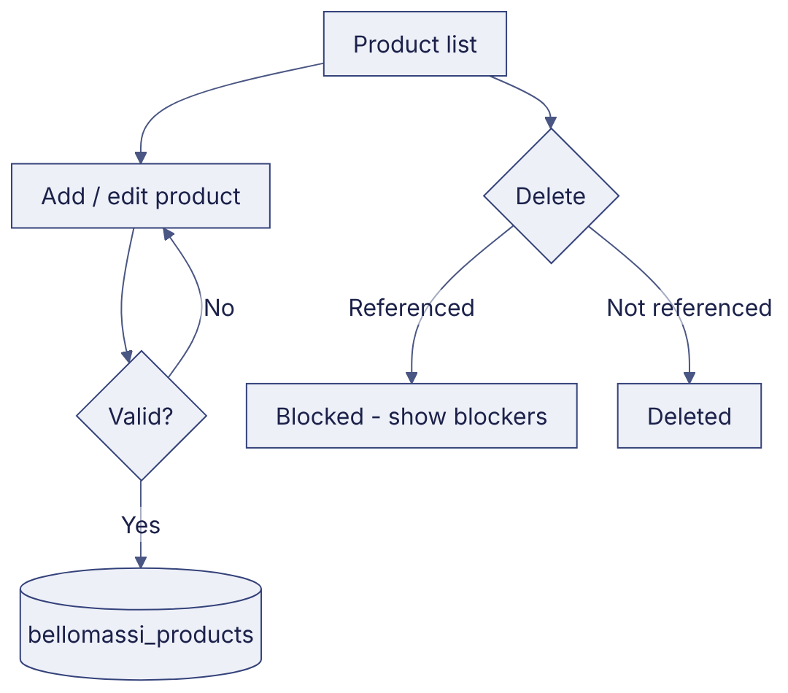{.diagram data-h="85bcedfcd0e3"}

## 5.4 Customers & credit

| Heading | Details |
|---|---|
| Purpose | Customer master (type, contacts, address, GST/PAN, hub, zone, sales rep, VIP) and credit settings (enabled, limit, balance, days). |
| Roles | View: Administrator, Sales Executive (own), Sales Manager, Customer Service; manage: Administrator; Customer Credit: Administrator, Sales Manager, Finance |
| Entry point | `/customers`, `/customers/credit` |
| Screens | Customer list, Add / Edit customer, Customer details (orders, documents, credit), Customer Credit |
| Preconditions | Hub and zone exist |
| Steps | Add customer → save → (optional) link a portal user to the customer in User Management |
| Actions | Create, edit, delete, search, view credit position |
| System behaviour | `customerService` → `bellomassi_customers`; `getOrderCreditPosition` calculates projected balance for each order |
| Validation | Code 3–20 characters, unique; type and status required; 10-digit Indian mobile; email; PAN `AAAAA9999A`; GSTIN 15 characters containing the PAN; 6-digit pincode; customer-since not in future; credit days whole number; credit balance non-negative |
| Decisions | Credit enabled? Credit limit exceeded (warning or block per settings)? |
| Approval / Rejection | — |
| Status transitions | Active / Inactive / other statuses from `CUSTOMER_STATUSES`; only **Active** customers pass order approval |
| Related modules | Orders, approval (credit check), invoices, customer app, reports |
| Output | Customer record, credit position |
| Exceptions | **Partially Implemented:** the credit balance is a field maintained on the customer record; issuing invoices and recording deliveries do **not** change it, and payments cannot be recorded |
| Flowchart | see below |

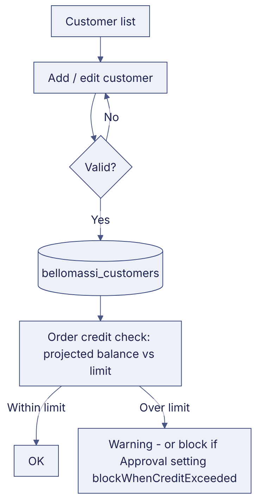{.diagram data-h="f81cfa73e914"}

## 5.5 Hubs

| Heading | Details |
|---|---|
| Purpose | Fulfilment locations (Main, Regional, Branch, Distribution hub, Warehouse) that hold stock and run dispatches. |
| Roles | View: most office roles; manage: Administrator |
| Entry point | `/hubs` (also `/admin/organization/hubs`) |
| Screens | Hub list, Add / Edit hub, Hub details (stock, zones, vehicles) |
| Preconditions | — |
| Steps | Add hub → save |
| Actions | Create, edit, delete |
| System behaviour | `hubService` → `bellomassi_hubs` |
| Validation | Code 2–6 letters/numbers, unique; unique name; type and status required; phone, email, 6-digit pincode |
| Decisions | Active or Inactive |
| Approval / Rejection | — |
| Status transitions | Active ↔ Inactive (inactive hubs cannot receive stock and block order approval) |
| Related modules | Inventory, orders, dispatch, zones, drivers, vehicles |
| Output | Hub record |
| Exceptions | Delete blocked when referenced (`getHubDeleteBlockers`) |
| Flowchart | `Hub list → Add/Edit → validate → bellomassi_hubs` (same pattern as 5.3) |

## 5.6 Suppliers

| Heading | Details |
|---|---|
| Purpose | Suppliers used in replenishment (lead time, products) and the supplier portal. |
| Roles | View: Administrator, Sales Manager, Dispatcher, Finance, Warehouse Manager; manage: Administrator |
| Entry point | `/suppliers` |
| Screens | Supplier list (create / edit in place) |
| Preconditions | — |
| Steps | Add or edit supplier → save |
| Actions | Create, edit |
| System behaviour | `supplierService.saveSupplier` → stored inside `bellomassi_forecast_settings.suppliers` |
| Validation | Required fields on the supplier form |
| Decisions / Approval / Rejection | — |
| Status transitions | — |
| Related modules | Replenishment, supplier portal, procurement reports |
| Output | Supplier record |
| Exceptions | Supplier invoices and payments are **Not Implemented** |
| Flowchart | `Supplier list → edit → bellomassi_forecast_settings` |

## 5.7 Order capture (create, draft, submit, resubmit)

| Heading | Details |
|---|---|
| Purpose | Record what a customer wants, priced with tax and discounts, and send it for approval. |
| Roles | Sales Executive, Administrator (`orders.create`); Customer via customer app |
| Entry point | `/orders/create`; `/orders/:id/edit`; `/orders/my-orders`; `/orders/returned` |
| Screens | Create / Edit order form (customer, hub, type, priority, payment terms, dates, address, lines), My Orders, Order List, Order Details (timeline), Returned Orders, Rejected Orders |
| Preconditions | Active customer, active hub, active products |
| Steps | Choose customer (address and hub default from customer) → add lines → review totals and warnings → **Save draft** or **Submit** |
| Actions | Save draft, submit, edit draft, delete draft, duplicate, resubmit after return |
| System behaviour | `orderService.createOrder` (DRAFT), `submitOrder` (number assigned from `bellomassi_order_sequence`, SUBMITTED + approval PENDING, credit/stock warning flags, timeline event, notifications to Sales Manager and salesman, event ORDER_CREATED); `resubmitOrder` after a return |
| Validation | "Select a customer.", "Assign a salesman.", "Select the fulfilment hub.", order type, priority, payment terms; order date valid and not in future; requested delivery date required and not before order date; address, city, state required; 6-digit pincode; "Add at least one product."; "Order total must be greater than zero." |
| Decisions | Save as draft or submit; credit / stock warnings are shown but do not block submission |
| Approval | Goes to 5.8 |
| Rejection | — (see 5.8) |
| Status transitions | (new) → DRAFT → SUBMITTED; RETURNED → SUBMITTED (resubmit) |
| Related modules | Customers, products, inventory (stock check), approval, call history (link order to call), customer app |
| Output | Order record in `bellomassi_orders`, timeline in `bellomassi_order_timeline` |
| Exceptions | "Only draft orders can be deleted. Submitted orders are kept for the audit trail."; "You can only delete your own drafts." Cancelling a submitted order is **Not Implemented** |
| Flowchart | see chapter 06 |

## 5.8 Order approval

| Heading | Details |
|---|---|
| Purpose | Sales Manager decides each submitted order. |
| Roles | Sales Manager (`orders.approve`, `orders.reject`); Super Admin (all keys). Administrator can view the queue (`orders.approval.view`) but not decide by default |
| Entry point | `/orders/approval` → `/orders/approval/:id` |
| Screens | Approval queue (oldest first), Review order (checks, lines, credit, history, decision panel) |
| Preconditions | Order SUBMITTED with approval PENDING |
| Steps | Open order → read the six checks → approve (with remarks and warning acknowledgement), or return / reject with reason and remarks |
| Actions | Approve, Return for correction, Reject |
| System behaviour | `approvalService.approveOrder / returnOrderForCorrection / rejectOrder` write the order, an approval record (`bellomassi_approvals`) and a timeline event in one transaction; notifications and automation events |
| Validation | Blocking checks (customer active, hub active, order total valid, products active, credit when `blockWhenCreditExceeded` is on); warnings (stock, credit) need acknowledgement; remarks required if setting `requireApprovalRemarks`; reject / return need a reason from the list and remarks |
| Decisions | Approve / Return / Reject |
| Approval | APPROVED, consolidation PENDING |
| Rejection | REJECTED (final) or RETURNED (back to the salesman) |
| Status transitions | SUBMITTED → APPROVED / RETURNED / REJECTED |
| Related modules | Order capture, consolidation, customers (credit), inventory (stock) |
| Output | Decision record, notifications |
| Exceptions | Draft orders cannot be decided; already-decided orders show "has already been approved / rejected / returned. No change was made." |
| Flowchart | Chapter 07, master flowchart 4 |

## 5.9 Order consolidation

| Heading | Details |
|---|---|
| Purpose | Customer Service verifies an approved order against the hub and releases it to dispatch. |
| Roles | Customer Service (`orders.consolidate`); view queue: Administrator, Customer Service |
| Entry point | `/orders/consolidation` → `/orders/consolidation/:id` |
| Screens | Consolidation queue, Consolidate order (verification checklist, stock review, notes) |
| Preconditions | Order APPROVED and not yet consolidated |
| Steps | Tick five checks — customer and delivery address verified; fulfilment hub confirmed; products and units checked; quantities match the approved order; hub stock availability reviewed → Consolidate → Mark ready for dispatch |
| Actions | Consolidate, Mark ready for dispatch |
| System behaviour | `consolidateOrder` writes `bellomassi_consolidations`, order CONSOLIDATED (consolidation COMPLETED), notifies Dispatcher; `markReadyForDispatch` → READY_FOR_DISPATCH, notifies Dispatcher and salesman, event ORDER_READY. The stock review is information only — nothing is deducted. |
| Validation | "Confirm every check before consolidating (N left)." |
| Decisions | All checks confirmed? |
| Approval | — |
| Rejection | — (Customer Service cannot reject; an issue must be resolved outside the system or by the Administrator) |
| Status transitions | APPROVED → CONSOLIDATED → READY_FOR_DISPATCH |
| Related modules | Approval, inventory, dispatch |
| Output | Consolidation record |
| Exceptions | "Only approved orders can be consolidated.", "has already been consolidated. No change was made.", "Only consolidated orders can be marked ready for dispatch." |
| Flowchart | see below |

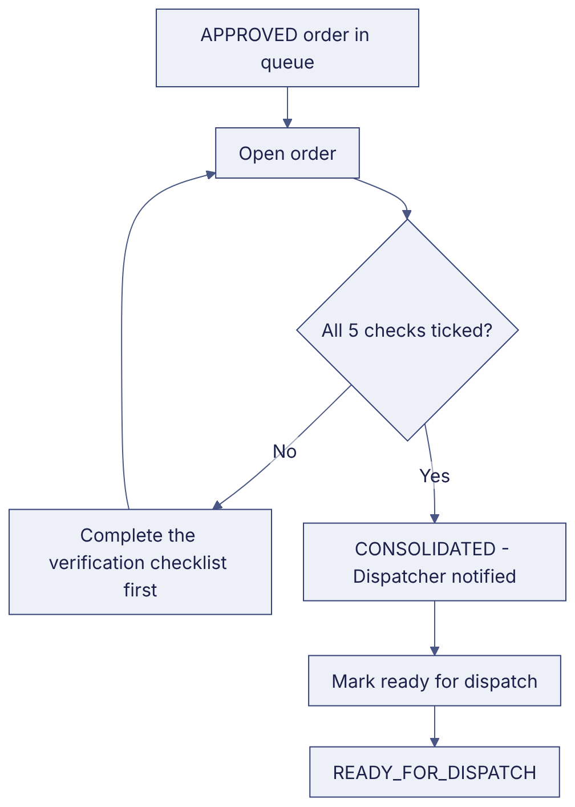{.diagram data-h="d7d25ba32d91"}

## 5.10 Inventory

| Heading | Details |
|---|---|
| Purpose | Keep stock per product per hub accurate; every change is a stock movement. |
| Roles | Receipts & transfers: Administrator, Warehouse Manager, Inventory Executive; adjustments: Administrator, Warehouse Manager, QA Manager; view: Dispatcher, Finance, Sales roles (stock overview) |
| Entry point | `/inventory`, `/inventory/stock`, `/inventory/low-stock`, `/inventory/stock-receipts`, `/inventory/stock-transfers`, `/inventory/stock-adjustments`, `/inventory/movements` |
| Screens | Inventory dashboard, Stock overview, Stock details (min / reorder / max levels), Low stock, Receipt list / New receipt, Transfer list / New transfer, Adjustment list / New adjustment, Stock movements |
| Preconditions | Product tracks inventory; hub active (for stock coming in) |
| Steps | See chapter 10 |
| Actions | Create receipt; create transfer (draft or complete), complete or cancel draft transfer; create adjustment (Increase, Decrease, Damaged, Lost, Correction); update stock levels |
| System behaviour | `inventoryService` updates `bellomassi_inventory` and appends `bellomassi_stock_movements` (Stock Receipt, Transfer In/Out, Adjustment Increase/Decrease, Damage, Lost Stock, Stock Dispatch, Dispatch Reversal, Delivery Return, Scrap Write-off) |
| Validation | Hub selected and active; product valid; quantity valid; date valid; reference ≤ 40 characters; transfer hubs must differ and source must hold the quantity; adjustment needs type, reason (notes for "Other"), cannot remove more than available unless the product allows negative stock; minimum, reorder, maximum non-negative and reorder ≤ maximum |
| Decisions | Transfer: save draft or complete now |
| Approval / Rejection | — (adjustments post immediately; no approval step) |
| Status transitions | Transfer: Draft → Completed / Cancelled |
| Related modules | Dispatch (deduction / reversal / return), scrap, replenishment, orders (stock warnings), reports |
| Output | Stock rows and movement ledger |
| Exceptions | "…is already completed — stock was not changed again."; "Only draft transfers can be cancelled." |
| Flowchart | Chapter 10, master flowchart 7 |

## 5.11 Scrap management

| Heading | Details |
|---|---|
| Purpose | Write off expired, damaged or rejected stock with approval and evidence. |
| Roles | Create: Administrator, Dispatcher, Warehouse Manager, Inventory Executive, QA Manager (`scrap.create`); approve / reject / write off: Administrator, Warehouse Manager (`scrap.approve`, `scrap.reject`) |
| Entry point | `/inventory/scrap` |
| Screens | Scrap dashboard, Scrap requests, New / Edit request, Scrap request detail, Scrap note (print) |
| Preconditions | Stock exists at the hub (available or damaged source) |
| Steps | Create draft → submit → approver approves or rejects → approver posts write-off |
| Actions | Save draft, edit draft, submit, approve, reject, post write-off, cancel, print scrap note |
| System behaviour | `scrapService` → `bellomassi_scrap_requests`; write-off posts a **Scrap Write-off** movement once (`inventoryService.postScrapWriteOff`) |
| Validation | Reason from list (Expired, Damaged, Quality Rejected, Temperature Excursion, Contamination, Packaging Damage, Other); quantity ≤ eligible stock (minus other open requests); no duplicate open request; photo proof required for Damaged, Packaging Damage, Contamination; batch number required for batch-controlled products; rejection reason ≥ 5 characters |
| Decisions | Approve or reject |
| Approval | Approver cannot be the requester ("You cannot approve your own scrap request.") |
| Rejection | REJECTED with reason |
| Status transitions | DRAFT → PENDING_APPROVAL → APPROVED → COMPLETED; PENDING_APPROVAL → REJECTED; DRAFT / PENDING_APPROVAL / APPROVED → CANCELLED |
| Related modules | Inventory, QA, reports (Scrap category) |
| Output | Scrap note; stock reduced |
| Exceptions | "Only an approved scrap request can create a stock write-off.", "The write-off would make stock negative." |
| Flowchart | Chapter 07 §7.3 |

## 5.12 Warehouse dashboard and QA & cold chain

| Heading | Details |
|---|---|
| Purpose | Warehouse view of picking/loading, alerts and expiry; QA view of inspections, quarantine and document expiry. |
| Roles | Warehouse dashboard: Administrator, Warehouse Manager, Inventory Executive, QA Manager; QA & Cold Chain: Administrator, Warehouse Manager, QA Manager |
| Entry point | `/warehouse`, `/quality` |
| Screens | Warehouse dashboard, QA dashboard |
| Preconditions | — |
| Steps | Review alerts → open the linked record (stock line, document, order) |
| Actions | Navigation only |
| System behaviour | Read-only aggregation of inventory, orders, documents, vehicles and drivers |
| Validation / Decisions / Approval / Rejection | — |
| Status transitions | — |
| Related modules | Inventory, documents, VMS, dispatch |
| Output | Alerts and queues |
| Exceptions | **Cold-chain temperature monitoring is Not Implemented** — the card shows the configured ranges (frozen −25 to −18 °C, chilled 0 to 4 °C) with "No sensor integration" / "No live readings". Picking strategy (FEFO) and QA hold on receipt are settings only — **UI Only**. |
| Flowchart | `Dashboard → alert → module record` |

## 5.13 Dispatch planning, assignment and confirmation

| Heading | Details |
|---|---|
| Purpose | Turn ready orders into a vehicle run with a driver, a stop sequence and a stock deduction. |
| Roles | Manage: Administrator, Dispatcher (`dispatch.manage`); view: Sales Manager, Customer Service, Finance, Warehouse Manager |
| Entry point | `/dispatch`, `/dispatch/ready-orders`, `/dispatch/planning`, `/dispatch/create`, `/dispatch/assignments`, `/dispatch/:id` |
| Screens | Dispatch dashboard, Ready for dispatch, Dispatch planning, New / Edit dispatch (orders, zone, date, sequence editor), Driver assignment, Dispatch details (timeline, confirmation review, cancel) |
| Preconditions | Orders READY_FOR_DISPATCH with a complete delivery address, not on another active dispatch |
| Steps | Select orders → set hub, zone, date → sequence (suggested or manual) → save as draft or plan → assign driver and vehicle → review and confirm |
| Actions | Create, edit (DRAFT / PLANNED / ASSIGNED), assign / reassign, change sequence, confirm, cancel |
| System behaviour | `dispatchService` → `bellomassi_dispatches`, `bellomassi_dispatch_timeline`; confirmation deducts stock once (`stockDeducted`), creates one delivery per order (`bellomassi_deliveries`), sets orders DISPATCHED, notifies driver and Administrator |
| Validation | Order eligibility; neighbouring-zone warning; driver issues (inactive, busy on another active dispatch, offline, other hub, licence expired / missing, required documents); vehicle issues (inactive, maintenance, busy, other hub, load over capacity, insurance / RC / fitness documents); confirmation tick required |
| Decisions | Which orders, sequence, driver, vehicle; cancel reason (Vehicle breakdown, Driver unavailable, Customer requested reschedule, Stock issue at hub, Planning error, Other) |
| Approval | Dispatcher's own confirmation |
| Rejection | Cancellation (reason + remarks) — orders return to READY_FOR_DISPATCH; if confirmed, stock is reversed once |
| Status transitions | DRAFT → PLANNED → ASSIGNED → CONFIRMED → IN_TRANSIT → COMPLETED / PARTIALLY_DELIVERED ("Closed with exceptions"); → CANCELLED |
| Related modules | Consolidation, inventory, fleet, VMS, driver app, delivery tracking |
| Output | Dispatch, deliveries, stock movements (Stock Dispatch) |
| Exceptions | "Assign a driver and vehicle before confirming.", "…is already confirmed. Stock was deducted once and was not deducted again.", "Invalid delivery sequence: every stop must appear exactly once." |
| Flowchart | Chapter 11, master flowchart 8 |

## 5.14 Delivery tracking, live tracking and exception review

| Heading | Details |
|---|---|
| Purpose | Follow every stop and resolve failed and partial deliveries. |
| Roles | Delivery tracking: Administrator, Sales Manager, Customer Service, Dispatcher; Live tracking: Administrator, Dispatcher (`tracking.fleet`); review: Administrator, Dispatcher |
| Entry point | `/dispatch/delivery-tracking`, `/dispatch/live-tracking`, `/dispatch/delivery-history`, `/dispatch/deliveries/:id` |
| Screens | Delivery tracking, Live Tracking (Demo GPS map), Delivery history, Delivery details (items, OTP inspector, POD, review panel), Delivery reports |
| Preconditions | Dispatch confirmed |
| Steps | Monitor → open failed / partial delivery → review with remarks → optionally return goods to hub → optionally re-queue (failed only) |
| Actions | Review, return to hub, re-queue, inspect OTP |
| System behaviour | `deliveryService.reviewDelivery`: review status REVIEWED; return to hub books undelivered (not damaged) quantity back once (Delivery Return movement); failed + returned → delivery RETURNED, order RETURNED_TO_HUB; re-queue → order READY_FOR_DISPATCH |
| Validation | "Add review remarks."; re-queue only for a failed delivery whose goods are returned; goods can be returned only once |
| Decisions | Return stock? Re-queue? |
| Approval / Rejection | — |
| Status transitions | Delivery FAILED → RETURNED; order DELIVERY_FAILED → RETURNED_TO_HUB or READY_FOR_DISPATCH |
| Related modules | Driver app, dispatch, inventory |
| Output | Reviewed delivery, return movements |
| Exceptions | "Only failed or partial deliveries need review.", "was already reviewed… No change was made." |
| Flowchart | Chapter 15 |

## 5.15 Driver app

| Heading | Details |
|---|---|
| Purpose | Mobile workflow for the driver's stops. |
| Roles | Driver (`driver.app`) |
| Entry point | `/driver/login` → `/driver/dashboard` |
| Screens | Today, My deliveries, Delivery (stop detail), Confirm delivery, Route, Completed, My delivery notes, Delivery note, Driver profile, My documents, Document |
| Preconditions | User linked to a driver record (`drivers.userId`); dispatch CONFIRMED or IN_TRANSIT; dispatch date not in the future |
| Steps | Chapter 08 |
| Actions | Start delivery, Reach location, Enter OTP & complete, Report issue / mark failed, Call / WhatsApp / navigate (contact actions), view route, view notes, upload documents |
| System behaviour | `deliveryService.startDelivery / markArrived / confirmDelivery / failDelivery`, `trackingService` (DEMO GPS), `otpService` |
| Validation | Sequence order, one stop out at a time, OTP, quantities, receiver name, POD size limit (350 KB) |
| Decisions | Deliver all, part, or fail |
| Approval / Rejection | — |
| Status transitions | Delivery DISPATCHED → OUT_FOR_DELIVERY → DELIVERED / PARTIALLY_DELIVERED / FAILED |
| Related modules | Dispatch, customer app, delivery notes, invoices |
| Output | Delivery note, POD, tracking session |
| Exceptions | Chapter 15 |
| Flowchart | Chapter 08, master flowchart 5 |

## 5.16 Delivery notes, OTP and proof of delivery

| Heading | Details |
|---|---|
| Purpose | Evidence that goods were handed over. |
| Roles | Generated by the driver's completion; viewed by Administrator, Sales roles, Customer Service, Dispatcher, Finance, Warehouse Manager (`deliveryNotes.view`), driver and customer |
| Entry point | `/dispatch/delivery-notes/:id`, `/driver/delivery-notes/:id`, `/customer/delivery-notes/:id` |
| Screens | Delivery note (printable) |
| Preconditions | Delivery completed (full or partial) |
| Steps | Driver completes → note created automatically |
| Actions | View, print |
| System behaviour | `deliveryNoteService` builds BM-DN numbered notes in `bellomassi_delivery_notes`; OTP records in `bellomassi_delivery_otps` (6 digits, default 10-minute expiry, 5 attempts, statuses ACTIVE / VERIFIED / EXPIRED / INVALIDATED / LOCKED); POD in `bellomassi_delivery_pod` |
| Validation | OTP must match, be active and unexpired; attempts limited |
| Decisions / Approval / Rejection | — |
| Status transitions | OTP: ACTIVE → VERIFIED / EXPIRED / LOCKED / INVALIDATED (regenerated) |
| Related modules | Driver app, customer app, invoices (delivered-quantity basis) |
| Output | Delivery note |
| Exceptions | **Simulated:** no SMS is sent; the customer reads the OTP in the customer app |
| Flowchart | Chapter 08 |

## 5.17 Customer app

| Heading | Details |
|---|---|
| Purpose | Self-service ordering and visibility for a customer. |
| Roles | Customer (`customer.app`, `customer.order`) |
| Entry point | `/customer/login` → `/customer/dashboard` |
| Screens | Home, Catalog, Cart, My orders, Order, Track delivery, Delivery notes, Delivery note, Invoices, Invoice, Payments, Profile |
| Preconditions | User linked to a customer (`user.customerId`) |
| Steps | Chapter 09 |
| Actions | Add to cart, change quantity, remove, place order, re-order, track, view OTP, view / print notes and invoices |
| System behaviour | `customerAppService` (cart in `bellomassi_customer_carts`, `placeCustomerOrder` → normal submit with source customer app) |
| Validation | Cart not empty; delivery address, city, state, 6-digit pincode; requested date (tomorrow onwards in the picker) |
| Decisions | Delivery address (registered or other), preferred time slot |
| Approval / Rejection | Handled by the Sales Manager |
| Status transitions | Same as order statuses; customer labels: Pending approval, Under review (returned), Approved, Rejected |
| Related modules | Orders, approval, delivery, invoices |
| Output | Submitted order |
| Exceptions | Payments: **Not Implemented** ("No payments recorded in this prototype"); cancelling an order: **Not Implemented** |
| Flowchart | Chapter 09, master flowchart 6 |

## 5.18 Fleet master — zones, drivers, vehicles

| Heading | Details |
|---|---|
| Purpose | Delivery zones (pincode groups per hub), driver master (licence, hub, zone, vehicle, availability) and vehicle master (type, capacity, hub, documents). |
| Roles | View: Administrator, Dispatcher (`fleet.view`); manage: Administrator (`fleet.manage`) |
| Entry point | `/dispatch/zones`, `/dispatch/drivers`, `/dispatch/vehicles` |
| Screens | Zone list / form, Driver list / form / details (performance), Vehicle list / form |
| Preconditions | Hub exists |
| Steps | Create zone → create vehicle → create driver (link to hub, zone, vehicle, and a user for the driver app) |
| Actions | Create, edit, delete |
| System behaviour | `zoneService`, `driverService`, `vehicleService`; driver availability and vehicle status are recomputed from active dispatches (`syncFleet`) |
| Validation | Zone code 2–12 characters, unique, name unique per hub, at least one pincode; driver code 3–12 characters, unique employee number and licence, 10-digit mobile, zone must belong to the driver's hub, vehicle must operate from that hub; vehicle number in Indian format (e.g. TN 01 BX 4521), unique, capacity > 0, type, unit, hub, fuel type, category, ownership |
| Decisions | Active / Inactive; availability (Available, Assigned, On Delivery, Offline); vehicle status (Available, Assigned, In Transit, Maintenance, Inactive) |
| Approval / Rejection | — |
| Status transitions | Vehicle: Available ↔ Assigned ↔ In Transit (derived), Maintenance / Inactive (manual); driver availability derived from dispatches |
| Related modules | Dispatch (assignment checks), VMS, driver app |
| Output | Master records |
| Exceptions | Delete blocked when referenced (`getDriverDeleteBlockers`, `getVehicleDeleteBlockers`) |
| Flowchart | `Zone → Vehicle → Driver (+ user link) → available for assignment` |

## 5.19 Vehicle Management System (VMS)

| Heading | Details |
|---|---|
| Purpose | Compliance of vehicles and drivers: document expiry tracking and assignment blocking. |
| Roles | View: Administrator, Dispatcher, QA Manager (`vms.view`); manage vehicles: Administrator (`vms.manage`); upload VMS documents: Administrator, Customer Service, Dispatcher; rules: Administrator (`vms.settings`) |
| Entry point | `/vms` |
| Screens | VMS dashboard, Vehicles, Vehicle details / documents, Driver documents, Document expiry register, VMS reports, Compliance rules |
| Preconditions | Vehicles and drivers exist |
| Steps | Record expiry dates and upload documents → register shows expiry state → rules decide whether assignment is blocked |
| Actions | Upload / replace documents, edit expiry dates, change compliance rules, scan expiries |
| System behaviour | `complianceService.vehicleCompliance / driverCompliance / expiryRegister`; opening the expiry page runs `automationService.scanDocumentExpiries` (events DOCUMENT_EXPIRING / DOCUMENT_EXPIRED) |
| Validation | Rule ranges on the settings form |
| Decisions | Default rules (`DEFAULT_VMS_SETTINGS`): required vehicle documents RC, Insurance, Fitness; required driver document Licence; expired required document **always blocks**; block on warning (within 7 days) off; block on missing off |
| Approval / Rejection | Document verification (5.20) |
| Status transitions | Expiry state: Valid → Within 30 days → Within 7 days → Expires today → Expired; Not on record |
| Related modules | Dispatch assignment, documents, automation, QA dashboard |
| Output | Compliance state per vehicle and driver |
| Exceptions | Assignment blocked with the specific message (e.g. "…'s driving licence expired on …") |
| Flowchart | Chapter 11 §11.6 |

## 5.20 Documents and OCR

| Heading | Details |
|---|---|
| Purpose | Central repository of business documents (licences, RC, insurance, customer KYC, invoices, etc.) with OCR field capture and review. |
| Roles | View / upload: most office roles and Driver (upload own); review & reject: Administrator, Customer Service, QA Manager; document types: Administrator |
| Entry point | `/documents` |
| Screens | Repository, Upload, OCR queue, OCR review, Document details, Verified, Rejected, Document types / form, Document reports |
| Preconditions | Active document type; user may upload for the chosen record |
| Steps | Upload (type, entity, record, file, fields) → Run OCR → review / correct fields → Verify or Reject |
| Actions | Upload, replace file, run / re-run OCR, save review, verify, reject |
| System behaviour | `documentService`, `documentStorageService` (file in browser storage), `ocrService` (providers MOCK / BROWSER / BACKEND) → `bellomassi_documents`, `bellomassi_ocr_results` |
| Validation | "Choose an active document type.", "Choose what this document belongs to.", "Select the related record.", "Choose a file to upload.", "You can only upload documents for your own records."; verify requires OCR or manually saved fields; reject needs a reason |
| Decisions | Verify or reject |
| Approval | VERIFIED (locked — replace the file to start a new review) |
| Rejection | REJECTED with reason for the uploader |
| Status transitions | PENDING_OCR → OCR_COMPLETED → PENDING_REVIEW → VERIFIED / REJECTED; EXPIRED (derived from expiry date) |
| Related modules | VMS, customers, drivers, QA dashboard, automation |
| Output | Verified document with extracted fields |
| Exceptions | MOCK OCR does not read the image (Simulated); BROWSER provider reports itself unavailable; BACKEND requires the gateway (Not Verified); "The file is not stored in this browser, so it cannot be sent for OCR." |
| Flowchart | Chapter 13 §13.6 |

## 5.21 Invoices and invoice templates

| Heading | Details |
|---|---|
| Purpose | Issue customer invoices from orders using a branded template and numbering scheme. |
| Roles | View: Administrator, Sales Manager, Finance; issue / cancel: Administrator, Finance (`invoices.manage`); templates: Administrator, Finance |
| Entry point | `/invoices/dashboard`, `/invoices`, `/invoices/create`, `/invoices/templates` |
| Screens | Invoice dashboard, Invoice list, New invoice (live preview), Invoice detail, Print invoice, Templates list / form / preview, Invoice reports |
| Preconditions | Order in an invoiceable status (APPROVED … RETURNED_TO_HUB); no active invoice for the order; an active template |
| Steps | Chapter 12 |
| Actions | Generate, preview, print, email (demo), cancel, manage templates and numbering |
| System behaviour | `invoiceService.generateInvoice` snapshots order, customer, hub, delivery note and template into `bellomassi_invoices`; number from `bellomassi_invoice_settings` (prefix BM-INV, year, 5 digits); event INVOICE_GENERATED |
| Validation | Eligibility messages; template active; option validation; "The invoice total must be greater than zero (check delivered quantities and discounts)."; cancel requires a reason |
| Decisions | Quantity basis: ORDERED or DELIVERED (delivered requires a delivery note); discounts and charges |
| Approval | — |
| Rejection | Cancellation → CANCELLED (then a new invoice can be issued) |
| Status transitions | ISSUED → CANCELLED |
| Related modules | Orders, delivery notes, customers, email, customer app, finance reports |
| Output | Invoice (printable) |
| Exceptions | Tax is a configurable **demo** calculation — not GST-compliant e-invoicing; payments, credit notes and refunds are **Not Implemented** |
| Flowchart | Chapter 12, master flowchart 9 |

## 5.22 Email

| Heading | Details |
|---|---|
| Purpose | Compose and track emails (orders, invoices, documents) and read the mailbox. |
| Roles | View / send: Administrator, Sales roles, Customer Service, Dispatcher, Finance; inbox: Administrator, Sales Manager, Customer Service; templates and settings: Administrator |
| Entry point | `/communication/email` |
| Screens | Email home, Compose, Inbox, Sent, Drafts, History, Templates (list / form), Settings |
| Preconditions | Demo mode (default) or gateway configured |
| Steps | Compose (to, subject, body, template, attachments) → send → status recorded |
| Actions | Send, save draft, use template, sync inbox |
| System behaviour | `emailService`: demo mode records QUEUED_DEMO → SENT_DEMO ("Sent · demo (not sent)"); backend mode posts to the gateway (SENT = accepted by SMTP, DELIVERED only if the provider reports it). Inbox: seeded demo mailbox; sync may add a simulated message |
| Validation | Recipient and subject required; settings validated |
| Decisions | Template or free text |
| Approval / Rejection | — |
| Status transitions | DRAFT → QUEUED → SENDING → SENT → DELIVERED / FAILED; demo: QUEUED_DEMO → SENT_DEMO / FAILED_DEMO |
| Related modules | Automation, invoices, documents |
| Output | Email history (`bellomassi_email_history`) |
| Exceptions | **Simulated** in demo mode; gateway mode **Not Verified** |
| Flowchart | Chapter 13 |

## 5.23 WhatsApp (OpenWA)

| Heading | Details |
|---|---|
| Purpose | Send WhatsApp messages to customers and drivers. |
| Roles | View / send: Administrator, Sales roles, Customer Service, Dispatcher, Finance; templates / settings: Administrator |
| Entry point | `/communication/whatsapp` |
| Screens | WhatsApp home, Compose, History, Templates, OpenWA settings (session, QR) |
| Preconditions | Mock session (demo) or OpenWA session `ready` through the gateway |
| Steps | Compose → send → history |
| Actions | Send, use template, start / stop session (settings) |
| System behaviour | `openWAService` / `whatsappMessageService`: Mock provider records "Sent · demo"; gateway proxies OpenWA REST (201 = handed to WhatsApp, not delivered) |
| Validation | Recipient number with country code (default 91); message body |
| Decisions / Approval / Rejection | — |
| Status transitions | As email (demo statuses) |
| Related modules | Automation, call history |
| Output | `bellomassi_whatsapp_messages` |
| Exceptions | **Simulated**; live **Not Verified** |
| Flowchart | Chapter 13 |

## 5.24 Automated notifications

| Heading | Details |
|---|---|
| Purpose | Send email / WhatsApp automatically when workflow events happen. |
| Roles | Administrator (`communication.automation`) |
| Entry point | `/communication/automation` |
| Screens | Automated notifications (rules per event, master switch, history) |
| Preconditions | Automation switched on; an enabled rule with a template for the event |
| Steps | Event fires in a service → rule found → recipients resolved → messages sent → history logged |
| Actions | Enable / disable automation, edit rule (channel, recipient rule, templates) |
| System behaviour | `automationService.fireEvent` with de-duplication; events ORDER_CREATED, ORDER_APPROVED, ORDER_REJECTED, ORDER_READY, DISPATCH_ASSIGNED, DELIVERY_STARTED, DELIVERY_COMPLETED, DELIVERY_FAILED, INVOICE_GENERATED, DOCUMENT_EXPIRING, DOCUMENT_EXPIRED; channels Email, WhatsApp, Both; recipients Customer contact, Order salesman, Operations team (Admin / Dispatcher), Document owner |
| Validation | "Only the Admin can switch automation." |
| Decisions | Skipped when switched off, no enabled rule, missing template, or missing address |
| Approval / Rejection | — |
| Status transitions | History status: SKIPPED / SENT_DEMO / SENT / PARTIAL / FAILED |
| Related modules | Email, WhatsApp, every workflow service |
| Output | `bellomassi_notification_history` |
| Exceptions | Messages go through the simulated channels in demo mode |
| Flowchart | Chapter 13, master flowchart 10 |

## 5.25 Call history

| Heading | Details |
|---|---|
| Purpose | Manual log of customer calls with outcomes and follow-ups. |
| Roles | View: Administrator, Sales Executive (own), Sales Manager, Customer Service (`communication.calls`); manage: same (`calls.manage`) |
| Entry point | `/communication/calls` |
| Screens | Call dashboard, All calls, Log a call, Edit call, Call details, Follow-ups |
| Preconditions | Customer exists |
| Steps | Log call (direction, status, outcome, duration, notes) → schedule follow-up → complete follow-up → link an order |
| Actions | Create, edit, delete, add note, schedule / complete follow-up, link order |
| System behaviour | `callService` → `bellomassi_call_history`; salesmen see only their calls |
| Validation | "Choose the follow-up date.", "Follow-up cannot be before the call.", note ≤ 500 characters |
| Decisions | Directions: Incoming, Outgoing; statuses: Connected, Missed, Busy, No Answer, Voicemail; outcomes: Order Received, Interested, Follow-up Required, No Response, Busy, Not Interested, Complaint, Payment Follow-up, Other |
| Approval / Rejection | — |
| Status transitions | Follow-up: open → completed (buckets overdue / today / upcoming) |
| Related modules | Orders, customers, communication reports |
| Output | Call record |
| Exceptions | No telephony — nothing is dialled (**Simulated / manual**) |
| Flowchart | Chapter 13 |

## 5.26 Notification center

| Heading | Details |
|---|---|
| Purpose | In-app inbox of notifications for the signed-in user. |
| Roles | All |
| Entry point | `/notifications`; bell icon in the header |
| Screens | Notification center (filter by category, read / unread), preferences |
| Preconditions | — |
| Steps | Open → read → follow link |
| Actions | Mark read, mark all read, mute categories, toggle toasts |
| System behaviour | `notificationService` (`bellomassi_notifications`, preferences in `bellomassi_notification_preferences`); notifications target roles, users or a driver / customer |
| Validation / Decisions / Approval / Rejection | — |
| Status transitions | Unread → Read (per user) |
| Related modules | All workflow services |
| Output | — |
| Exceptions | Browser push notifications are not used (in-app only) |
| Flowchart | `Service event → pushNotification → bell / Notification center → link to record` |

## 5.27 Reports Center

| Heading | Details |
|---|---|
| Purpose | One catalogue of 118 reports in 11 categories with filters, export and favourites. |
| Roles | Office roles with `reports.center`; categories filtered by permission |
| Entry point | `/reports/center` → `/reports/view/:id` |
| Screens | Reports Center, Report viewer |
| Steps | Chapter 14 |
| Preconditions | Category permission |
| Actions | Search, filter, favourite, run, export CSV, print |
| System behaviour | `reportService.runReport` builds rows from LocalStorage with the user's data scope; favourites / recent in `bellomassi_report_prefs` |
| Validation | — |
| Decisions | — |
| Approval / Rejection | — |
| Status transitions | — |
| Related modules | All |
| Output | Tables, CSV |
| Exceptions | 24 reports show "no source data" with the reason (payments, credit notes, expenses, batches, cycle counts, fuel, supplier invoices, returns) |
| Flowchart | Chapter 14, master flowchart 11 |

## 5.28 AI Assistant and Jarvis

| Heading | Details |
|---|---|
| Purpose | Ask business questions in natural language (typed or voice) and get answers built from the user's own data. |
| Roles | View / use: most office roles (`ai.assistant.*`, `jarvis.*`); settings: Administrator |
| Entry point | `/ai`, `/ai/assistant`, `/ai/jarvis`, `/ai/activity`, `/ai/settings` |
| Screens | AI overview, Assistant (conversations), Jarvis (voice / wake word), AI activity, AI settings |
| Preconditions | — |
| Steps | Ask → intent engine picks a permission-checked tool → result blocks (KPIs, table, chart) → write actions shown as a confirmation card → confirm or cancel |
| Actions | Ask, confirm / cancel proposal, rename / delete conversation, clear Jarvis history |
| System behaviour | `aiChatService`, `aiIntentService`, `aiToolRegistry`; conversations private per user (`bellomassi_ai_conversations`, `bellomassi_ai_messages`, `bellomassi_jarvis_history`); activity in `bellomassi_ai_activity` |
| Validation | Tools respect the user's permissions and data scope |
| Decisions | Confirm a proposed write action |
| Approval / Rejection | User confirmation of proposals |
| Status transitions | — |
| Related modules | All data modules |
| Output | Answers, executed actions |
| Exceptions | Provider DEMO is the default (**Simulated**); OpenJarvis, Ollama, Gemini, OpenAI-compatible and custom providers are configurable but **Not Verified** |
| Flowchart | Chapter 14 |

## 5.29 Forecasting, predictive inventory and model management

| Heading | Details |
|---|---|
| Purpose | Demand forecasts and reorder recommendations computed in the browser. |
| Roles | View: Administrator, Sales Manager, Dispatcher, Finance, Warehouse Manager; generate: Administrator, Sales Manager; planning parameters: Administrator |
| Entry point | `/ai/forecasting`, `/ai/predictive-inventory`, `/ai/models` |
| Screens | Forecast dashboard, New forecast, History, Compare, Forecast detail / print; Predictive dashboard, Reorder recommendations, Risk analysis, Demand forecasting, Planning parameters, Prediction detail; Model management |
| Preconditions | Sales history (`bellomassi_sales_history`) |
| Steps | Choose target, scope and horizon → generate → review accuracy → export CSV |
| Actions | Generate, delete, compare, export, enable / disable models |
| System behaviour | `forecastService`, `services/ml/*` — models Auto (best backtest), Moving average, Weighted moving average, Exponential smoothing, Holt, Seasonal |
| Validation | Permission checks ("Only an Administrator can change inventory planning parameters.") |
| Decisions | Model choice |
| Approval / Rejection | — |
| Status transitions | Recommendation: OPEN → IN_DRAFT (added to replenishment) / DISMISSED |
| Related modules | Replenishment, inventory |
| Output | `bellomassi_forecasts`, `bellomassi_inventory_predictions`, `bellomassi_reorder_recommendations` |
| Exceptions | Backend model registration requires a gateway (**Not Verified**) |
| Flowchart | Chapter 10 §10.8 |

## 5.30 Replenishment

| Heading | Details |
|---|---|
| Purpose | Purchase requests to suppliers, from draft to goods receipt. |
| Roles | Create: Administrator, Dispatcher, Warehouse Manager, Inventory Executive; approve / reject / convert: Administrator (`procurement.approve`, `procurement.reject`); view: roles with `procurement.view`; Supplier portal (read-only) |
| Entry point | `/ai/replenishment` |
| Screens | Replenishment list, New draft, Draft detail |
| Preconditions | Hub, products, supplier |
| Steps | Draft → submit → approve or reject → convert ("Awaiting goods receipt") → receive via Stock Receipt links → Received |
| Actions | Create, edit (creator / admin), submit, approve, reject, convert, cancel, open receipt link |
| System behaviour | `replenishmentService` → `bellomassi_replenishment_drafts`; RECEIVED is derived when stock receipts referencing the draft cover all lines |
| Validation | Field validation; "A reason is required." to reject |
| Decisions | Approve / reject |
| Approval | APPROVED → CONVERTED |
| Rejection | REJECTED |
| Status transitions | DRAFT → SUBMITTED → APPROVED → CONVERTED → RECEIVED; SUBMITTED → REJECTED; DRAFT / SUBMITTED / APPROVED → CANCELLED |
| Related modules | Predictive inventory, stock receipts, supplier portal |
| Output | Purchase request; stock receipts |
| Exceptions | Supplier invoices, purchase returns and supplier payments **Not Implemented** |
| Flowchart | Chapter 07 §7.4 |

## 5.31 AI insights

| Heading | Details |
|---|---|
| Purpose | Automatically generated observations (stock-out risk, demand spikes, delivery issues). |
| Roles | View: Administrator, Sales Manager, Customer Service, Dispatcher, Finance, Warehouse Manager, QA Manager; manage: Administrator, Sales Manager, Dispatcher |
| Entry point | `/ai/insights` |
| Screens | AI insights |
| Steps | Refresh → review → mark Reviewed / Resolved |
| Actions | Refresh, change status |
| System behaviour | `insightService.refreshInsights` (rule-based `ml/insightsEngine`) → `bellomassi_ai_insights` |
| Preconditions / Validation / Decisions / Approval / Rejection | — |
| Status transitions | NEW → REVIEWED → RESOLVED |
| Related modules | Dashboards (OpsOverview), inventory, dispatch |
| Output | Insight records |
| Exceptions | Rule-based, not a trained model |
| Flowchart | `Refresh → NEW → REVIEWED → RESOLVED` |

## 5.32 Users, roles and permissions

| Heading | Details |
|---|---|
| Purpose | Who can sign in, with which role(s), hub and data scope. |
| Roles | Super Admin, Administrator (`users.*`, `roles.*`) |
| Entry point | `/admin/users`, `/admin/roles`, `/admin/permissions`, `/admin/role-assignment` |
| Screens | User list / form / details, Role list / form / details, Permission matrix, User role assignment |
| Preconditions | — |
| Steps | Create user (role, hub, customer / driver link) → user signs in; create custom role → assign permissions → assign users |
| Actions | Create, edit, activate / deactivate, delete, reset password, unlock, assign roles, assign hub; create / edit / clone / delete roles |
| System behaviour | `userService`, `rbacService` → `bellomassi_demo_users`, `bellomassi_roles`; audit entries |
| Validation | Passwords match; "You cannot deactivate your own account."; "Only a Super Admin can change a Super Admin account."; "Drivers need a home hub."; "This change would remove your own access to user management."; role landing page required |
| Decisions | Role, data scope, landing page |
| Approval / Rejection | — |
| Status transitions | User active ↔ inactive; locked → unlocked |
| Related modules | Authentication, every module |
| Output | Users, roles |
| Exceptions | Protected / locked system roles cannot be deleted |
| Flowchart | `Create role → set permissions → create user → assign role and hub → user signs in` |

## 5.33 Audit log

| Heading | Details |
|---|---|
| Purpose | History of administrative and security events (who changed what, when). |
| Roles | Administrator, Super Admin (`audit.view`) |
| Entry point | `/admin/audit-logs` |
| Screens | Audit log (filters, details) |
| System behaviour | `auditService.logAudit` → `bellomassi_audit_logs` (user, role, settings, account lock, etc.) |
| Preconditions / Steps / Actions | View and filter |
| Validation / Decisions / Approval / Rejection / Status transitions | — |
| Related modules | Users, roles, settings, authentication |
| Output | Audit trail |
| Exceptions | Business record history is in the order and dispatch timelines, not in the audit log |
| Flowchart | `Admin action → logAudit → Audit log` |

## 5.34 Application settings

| Heading | Details |
|---|---|
| Purpose | Company-wide configuration. |
| Roles | View: Administrator (`settings.view`); change: Administrator (`settings.manage`) |
| Entry point | `/admin/settings` |
| Screens | Tabs including Localization / numbering, Security (session timeout 60, failed attempts 5, lockout 15, password length 8, mixed password, reset code 15 min, force change after reset), Approval (require remarks, block when credit exceeded, rejection remarks minimum 5), Inventory defaults, Warehouse (FEFO, putaway, QA hold), Cold Chain ranges |
| Steps | Edit tab → save |
| System behaviour | `appSettingsService` → `bellomassi_settings`; values feed `runtimeConfig` |
| Validation | Ranges (e.g. session timeout 5–1440, failed attempts 3–20, lockout 1–1440) |
| Preconditions / Decisions / Approval / Rejection / Status transitions | — |
| Related modules | Authentication, approval, inventory, QA |
| Output | Settings |
| Exceptions | Warehouse picking strategy and QA hold are stored but not enforced (**UI Only**) |
| Flowchart | `Settings tab → validate → save → used by services` |

## 5.35 Organization

| Heading | Details |
|---|---|
| Purpose | Company profile and organisation structure. |
| Roles | View: Administrator (`organization.view`); manage: Administrator |
| Entry point | `/admin/organization/company` |
| Screens | Company, Branches, Business units, Departments, Designations, Employee master, Hub master, Warehouse master |
| System behaviour | `organizationService` → `bellomassi_company`, `bellomassi_organization` |
| Steps / Actions | Create, edit records |
| Preconditions / Validation / Decisions / Approval / Rejection / Status transitions | Standard form validation |
| Related modules | Users (employee master), invoices (company details), hubs |
| Output | Organisation records |
| Exceptions | — |
| Flowchart | `Company → Branches → Business units → Departments → Designations → Employees` |

## 5.36 My account

| Heading | Details |
|---|---|
| Purpose | The user's own profile, password, notification and display preferences. |
| Roles | All |
| Entry point | `/profile`, `/account/change-password`, `/settings`, `/driver/profile`, `/customer/profile` |
| Screens | My profile, Change password, Preferences (theme light / dark, notifications) |
| System behaviour | `authService.updateUserProfile`, `changeDemoPassword`; theme in `bellomassi_theme` |
| Validation | Name 2–60 characters; phone format; password policy |
| Steps / Actions | Edit and save |
| Preconditions / Decisions / Approval / Rejection / Status transitions | — |
| Related modules | Authentication |
| Output | Updated profile |
| Exceptions | — |
| Flowchart | `Profile → edit → validate → save` |

# 06 · Order-to-Delivery Workflow {#ch-06}

**Status:** Implemented end to end. GPS tracking and the delivery OTP are **Simulated** (no GPS device, no SMS).

## 6.1 Business summary

1. An order is raised by a **Sales Executive** (`/orders/create`) or by the **customer** (`/customer/cart`).
2. The **Sales Manager** approves it (or returns / rejects it).
3. **Customer Service** consolidates it after a five-point verification and marks it ready for dispatch.
4. The **Dispatcher** puts it on a dispatch with other orders for the same hub and date, assigns a compliant driver and
   vehicle, and confirms the dispatch. Stock leaves the hub at this moment.
5. The **Driver** delivers it in sequence: start → reach location → OTP → quantities and proof → complete (or fail).
6. A **delivery note** is generated; **Finance** issues the **invoice**; the **customer** sees both in the customer app.

## 6.2 Master flowchart 3 — Order-to-delivery

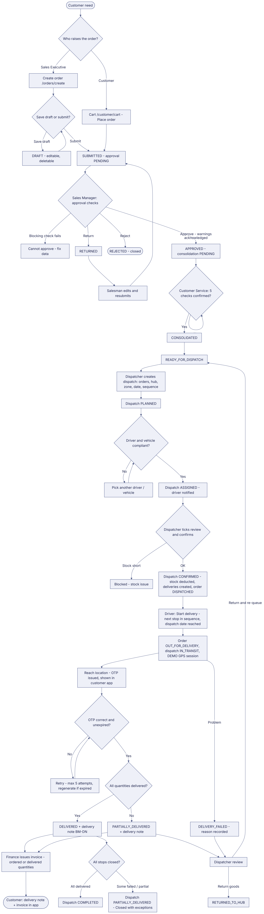{.diagram data-h="e6b350abc337"}

## 6.3 Swimlane — order lifecycle

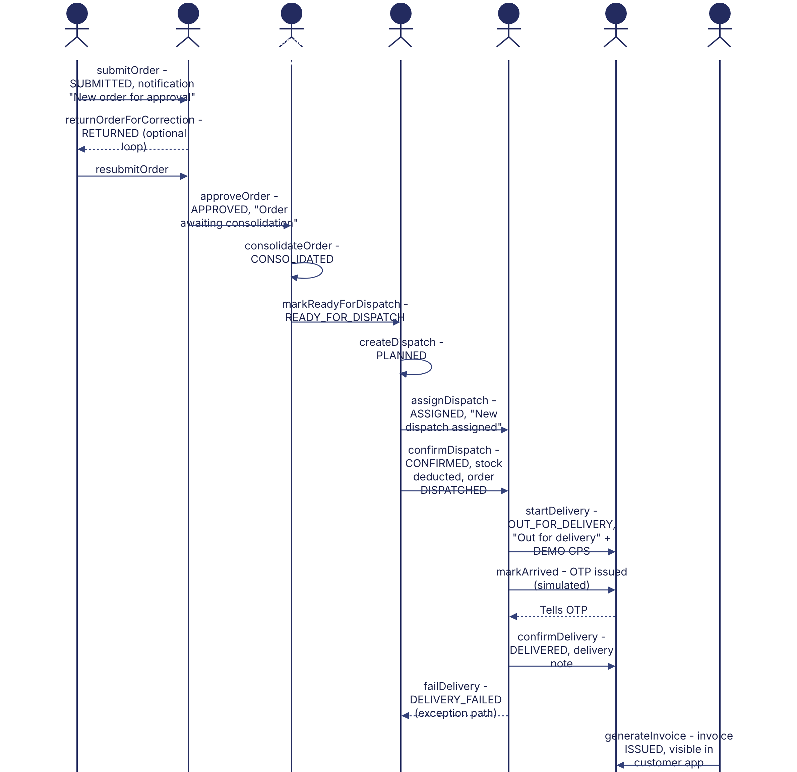{.diagram data-h="9b01a333a6d8"}

## 6.4 Step reference

| Step | Screen / route | Component | Service function | Permission | LocalStorage written |
|---|---|---|---|---|---|
| Create / draft | `/orders/create`, `/orders/:id/edit` | `orderForm` | `createOrder`, `updateOrder` | `orders.create` | `bellomassi_orders` |
| Submit | same | `orderForm` | `submitOrder` | `orders.create` | `orders`, `order_sequence`, `order_timeline`, `notifications`, `activities` |
| Customer order | `/customer/cart` | `CustomerCart` | `placeCustomerOrder` → submit | `customer.order` | as above + `customer_carts` cleared |
| Approve / return / reject | `/orders/approval/:id` | `approvalDetail` | `approveOrder`, `returnOrderForCorrection`, `rejectOrder` | `orders.approve`, `orders.reject` | `orders`, `approvals`, `order_timeline` |
| Resubmit | `/orders/:id/edit` | `orderForm` | `resubmitOrder` | `orders.create` | `orders`, `order_timeline` |
| Consolidate | `/orders/consolidation/:id` | `consolidationDetail` | `consolidateOrder` | `orders.consolidate` | `orders`, `consolidations`, `order_timeline` |
| Ready for dispatch | same | same | `markReadyForDispatch` | `orders.consolidate` | `orders`, `order_timeline` |
| Plan dispatch | `/dispatch/create` | `dispatchForm` | `createDispatch` | `dispatch.manage` | `dispatches`, `dispatch_sequence`, `dispatch_timeline`, `orders` (dispatchId) |
| Assign | `/dispatch/assignments`, `/dispatch/:id` | `dispatchAssignments`, `dispatchDetail` | `assignDispatch` | `dispatch.manage` | `dispatches`, `dispatch_timeline` |
| Confirm | `/dispatch/:id` | `dispatchDetail` | `confirmDispatch` | `dispatch.manage` | `dispatches`, `deliveries`, `inventory`, `stock_movements`, `orders`, timelines |
| Start | `/driver/deliveries/:id` | `DriverDeliveryDetail` | `startDelivery` | `driver.app` | `deliveries`, `dispatches`, `orders`, `driver_tracking` |
| Arrive | same | same | `markArrived` | `driver.app` | `deliveries`, `delivery_otps` |
| Complete | `/driver/deliveries/:id/confirm` | `DriverConfirmDelivery` | `confirmDelivery` | `driver.app` | `deliveries`, `delivery_notes`, `delivery_pod`, `orders`, `dispatches`, `delivery_otps` |
| Fail | `/driver/deliveries/:id` | `FailDeliveryDialog` | `failDelivery` | `driver.app` | `deliveries`, `orders`, `dispatches` |
| Review exception | `/dispatch/deliveries/:id` | `deliveryDetail` | `reviewDelivery` | `dispatch.manage` | `deliveries`, `orders`, `inventory`, `stock_movements` |
| Invoice | `/invoices/create` | `invoiceCreate` | `generateInvoice` | `invoices.manage` | `invoices`, `invoice_settings` |

## 6.5 Stock effect along the flow

| Moment | Stock effect | Movement type |
|---|---|---|
| Submit / approve | None — a **warning** is shown if hub stock is short | — |
| Consolidate | None — stock review is information only | — |
| Confirm dispatch | Hub stock reduced for every line, exactly once (`stockDeducted`) | Stock Dispatch |
| Cancel a confirmed dispatch | Stock restored once (`stockReversed`) | Stock Dispatch Reversal |
| Partial / failed delivery reviewed with "return to hub" | Undelivered (not damaged) quantity booked back once (`returnedToHub`) | Delivery Return |

## 6.6 Rules that stop the flow

| Where | Rule | Message (from code) |
|---|---|---|
| Submit | Required data | "Select a customer.", "Add at least one product.", "Delivery date cannot be before the order date." … |
| Approval | Blocking checks | "Cannot approve: …" (customer inactive, hub inactive, products inactive, total invalid, credit when blocking enabled) |
| Approval | Warnings | "Confirm that you have reviewed the credit and stock warnings." |
| Consolidation | Checklist | "Complete the verification checklist first." |
| Dispatch planning | Eligibility | "Only orders ready for dispatch can be dispatched.", "…is already on BM-DSP-…", "…has no complete delivery address." |
| Assignment | Compliance | Driver / vehicle issues (chapter 11) |
| Confirmation | Review | "Review the orders, driver, vehicle, route and stock, then tick the confirmation." |
| Start | Sequence / date / confirmation | "Stop N (…) comes first in the sequence.", "Waiting for the Dispatcher to confirm the dispatch.", "Planned for … — Start is available on that day.", "Finish your current delivery first." |
| Complete | OTP | Wrong / expired / locked OTP blocks completion |
| Complete | State | "Start the delivery before confirming it.", "…is already delivered. It was not confirmed again." |
| Invoice | Eligibility | "Draft orders cannot be invoiced.", "…already has invoice … Cancel it first to issue a new one." |

# 07 · Approval Workflow {#ch-07}

Bellomassi has four approval processes in which one person decides on another person's request, plus two
**self-confirmation** steps (dispatch confirmation and delivery exception review) that work like approvals.

| Approval | Requester | Approver | Service | Status |
|---|---|---|---|---|
| Order approval | Sales Executive, Customer (app), Administrator | Sales Manager (Super Admin holds all keys; Administrator views only) | `approvalService` | Implemented |
| Scrap approval | Administrator, Dispatcher, Warehouse Manager, Inventory Executive, QA Manager | Warehouse Manager, Administrator (never the requester) | `scrapService` | Implemented |
| Replenishment approval | Administrator, Dispatcher, Warehouse Manager, Inventory Executive | Administrator (`procurement.approve`) | `services/ai/replenishmentService` | Implemented |
| Document verification | Any uploader (incl. Driver) | Administrator, Customer Service, QA Manager | `documentService` | Implemented |
| Dispatch confirmation | Dispatcher | Dispatcher (review tick) | `dispatchService.confirmDispatch` | Implemented |
| Delivery exception review | Driver (reports failure / partial) | Dispatcher, Administrator | `deliveryService.reviewDelivery` | Implemented |

## 7.1 Master flowchart 4 — Order approval

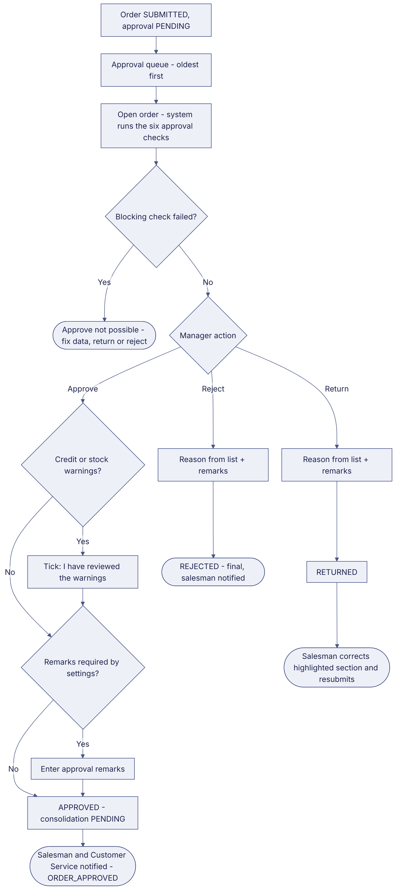{.diagram data-h="f8b6128f1234"}

### Approval checks (`approvalService.getApprovalChecks`)

| Check | Severity | Passes when |
|---|---|---|
| Customer active | Block | Customer exists and status is Active |
| Hub active | Block | Hub exists and status is Active |
| Credit within limit | **Warn** (Block if Application Settings › Approval › *Block when credit exceeded* is on) | Credit enabled and the order does not take the balance over the limit |
| Stock available | Warn | Every inventory-tracked line is covered by hub stock |
| Order total valid | Block | Total > 0 and at least one line |
| Products active | Block | Every product is Active |

### Reasons

- **Rejection reasons** (`REJECTION_REASONS`): Credit limit exceeded, Duplicate order, Customer cancelled, Pricing not
  approved, Stock not available, Other.
- **Return reasons** (`RETURN_REASONS`): Quantity needs confirmation, Pricing or discount correction, Reduce order value
  (credit), Delivery details incomplete, Wrong product selected, Other. Each return reason highlights the matching
  section on the salesman's edit screen (`RETURN_REASON_SECTIONS`).

### What the system records

One transaction writes the updated order, an approval record in `bellomassi_approvals` (decision, reason, remarks,
decided by, order total, credit and stock warning flags) and a timeline event in `bellomassi_order_timeline`.

### Edge cases

- A draft cannot be decided: "Draft orders cannot be decided — the salesman has not submitted it."
- A second decision is refused: "BM-ORD-… has already been approved. No change was made."
- Only `orders.approve` may approve; only `orders.reject` may return or reject.

## 7.2 Order approval — swimlane

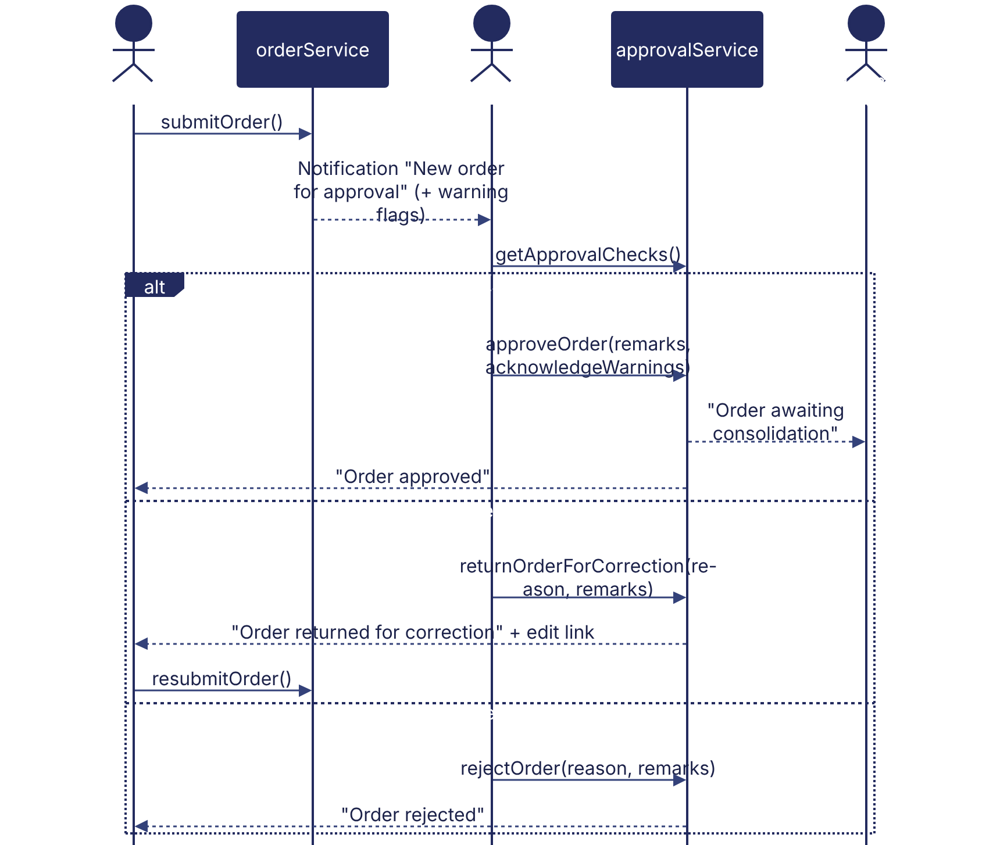{.diagram data-h="8c68e4c6f105"}

## 7.3 Scrap approval

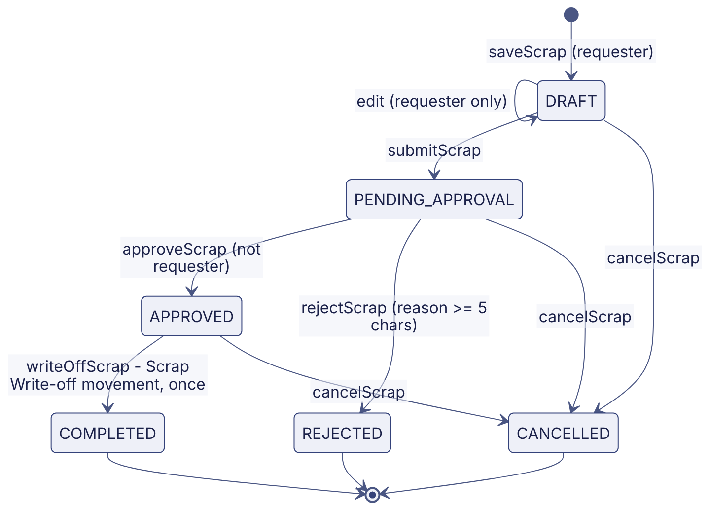{.diagram data-h="d869b62c9a3c"}

| Rule | Message |
|---|---|
| Requester cannot approve own request | "You cannot approve your own scrap request." |
| Only drafts can be edited, only by the requester | "Only draft requests can be edited.", "Only the requester can edit this draft." |
| Rejection needs a reason | "Enter a rejection reason (at least 5 characters)." |
| Write-off only after approval, by an approver | "Only an approved scrap request can create a stock write-off.", "Only an approver can post a stock write-off." |
| Stock cannot go negative | "The write-off would make stock negative." |

Screens: `/inventory/scrap` (dashboard), `/inventory/scrap/requests`, `/inventory/scrap/requests/:id`, print
`/inventory/scrap/requests/:id/print`. Storage: `bellomassi_scrap_requests`, write-off in `bellomassi_stock_movements`.

## 7.4 Replenishment approval

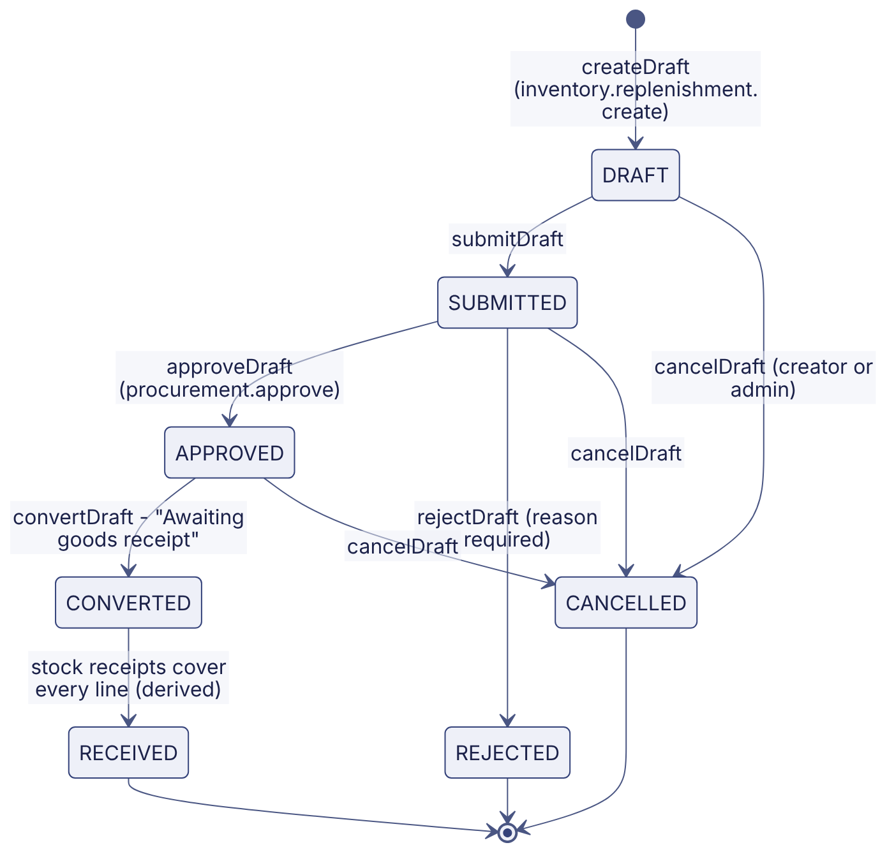{.diagram data-h="a370f8f704bf"}

- Only the creator or an Administrator can edit or cancel a draft.
- After conversion, each line has a link to **New Stock Receipt** pre-filled with hub, product, outstanding quantity
  and the request number as reference (`receiptLink`). When receipts referencing the request cover all lines, the status
  shows **Received**.
- The Supplier portal shows approved / converted requests for the linked supplier (read-only).

## 7.5 Document verification

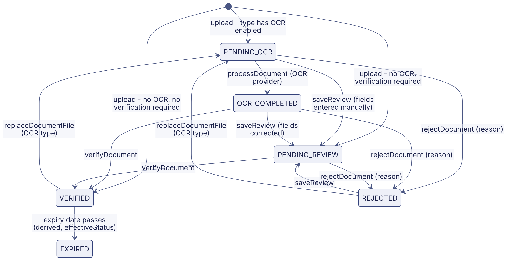{.diagram data-h="7130fafeff7d"}

The initial status depends on the document type (`ocrEnabled`, `verificationRequired`). Replacing the file restarts the
review (PENDING_OCR for OCR types, otherwise PENDING_REVIEW). "Verified documents are locked. Replace the file to start a
new review." Verifying an OCR-type document needs OCR or manually saved fields first ("Run OCR (or enter the fields
manually and save) before verifying."). Rejection requires a reason "so the uploader knows what to fix." EXPIRED is not
stored — it is derived from the expiry date for any non-rejected document.

## 7.6 Dispatch confirmation and exception review

These are covered in chapters 11 and 15. Both require an explicit tick or remarks from the Dispatcher and are refused
when repeated ("…is already confirmed. Stock was deducted once and was not deducted again.", "…was already reviewed…
No change was made.").

## 7.7 Approval responsibilities

| Approval | Approve | Return | Reject | Who is notified |
|---|---|---|---|---|
| Order | Sales Manager | Sales Manager | Sales Manager | Salesman; Customer Service on approval |
| Scrap | Warehouse Manager / Administrator | — | Warehouse Manager / Administrator | (in-app list / dashboard) |
| Replenishment | Administrator | — | Administrator | (in-app list); Supplier portal shows approved requests |
| Document | Administrator / Customer Service / QA Manager | — | same | Uploader sees status and reason |

# 08 · Driver Workflow {#ch-08}

**Status:** Implemented. GPS tracking is **Simulated** (DEMO GPS badge), the delivery OTP is **Simulated** (no SMS — the
customer reads the code in the customer app). Photo and signature proof of delivery are **Implemented** and stored in
the browser (`bellomassi_delivery_pod`, max 350 KB each).

## 8.1 The driver's day in plain English

1. Sign in on the phone at `/driver/login` (mobile number, email or username).
2. **Today** shows today's and tomorrow's stops "published by the Dispatcher", the next stop, an ETA plan and personal
   performance for the selected period (default **Today**).
3. Nothing can start until the Dispatcher **confirms** the dispatch (vehicle loaded, stock deducted).
4. Open the first stop → **Start delivery**. The order becomes *Out for delivery*, a DEMO GPS session starts and the
   customer and Dispatcher are notified.
5. At the customer → **Reach location**. Arrival time is recorded and a 6-digit OTP is issued to the customer (shown in
   their app, valid 10 minutes by default).
6. **Enter OTP & complete**: enter delivered and damaged quantities per line, who received the goods, remarks, optional
   rejected quantities and shortfall reason, optional signature and photo, the customer's remarks, then the OTP.
7. If everything was delivered → *Delivered*; otherwise → *Partially delivered*. A delivery note (BM-DN-YYYY-NNNNN) is
   generated and can be shown to the customer.
8. If the delivery cannot happen → **Report issue / mark failed** with a reason. The Dispatcher reviews it.
9. Move to the next stop. When every stop is closed, the dispatch closes as *Completed* or *Closed with exceptions*.
10. Sign out from **Driver Profile**.

## 8.2 Master flowchart 5 — Driver workflow

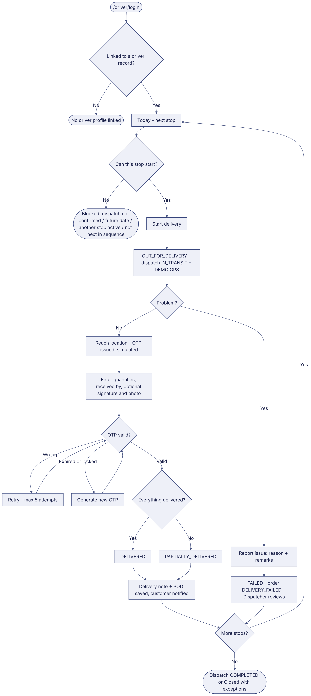{.diagram data-h="bd6eeee162c1"}

## 8.3 Driver app screens

| Screen | Route | Component | What the driver does |
|---|---|---|---|
| Sign in | `/driver/login` | `AppLogin` (driver) | Mobile / email / username + password |
| Today | `/driver/dashboard` | `DriverHome` | See today / tomorrow plan, next stop, period performance |
| My deliveries | `/driver/deliveries` | `DriverDeliveries` | List of own stops |
| Delivery (stop) | `/driver/deliveries/:id` | `DriverDeliveryDetail` | Address, contact actions, requested time, ETA, items, Start / Reach location / Complete / Report issue |
| Confirm delivery | `/driver/deliveries/:id/confirm` | `DriverConfirmDelivery` | Quantities, received by, proof of delivery, OTP |
| Route | `/driver/route` | `DriverRoute` | DEMO route map of the dispatch's stops |
| Completed | `/driver/completed` | `DriverCompleted` | Closed stops |
| My delivery notes | `/driver/delivery-notes` (+ `/:id`) | `DriverNotes` | View / show delivery notes |
| Driver profile | `/driver/profile` | `DriverProfile` | Profile, vehicle, sign out |
| My documents | `/driver/documents` (+ `/:id`) | `DriverDocuments` | Licence, medical and other documents, upload |

## 8.4 Rules enforced by `deliveryService`

| Action | Allowed when | Refusal message |
|---|---|---|
| `startDelivery` | Delivery DISPATCHED; dispatch CONFIRMED or IN_TRANSIT; dispatch date not in the future; it is the next stop in sequence; no other stop of this dispatch is out | "…is already out for delivery.", "…is already delivered and cannot be restarted." and the blockers shown in 8.2 |
| `markArrived` | Delivery OUT_FOR_DELIVERY | "Start the delivery first.", "…is already closed." |
| `confirmDelivery` | Delivery OUT_FOR_DELIVERY; OTP valid | "Start the delivery before confirming it.", "…is already delivered. It was not confirmed again.", "…was already marked failed." |
| `failDelivery` | Delivery OUT_FOR_DELIVERY | "Start the delivery before reporting a failure.", "…is already delivered and cannot be marked failed.", "…is already marked failed." |

### Quantity and POD validation

| Field | Rule |
|---|---|
| Delivered | Required, not negative, whole units, not more than the dispatched quantity |
| Damaged / rejected | 0 or more; rejected cannot exceed what was not delivered |
| Received by | "Enter the name of the person who received the goods." |
| Signature / photo | Optional; each ≤ 350 KB ("The photo is too large — retake it.") |
| Customer remarks | ≤ 300 characters |

### OTP (`otpService`, `OTP_CONFIG`)

| Setting | Value |
|---|---|
| Length | 6 digits |
| Default expiry | 10 minutes (allowed 1–60) |
| Maximum attempts | 5 → status LOCKED ("Too many incorrect attempts. Generate a new OTP.") |
| Statuses | ACTIVE (Awaiting entry), VERIFIED, EXPIRED, INVALIDATED (replaced by a new code), LOCKED |
| Delivery | Shown in the customer app tracking screen; the Dispatcher can inspect it (`dispatch.otp.inspect`). **No SMS.** |

### Failure reasons (`FAILURE_REASONS`)

Customer Not Available · Customer Refused · Customer Requested Reschedule · Incorrect Address · Damaged Goods · Partial
Delivery · Other.

## 8.5 What happens in the data

| Action | Delivery | Order | Dispatch | Other |
|---|---|---|---|---|
| Start | OUT_FOR_DELIVERY, `startedAt` | OUT_FOR_DELIVERY | IN_TRANSIT (first start) | Tracking session in `bellomassi_driver_tracking`; event DELIVERY_STARTED |
| Reach location | `arrivedAt` | — | — | OTP in `bellomassi_delivery_otps` |
| Complete (full) | DELIVERED | DELIVERED | COMPLETED when all stops delivered | Delivery note, POD, OTP VERIFIED, tracking stopped, event DELIVERY_COMPLETED |
| Complete (short) | PARTIALLY_DELIVERED | PARTIALLY_DELIVERED | PARTIALLY_DELIVERED when all stops closed | Same; Dispatcher review needed |
| Fail | FAILED, review PENDING | DELIVERY_FAILED | Closes when all stops closed | Notifications; event DELIVERY_FAILED |

## 8.6 Sequence — one stop

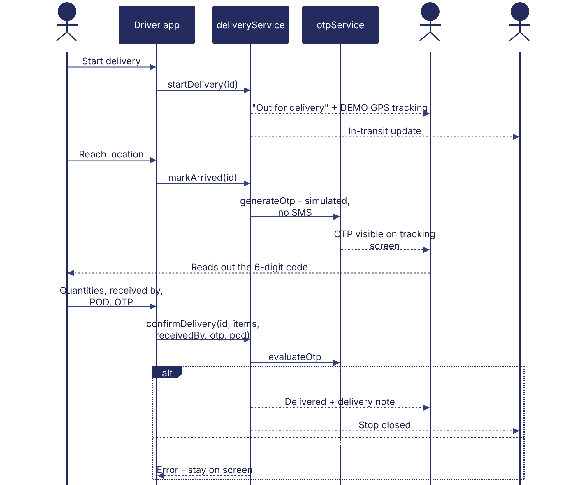{.diagram data-h="ff584b15524b"}

## 8.7 What the driver cannot do

- See or act on another driver's deliveries ("Access denied").
- Change the stop sequence (Dispatcher only), reassign the vehicle, or edit a closed stop.
- Complete without the customer's OTP.
- Use office modules (the Driver role has only `dashboard.view`, `driver.app`, `documents.upload`).

# 09 · Customer Workflow {#ch-09}

**Status:** Implemented for ordering, tracking and documents. Delivery tracking uses **DEMO GPS** (Simulated); the
OTP is shown in the app instead of being sent by SMS (Simulated). **Payments are Not Implemented** and **order
cancellation by the customer is Not Implemented**.

## 9.1 The customer's journey in plain English

1. Sign in at `/customer/login` with mobile number, email or username (demo: `customer` / `Customer@123` or
   `+91 98410 22310`). The login must be linked to a customer account; otherwise the app shows "No customer account
   linked".
2. **Home** shows Active orders, Pending approval, Delivered (period filter) and the Outstanding balance (current), a
   card for any delivery on the road, recent orders, delivery notes and notifications.
3. **Catalog** lists active products with a selling price, searchable by name / code / SKU / brand and filterable by
   category. Availability at the customer's hub is shown; limited stock does not stop ordering.
4. **Cart**: change quantities, remove lines, see subtotal, discount, tax and total. A credit warning appears if the
   order takes the account over its limit — the order can still be placed and the Sales Manager reviews it.
5. Choose **delivery address** (registered or another), **requested date** (tomorrow up to 60 days ahead), optional
   **preferred time** slot, PO / reference and remarks → **Place order** → confirm.
6. The order is submitted exactly like a salesman's order (source `customer_app`, salesman = the customer's sales rep,
   priority High for VIP customers, payment terms Credit or Cash on Delivery from the customer record). Status:
   **Pending approval**.
7. The customer follows the order on **My orders** / **Order** with a 9-stage tracker: Order placed → Pending approval →
   Approved → Prepared → Dispatch planned → Out for delivery → Driver arrived → OTP verified → Delivered.
8. When the driver is on the way, **Track delivery** shows the driver, vehicle and a DEMO GPS map. When the driver
   arrives, the **OTP** appears in large digits with its expiry time — the customer reads it to the driver.
9. After delivery, the **delivery note** is available under Delivery notes; once Finance issues the invoice it appears
   under **Invoices**.
10. **Reorder** on a past order copies its still-orderable lines into the cart.

## 9.2 Master flowchart 6 — Customer workflow

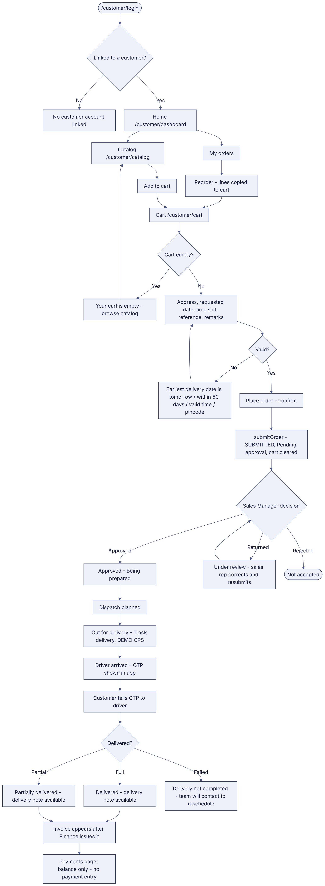{.diagram data-h="786aa194d027"}

## 9.3 Screens

| Screen | Route | Component | Purpose |
|---|---|---|---|
| Sign in | `/customer/login` | `AppLogin` (customer) | Mobile / email / username |
| Home | `/customer/dashboard` | `CustomerHome` | KPIs, on-the-road card, quick actions, recent items |
| Catalog | `/customer/catalog` | `CustomerCatalog` | Search, category chips, quantity stepper, add to cart |
| Cart | `/customer/cart` | `CustomerCart` | Lines, totals, delivery details, place order (sticky button) |
| My orders | `/customer/orders` | `CustomerOrders` | Filters: active, pending, delivered |
| Order | `/customer/orders/:id` | `CustomerOrderDetail` | Stage tracker, lines, approval / delivery labels, Reorder |
| Track delivery | `/customer/tracking/:id` | `CustomerTracking` | DEMO GPS map, driver, vehicle, OTP when arrived |
| Delivery notes | `/customer/delivery-notes` (+ `/:id`) | `CustomerDocuments` | List and view notes |
| Invoices | `/customer/invoices` (+ `/:id`) | `CustomerDocuments` | List and view invoices |
| Payments | `/customer/payments` | `CustomerPayments` | Account balance; "No payments recorded in this prototype" |
| Profile | `/customer/profile` | `CustomerProfile` | Account details, sign out |

## 9.4 Customer-facing labels

| Internal status | What the customer sees |
|---|---|
| SUBMITTED | Pending approval |
| RETURNED | Under review |
| REJECTED | Not accepted |
| APPROVED | Approved / Not scheduled |
| CONSOLIDATED, READY_FOR_DISPATCH | Being prepared, or Dispatch planned once on a dispatch |
| OUT_FOR_DELIVERY | Out for delivery, or Driver arrived |
| DELIVERED / PARTIALLY_DELIVERED | Delivered / Partially delivered |
| DELIVERY_FAILED | Delivery failed |

## 9.5 Validation (`customerAppService.placeCustomerOrder`)

| Rule | Message |
|---|---|
| Login linked to a customer | "Your login is not linked to a customer account." |
| Cart has items | "Your cart is empty." |
| Requested date | "Choose a delivery date.", "The earliest delivery date is tomorrow.", "Choose a date within the next 60 days." |
| Time | "Enter a valid time." |
| Remarks | "Use 300 characters or fewer." |
| Order rules | All order validation from `orderService.validateOrder` (address, pincode, products, total) |
| Reorder | "This order belongs to another account.", "None of the products on this order can be ordered now." |

## 9.6 Notifications the customer receives

| When | Title |
|---|---|
| Driver starts the stop | "Out for delivery: BM-ORD-…" (track in the app, DEMO GPS) |
| Driver reaches the address | "Driver arrived: …" — share the delivery OTP shown in the app (demo OTP — no SMS) |
| Delivery completed | "Delivered: …" or "Partially delivered: …" — OTP verified, delivery note available |
| Delivery failed | "Delivery not completed: …" — "Our team will contact you to reschedule." |
| Automation (if rules enabled) | Email / WhatsApp per rule for ORDER_CREATED, ORDER_APPROVED, ORDER_REJECTED, ORDER_READY, DISPATCH_ASSIGNED, DELIVERY_STARTED, DELIVERY_COMPLETED, DELIVERY_FAILED, INVOICE_GENERATED (demo channels) |

## 9.7 What the customer cannot do

- Cancel or edit an order after placing it (**Not Implemented**).
- Pay online or see a payment history (**Not Implemented**).
- See other customers' orders, notes or invoices.
- Approve anything.

## 9.8 Customer portal on the office web app

The CUSTOMER role's office dashboard (`CustomerPortalDashboard`: My orders, Open orders, Deliveries, Deliveries on the
way, Invoices, Credit available, Account) exists, but a customer who opens `/dashboard` is redirected to
`/customer/dashboard`, so in practice the customer always uses the customer app.

# 10 · Inventory Workflow {#ch-10}

**Status:** Implemented. All stock lives in `bellomassi_inventory` (one row per product per hub) and every change is
written to the movement ledger `bellomassi_stock_movements`. Batch and expiry tracking on stock rows is **Not
Implemented** (only scrap requests carry a batch reference); cycle counting is **Not Implemented** (use adjustments).

## 10.1 Stock figures

| Figure | Formula / meaning |
|---|---|
| Total quantity | Physical quantity at the hub |
| Damaged quantity | Part of total held as damaged (quarantine) |
| Reserved quantity | Part of total reserved |
| **Available** | Total − Reserved − Damaged (`utils/stock.getAvailable`) |
| Minimum / Reorder level / Maximum | Set per row on Stock details (`updateStockLevels`; button shown to holders of `inventory.receipts.manage`) |
| Stock status | Out of Stock (available ≤ 0) → Low Stock (available ≤ reorder level) → Overstock (total > maximum) → In Stock |

## 10.2 Master flowchart 7 — Inventory workflow

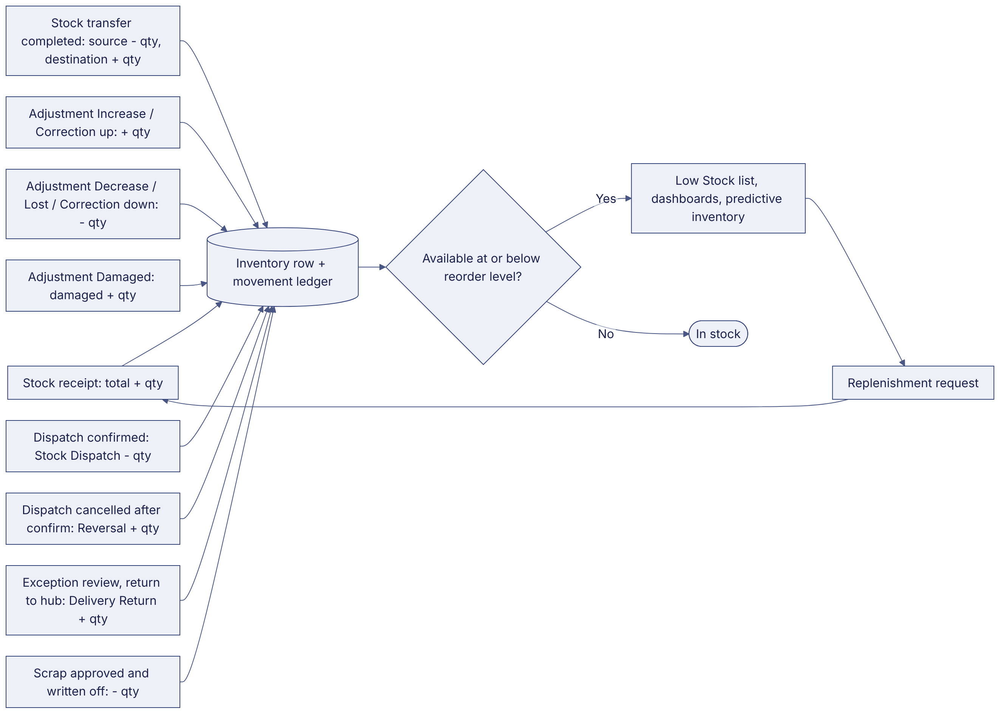{.diagram data-h="4707dc74ee04"}

## 10.3 Stock receipt

| Item | Details |
|---|---|
| Who | Administrator, Warehouse Manager, Inventory Executive (`inventory.receipts.manage`) |
| Screens | `/inventory/stock-receipts` (list), `/inventory/stock-receipts/create` |
| Steps | Choose hub, product, quantity, receipt date, reference (e.g. supplier invoice or replenishment number) → save |
| Validation | "Select a hub."; inactive hub "…is inactive and cannot receive stock."; product must track inventory; valid quantity (whole units for whole-unit products); valid date; reference ≤ 40 characters |
| Effect | Total quantity increases; movement **Stock Receipt**; receipt numbered GRN-… in `bellomassi_stock_receipts` |
| Approval | None — posted immediately |

## 10.4 Stock transfer

| Item | Details |
|---|---|
| Who | Administrator, Warehouse Manager, Inventory Executive (`inventory.transfers.manage`) |
| Screens | `/inventory/stock-transfers`, `/inventory/stock-transfers/create` |
| Steps | Source hub, destination hub, product, quantity, date, notes → **Save draft** or **Complete** |
| Validation | Both hubs required and different; destination active; at completion the quantity must be available at the source ("Only N … available at …") |
| Effect | On completion: source total − qty (**Stock Transfer Out**), destination total + qty (**Stock Transfer In**) |
| Statuses | Draft → Completed / Cancelled (`TRANSFER_STATUS`) |
| Guards | "…is already completed — stock was not changed again."; "Only draft transfers can be cancelled." |

## 10.5 Stock adjustment

| Item | Details |
|---|---|
| Who | Administrator, Warehouse Manager, QA Manager (`inventory.adjustments.manage`) |
| Screens | `/inventory/stock-adjustments`, `/inventory/stock-adjustments/create` |
| Types | Increase, Decrease, Damaged, Lost, Correction (with direction increase / decrease) |
| Reasons | Physical Stock Correction, Damaged Stock, Lost Stock, Expired Stock, Data Correction, Other (notes required) |
| Validation | Product must track inventory; cannot remove more than available unless the product allows negative stock; cannot mark more than available as damaged; stock can only be reduced at an inactive hub |
| Effect | Movement Stock Adjustment Increase / Decrease, Lost Stock or Damage |
| Approval | None — posted immediately (**no adjustment approval exists**) |

## 10.6 Movements, stock overview and low stock

| Screen | Route | Purpose |
|---|---|---|
| Inventory dashboard | `/inventory` | Stock value, status mix, alerts (period filter on dated documents) |
| Stock overview | `/inventory/stock` | All rows by product and hub with status; filters |
| Stock details | `/inventory/stock/:id` | Row history and min / reorder / max levels |
| Low stock | `/inventory/low-stock` | Rows that are Low or Out |
| Stock movements | `/inventory/movements` | Full ledger with type, sign, reference |

Movement types (`MOVEMENT_TYPES`): Stock Receipt, Stock Transfer In, Stock Transfer Out, Stock Adjustment Increase,
Stock Adjustment Decrease, Damage, Lost Stock, Stock Dispatch, Stock Dispatch Reversal, Delivery Return, Scrap
Write-off.

## 10.7 Scrap

Scrap takes stock from the **available** or **damaged** source. Eligible quantity = on-hand in that source minus the
quantity already in other open requests. Full lifecycle and approval rules are in chapter 07 §7.3. Write-off posts a
single **Scrap Write-off** movement (`inventoryService.postScrapWriteOff`).

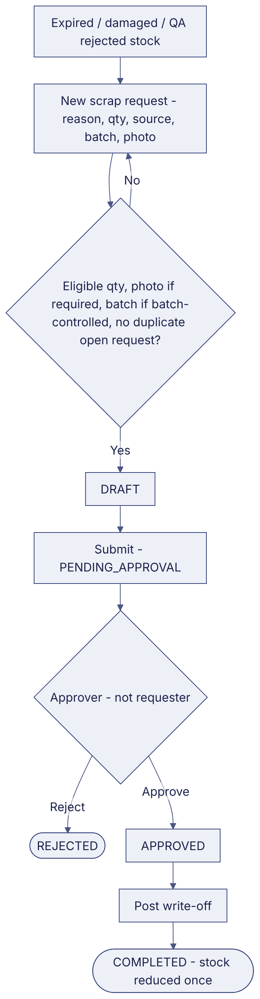{.diagram data-h="2c250c7a6bc2"}

## 10.8 Predictive inventory and replenishment

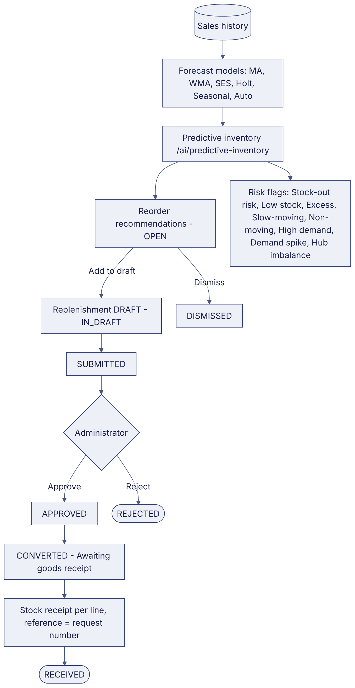{.diagram data-h="0d15516977e8"}

| Step | Who | Route |
|---|---|---|
| Review predictions and risks | Roles with `inventory.predictions.view` | `/ai/predictive-inventory`, `/risks`, `/reorder`, `/demand` |
| Change planning parameters | Administrator (`inventory.predictions.manage`) | `/ai/predictive-inventory/settings` |
| Create replenishment draft | Administrator, Dispatcher, Warehouse Manager, Inventory Executive | `/ai/replenishment/create` |
| Approve / reject / convert | Administrator | `/ai/replenishment/:id` |
| Receive goods | Administrator, Warehouse Manager, Inventory Executive | Stock receipt link from the request |
| See approved requests | Supplier | Supplier portal dashboard |

## 10.9 Inventory responsibilities

| Activity | Inventory Executive | Warehouse Manager | QA Manager | Dispatcher | Administrator |
|---|---|---|---|---|---|
| Stock receipt | ✓ | ✓ | view | view | ✓ |
| Stock transfer | ✓ | ✓ | view | view | ✓ |
| Stock adjustment | view | ✓ | ✓ | view | ✓ |
| Stock levels (min / reorder / max) | ✓ | ✓ | — | — | ✓ |
| Scrap request | ✓ | ✓ | ✓ | ✓ | ✓ |
| Scrap approval / write-off | — | ✓ | — | — | ✓ |
| Replenishment draft | ✓ | ✓ | — | ✓ | ✓ |
| Replenishment approval | — | — | — | — | ✓ |
| Dispatch stock deduction | — | — | — | ✓ (by confirming) | ✓ |

# 11 · Dispatch & VMS Workflow {#ch-11}

**Status:** Dispatch planning, assignment, confirmation, cancellation, sequencing, delivery review and VMS compliance are
**Implemented**. Live tracking is **Simulated** (DEMO GPS). Route optimisation is a suggested sequence, not a road
routing engine.

## 11.1 Business summary

The Dispatcher works from the **Ready for Dispatch** queue. A dispatch is one vehicle run from one hub on one date. It
holds a set of orders in a delivery sequence, one driver and one vehicle. Before anything leaves the hub, the system
checks that every order is still ready, that the driver and vehicle are free, from the same hub, legally compliant and
that the load fits the vehicle. **Confirming** the dispatch is the loading sign-off: hub stock is deducted and the
driver can start. The Dispatcher then follows the run on Delivery Tracking / Live Tracking and resolves failed and
partial stops.

## 11.2 Master flowchart 8 — Dispatch / VMS workflow

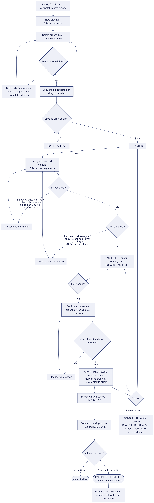{.diagram data-h="fe85814da394"}

## 11.3 Dispatch statuses (`DISPATCH_STATUS_META`)

| Status | Label | Meaning | Editable? |
|---|---|---|---|
| DRAFT | Draft | Saved, incomplete plan | Yes |
| PLANNED | Planned | Orders and sequence set | Yes |
| ASSIGNED | Assigned | Driver and vehicle assigned | Yes |
| CONFIRMED | Confirmed | Loaded; stock deducted; deliveries created | No (cancel only while no stop has started) |
| IN_TRANSIT | In transit | First stop started | No |
| PARTIALLY_DELIVERED | Closed with exceptions | All stops closed; at least one failed / partial | No |
| COMPLETED | Completed | All stops delivered | No |
| CANCELLED | Cancelled | Cancelled with reason | No |

Resource-holding statuses (driver / vehicle busy): ASSIGNED, CONFIRMED, IN_TRANSIT.

## 11.4 Step reference

| Step | Route | Service | Rules and messages |
|---|---|---|---|
| Create | `/dispatch/create` | `createDispatch` | "Only the Dispatcher or Admin can create dispatches."; orders must be READY_FOR_DISPATCH, not on another active dispatch, with a complete address; neighbouring-zone **warning** |
| Edit | `/dispatch/:id/edit` | `updateDispatch` | Only DRAFT / PLANNED / ASSIGNED: "…is confirmed and can no longer be edited." |
| Assign / reassign | `/dispatch/assignments`, `/dispatch/:id` | `assignDispatch` | Only PLANNED / ASSIGNED: "Complete the draft plan before assigning a driver."; driver and vehicle issue checks; previous driver notified "Removed from …" |
| Change sequence | `/dispatch/:id` (sequence editor) | `updateSequence` | "Invalid delivery sequence: every stop must appear exactly once.", "The sequence has not changed."; driver notified |
| Confirm | `/dispatch/:id` | `confirmDispatch` | Must be ASSIGNED; review tick required; stock checked per line ("…needs N, only M available at the hub."); stock deducted once |
| Cancel | `/dispatch/:id` | `cancelDispatch` | Reason from list + remarks; not after a stop has started; confirmed dispatch → stock reversed once; orders back to READY_FOR_DISPATCH |
| Review exception | `/dispatch/deliveries/:id` | `reviewDelivery` | Chapter 15 |

**Cancel reasons** (`CANCEL_REASONS`): Vehicle breakdown, Driver unavailable, Customer requested reschedule, Stock issue
at hub, Planning error, Other.

## 11.5 Driver and vehicle assignment checks

| Resource | Check | Message |
|---|---|---|
| Driver | Selected | "Select a driver." |
| Driver | Active | "… is inactive." |
| Driver | Not on another active dispatch | "… already has an active dispatch (BM-DSP-…)." |
| Driver | Not offline | "… is offline." |
| Driver | Same hub | "… works from another hub." |
| Driver | Licence | "…'s driving licence expired on …", "… has no valid licence expiry on record." |
| Driver | VMS required documents | From `driverComplianceIssues` (default: licence) |
| Vehicle | Selected | "Select a vehicle." |
| Vehicle | Not inactive / maintenance | "… is inactive.", "… is under maintenance." |
| Vehicle | Not on another active dispatch | "… is already on BM-DSP-…." |
| Vehicle | Same hub | "… belongs to another hub." |
| Vehicle | Capacity | "Load of N exceeds …'s capacity of C …" |
| Vehicle | VMS required documents | From `vehicleComplianceIssues` (default: RC, insurance, fitness) |

## 11.6 VMS compliance

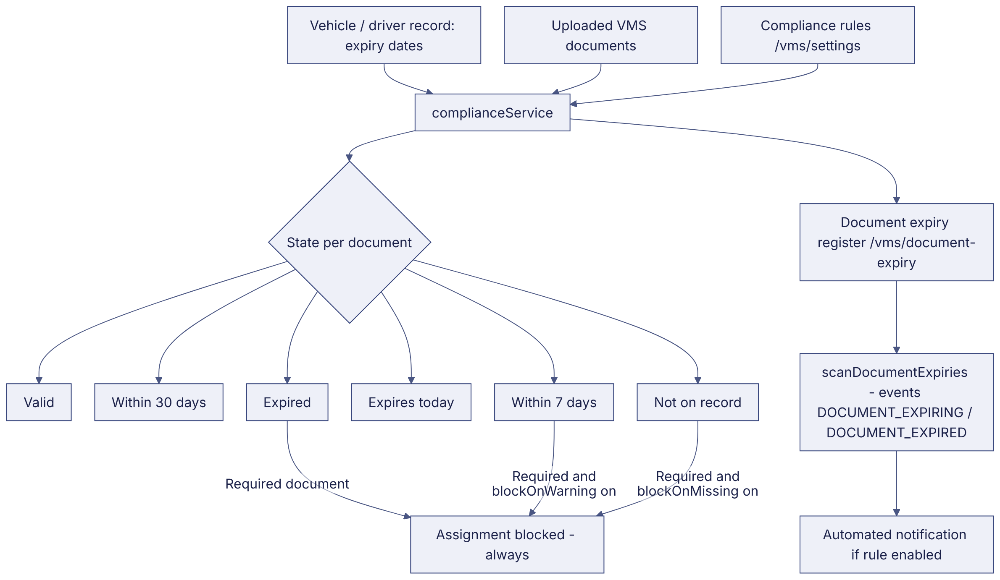{.diagram data-h="f894a8f9a077"}

| Setting (`DEFAULT_VMS_SETTINGS`) | Default |
|---|---|
| Required vehicle documents | Registration (RC), Insurance, Fitness certificate |
| Required driver documents | Driving licence |
| Block on expired required document | Always on |
| Block when expiring within warning days | Off (warning days 7) |
| Block when not on record | Off |

Tracked expiry fields — vehicle: Registration (RC), Insurance, Pollution (PUC), Fitness certificate, Permit; driver:
Driving licence, Medical certificate.

VMS screens: VMS dashboard `/vms`, Vehicles `/vms/vehicles` (details and documents), Driver documents `/vms/drivers`,
Document expiry `/vms/document-expiry`, VMS reports `/vms/reports`, Compliance rules `/vms/settings` (Administrator).

## 11.7 Tracking

| Screen | Route | Who | What it shows |
|---|---|---|---|
| Dispatch dashboard | `/dispatch` | Dispatch viewers | KPIs and charts (chapter 04 §4.6) |
| Delivery tracking | `/dispatch/delivery-tracking` | Administrator, Sales Manager, Customer Service, Dispatcher | Every stop with status, driver, time |
| Live Tracking (Demo GPS) | `/dispatch/live-tracking` | Administrator, Dispatcher | Map with simulated vehicle positions from `bellomassi_driver_tracking` |
| Delivery history | `/dispatch/delivery-history` | Dispatch viewers, Finance, Warehouse Manager | Closed stops, exceptions to review |
| Delivery details | `/dispatch/deliveries/:id` | `deliveries.view` | Items, POD, OTP inspector (Dispatcher / Admin), review panel |
| Delivery reports | `/dispatch/reports` | Administrator, Dispatcher, Finance | Delivery performance |

## 11.8 Dispatch — swimlane

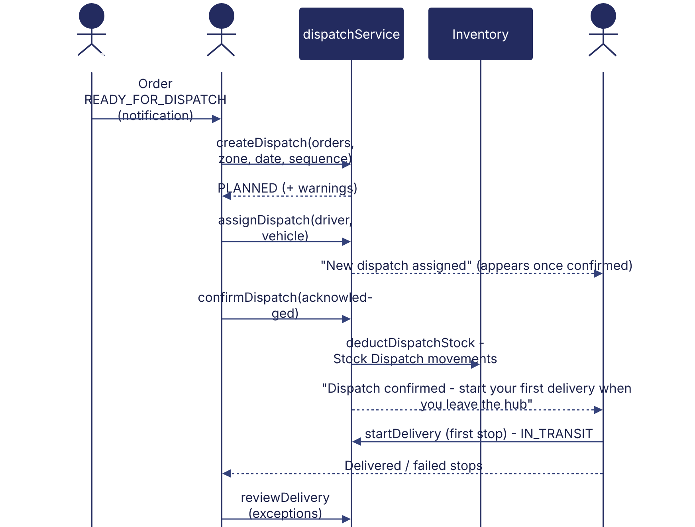{.diagram data-h="47ca4a2e6281"}

# 12 · Finance & Invoice Workflow {#ch-12}

**Status:** Invoice templates, numbering, generation, printing and cancellation are **Implemented**. Tax is a configurable
**demo** calculation (not GST-compliant e-invoicing). Emailing an invoice uses the email module (**Simulated** in demo
mode). **Payments, receipts, credit notes, refunds, collections posting and expenses are Not Implemented.** The
customer's credit balance is a field on the customer record and is **not** updated by invoices.

## 12.1 Business summary

Finance (or an Administrator) picks an approved-or-later order and issues one invoice for it. The invoice is a frozen
snapshot of the order, customer, hub, template and — when available — the delivery note, so later changes to master
data never change an issued invoice. Finance chooses whether to bill **ordered** quantities or **delivered**
quantities (from the delivery note), can add an order discount, shipping and additional charges, and sets invoice and
due dates. An invoice that is wrong is **cancelled** with a reason; a new one can then be issued.

## 12.2 Master flowchart 9 — Finance / invoice workflow

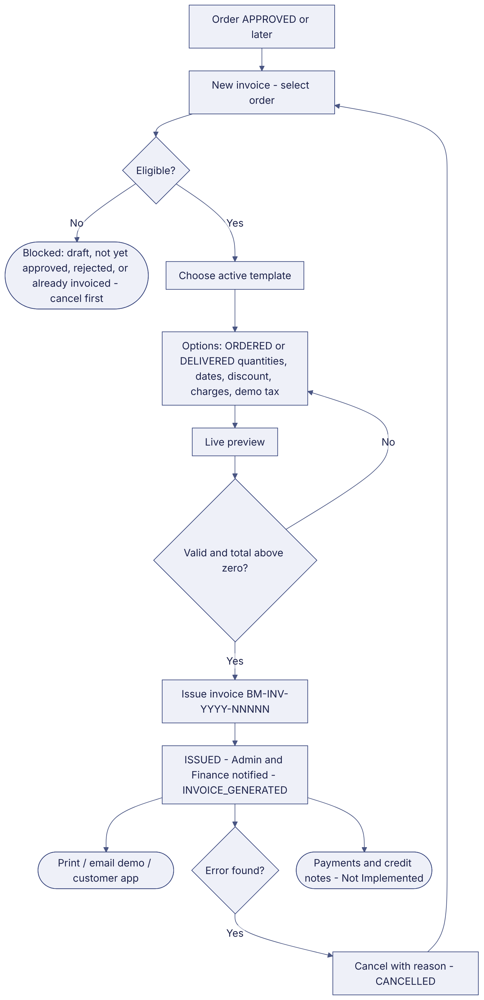{.diagram data-h="ca7090d7b937"}

## 12.3 Templates and numbering

| Item | Details |
|---|---|
| Templates | `/invoices/templates` — code, company details (GSTIN, PAN, email), page format (A4 portrait, A4 landscape, custom 100–500 mm), font (Inter, Georgia, Helvetica, Courier), font size 8–14 pt, primary / accent colours, header and footer layouts, sections (e.g. signature, QR code placeholder), active flag, default flag. Preview at `/invoices/templates/:id/preview`. |
| Who | Administrator, Finance (`invoices.templates`) |
| Numbering | `bellomassi_invoice_settings`: prefix **BM-INV**, include year, starting number, 5 digits → e.g. BM-INV-2026-00001. Only Administrator or Finance can change numbering. |

## 12.4 Calculation (`services/invoiceCalculationService.js`)

| Line | Formula |
|---|---|
| Line subtotal | quantity × unit price |
| Item discount | line subtotal × item discount % |
| Order discount | NONE, flat AMOUNT or PERCENT of (Σ subtotal − Σ item discount), allocated to lines by value |
| Taxable amount | line subtotal − item discount − allocated order discount |
| Tax | taxable × tax % (product rate from the order, or a flat demo rate ≤ 40%) |
| Charges | shipping + additional charges, taxed at charges tax % (default 0, ≤ 40%) |
| Grand total | Σ taxable + Σ tax + charges + charges tax |

Quantity basis: **DELIVERED** bills what the delivery note recorded as delivered; it falls back to **ORDERED** when there
is no delivery note (`utils/invoiceSnapshot.js`).

## 12.5 Validation and messages

| Rule | Message |
|---|---|
| Permission | "Only Finance or Admin can issue invoices." / "…cancel invoices." |
| Template | "Create an invoice template first.", "… is inactive." |
| Customer | "The order's customer record no longer exists." |
| Dates | "Enter a valid date.", "Due date cannot be before the invoice date." |
| Charges / tax | "Enter 0 or more.", "Demo tax rate cannot exceed 40%." |
| Discount | "Discount must be 0–100%.", "Discount cannot be negative." |
| Total | "The invoice total must be greater than zero (check delivered quantities and discounts)." |
| Cancel | "Give a reason for cancelling.", "… is already cancelled." |

## 12.6 Statuses

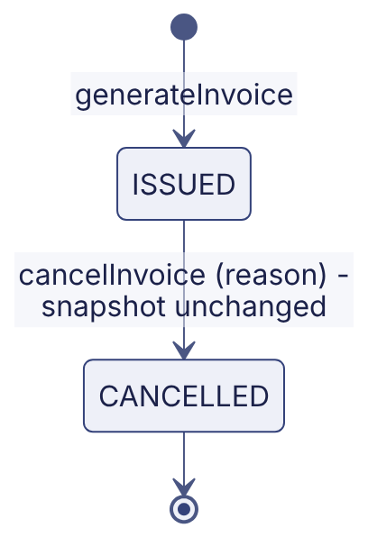{.diagram data-h="3715b4744505"}

Invoiceable order statuses (`INVOICEABLE_ORDER_STATUSES`): APPROVED, CONSOLIDATED, READY_FOR_DISPATCH, DISPATCHED,
OUT_FOR_DELIVERY, PARTIALLY_DELIVERED, DELIVERED, DELIVERY_FAILED, RETURNED_TO_HUB.

## 12.7 Credit and outstanding

| Topic | How it works today |
|---|---|
| Credit limit, days, enabled | Customer master (Administrator) |
| Credit balance | Customer master field; seeded demo values; **not** changed by invoices or deliveries |
| Order credit check | `getOrderCreditPosition`: projected balance = balance + order total; warning (or block, if configured) at approval |
| Customer Credit page | `/customers/credit` — limits, balances, utilisation (Administrator, Sales Manager, Finance) |
| Finance dashboard | Outstanding (customer balances), Credit utilisation, Over credit limit, Collections |
| Customer app | Outstanding balance on Home and Payments; "No payments recorded in this prototype" |
| Payments, receipts, allocation, credit notes, refunds | **Not Implemented** — the related Finance reports show "no source data" |

## 12.8 Finance — swimlane

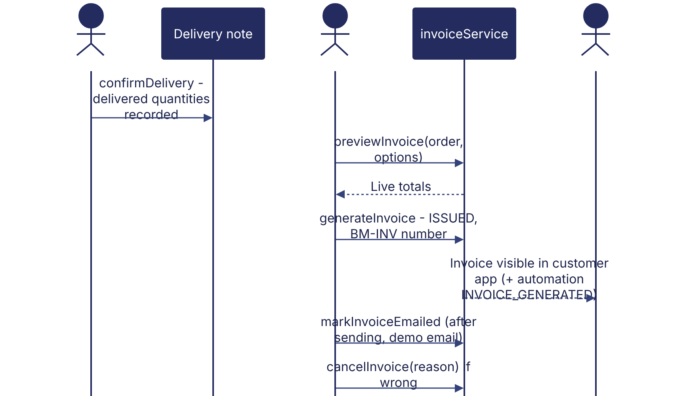{.diagram data-h="e0b9c9f66b7a"}

# 13 · Communication & Documents Workflow {#ch-13}

| Feature | Status |
|---|---|
| In-app notifications | Implemented |
| Automated notifications (rules per event) | Implemented — delivered through the simulated channels in demo mode |
| Email (compose, drafts, sent, history, templates, inbox) | **Simulated** in demo mode ("Sent · demo (not sent)"); gateway SMTP / IMAP mode **Not Verified** |
| WhatsApp via OpenWA | **Simulated** (mock session); gateway mode **Not Verified** |
| Call history and follow-ups | Implemented as a manual log (no telephony) |
| Documents repository, upload, review, verify, reject | Implemented |
| OCR | **Simulated** (MOCK provider); browser OCR unavailable; backend OCR **Not Verified** |

## 13.1 Master flowchart 10 — Communication workflow

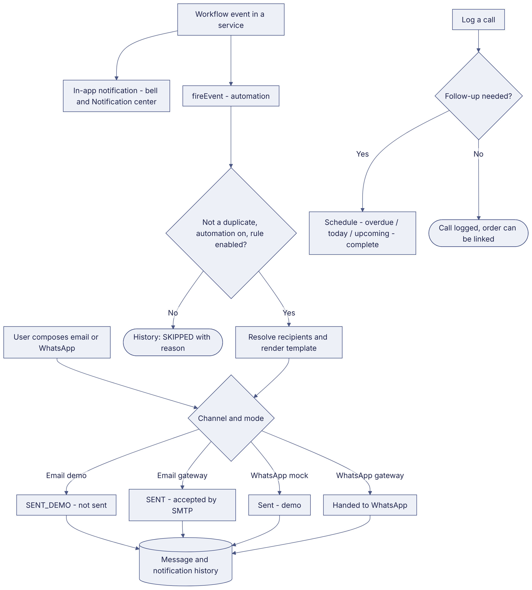{.diagram data-h="8b61c7d83c9d"}

## 13.2 In-app notifications

| Item | Details |
|---|---|
| Created by | Workflow services (`notifyOrder`, `notifyDispatch`, `notifyCustomer`, `pushNotification`) |
| Addressed to | Roles, a specific user (e.g. the order's salesman), a driver, or a customer |
| Storage | `bellomassi_notifications`; preferences `bellomassi_notification_preferences` (muted categories, toasts, digest) |
| Screens | Header bell dropdown; `/notifications` (Notification Center) |
| Actions | Mark read, mark all read, filter by category, open linked record |

Key notifications by event:

| Event | Recipients |
|---|---|
| Order submitted / resubmitted | Sales Manager ("New order for approval"), salesman |
| Order approved | Salesman, Customer Service ("Order awaiting consolidation") |
| Order returned / rejected | Salesman |
| Order consolidated / ready for dispatch | Dispatcher; salesman on ready |
| Dispatch assigned / changed / sequence updated / cancelled | Driver; Administrator / Dispatcher |
| Dispatch confirmed | Driver; Administrator |
| Out for delivery / driver arrived / delivered / not completed | Customer; Dispatcher |
| Delivery failed | Administrator, Dispatcher ("Review required"), customer |
| Invoice issued | Administrator, Finance |

## 13.3 Email

| Step | Route | Notes |
|---|---|---|
| Home | `/communication/email` | Counts, mode (Demo / Live) |
| Compose | `/communication/email/compose` | To, CC, subject, body, template, attachments from documents |
| Drafts | `/communication/email/drafts` | `bellomassi_email_drafts` |
| Sent / History | `/communication/email/sent`, `/history` | `bellomassi_email_history` with status |
| Inbox | `/communication/email/inbox` | Seeded demo mailbox; "sync" may add a simulated message (`bellomassi_email_inbox`) |
| Templates | `/communication/email/templates` | Variables such as customer, order, invoice fields |
| Settings | `/communication/email/settings` | SMTP / IMAP settings, encryption; credentials are only used by the gateway |

## 13.4 WhatsApp (OpenWA)

| Step | Route | Notes |
|---|---|---|
| Home | `/communication/whatsapp` | Session state; "Connected" only when OpenWA reports `ready` |
| Compose | `/communication/whatsapp/compose` | Recipient (country code default 91), message, template |
| History | `/communication/whatsapp/history` | `bellomassi_whatsapp_messages` |
| Templates | `/communication/whatsapp/templates` | `bellomassi_whatsapp_templates` |
| OpenWA settings | `/communication/whatsapp/settings` | Session start / stop / QR through the gateway; mock in demo |

## 13.5 Call history

| Step | Details |
|---|---|
| Log a call | Customer, direction (Incoming / Outgoing), status (Connected, Missed, Busy, No Answer, Voicemail), outcome, duration, notes |
| Outcomes | Order Received, Interested, Follow-up Required, No Response, Busy, Not Interested, Complaint, Payment Follow-up, Other |
| Follow-up | Suggested for Follow-up Required, Interested, Complaint, Payment Follow-up, No Response; date must not be before the call |
| Notes | Add notes (≤ 500 characters) |
| Order link | Link an order created from the call |
| Visibility | Salesmen see only their own calls; Sales Manager, Customer Service and Administrator see all |
| Storage | `bellomassi_call_history` |

## 13.6 Documents and OCR

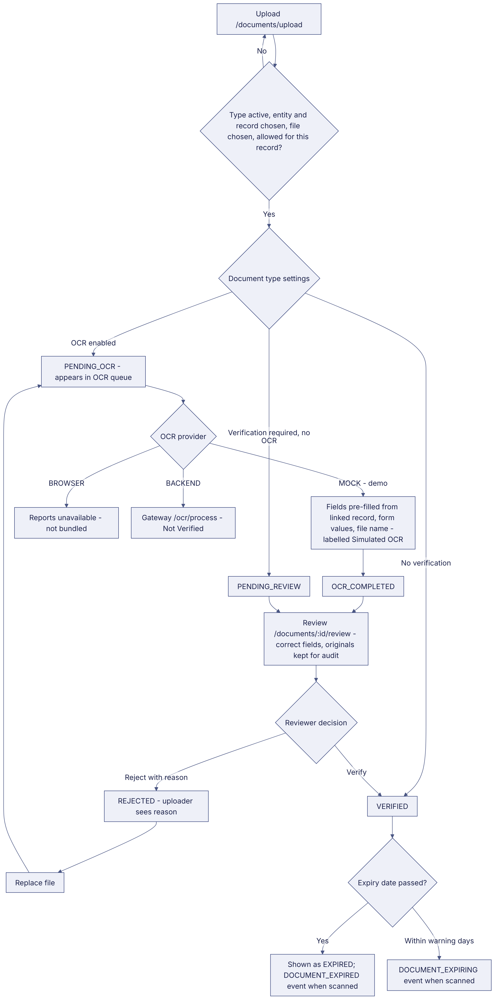{.diagram data-h="41bdc2757dae"}

| Item | Details |
|---|---|
| Who uploads | Most office roles and the Driver (own records only for scoped roles) |
| Who reviews | Administrator, Customer Service, QA Manager (`documents.review`, `documents.reject`) |
| Document types | `/documents/types` (Administrator): code, name, entity, fields to capture, expiry required, warning days, OCR enabled, verification required. Built-in codes (e.g. VEH_RC, VEH_INSURANCE, DRV_LICENSE) cannot change because VMS rules refer to them. |
| Storage | `bellomassi_documents`, files via `documentStorageService`, OCR results `bellomassi_ocr_results`, types `bellomassi_document_types` |
| Lists | Repository, OCR queue (PENDING_OCR, OCR_COMPLETED, PENDING_REVIEW), Verified, Rejected, Document reports |

## 13.7 Communication — swimlane

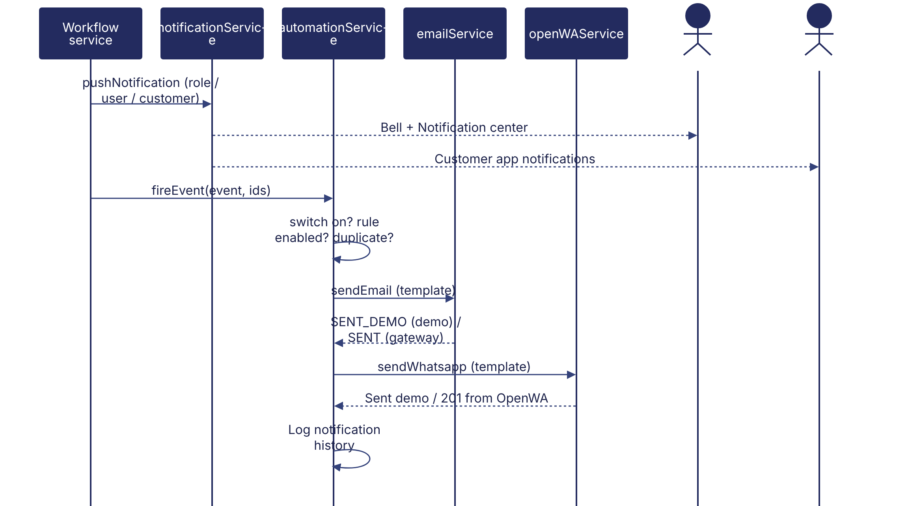{.diagram data-h="f833aed4276b"}

# 14 · Reports & Dashboard Workflow {#ch-14}

| Feature | Status |
|---|---|
| Role dashboards (12 dashboards + generic launcher) | Implemented |
| Universal dashboard period filter with comparison | Implemented (selection kept in memory, not stored) |
| Reports Center — 118 reports in 11 categories | Implemented; **24 reports have no source data** in the prototype and say so |
| Module report pages (orders, delivery, invoices, documents, VMS) | Implemented |
| CSV export, print | Implemented |
| Forecasting and predictive inventory | Implemented (in-browser statistical models) |
| AI Assistant / Jarvis | **Simulated** (demo intent engine; external providers Not Verified) |
| AI insights | Implemented (rule-based) |

## 14.1 Dashboards

| Role | Dashboard component | Main KPIs / queues |
|---|---|---|
| Super Admin, Administrator | `AdminDashboard` + `OpsOverview` | Total orders, Pending approval, Approved, Rejected, Consolidated, Ready for dispatch, Order pipeline; Sales (delivered), Delivery, Inventory value, Finance — invoiced, Purchase (replenishment), AI insights |
| Sales Executive | `SalesmanDashboard` | My orders, Draft, Pending approval, Approved, Returned, Rejected, Needs your action, My order trend |
| Sales Manager | `SalesManagerDashboard` | Pending approvals, Returned orders, Recent pending orders, Active accounts and credit position |
| Customer Service | `CustomerServiceDashboard` | Approved orders, Awaiting consolidation, Consolidated, Ready for dispatch, Queue by salesman, Consolidation queue |
| Dispatcher | `DispatcherDashboard` / `DispatchOverview` | Ready for dispatch, Planned, Assigned, Confirmed, In transit, Completed, Failed, Partial deliveries, Active drivers, Available vehicles; trends; driver and zone performance |
| Finance | `FinanceDashboard` | Order value (submitted), Approved order value, Delivered to invoice, Invoices, Collections, Outstanding, Credit exposure / utilisation, Over credit limit |
| Warehouse Manager / Inventory Executive | `WarehouseDashboard` (inventory variant) | Stock value, Low / out of stock, Damaged / held, Expiry, Inventory alerts, Picking & loading |
| QA Manager | `QaDashboard` | Inspections pending, Quarantine, Expired documents, Expiry, Cold chain card ("No sensor integration") |
| Supplier | `SupplierPortalDashboard` | Open purchase requests, Approved replenishment, Lines requested, Lead time, Goods receipts |
| Customer | Customer app Home | Active orders, Pending approval, Delivered, Outstanding |
| Driver | Driver app Today | Today / tomorrow stops, next stop, performance |
| Custom role | `GenericDashboard` | Workspace launcher (permission-driven) |

### Period filter

Options: Today, Yesterday, This Week, Last Week, Last 7 Days, Last 30 Days, This Month, Last Month, Month to Date, This
Quarter, Last Quarter, Quarter to Date, This Half-Year, Last Half-Year, Half-Year to Date, This Year, Last Year, Year to
Date, Custom Date Range, All Time, plus **Specific period** (day, week, month, quarter, half-year, calendar year,
financial year; financial year starts in April by default). **Compare** shows % change, difference and previous value
against the previous equivalent period. Defaults: office and customer dashboards **All Time**; driver **Today**.

Each dated collection is filtered on its own business date: orders (order date), approvals (decision date), dispatches
(dispatch date), deliveries (completion / failure date), invoices (invoice date), receipts / transfers / adjustments
(their dates), replenishment (created date), documents (upload date), delivery notes (delivery date), AI insights
(generated date). Stock, inventory value, credit balances, customers, products, vehicles and drivers are **Current**
positions. Source: `utils/dashboardFilter.js`, `context/DashboardPeriodContext.jsx`.

## 14.2 Master flowchart 11 — Reports workflow

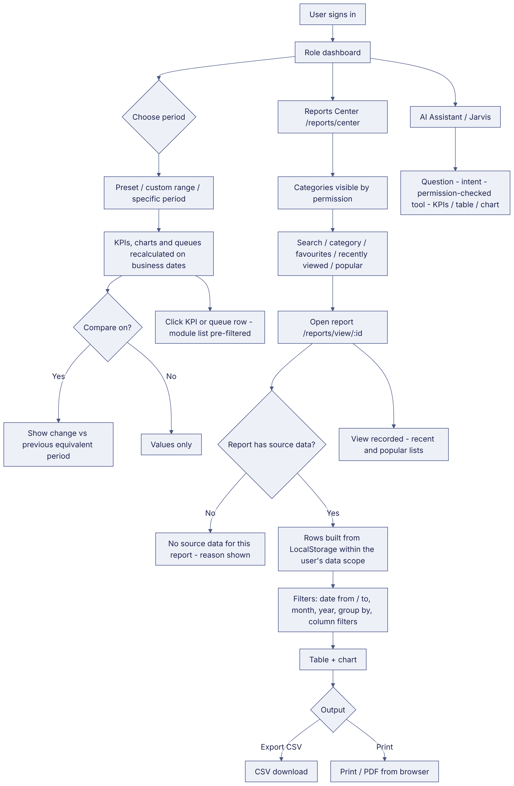{.diagram data-h="6408b54efb01"}

## 14.3 Reports Center catalogue

Entries marked * have **no source data** in this prototype; the report opens and states why (payments, credit notes,
refunds, expenses, supplier invoices, purchase / customer returns, batch / expiry on stock, cycle counts, fuel and
maintenance are not captured).

| Category | Reports | Visible with | Report titles |
|---|---|---|---|
| Sales | 14 | `orders.reports` | Sales Order Register, Sales Order Summary, Sales by Customer, Sales by Salesman, Sales by Product, Sales by Category, Sales by Month, Sales Order Status, Pending Approval, Rejected Orders, Credit Limit Exceptions, Order Conversion, Customer Sales Analysis, VIP Orders |
| Inventory | 18 | `reports.inventory` | Stock Overview, Stock Valuation, Stock Movement, Stock Ageing*, Batch Inventory*, Expiry Report*, Near Expiry*, Expired Stock, Slow Moving Stock, Non Moving Stock, Stock-Out Report, Stock Transfer, Stock Adjustment, Scrap Register, Scrap Valuation, Warehouse Utilization, Cycle Count Variance*, Inventory Transaction History |
| Procurement | 10 | `procurement.view` | Purchase Order Register, Purchase Order Status, Purchase by Supplier, Purchase by Product, Goods Receipt Register, Pending Goods Receipts, Purchase Return*, Supplier Invoice Register*, Supplier Outstanding*, Procurement Performance |
| Dispatch & Delivery | 19 | `dispatch.reports or dispatch.history` | Dispatch Register, Dispatch Summary, Dispatch by Zone, Dispatch by Driver, Dispatch by Vehicle, Delivery Register, Delivered Orders, Pending Deliveries, Failed Deliveries, Partial Deliveries, Delivery Performance, On-Time Delivery, VIP Delivery Performance, Delivery Proof Report, OTP Verification Report, Delivery Note Register, Driver Performance, Route Performance, Customer Delivery History |
| Finance | 14 | `finance.view or invoices.reports` | Customer Outstanding, Customer Ageing, Receivable Summary, Invoice Register, Payment Register*, Payment Allocation*, Credit Note Register*, Refund Register*, Supplier Outstanding*, Supplier Ageing*, Supplier Payment Register*, Expense Register*, Expense Category Report*, Finance Summary |
| Customer | 8 | `customers.view` | Customer Master, Customer Sales, Customer Outstanding, Customer Order History, Customer Delivery History, Customer Payment History*, Customer Return History*, Customer Performance |
| Supplier | 5 | `suppliers.view` | Supplier Master, Supplier Purchase, Supplier Outstanding*, Supplier Payment*, Supplier Performance |
| Fleet | 9 | `fleet.view or vms.view` | Vehicle Register, Driver Register, Vehicle Utilization, Vehicle Maintenance*, Vehicle Expenses*, Fuel Register*, Vehicle Document Expiry, Driver Performance, Delivery per Vehicle |
| Communication | 7 | `communication.calls` | Call History, Calls by Salesman, Calls by Customer, Call Outcome, Follow-up Pending, Overdue Follow-ups, Call-to-Order Conversion |
| Scrap | 7 | `inventory.scrap.view` | Scrap Register, Scrap by Product, Scrap by Batch, Scrap by Hub, Scrap by Reason, Scrap Valuation, Scrap Approval History |
| AI | 7 | `ai.insights.view` | Sales Insights, Inventory Insights, Demand Forecast, Expiry Risk, Slow-Moving Products, Delivery Insights, Business Summary |

Total: 118 reports; 94 with data, 24 marked *.

Module report pages also exist: Order Reports `/orders/reports`, Delivery Reports `/dispatch/reports`, Invoice
Reports `/invoices/reports`, Document Reports `/documents/reports`, VMS Reports `/vms/reports`. Legacy routes
`/reports`, `/reports/deliveries`, `/reports/inventory`, `/reports/invoices` redirect to the current pages.

## 14.4 Forecasting

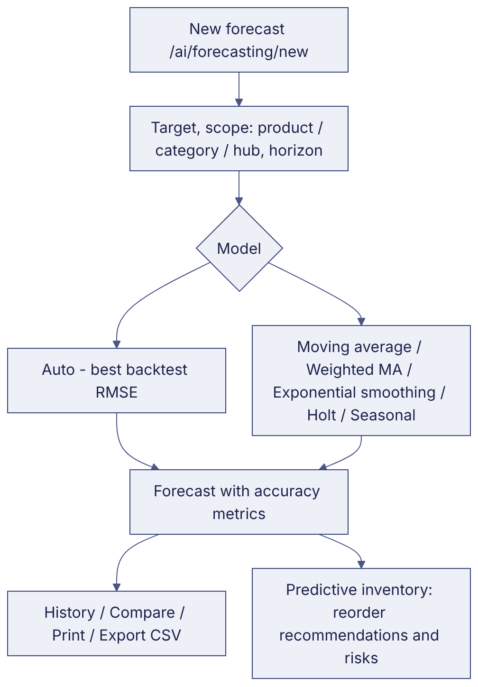{.diagram data-h="df8d0d335494"}

## 14.5 AI Assistant and Jarvis

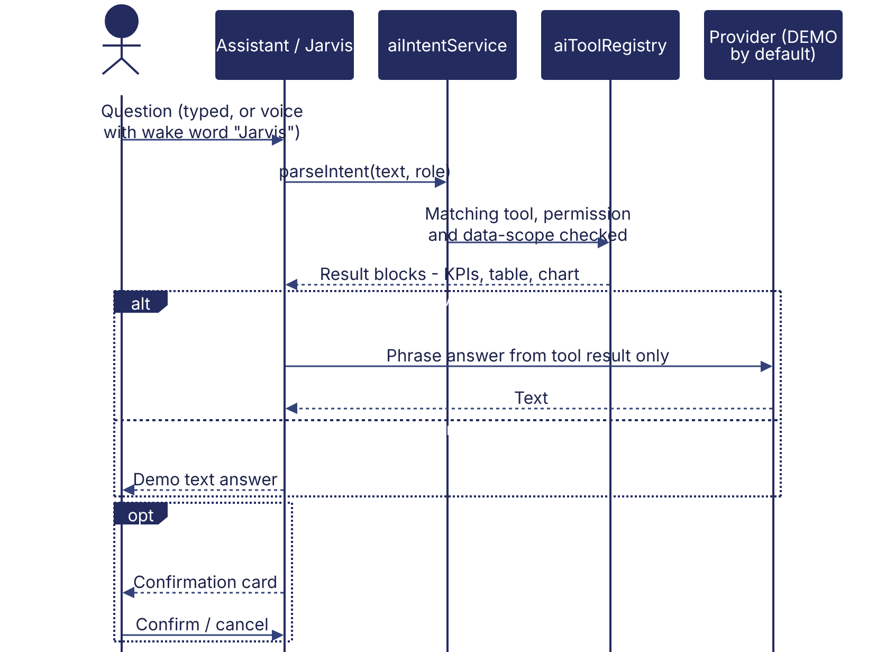{.diagram data-h="962a85a5c3f2"}

Conversations are private to each user. Every assistant action is logged in AI Activity (`/ai/activity`). AI Settings
(`/ai/settings`, Administrator) choose the provider: Demo, OpenJarvis, Ollama, Gemini, OpenAI-compatible or Custom —
only Demo was verified.

# 15 · Exception Workflow {#ch-15}

An exception is anything that stops the normal path. In Bellomassi every exception is handled by the service that owns
the record: the action is refused with a message and nothing is saved, or the record moves to an exception status that
a named role must resolve. Repeating an action that already happened never changes data twice ("No change was made.").

## 15.1 Master flowchart 12 — Exception workflow

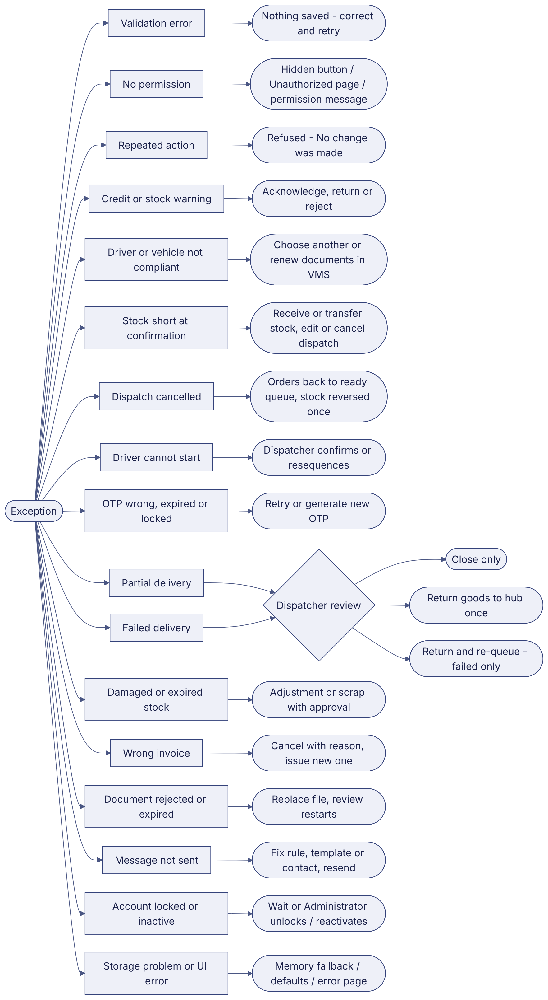{.diagram data-h="24a7bf897b31"}

## 15.2 Exception register

| # | Exception | Detected in | What the user sees | Who resolves | Resolution | Status |
|---|---|---|---|---|---|---|
| 1 | Wrong password | `authService.login` | "The email/username or password is incorrect…" | User | Retry; reset password | Implemented |
| 2 | Account locked (5 failures) | `authService` | "Too many failed attempts. This account is locked for N minutes." | User / Administrator | Wait, or **Unlock** in User Management | Implemented |
| 3 | Inactive account | `authService` | "This account is inactive…" | Administrator | Reactivate user | Implemented |
| 4 | Idle session | `SessionWatcher` | Signed out | User | Sign in again | Implemented |
| 5 | No permission | `ProtectedRoute`, services | `/unauthorized` or "You do not have permission to…" | Administrator | Grant permission / role | Implemented |
| 6 | Order data invalid | `orderService.validateOrder` | Field messages | Sales Executive | Correct and submit | Implemented |
| 7 | Credit limit exceeded | `getApprovalChecks` | Warning (or block if configured) | Sales Manager | Acknowledge, return ("Reduce order value (credit)") or reject | Implemented |
| 8 | Stock short at approval | `getApprovalChecks` | Warning | Sales Manager | Acknowledge or return / reject ("Stock not available") | Implemented |
| 9 | Inactive customer / hub / product | `getApprovalChecks` | "Cannot approve: …" | Administrator / Sales Manager | Fix master data, or reject | Implemented |
| 10 | Order returned | `returnOrderForCorrection` | Salesman notification with edit link, highlighted section | Sales Executive | Correct and resubmit | Implemented |
| 11 | Order rejected | `rejectOrder` | Rejected Orders list, notification | — | Final; a new order can be created (or duplicated) | Implemented |
| 12 | Customer wants to cancel a submitted order | — | — | — | **Not Implemented** (Sales Manager may reject with "Customer cancelled") | Not Implemented |
| 13 | Consolidation checklist incomplete | `consolidateOrder` | "Complete the verification checklist first." | Customer Service | Tick all checks | Implemented |
| 14 | Order not eligible for dispatch | `orderIneligibility` | "Only orders ready for dispatch can be dispatched." / already on another dispatch / no complete address | Dispatcher / Customer Service | Wait for release, fix address | Implemented |
| 15 | Driver / vehicle not compliant or busy | `driverAssignmentIssues`, `vehicleAssignmentIssues` | Specific issue messages | Dispatcher / Administrator | Choose another, renew documents, maintenance | Implemented |
| 16 | Load exceeds capacity | `vehicleAssignmentIssues` | "Load of N exceeds … capacity" | Dispatcher | Bigger vehicle or split dispatch | Implemented |
| 17 | Stock short at confirmation | `deductDispatchStock` | "…needs N, only M available at the hub." | Warehouse / Dispatcher | Receive or transfer stock; edit dispatch | Implemented |
| 18 | Dispatch cancelled | `cancelDispatch` | Driver and Admin notified; orders back in ready queue | Dispatcher | Re-plan; stock reversed if it was deducted | Implemented |
| 19 | Driver starts out of order / too early | `startDelivery` | Blocker text under the Start button | Driver / Dispatcher | Follow sequence; Dispatcher resequences or confirms | Implemented |
| 20 | Wrong OTP | `otpService.evaluateOtp` | Error on confirm screen; attempt counted | Driver / customer | Re-enter | Simulated OTP |
| 21 | OTP expired / locked | `otpService` | "This OTP has expired. Generate a new one." / "Too many incorrect attempts. Generate a new OTP." | Driver | Generate a new OTP | Simulated OTP |
| 22 | Partial delivery | `confirmDelivery` | PARTIALLY_DELIVERED; remaining stays with Dispatcher | Dispatcher | Review; return undelivered stock to hub | Implemented |
| 23 | Failed delivery | `failDelivery` | FAILED; reasons list; customer told "Our team will contact you to reschedule." | Dispatcher | Review; return to hub; re-queue | Implemented |
| 24 | Damaged goods at delivery | `confirmDelivery` (damaged qty) | Recorded on the delivery and note | Dispatcher / Warehouse | Damaged quantity is not returned to available stock by review; use adjustment / scrap | Implemented |
| 25 | Transfer more than available | `validateTransfer` | "Only N … available at …" | Inventory staff | Reduce quantity | Implemented |
| 26 | Adjustment would go negative | `validateAdjustment` | "Cannot remove more than the N available…" | Inventory staff | Correct quantity | Implemented |
| 27 | Scrap exceeds eligible / duplicate / missing photo or batch | `validateScrap` | "Only N eligible…", photo / batch messages | Requester | Correct request | Implemented |
| 28 | Scrap rejected | `rejectScrap` | Rejection reason | Requester | New request if needed | Implemented |
| 29 | Invoice wrong | `cancelInvoice` | CANCELLED with reason | Finance | Issue a new invoice | Implemented |
| 30 | Invoice for ineligible / already invoiced order | `invoiceEligibility` | Eligibility message | Finance | Wait or cancel existing invoice | Implemented |
| 31 | Document rejected | `rejectDocument` | Reason shown to uploader | Uploader | Replace file | Implemented |
| 32 | Document expired | `effectiveStatus`, VMS | EXPIRED badge; assignment blocked for required VMS documents | Administrator / Dispatcher / QA | Upload renewed document, update expiry | Implemented |
| 33 | OCR not possible | `ocrService` | "The file is not stored in this browser…", provider unavailable | Reviewer | Enter fields manually | Implemented |
| 34 | Automated message skipped / failed | `automationService` | History entry with note | Administrator | Enable automation / rule, add template or contact | Implemented |
| 35 | Cold-chain temperature excursion | — | "No sensor integration" | — | Record a scrap request with reason "Temperature Excursion" | Not Implemented (monitoring) |
| 36 | Browser storage blocked or corrupted | `storageService` | App keeps working in memory; corrupted key falls back to defaults | User / Administrator | Allow storage; reset demo data if needed | Implemented |
| 37 | Unknown page | Router | Not Found page | User | Use the menu | Implemented |

## 15.3 Delivery exception review — detail

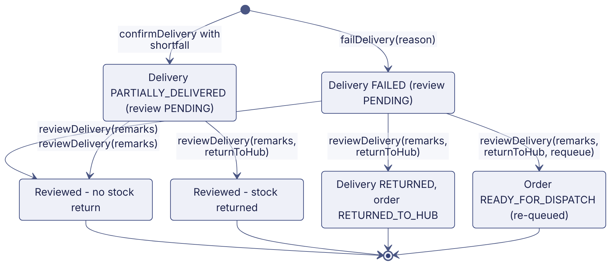{.diagram data-h="13cc45d3ef98"}

Rules (`deliveryService.reviewDelivery`): only Dispatcher / Administrator; only FAILED or PARTIALLY_DELIVERED; remarks
required; goods can be returned once; re-queue only for a failed delivery whose goods are returned; a second review is
refused.

# 16 · Role Responsibility Matrix {#ch-16}

Role abbreviations: **SA** Super Admin · **AD** Administrator · **SE** Sales Executive · **SM** Sales Manager · **CS**
Customer Service · **DP** Dispatcher · **DR** Driver · **FI** Finance · **WM** Warehouse Manager · **IE** Inventory
Executive · **QA** QA Manager · **CU** Customer · **SU** Supplier.

Legend: **R** responsible (does the work) · **A** approves / decides · **C** can act or contribute · **V** view only ·
blank = no access. Derived from the default permissions in `src/config/permissions.js` and the service rules.

## 16.1 Process responsibility matrix

| Process step | SA | AD | SE | SM | CS | DP | DR | FI | WM | IE | QA | CU | SU |
|---|:-:|:-:|:-:|:-:|:-:|:-:|:-:|:-:|:-:|:-:|:-:|:-:|:-:|
| Maintain customers | R | R | V | V | V |  |  |  |  |  |  |  |  |
| Maintain products | R | R | V | V | V | V |  | V | V | V | V |  |  |
| Maintain hubs | R | R |  | V | V | V |  |  | V | V | V |  |  |
| Maintain suppliers | R | R |  | V |  | V |  | V | V |  |  |  |  |
| Maintain zones, drivers, vehicles | R | R |  |  |  | V |  |  |  |  |  |  |  |
| Create / submit order | C | C | R |  |  |  |  |  |  |  |  | R |  |
| Approve / return / reject order | A | V |  | A |  |  |  |  |  |  |  |  |  |
| Correct returned order | C | C | R |  |  |  |  |  |  |  |  |  |  |
| Consolidate, mark ready for dispatch | C | V |  |  | R |  |  |  |  |  |  |  |  |
| Plan dispatch, assign driver and vehicle | R | R |  | V | V | R |  | V | V |  |  |  |  |
| Confirm dispatch (stock deducted) | R | R |  |  |  | R |  |  |  |  |  |  |  |
| Cancel dispatch | R | R |  |  |  | R |  |  |  |  |  |  |  |
| Deliver (start, arrive, OTP, POD, complete / fail) | C* |  |  |  |  |  | R |  |  |  |  | C (shares OTP) |  |
| Review failed / partial delivery | A | A |  |  |  | A |  |  |  |  |  |  |  |
| Issue / cancel invoice | R | R |  | V |  |  |  | R |  |  |  | V |  |
| Invoice templates and numbering | R | R |  |  |  |  |  | R |  |  |  |  |  |
| Stock receipt | R | R |  |  |  | V |  |  | R | R | V |  |  |
| Stock transfer | R | R |  |  |  | V |  |  | R | R | V |  |  |
| Stock adjustment | R | R |  |  |  | V |  |  | R | V | R |  |  |
| Scrap request | R | R |  |  |  | R |  |  | R | R | R |  |  |
| Scrap approval / write-off | A | A |  |  |  |  |  |  | A |  |  |  |  |
| Replenishment draft | R | R |  |  |  | R |  |  | R | R |  |  |  |
| Replenishment approval / convert | A | A |  |  |  |  |  |  |  |  |  |  |  |
| View approved replenishment |  |  |  |  |  |  |  |  |  |  |  |  | V |
| Vehicle / driver compliance rules | R | R |  |  |  |  |  |  |  |  |  |  |  |
| Upload VMS documents | R | R |  |  | R | R |  |  |  |  |  |  |  |
| Upload documents | R | R | R | R | R | R | R | R | R | R | R |  |  |
| Verify / reject documents | A | A |  |  | A |  |  |  |  |  | A |  |  |
| Document types | R | R |  |  |  |  |  |  |  |  |  |  |  |
| Send email / WhatsApp | R | R | R | R | R | R |  | R |  |  |  |  |  |
| Automation rules | R | R |  |  |  |  |  |  |  |  |  |  |  |
| Call log and follow-ups | R | R | R (own) | R | R |  |  |  |  |  |  |  |  |
| Reports Center | V | V | V | V | V | V |  | V | V | V | V |  |  |
| Generate forecasts | R | R |  | R |  |  |  |  |  |  |  |  |  |
| Users, roles, permissions | R | R |  |  |  |  |  |  |  |  |  |  |  |
| Application settings, organization | R | R |  |  |  |  |  |  |  |  |  |  |  |
| Audit log | V | V |  |  |  |  |  |  |  |  |  |  |  |

\* Super Admin holds `driver.app` and `customer.app` but can only act in those apps if the user is linked to a
driver or customer record.

## 16.2 Hand-off matrix (who passes work to whom)

| From | Hand-off | To | Trigger in code |
|---|---|---|---|
| Sales Executive / Customer | Submitted order | Sales Manager | `submitOrder` notification |
| Sales Manager | Returned order | Sales Executive | `returnOrderForCorrection` notification with edit link |
| Sales Manager | Approved order | Customer Service | `approveOrder` notification |
| Customer Service | Ready order | Dispatcher | `markReadyForDispatch` notification |
| Dispatcher | Assigned / confirmed dispatch | Driver | `assignDispatch`, `confirmDispatch` notifications |
| Driver | Delivery started / arrived / completed | Customer | `startDelivery`, `markArrived`, `confirmDelivery` notifications |
| Driver | Failed / partial delivery | Dispatcher | `failDelivery` notification ("Review required") |
| Driver | Delivered order | Finance | Delivery note; "Delivered, to invoice" on Finance dashboard |
| Finance | Invoice | Customer | Invoice visible in customer app; automation INVOICE_GENERATED |
| Inventory Executive / QA | Scrap request | Warehouse Manager | Scrap queue (PENDING_APPROVAL) |
| Warehouse / Inventory / Dispatcher | Replenishment draft | Administrator | Replenishment list (SUBMITTED) |
| Administrator | Approved replenishment | Supplier, warehouse | Supplier portal; receipt links |
| Any uploader | Document | Customer Service / QA / Administrator | OCR queue |

## 16.3 Permission matrix (default grants)

All 110 permission keys from `src/config/rbacCatalog.js` with the default grant per system role
(`src/config/permissions.js`). Super Admin always holds every key. Administrators can change grants for non-locked
roles in **Role Management**.

| Permission key | Meaning | SA | AD | SE | SM | CS | DP | DR | FI | WM | IE | QA | CU | SU |
|---|---|:-:|:-:|:-:|:-:|:-:|:-:|:-:|:-:|:-:|:-:|:-:|:-:|:-:|
| `dashboard.view` | Role dashboard | ✓ | ✓ | ✓ | ✓ | ✓ | ✓ | ✓ | ✓ | ✓ | ✓ | ✓ | ✓ | ✓ |
| `customers.view` | Customer list & details | ✓ | ✓ | ✓ | ✓ | ✓ |  |  |  |  |  |  |  |  |
| `customers.manage` | Create, edit and delete customers | ✓ | ✓ |  |  |  |  |  |  |  |  |  |  |  |
| `customers.credit.view` | Customer credit | ✓ | ✓ |  | ✓ |  |  |  | ✓ |  |  |  |  |  |
| `products.view` | Product catalogue | ✓ | ✓ | ✓ | ✓ | ✓ | ✓ |  | ✓ | ✓ | ✓ | ✓ |  |  |
| `products.manage` | Create, edit and delete products | ✓ | ✓ |  |  |  |  |  |  |  |  |  |  |  |
| `suppliers.view` | Supplier directory | ✓ | ✓ |  | ✓ |  | ✓ |  | ✓ | ✓ |  |  |  |  |
| `suppliers.manage` | Edit supplier records | ✓ | ✓ |  |  |  |  |  |  |  |  |  |  |  |
| `hubs.view` | Hubs & warehouses | ✓ | ✓ |  | ✓ | ✓ | ✓ |  |  | ✓ | ✓ | ✓ |  |  |
| `hubs.manage` | Create, edit and delete hubs | ✓ | ✓ |  |  |  |  |  |  |  |  |  |  |  |
| `inventory.dashboard` | Inventory dashboard | ✓ | ✓ |  |  |  | ✓ |  | ✓ | ✓ | ✓ |  |  |  |
| `inventory.stock.view` | Stock overview | ✓ | ✓ | ✓ | ✓ | ✓ | ✓ |  | ✓ | ✓ | ✓ | ✓ |  |  |
| `inventory.lowstock.view` | Low stock | ✓ | ✓ |  | ✓ | ✓ | ✓ |  |  | ✓ | ✓ | ✓ |  |  |
| `inventory.movements.view` | Stock movement ledger | ✓ | ✓ |  |  |  | ✓ |  |  | ✓ | ✓ | ✓ |  |  |
| `inventory.documents.view` | Receipts, transfers & adjustments lists | ✓ | ✓ |  |  |  | ✓ |  |  | ✓ | ✓ | ✓ |  |  |
| `inventory.receipts.manage` | Receive stock (GRN) | ✓ | ✓ |  |  |  |  |  |  | ✓ | ✓ |  |  |  |
| `inventory.transfers.manage` | Stock transfers between hubs | ✓ | ✓ |  |  |  |  |  |  | ✓ | ✓ |  |  |  |
| `inventory.adjustments.manage` | Post stock adjustments | ✓ | ✓ |  |  |  |  |  |  | ✓ |  | ✓ |  |  |
| `inventory.scrap.view` | Scrap management | ✓ | ✓ |  |  |  | ✓ |  |  | ✓ | ✓ | ✓ |  |  |
| `scrap.create` | Create, edit & submit scrap requests | ✓ | ✓ |  |  |  | ✓ |  |  | ✓ | ✓ | ✓ |  |  |
| `scrap.approve` | Approve scrap & post the stock write-off | ✓ | ✓ |  |  |  |  |  |  | ✓ |  |  |  |  |
| `scrap.reject` | Reject scrap requests | ✓ | ✓ |  |  |  |  |  |  | ✓ |  |  |  |  |
| `warehouse.dashboard` | Warehouse dashboard | ✓ | ✓ |  |  |  |  |  |  | ✓ | ✓ | ✓ |  |  |
| `warehouse.qa.view` | QA & cold-chain overview | ✓ | ✓ |  |  |  |  |  |  | ✓ |  | ✓ |  |  |
| `orders.view` | Order list & details | ✓ | ✓ | ✓ | ✓ | ✓ | ✓ |  | ✓ | ✓ |  |  |  |  |
| `orders.create` | Create & edit sales orders | ✓ | ✓ | ✓ |  |  |  |  |  |  |  |  |  |  |
| `orders.mine` | My orders | ✓ | ✓ | ✓ |  |  |  |  |  |  |  |  |  |  |
| `orders.corrections.view` | Returned & rejected orders | ✓ | ✓ | ✓ | ✓ |  |  |  |  |  |  |  |  |  |
| `orders.approval.view` | Approval queue | ✓ | ✓ |  | ✓ |  |  |  |  |  |  |  |  |  |
| `orders.approve` | Approve orders | ✓ |  |  | ✓ |  |  |  |  |  |  |  |  |  |
| `orders.reject` | Reject or return orders | ✓ |  |  | ✓ |  |  |  |  |  |  |  |  |  |
| `orders.consolidation.view` | Consolidation queue | ✓ | ✓ |  |  | ✓ |  |  |  |  |  |  |  |  |
| `orders.consolidate` | Consolidate & release orders | ✓ |  |  |  | ✓ |  |  |  |  |  |  |  |  |
| `orders.reports` | Order reports | ✓ | ✓ |  | ✓ |  |  |  | ✓ |  |  |  |  |  |
| `sales.targets.manage` | Set sales targets | ✓ | ✓ |  | ✓ |  |  |  |  |  |  |  |  |  |
| `customer.app` | Customer app — catalogue, own orders, tracking & documents | ✓ |  |  |  |  |  |  |  |  |  |  | ✓ |  |
| `customer.order` | Customer app — place orders | ✓ |  |  |  |  |  |  |  |  |  |  | ✓ |  |
| `tracking.fleet` | Live fleet map (demo GPS) | ✓ | ✓ |  |  |  | ✓ |  |  |  |  |  |  |  |
| `dispatch.view` | Dispatch dashboard & planning | ✓ | ✓ |  | ✓ | ✓ | ✓ |  | ✓ | ✓ |  |  |  |  |
| `dispatch.ready.view` | Ready-for-dispatch queue | ✓ | ✓ |  |  | ✓ | ✓ |  |  | ✓ |  |  |  |  |
| `dispatch.manage` | Create dispatches & assign drivers / vehicles | ✓ | ✓ |  |  |  | ✓ |  |  |  |  |  |  |  |
| `dispatch.tracking` | Delivery tracking | ✓ | ✓ |  | ✓ | ✓ | ✓ |  |  |  |  |  |  |  |
| `dispatch.history` | Delivery history | ✓ | ✓ |  | ✓ | ✓ | ✓ |  | ✓ | ✓ |  |  |  |  |
| `dispatch.reports` | Delivery reports | ✓ | ✓ |  |  |  | ✓ |  | ✓ |  |  |  |  |  |
| `dispatch.otp.inspect` | Inspect simulated delivery OTPs | ✓ | ✓ |  |  |  | ✓ |  |  |  |  |  |  |  |
| `deliveries.view` | Delivery details | ✓ | ✓ | ✓ | ✓ | ✓ | ✓ |  | ✓ | ✓ |  |  |  |  |
| `fleet.view` | Zones, drivers & vehicles | ✓ | ✓ |  |  |  | ✓ |  |  |  |  |  |  |  |
| `fleet.manage` | Manage zones, drivers & vehicles | ✓ | ✓ |  |  |  |  |  |  |  |  |  |  |  |
| `deliveryNotes.view` | Delivery notes | ✓ | ✓ | ✓ | ✓ | ✓ | ✓ |  | ✓ | ✓ |  |  |  |  |
| `driver.app` | Driver app — run deliveries & confirm with OTP | ✓ |  |  |  |  |  | ✓ |  |  |  |  |  |  |
| `vms.view` | VMS dashboard, register & expiry | ✓ | ✓ |  |  |  | ✓ |  |  |  |  | ✓ |  |  |
| `vms.manage` | Manage vehicle register | ✓ | ✓ |  |  |  |  |  |  |  |  |  |  |  |
| `vms.documents.upload` | Upload vehicle & driver documents | ✓ | ✓ |  |  | ✓ | ✓ |  |  |  |  |  |  |  |
| `vms.settings` | Compliance rules | ✓ | ✓ |  |  |  |  |  |  |  |  |  |  |  |
| `documents.view` | Document repository | ✓ | ✓ | ✓ | ✓ | ✓ | ✓ |  | ✓ | ✓ | ✓ | ✓ |  |  |
| `documents.upload` | Upload documents | ✓ | ✓ | ✓ | ✓ | ✓ | ✓ | ✓ | ✓ | ✓ | ✓ | ✓ |  |  |
| `documents.review` | Run OCR review & verify documents | ✓ | ✓ |  |  | ✓ |  |  |  |  |  | ✓ |  |  |
| `documents.reject` | Reject documents | ✓ | ✓ |  |  | ✓ |  |  |  |  |  | ✓ |  |  |
| `documents.types` | Document types & OCR fields | ✓ | ✓ |  |  |  |  |  |  |  |  |  |  |  |
| `documents.reports` | Document reports | ✓ | ✓ |  |  | ✓ |  |  |  |  |  | ✓ |  |  |
| `invoices.view` | Invoices | ✓ | ✓ |  | ✓ |  |  |  | ✓ |  |  |  |  |  |
| `invoices.manage` | Generate & cancel invoices | ✓ | ✓ |  |  |  |  |  | ✓ |  |  |  |  |  |
| `invoices.templates` | Invoice templates & numbering | ✓ | ✓ |  |  |  |  |  | ✓ |  |  |  |  |  |
| `invoices.reports` | Invoice reports | ✓ | ✓ |  |  |  |  |  | ✓ |  |  |  |  |  |
| `communication.view` | Communication center, sent & history | ✓ | ✓ | ✓ | ✓ | ✓ | ✓ |  | ✓ |  |  |  |  |  |
| `communication.send` | Compose & send email | ✓ | ✓ | ✓ | ✓ | ✓ | ✓ |  | ✓ |  |  |  |  |  |
| `communication.inbox` | Email inbox | ✓ | ✓ |  | ✓ | ✓ |  |  |  |  |  |  |  |  |
| `communication.templates` | Email & WhatsApp templates | ✓ | ✓ |  |  |  |  |  |  |  |  |  |  |  |
| `communication.settings` | SMTP / IMAP & OpenWA settings | ✓ | ✓ |  |  |  |  |  |  |  |  |  |  |  |
| `communication.automation` | Automated notification rules | ✓ | ✓ |  |  |  |  |  |  |  |  |  |  |  |
| `communication.calls` | Call history | ✓ | ✓ | ✓ | ✓ | ✓ |  |  |  |  |  |  |  |  |
| `calls.manage` | Log, edit and delete call records & follow-ups | ✓ | ✓ | ✓ | ✓ | ✓ |  |  |  |  |  |  |  |  |
| `whatsapp.view` | WhatsApp home & history | ✓ | ✓ | ✓ | ✓ | ✓ | ✓ |  | ✓ |  |  |  |  |  |
| `whatsapp.send` | Compose & send WhatsApp | ✓ | ✓ | ✓ | ✓ | ✓ | ✓ |  | ✓ |  |  |  |  |  |
| `ai.assistant.view` | AI overview & assistant | ✓ | ✓ | ✓ | ✓ | ✓ | ✓ |  | ✓ | ✓ | ✓ | ✓ |  |  |
| `ai.assistant.use` | Ask the AI assistant | ✓ | ✓ | ✓ | ✓ | ✓ | ✓ |  | ✓ | ✓ | ✓ | ✓ |  |  |
| `ai.insights.view` | AI insights | ✓ | ✓ |  | ✓ | ✓ | ✓ |  | ✓ | ✓ |  | ✓ |  |  |
| `ai.insights.manage` | Acknowledge & resolve insights | ✓ | ✓ |  | ✓ |  | ✓ |  |  |  |  |  |  |  |
| `jarvis.view` | Jarvis | ✓ | ✓ | ✓ | ✓ | ✓ | ✓ |  | ✓ | ✓ |  |  |  |  |
| `jarvis.use` | Use Jarvis commands | ✓ | ✓ | ✓ | ✓ | ✓ | ✓ |  | ✓ | ✓ |  |  |  |  |
| `forecasting.view` | Forecasting | ✓ | ✓ |  | ✓ |  | ✓ |  | ✓ | ✓ |  |  |  |  |
| `forecasting.generate` | Generate forecasts | ✓ | ✓ |  | ✓ |  |  |  |  |  |  |  |  |  |
| `forecasting.export` | Export & print forecasts | ✓ | ✓ |  | ✓ |  |  |  | ✓ |  |  |  |  |  |
| `inventory.predictions.view` | Predictive inventory | ✓ | ✓ |  | ✓ |  | ✓ |  | ✓ | ✓ |  |  |  |  |
| `inventory.predictions.manage` | Planning parameters & recommendation status | ✓ | ✓ |  |  |  |  |  |  |  |  |  |  |  |
| `inventory.replenishment.create` | Create & submit replenishment drafts | ✓ | ✓ |  |  |  | ✓ |  |  | ✓ | ✓ |  |  |  |
| `procurement.view` | Replenishment drafts | ✓ | ✓ |  | ✓ |  | ✓ |  | ✓ | ✓ | ✓ |  |  |  |
| `procurement.approve` | Approve & convert replenishment drafts | ✓ | ✓ |  |  |  |  |  |  |  |  |  |  |  |
| `procurement.reject` | Reject replenishment drafts | ✓ | ✓ |  |  |  |  |  |  |  |  |  |  |  |
| `ai.settings.manage` | AI provider settings | ✓ | ✓ |  |  |  |  |  |  |  |  |  |  |  |
| `ai.models.manage` | Model management | ✓ | ✓ |  |  |  |  |  |  |  |  |  |  |  |
| `reports.inventory` | Inventory reports | ✓ | ✓ |  | ✓ |  |  |  | ✓ | ✓ |  |  |  |  |
| `reports.center` | Reports center (each report also needs its module permission) | ✓ | ✓ | ✓ | ✓ | ✓ | ✓ |  | ✓ | ✓ | ✓ | ✓ |  |  |
| `data.export` | Export CSV files | ✓ | ✓ | ✓ | ✓ | ✓ | ✓ |  | ✓ | ✓ | ✓ | ✓ |  |  |
| `data.import` | Import a backup | ✓ | ✓ |  |  |  |  |  |  |  |  |  |  |  |
| `finance.view` | Finance overview (outstanding & collections) | ✓ | ✓ |  |  |  |  |  | ✓ |  |  |  |  |  |
| `settings.view` | Application settings (read-only) | ✓ | ✓ |  |  |  |  |  |  |  |  |  |  |  |
| `settings.manage` | Change application settings | ✓ | ✓ |  |  |  |  |  |  |  |  |  |  |  |
| `organization.view` | Organization master | ✓ | ✓ |  |  |  |  |  |  |  |  |  |  |  |
| `organization.manage` | Edit organization master | ✓ | ✓ |  |  |  |  |  |  |  |  |  |  |  |
| `users.view` | Users | ✓ | ✓ |  |  |  |  |  |  |  |  |  |  |  |
| `users.create` | Create users | ✓ | ✓ |  |  |  |  |  |  |  |  |  |  |  |
| `users.edit` | Edit users | ✓ | ✓ |  |  |  |  |  |  |  |  |  |  |  |
| `users.delete` | Delete users | ✓ | ✓ |  |  |  |  |  |  |  |  |  |  |  |
| `users.manage` | Activate / deactivate users, reset demo passwords, assign roles & hubs | ✓ | ✓ |  |  |  |  |  |  |  |  |  |  |  |
| `roles.view` | Roles & permission matrix | ✓ | ✓ |  |  |  |  |  |  |  |  |  |  |  |
| `roles.create` | Create & duplicate roles | ✓ | ✓ |  |  |  |  |  |  |  |  |  |  |  |
| `roles.edit` | Edit roles & permissions | ✓ | ✓ |  |  |  |  |  |  |  |  |  |  |  |
| `roles.delete` | Delete custom roles | ✓ | ✓ |  |  |  |  |  |  |  |  |  |  |  |
| `audit.view` | Audit log | ✓ | ✓ |  |  |  |  |  |  |  |  |  |  |  |

# 17 · Status Lifecycle {#ch-17}

All values below are the exact codes stored in LocalStorage, with the label the UI shows. Sources are given for each
set.

## 17.1 Order status (`orderStatus`, `ORDER_STATUS_META` in `src/config/orderConfig.js`)

| Code | Label | Step | Set by |
|---|---|---|---|
| DRAFT | Draft | 1 | `createOrder`, `updateOrder` |
| SUBMITTED | Submitted | 2 | `submitOrder`, `resubmitOrder`, `placeCustomerOrder` |
| RETURNED | Returned for correction | 2 | `returnOrderForCorrection` |
| REJECTED | Rejected | 0 | `rejectOrder` |
| APPROVED | Approved | 3 | `approveOrder` |
| CONSOLIDATED | Consolidated | 4 | `consolidateOrder` |
| READY_FOR_DISPATCH | Ready for dispatch | 5 | `markReadyForDispatch`; `cancelDispatch`; `reviewDelivery` (re-queue) |
| DISPATCHED | Dispatched | 6 | `confirmDispatch` |
| OUT_FOR_DELIVERY | Out for delivery | 7 | `startDelivery` |
| PARTIALLY_DELIVERED | Partially delivered | 8 | `confirmDelivery` (shortfall) |
| DELIVERED | Delivered | 8 | `confirmDelivery` (full) |
| DELIVERY_FAILED | Delivery failed | 7 | `failDelivery` |
| RETURNED_TO_HUB | Returned to hub | 7 | `reviewDelivery` (failed + return to hub, no re-queue) |

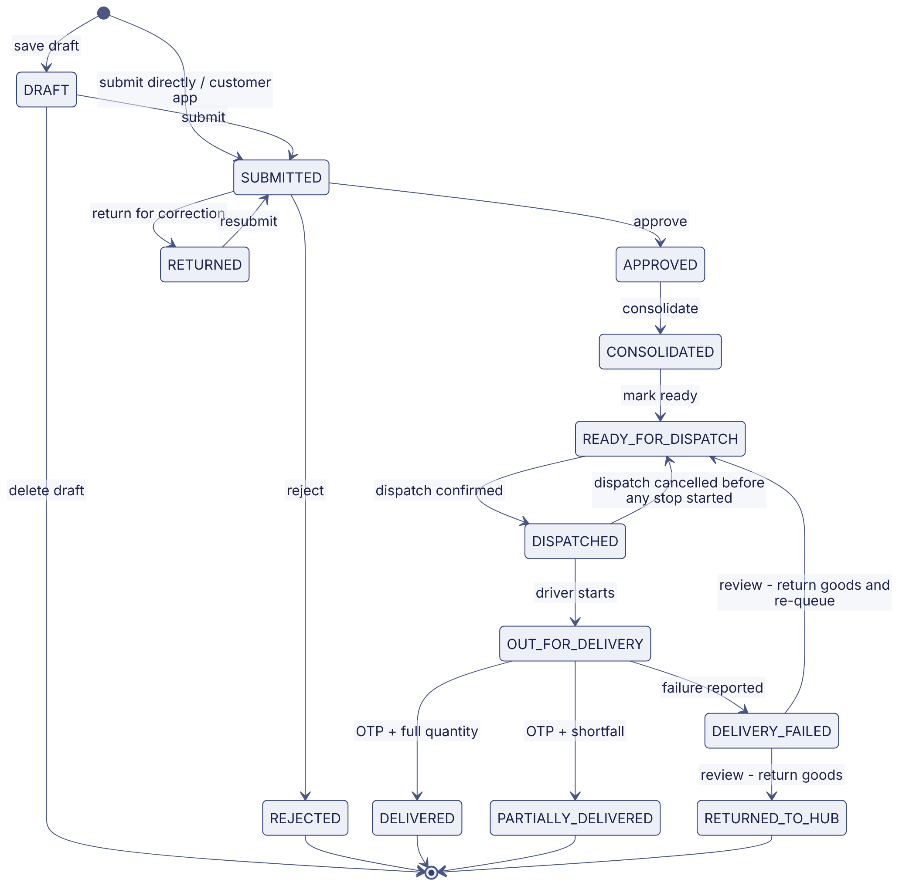{.diagram data-h="f725453ae2c2"}

Notes: while an order sits on a DRAFT / PLANNED / ASSIGNED dispatch it stays READY_FOR_DISPATCH (with `dispatchId`
set). Cancelling a dispatch that was never confirmed also leaves orders READY_FOR_DISPATCH.

### Companion fields

| Field | Values | Meaning |
|---|---|---|
| `approvalStatus` | NOT_SUBMITTED, PENDING, APPROVED, REJECTED, RETURNED | Sales Manager decision |
| `consolidationStatus` | NOT_STARTED, PENDING, COMPLETED | PENDING after approval; COMPLETED after consolidation |
| `orderSource` | e.g. `customer_app` for customer orders | Where the order came from |
| `creditWarning`, `stockWarning` | true / false | Flags shown to the approver |

## 17.2 Dispatch status (`DISPATCH_STATUS_META`, `src/config/dispatchConfig.js`)

| Code | Label | Step |
|---|---|---|
| DRAFT | Draft | 0 |
| PLANNED | Planned | 1 |
| ASSIGNED | Assigned | 2 |
| CONFIRMED | Confirmed | 3 |
| IN_TRANSIT | In transit | 4 |
| PARTIALLY_DELIVERED | Closed with exceptions | 5 |
| COMPLETED | Completed | 5 |
| CANCELLED | Cancelled | −1 |

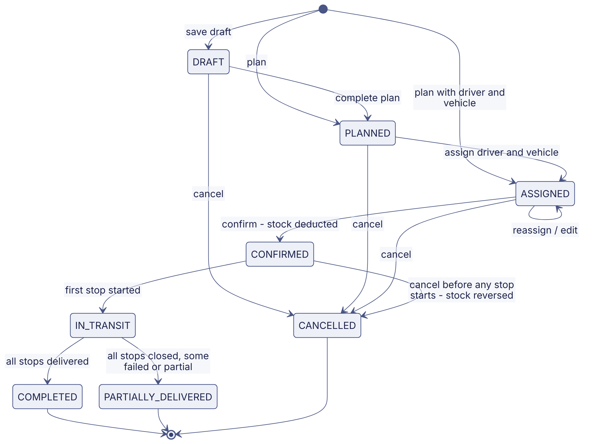{.diagram data-h="6f0388b07ac2"}

## 17.3 Delivery status (`DELIVERY_STATUS`)

| Code | Label | Set by |
|---|---|---|
| DISPATCHED | Dispatched | `confirmDispatch` (one delivery per order) |
| OUT_FOR_DELIVERY | Out for delivery | `startDelivery` |
| DELIVERED | Delivered | `confirmDelivery` |
| PARTIALLY_DELIVERED | Partially delivered | `confirmDelivery` |
| FAILED | Failed | `failDelivery` |
| RETURNED | Returned | `reviewDelivery` (failed + return to hub) |
| CANCELLED | Cancelled | `cancelDispatch` (confirmed dispatch) |

Review status on failed / partial deliveries: `PENDING` → `REVIEWED`. Terminal delivery statuses
(`TERMINAL_DELIVERY_STATUSES`) cannot be restarted.

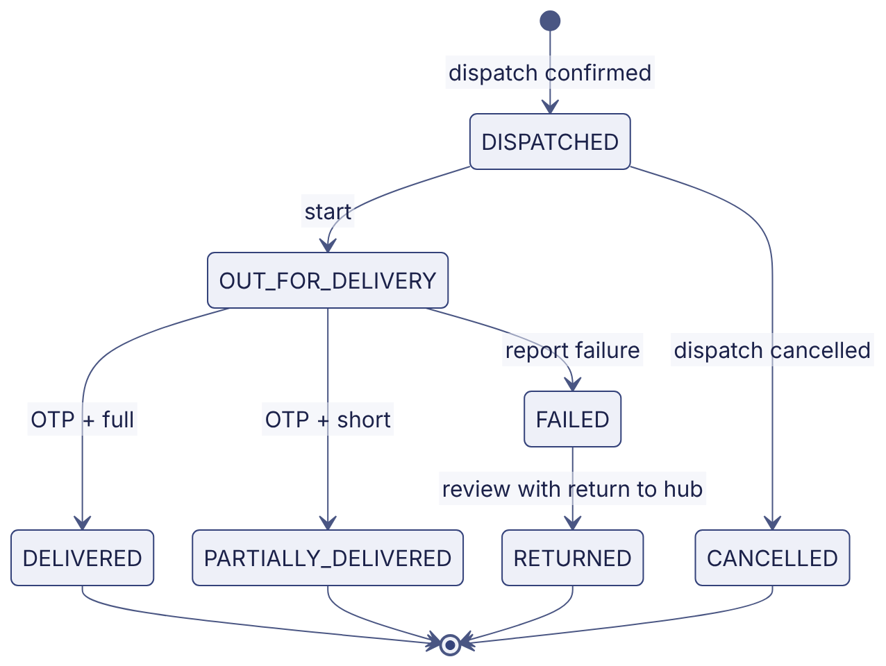{.diagram data-h="5600b213db6d"}

## 17.4 Delivery OTP (`OTP_STATUS`)

| Code | Label |
|---|---|
| ACTIVE | Awaiting entry |
| VERIFIED | Verified |
| EXPIRED | Expired (derived when `expiresAt` passes) |
| INVALIDATED | Replaced by a newer OTP |
| LOCKED | Too many attempts (5) |

## 17.5 Scrap request (`SCRAP_STATUS`, `scrapService`)

DRAFT → PENDING_APPROVAL → APPROVED → COMPLETED; PENDING_APPROVAL → REJECTED; DRAFT / PENDING_APPROVAL / APPROVED →
CANCELLED. Diagram: chapter 07 §7.3.

## 17.6 Replenishment (`REPLENISHMENT_META`, `src/config/aiConfig.js`)

| Code | Label |
|---|---|
| DRAFT | Draft |
| SUBMITTED | Submitted for approval |
| APPROVED | Approved |
| REJECTED | Rejected |
| CONVERTED | Awaiting goods receipt |
| RECEIVED | Received (derived from stock receipts) |
| CANCELLED | Cancelled |

Reorder recommendation (`RECOMMENDATION_STATUS`): OPEN, IN_DRAFT, DISMISSED. Diagram: chapter 07 §7.4.

## 17.7 Document (`DOCUMENT_STATUS_META`, `src/config/documentConfig.js`)

| Code | Label |
|---|---|
| PENDING_OCR | Pending OCR |
| OCR_COMPLETED | OCR completed |
| PENDING_REVIEW | Pending review |
| VERIFIED | Verified |
| REJECTED | Rejected |
| EXPIRED | Expired (derived from expiry date) |

Diagram: chapter 07 §7.5.

## 17.8 Invoice (`INVOICE_STATUS_META`, `src/config/invoiceConfig.js`)

| Code | Label |
|---|---|
| ISSUED | Issued |
| CANCELLED | Cancelled |

## 17.9 Stock transfer (`TRANSFER_STATUS`, `src/config/masterData.js`)

Draft → Completed; Draft → Cancelled.

## 17.10 Stock status (`STOCK_STATUS`, `utils/stock.getStockStatus`)

In Stock · Low Stock · Out of Stock · Overstock (first match: Out → Low → Over → In).

## 17.11 Messages — email and WhatsApp (`MESSAGE_STATUS_META`, `src/config/communicationConfig.js`)

| Code | Label |
|---|---|
| DRAFT | Draft |
| QUEUED | Queued |
| SENDING | Sending |
| SENT | Sent (accepted by provider) |
| DELIVERED | Delivered (provider confirmed) |
| FAILED | Failed |
| QUEUED_DEMO | Queued · demo |
| SENT_DEMO | Sent · demo (not sent) |
| FAILED_DEMO | Failed · demo |

Automation history status: SKIPPED, SENT_DEMO / SENT / DELIVERED, PARTIAL, FAILED.

## 17.12 VMS expiry state (`EXPIRY_META`, `src/config/vmsConfig.js`)

| Code | Label |
|---|---|
| EXPIRED | Expired |
| TODAY | Expires today |
| WEEK | Within 7 days |
| MONTH | Within 30 days |
| VALID | Valid |
| MISSING | Not on record |

## 17.13 Fleet

| Set | Values |
|---|---|
| Vehicle status | Available, Assigned, In Transit (derived from dispatches), Maintenance, Inactive |
| Driver status | Active, Inactive |
| Driver availability | Available, Assigned, On Delivery, Offline |

## 17.14 Master data and users

| Set | Values |
|---|---|
| Customer status | Active, Inactive, Blocked |
| Hub status | Active, Inactive |
| Product status | Active, Inactive, Discontinued (only Active products can be ordered and approved) |
| Zone status | Active, Inactive |
| User status | active / inactive; temporary lock after failed sign-ins |
| Role status | active / inactive; system, protected and locked flags |

## 17.15 AI and calls

| Set | Values |
|---|---|
| AI insight | NEW (New), REVIEWED (Reviewed), RESOLVED (Resolved) |
| Call status | Connected, Missed, Busy, No Answer, Voicemail |
| Call outcome | Order Received, Interested, Follow-up Required, No Response, Busy, Not Interested, Complaint, Payment Follow-up, Other |
| Call follow-up | Open (overdue / today / upcoming) → Completed |

# 18 · Screen-Wise User Guide {#ch-18}

Every screen in the application, in simple English. "Who" uses the role abbreviations from chapter 16 (SA Super Admin
can open every screen and is not repeated). Screens reached from a list (details, edit, print) are included after their
list.

## 18.1 Before you sign in

| Screen | Route | What you do here |
|---|---|---|
| Sign in | `/login` | Type your email or username and password. Tick "Keep me signed in" on your own computer. Pick a demo account from the list if you are trying the demo. |
| Driver sign in | `/driver/login` | Drivers sign in with mobile number, email or username. |
| Customer sign in | `/customer/login` | Customers sign in with mobile number, email or username. |
| Forgot password | `/forgot-password` | Get a 6-digit reset code (shown on screen in the demo) or restore the demo password. |
| Reset password | `/reset-password` | Enter the code and your new password. |
| Unauthorized | `/unauthorized` | You opened a page your role cannot use. Go back to your dashboard. |
| Not found | any unknown address | The page does not exist. Use the menu. |

## 18.2 Common controls

- **Sidebar** (office app): menu groups for your role; collapse it with the arrow. **Bottom bar** (driver and customer apps).
- **Header**: global search, notifications bell, theme, your name menu (profile, password, sign out).
- **Lists**: search box, filters, column sorting, pagination, export where allowed.
- **Forms**: required fields are marked; errors appear under the field; the save buttons stay at the bottom.
- **Status badges**: colours follow the status (green done, amber waiting, red problem, grey closed).
- **DEMO badges**: "DEMO GPS", "Simulated OCR", "Sent · demo" mark simulated behaviour.

## 18.3 Dashboard

| Screen | Route | Who | What you do here |
|---|---|---|---|
| Dashboard | `/dashboard` | All | Your home page. Shows the numbers and work queues for your role. Pick a period at the top; click any card to open the list behind it. |

## 18.4 Order Management

| Screen | Route | Who | What you do here |
|---|---|---|---|
| Create Order | `/orders/create` | AD, SE | Fill in customer, hub, delivery date and address, add products and quantities. Check the totals and warnings, then Save draft or Submit for approval. |
| My Orders | `/orders/my-orders` | AD, SE | All orders you created, with their status. Open one to see details, edit a draft or a returned order. |
| Order List | `/orders` | AD, SE, SM, CS, DP, FI, WM | Every order you are allowed to see. Search and filter by status, customer, salesman, hub or date. |
| Order Approval | `/orders/approval` | AD, SM | Orders waiting for your decision, oldest first. Open an order to approve, return or reject it. |
| Order Consolidation | `/orders/consolidation` | AD, CS | Approved orders waiting to be checked against the warehouse. Open one to consolidate it. |
| Returned Orders | `/orders/returned` | AD, SE, SM | Orders the Sales Manager sent back. Open one to see the reason, correct it and resubmit. |
| Rejected Orders | `/orders/rejected` | AD, SE, SM | Orders that were rejected, with the reason. They cannot be changed; duplicate one to start again. |
| Order Reports | `/orders/reports` | AD, SM, FI | Order totals and trends by status, salesman, customer and period. |
| Edit Order | `/orders/:id/edit` | AD, SE | Change a draft or a returned order. For a returned order the section to fix is highlighted. Resubmit when done. |
| Review Order | `/orders/approval/:id` | AD, SM | Review one order: approval checks (customer, hub, credit, stock, total, products), lines and history. Approve with optional remarks, or return / reject with a reason. |
| Consolidate Order | `/orders/consolidation/:id` | AD, CS | Tick the five verification checks, review hub stock, add notes, Consolidate, then Mark ready for dispatch. |
| Order Details | `/orders/:id` | AD, SE, SM, CS, DP, FI, WM | Everything about one order: lines, totals, approval, dispatch, delivery, invoice and the full timeline. |

## 18.5 Customers

| Screen | Route | Who | What you do here |
|---|---|---|---|
| Customer List | `/customers` | AD, SE, SM, CS | List of customers. Search, filter and open a customer. |
| Customer Credit | `/customers/credit` | AD, SM, FI | Credit limit, balance and utilisation for every customer. Spot who is over the limit. |
| Add Customer | `/customers/create` | AD | Add a new customer: details, contacts, address, GST / PAN, hub, zone, sales rep and credit settings. |
| Customer Details | `/customers/:id` | AD, SE, SM, CS | One customer: profile, credit position, orders, deliveries and documents. |
| Edit Customer | `/customers/:id/edit` | AD | Change a customer's details or credit settings. |

## 18.6 Master data

| Screen | Route | Who | What you do here |
|---|---|---|---|
| Products | `/products` | AD, SE, SM, CS, DP, FI, WM, IE, QA | Product catalogue with price, tax, unit and status. Open or add a product. |
| Suppliers | `/suppliers` | AD, SM, DP, FI, WM | Suppliers used for replenishment. Add or edit a supplier and its lead time. |
| Hubs | `/hubs` | AD, SM, CS, DP, WM, IE, QA | Hubs (warehouses / distribution points). Open or add a hub. |
| Add Product | `/products/create` | AD | Add a product: code, SKU, barcode, category, unit, price, tax, discount limit, storage and stock settings. |
| Product Details | `/products/:id` | AD, SE, SM, CS, DP, FI, WM, IE, QA | One product: details and stock at each hub. |
| Edit Product | `/products/:id/edit` | AD | Change a product. |
| Add Hub | `/hubs/create` | AD | Add a hub: code, name, type, address and contacts. |
| Hub Details | `/hubs/:id` | AD, SM, CS, DP, WM, IE, QA | One hub: details, stock, zones and fleet. |
| Edit Hub | `/hubs/:id/edit` | AD | Change a hub. |

## 18.7 Inventory

| Screen | Route | Who | What you do here |
|---|---|---|---|
| Inventory Dashboard | `/inventory` | AD, DP, FI, WM, IE | Inventory overview: stock value, status mix, alerts and recent stock documents. |
| Warehouse Dashboard | `/warehouse` | AD, WM, IE, QA | Warehouse view: picking and loading for today, stock alerts, damaged stock and document expiry. |
| QA & Cold Chain | `/quality` | AD, WM, QA | QA view: documents to inspect, quarantine (damaged stock), expiries and the cold-chain card (no live sensors). |
| Stock Overview | `/inventory/stock` | AD, SE, SM, CS, DP, FI, WM, IE, QA | Stock for every product at every hub, with available quantity and status. |
| Low Stock | `/inventory/low-stock` | AD, SM, CS, DP, WM, IE, QA | Lines at or below the reorder level, or out of stock. Start a receipt, transfer or replenishment from here. |
| Stock Receipts | `/inventory/stock-receipts` | AD, DP, WM, IE, QA | List of goods received (GRN). Open one or create a new receipt. |
| Stock Transfers | `/inventory/stock-transfers` | AD, DP, WM, IE, QA | Transfers between hubs. Complete or cancel drafts. |
| Stock Adjustments | `/inventory/stock-adjustments` | AD, DP, WM, IE, QA | Stock corrections (increase, decrease, damaged, lost, correction) with reasons. |
| Stock Movements | `/inventory/movements` | AD, DP, WM, IE, QA | The stock ledger: every movement in and out with reference. |
| Scrap Management | `/inventory/scrap` | AD, DP, WM, IE, QA | Scrap overview: requests by status, value and reason. |
| Scrap Requests | `/inventory/scrap/requests` | AD, DP, WM, IE, QA | All scrap requests. Filter by status and open one. |
| New Scrap Request | `/inventory/scrap/requests/create` | AD, DP, WM, IE, QA | Request scrap: product, hub, stock source, quantity, reason, batch and photo. Save draft or submit. |
| Edit Scrap Request | `/inventory/scrap/requests/:id/edit` | AD, DP, WM, IE, QA | Change your draft scrap request. |
| Scrap Note | `/inventory/scrap/requests/:id/print` | AD, DP, WM, IE, QA | Printable scrap note. |
| Scrap Request | `/inventory/scrap/requests/:id` | AD, DP, WM, IE, QA | One scrap request: details, photo, history; approve, reject, write off or cancel depending on your role. |
| Stock Details | `/inventory/stock/:id` | AD, SE, SM, CS, DP, FI, WM, IE, QA | One stock line: quantities, recent movements, and minimum / reorder / maximum levels. |
| New Receipt | `/inventory/stock-receipts/create` | AD, WM, IE | Record goods received: hub, product, quantity, date and reference. Stock goes up immediately. |
| New Transfer | `/inventory/stock-transfers/create` | AD, WM, IE | Move stock from one hub to another. Save as draft or complete now. |
| New Adjustment | `/inventory/stock-adjustments/create` | AD, WM, QA | Correct stock with a type and reason. Posted immediately. |

## 18.8 Dispatch

| Screen | Route | Who | What you do here |
|---|---|---|---|
| Dispatch Dashboard | `/dispatch` | AD, SM, CS, DP, FI, WM | Dispatch overview: ready orders, dispatches by status, deliveries, drivers, vehicles and performance charts. |
| Ready for Dispatch | `/dispatch/ready-orders` | AD, CS, DP, WM | Orders released by Customer Service and waiting to be planned. Select orders to start a dispatch. |
| Dispatch Planning | `/dispatch/planning` | AD, SM, CS, DP, FI, WM | All dispatches by date and status. Open one or create a new dispatch. |
| Driver Assignment | `/dispatch/assignments` | AD, DP | Dispatches that need a driver and vehicle. Assign only compliant, free resources from the same hub. |
| Delivery Tracking | `/dispatch/delivery-tracking` | AD, SM, CS, DP | Every stop on active dispatches with live status. |
| Delivery History | `/dispatch/delivery-history` | AD, SM, CS, DP, FI, WM | Closed stops. Failed and partial deliveries waiting for review are highlighted. |
| Dispatch Zones | `/dispatch/zones` | AD, DP | Delivery zones (pincode groups) for each hub. |
| Drivers | `/dispatch/drivers` | AD, DP | Driver list with availability, hub and licence status. |
| Vehicles | `/dispatch/vehicles` | AD, DP | Vehicle list with status, capacity and hub. |
| Delivery Reports | `/dispatch/reports` | AD, DP, FI | Delivery performance: on-time, failed, partial, by driver and zone. |
| New Dispatch | `/dispatch/create` | AD, DP | Build a dispatch: pick ready orders, hub, zone, date, put the stops in order, optionally assign driver and vehicle. Save draft or plan. |
| New Zone | `/dispatch/zones/create` | AD | Add a zone with its pincodes. |
| Edit Zone | `/dispatch/zones/:id/edit` | AD | Change a zone. |
| Live Tracking (Demo GPS) | `/dispatch/live-tracking` | AD, DP | Map with simulated (DEMO GPS) positions of vehicles on the road. |
| New Driver | `/dispatch/drivers/create` | AD | Add a driver: code, contact, hub, zone, licence, vehicle and app login. |
| Edit Driver | `/dispatch/drivers/:id/edit` | AD | Change a driver. |
| Driver Details | `/dispatch/drivers/:id` | AD, DP | One driver: profile, compliance and performance. |
| New Vehicle | `/dispatch/vehicles/create` | AD | Add a vehicle: number, type, capacity, hub, category, fuel, ownership and document dates. |
| Edit Vehicle | `/dispatch/vehicles/:id/edit` | AD | Change a vehicle. |
| Delivery Details | `/dispatch/deliveries/:id` | AD, SE, SM, CS, DP, FI, WM | One stop: items, delivered / damaged quantities, proof of delivery, OTP (for the Dispatcher) and the review panel for exceptions. |
| Delivery Note | `/dispatch/delivery-notes/:id` | AD, SE, SM, CS, DP, FI, WM | Printable delivery note (BM-DN number) with what was delivered and who received it. |
| Edit Dispatch | `/dispatch/:id/edit` | AD, DP | Change a dispatch that is still Draft, Planned or Assigned. |
| Dispatch Details | `/dispatch/:id` | AD, SM, CS, DP, FI, WM | One dispatch: stops, sequence, driver, vehicle, stock check, timeline. Confirm (loading sign-off) or cancel here. |

## 18.9 My Deliveries

| Screen | Route | Who | What you do here |
|---|---|---|---|
| Today | `/driver/dashboard` | DR | Driver home: today's and tomorrow's stops, your next stop and your performance. |
| My Deliveries | `/driver/deliveries` | DR | All your stops. Tap one to open it. |
| Route | `/driver/route` | DR | Map of your stops in order (DEMO GPS). |
| Completed | `/driver/completed` | DR | Stops you have finished. |
| My Delivery Notes | `/driver/delivery-notes` | DR | Delivery notes for your completed stops. |
| Driver Profile | `/driver/profile` | DR | Your details and vehicle. Sign out from here. |
| My Documents | `/driver/documents` | DR | Your licence and other documents. Upload new ones. |
| Document | `/driver/documents/:id` | DR | One of your documents. |
| Confirm Delivery | `/driver/deliveries/:id/confirm` | DR | Enter what the customer accepted, who received it, optional signature and photo, then the customer's OTP to complete. |
| Delivery | `/driver/deliveries/:id` | DR | One stop: address, contact, items. Start delivery, Reach location, Complete with OTP, or Report issue. |
| Delivery Note | `/driver/delivery-notes/:id` | DR | A delivery note to show the customer. |

## 18.10 My Account (Customer)

| Screen | Route | Who | What you do here |
|---|---|---|---|
| Home | `/customer/dashboard` | CU | Customer home: your orders, deliveries on the way, notes and balance. |
| Catalog | `/customer/catalog` | CU | Browse and search products and add them to your cart. |
| Cart | `/customer/cart` | CU | Check your cart, choose the delivery address and date, and place the order. |
| My Orders | `/customer/orders` | CU | Your orders with filters (active, pending, delivered). |
| Order | `/customer/orders/:id` | CU | One order: progress tracker, items, status. Reorder from here. |
| Track Delivery | `/customer/tracking/:id` | CU | Follow the driver on the map (DEMO GPS). When the driver arrives, your OTP is shown here. |
| Delivery Notes | `/customer/delivery-notes` | CU | Delivery notes for your deliveries. |
| Delivery Note | `/customer/delivery-notes/:id` | CU | One delivery note. |
| Invoices | `/customer/invoices` | CU | Your invoices. |
| Invoice | `/customer/invoices/:id` | CU | One invoice. |
| Payments | `/customer/payments` | CU | Your outstanding balance. Payment history is not available in this prototype. |
| Profile | `/customer/profile` | CU | Your account details. Sign out from here. |

## 18.11 Vehicle Management

| Screen | Route | Who | What you do here |
|---|---|---|---|
| VMS Dashboard | `/vms` | AD, DP, QA | Fleet compliance overview: vehicles and drivers by document status. |
| Vehicles | `/vms/vehicles` | AD, DP, QA | Vehicles with their compliance state. |
| Driver Documents | `/vms/drivers` | AD, DP, QA | Drivers and their documents. |
| Document Expiry | `/vms/document-expiry` | AD, DP, QA | All vehicle and driver documents sorted by urgency: expired, today, 7 days, 30 days. |
| VMS Reports | `/vms/reports` | AD, DP, QA | Fleet and compliance reports. |
| Compliance Rules | `/vms/settings` | AD | Choose which documents are required and when expiry blocks assignment. |
| New Vehicle | `/vms/vehicles/create` | AD | Add a vehicle (VMS). |
| Edit Vehicle | `/vms/vehicles/:id/edit` | AD | Change a vehicle (VMS). |
| Vehicle Documents | `/vms/vehicles/:id/documents` | AD, DP, QA | A vehicle's documents and expiry dates. |
| Vehicle Details | `/vms/vehicles/:id` | AD, DP, QA | One vehicle: details and compliance. |
| Driver Documents | `/vms/drivers/:id/documents` | AD, DP, QA | A driver's documents and expiry dates. |

## 18.12 Documents

| Screen | Route | Who | What you do here |
|---|---|---|---|
| Document Repository | `/documents` | AD, SE, SM, CS, DP, FI, WM, IE, QA | All documents you may see. Search by type, record or status. |
| Upload Documents | `/documents/upload` | AD, SE, SM, CS, DP, FI, WM, IE, QA | Upload a document: type, what it belongs to, the record, the file and key fields. |
| OCR Queue | `/documents/ocr-queue` | AD, SE, SM, CS, DP, FI, WM, IE, QA | Documents waiting for OCR or review. |
| Verified | `/documents/verified` | AD, SE, SM, CS, DP, FI, WM, IE, QA | Verified documents. |
| Rejected | `/documents/rejected` | AD, SE, SM, CS, DP, FI, WM, IE, QA | Rejected documents with the reason. |
| Document Types | `/documents/types` | AD | Document types and the fields each one captures. |
| Document Reports | `/documents/reports` | AD, CS, QA | Document counts by type, status and expiry. |
| New Document Type | `/documents/types/create` | AD | Add a document type. |
| Edit Document Type | `/documents/types/:id/edit` | AD | Change a document type. |
| OCR Review | `/documents/:id/review` | AD, SE, SM, CS, DP, FI, WM, IE, QA | Check the extracted fields against the file, correct them, then verify or reject. |
| Document | `/documents/:id` | AD, SE, SM, CS, DP, FI, WM, IE, QA | One document: file, fields, status and history. |

## 18.13 Invoices

| Screen | Route | Who | What you do here |
|---|---|---|---|
| Invoice Dashboard | `/invoices/dashboard` | AD, SM, FI | Invoice overview: issued value, orders delivered but not invoiced, recent invoices. |
| Invoices | `/invoices` | AD, SM, FI | All invoices. Search and open. |
| New Invoice | `/invoices/create` | AD, FI | Pick an order, choose template and options, check the live preview, then issue the invoice. |
| Invoice Templates | `/invoices/templates` | AD, FI | Invoice designs. Set the default template. |
| Invoice Reports | `/invoices/reports` | AD, FI | Invoice totals by status, customer and period. |
| New Template | `/invoices/templates/create` | AD, FI | Design a new invoice template. |
| Edit Template | `/invoices/templates/:id/edit` | AD, FI | Change an invoice template. |
| Template Preview | `/invoices/templates/:id/preview` | AD, SM, FI | See a template with sample data. |
| Print Invoice | `/invoices/:id/print` | AD, SM, FI | Print-ready invoice. |
| Invoice | `/invoices/:id` | AD, SM, FI | One invoice: lines, totals, status. Print, email or cancel. |

## 18.14 Communication

| Screen | Route | Who | What you do here |
|---|---|---|---|
| Communication Center | `/communication` | AD, SE, SM, CS, DP, FI | Communication hub: email, WhatsApp, automation and calls at a glance. |
| Email | `/communication/email` | AD, SE, SM, CS, DP, FI | Email home: counts and mode (demo or live). |
| WhatsApp | `/communication/whatsapp` | AD, SE, SM, CS, DP, FI | WhatsApp home: session state and recent messages. |
| Automated Notifications | `/communication/automation` | AD | Switch automation on or off and set, for each business event, the channel, recipients and templates. See the send history. |
| Call History | `/communication/calls` | AD, SE, SM, CS | Call overview: today's calls, outcomes and follow-ups due. |
| Call Follow-ups | `/communication/calls/follow-ups` | AD, SE, SM, CS | Follow-ups by overdue, today and upcoming. Complete them here. |
| All Calls | `/communication/calls/list` | AD, SE, SM, CS | All calls you may see. |
| Log a Call | `/communication/calls/create` | AD, SE, SM, CS | Log a call: customer, direction, status, outcome, duration, notes and follow-up. |
| Edit Call | `/communication/calls/:id/edit` | AD, SE, SM, CS | Change a call. |
| Call Details | `/communication/calls/:id` | AD, SE, SM, CS | One call: details, notes, follow-up and linked order. |
| Compose Email | `/communication/email/compose` | AD, SE, SM, CS, DP, FI | Write an email (or use a template) and send it. In demo mode it is recorded, not sent. |
| Inbox | `/communication/email/inbox` | AD, SM, CS | Received emails (demo mailbox unless a live gateway is connected). |
| Sent | `/communication/email/sent` | AD, SE, SM, CS, DP, FI | Emails you sent and their status. |
| Drafts | `/communication/email/drafts` | AD, SE, SM, CS, DP, FI | Saved email drafts. |
| History | `/communication/email/history` | AD, SE, SM, CS, DP, FI | Full email log. |
| Email Templates | `/communication/email/templates` | AD, SE, SM, CS, DP, FI | Email templates with variables. |
| New Template | `/communication/email/templates/create` | AD | Add an email template. |
| Edit Template | `/communication/email/templates/:id/edit` | AD | Change an email template. |
| Email Settings | `/communication/email/settings` | AD | Email server settings (used only through the gateway). |
| Compose | `/communication/whatsapp/compose` | AD, SE, SM, CS, DP, FI | Write and send a WhatsApp message. In demo mode it is recorded, not sent. |
| History | `/communication/whatsapp/history` | AD, SE, SM, CS, DP, FI | WhatsApp message log. |
| WhatsApp Templates | `/communication/whatsapp/templates` | AD, SE, SM, CS, DP, FI | WhatsApp templates. |
| New Template | `/communication/whatsapp/templates/create` | AD | Add a WhatsApp template. |
| Edit Template | `/communication/whatsapp/templates/:id/edit` | AD | Change a WhatsApp template. |
| OpenWA Settings | `/communication/whatsapp/settings` | AD | OpenWA session settings (QR, start / stop) through the gateway. |

## 18.15 Administration

| Screen | Route | Who | What you do here |
|---|---|---|---|
| User Management | `/admin/users` | AD | All user accounts with role, hub and status. |
| Role Management | `/admin/roles` | AD | All roles with their data scope and number of users. |
| Permission Matrix | `/admin/permissions` | AD | Matrix of permissions by role. Change grants for editable roles. |
| User Role Assignment | `/admin/role-assignment` | AD | Give users their roles and home hub. |
| Audit Log | `/admin/audit-logs` | AD | Who changed what and when (administration and security events). |
| Application Settings | `/admin/settings` | AD | Company-wide settings: localisation, numbering, security, approval rules, inventory, warehouse, cold chain. |
| Create User | `/admin/users/create` | AD | Create a user: name, login, role, hub and (for portal users) the linked customer or driver. |
| Edit User | `/admin/users/:id/edit` | AD | Change a user. |
| User Details | `/admin/users/:id` | AD | One user: details, roles, status; reset password, unlock, activate / deactivate. |
| Create Role | `/admin/roles/create` | AD | Create a custom role: name, scope, landing page and permissions. |
| Edit Role | `/admin/roles/:id/edit` | AD | Change a role. |
| Role Details | `/admin/roles/:id` | AD | One role: permissions and users. |

## 18.16 Organization

| Screen | Route | Who | What you do here |
|---|---|---|---|
| Company | `/admin/organization/company` | AD | Company profile used across the app and on documents. |
| Branches | `/admin/organization/branches` | AD | Branches. |
| Business Units | `/admin/organization/business-units` | AD | Business units. |
| Departments | `/admin/organization/departments` | AD | Departments. |
| Designations | `/admin/organization/designations` | AD | Job titles. |
| Employee Master | `/admin/organization/employees` | AD | Employee master linked to users. |
| Warehouse Master | `/admin/organization/warehouses` | AD | Warehouse master. |

## 18.17 AI & Intelligence

| Screen | Route | Who | What you do here |
|---|---|---|---|
| AI Overview | `/ai` | AD, SE, SM, CS, DP, FI, WM, IE, QA | AI overview: what the assistant, forecasting and insights can do. |
| AI Assistant | `/ai/assistant` | AD, SE, SM, CS, DP, FI, WM, IE, QA | Ask questions about your data in plain words and get tables and charts back. |
| Jarvis | `/ai/jarvis` | AD, SE, SM, CS, DP, FI, WM | Voice-style assistant ("Jarvis") for quick questions and actions with confirmation. |
| Forecasting | `/ai/forecasting` | AD, SM, DP, FI, WM | Forecast overview and recent forecasts. |
| Predictive Inventory | `/ai/predictive-inventory` | AD, SM, DP, FI, WM | Predicted stock needs, risks and reorder suggestions. |
| Replenishment | `/ai/replenishment` | AD, SM, DP, FI, WM, IE | Purchase requests to suppliers and their status. |
| AI Insights | `/ai/insights` | AD, SM, CS, DP, FI, WM, QA | Automatically found issues and opportunities. Mark them reviewed or resolved. |
| Model Management | `/ai/models` | AD, SM, DP, FI, WM | Forecasting models: enable or disable, see accuracy. |
| AI Settings | `/ai/settings` | AD | Choose the AI provider and data-sharing level. |
| AI Activity | `/ai/activity` | AD, SE, SM, CS, DP, FI, WM, IE, QA | Log of what the assistant did for you. |
| New Forecast | `/ai/forecasting/new` | AD, SM | Create a forecast: what, where, how far ahead, which model. |
| Forecast History | `/ai/forecasting/history` | AD, SM, DP, FI, WM | Past forecasts. |
| Compare Forecasts | `/ai/forecasting/compare` | AD, SM, DP, FI, WM | Compare forecasts side by side. |
| Forecast Report | `/ai/forecasting/:id/print` | AD, SM, FI | Printable forecast report. |
| Forecast | `/ai/forecasting/:id` | AD, SM, DP, FI, WM | One forecast with chart and accuracy. |
| Reorder Recommendations | `/ai/predictive-inventory/reorder` | AD, SM, DP, FI, WM | Suggested reorders. Add to a replenishment draft or dismiss. |
| Inventory Risk Analysis | `/ai/predictive-inventory/risks` | AD, SM, DP, FI, WM | Stock-out, excess, slow and non-moving risks. |
| Demand Forecasting | `/ai/predictive-inventory/demand` | AD, SM, DP, FI, WM | Demand forecast by product and hub. |
| Planning Parameters | `/ai/predictive-inventory/settings` | AD, SM, DP, FI, WM | Planning parameters (Administrator). |
| Prediction Detail | `/ai/predictive-inventory/lines/:id` | AD, SM, DP, FI, WM | Prediction for one product at one hub. |
| New Replenishment Draft | `/ai/replenishment/create` | AD, DP, WM, IE | Create a purchase request: supplier, hub, products and quantities. |
| Replenishment Draft | `/ai/replenishment/:id` | AD, SM, DP, FI, WM, IE | One purchase request: submit, approve, reject, convert, cancel, and receive goods. |

## 18.18 Reports

| Screen | Route | Who | What you do here |
|---|---|---|---|
| Reports Center | `/reports/center` | AD, SE, SM, CS, DP, FI, WM, IE, QA | All reports you may see. Search, favourite and open. |
| Report | `/reports/view/:id` | AD, SE, SM, CS, DP, FI, WM, IE, QA | Run a report: set dates and filters, view table and chart, export CSV or print. |

## 18.19 My Account

| Screen | Route | Who | What you do here |
|---|---|---|---|
| My Profile | `/profile` | All | Your profile. |
| Notification Center | `/notifications` | All | All your notifications. Mark them read and open the linked record. |
| Change Password | `/account/change-password` | All | Change your password (required after an administrator reset). |
| Preferences | `/settings` | All | Your preferences: theme and notifications. |
| Sign Out | `/logout` | All | Confirm sign out. |

# 19 · Glossary {#ch-19}

## 19.1 Business terms

| Term | Meaning in Bellomassi |
|---|---|
| Approval checks | Six automatic checks shown to the Sales Manager: customer active, hub active, credit within limit, stock available, order total valid, products active. |
| Available stock | Total − reserved − damaged quantity at a hub. |
| Batch-controlled product | A product whose scrap requests must name a batch number. Batch tracking on stock is not implemented. |
| Closed with exceptions | Label of dispatch status PARTIALLY_DELIVERED: all stops closed, at least one failed or partial. |
| Cold chain | Keeping frozen (−25 to −18 °C) and chilled (0 to 4 °C) goods in range. Ranges are configured; live readings are not available. |
| Consolidation | Customer Service's five-point check of an approved order before it is released to dispatch. |
| Credit limit / balance | Maximum outstanding amount allowed for a customer / the outstanding amount recorded on the customer. |
| Credit warning | Flag on an order whose total would take the customer over the credit limit. |
| Customer app | Mobile-first part of the application for customers (`/customer/*`). |
| Data scope | Which records a role can see (all, own, linked customer, etc.). |
| Delivery | One stop on a dispatch, created per order when the dispatch is confirmed. |
| Delivery note | Proof-of-delivery document generated when a stop is completed (BM-DN-YYYY-NNNNN). |
| DEMO GPS | Simulated vehicle position used for tracking; no real GPS device. |
| Dispatch | One vehicle run from one hub on one date with a driver and a sequence of stops. |
| Dispatch confirmation | The Dispatcher's loading sign-off. Stock is deducted and the driver can start. |
| Driver app | Mobile-first part of the application for drivers (`/driver/*`). |
| Exception review | The Dispatcher's decision on a failed or partial delivery (return goods, re-queue). |
| FEFO | First-expiry-first-out picking strategy (a setting only). |
| Follow-up | A future action scheduled on a call record. |
| GRN | Goods receipt note — a stock receipt. |
| Hub | Location that holds stock and runs dispatches. |
| Invoice basis | Bill ordered quantities or delivered quantities (from the delivery note). |
| Landing page | First page a role sees after sign-in. |
| OTP | One-time 6-digit code the customer gives the driver to confirm the handover (simulated, shown in the customer app). |
| POD | Proof of delivery: receiver name, optional signature and photo, customer remarks. |
| Quarantine | Damaged quantity held at a hub (shown on the QA dashboard). |
| Re-queue | Putting a failed order back to READY_FOR_DISPATCH so it can be planned again. |
| Ready for dispatch | Order released by Customer Service to the Dispatcher. |
| Reorder level | Available quantity at or below which a stock line is Low Stock. |
| Replenishment | Purchase request to a supplier (draft → approval → goods receipt). |
| Return for correction | Sales Manager sends an order back to the salesman with a reason; the salesman fixes and resubmits. |
| Scrap / write-off | Removing unusable stock after approval; posts a Scrap Write-off movement. |
| Sequence | The order in which a driver must deliver the stops of a dispatch. |
| Simulated | Works realistically in the demo without a real external system. |
| Supplier portal | Read-only dashboard for a supplier showing approved replenishment. |
| VIP customer | Customer flag; customer-app orders get High priority and VIP reports. |
| VMS | Vehicle Management System — vehicle and driver document compliance. |
| Zone | Group of pincodes served from a hub. |

## 19.2 Technical terms

| Term | Meaning |
|---|---|
| `can(user, key)` | Permission check used by routes and services (`src/config/permissions.js`). |
| Data version | `APP_DATA_VERSION` 8 — the LocalStorage schema version; older data is migrated on load. |
| Integration gateway | Optional backend proxy (`VITE_INTEGRATION_GATEWAY_URL`) for live email, WhatsApp, OCR and AI. Not configured in the demo. |
| LocalStorage key | Browser storage entry; all start with `bellomassi_` (chapter 01 §1.6). |
| `navigation.js` | Single list of 206 route entries driving menus, routes, breadcrumbs and access. |
| Permission key | Name of one capability, e.g. `orders.approve` (110 keys). |
| `ProtectedRoute` | Router guard that sends signed-out users to sign-in and unauthorised users to `/unauthorized`. |
| Service | Module in `src/services` that owns the business rules for one area and returns `{ ok, record }` or `{ ok: false, error }`. |
| `storageService` | Only module that reads / writes browser storage; JSON safety, in-memory fallback, transactions. |
| Timeline | Event history of an order (`bellomassi_order_timeline`) or dispatch (`bellomassi_dispatch_timeline`). |
| Transaction | Several LocalStorage keys written together (`storage.transaction`) so a step is all-or-nothing. |

## 19.3 Document numbering

| Record | Format / prefix |
|---|---|
| Order | BM-ORD-… |
| Dispatch | BM-DSP-… |
| Delivery note | BM-DN-YYYY-NNNNN |
| Invoice | BM-INV-YYYY-NNNNN (prefix, year and digits configurable) |
| Stock receipt | GRN-… |
| Stock transfer | TRF-… |
| Stock adjustment | ADJ-… |
| Scrap request | SCR-… |
| Replenishment request | RPL-… |
| Call | CALL-… |

## 19.4 Role abbreviations

SA Super Admin · AD Administrator · SE Sales Executive (SALESMAN) · SM Sales Manager · CS Customer Service · DP
Dispatcher · DR Driver · FI Finance Executive · WM Warehouse Manager · IE Inventory Executive · QA QA Manager · CU
Customer · SU Supplier.

## 19.5 Status label legend

Implemented · Partially Implemented · Simulated · UI Only · Coming Soon · Not Implemented · Not Verified — see the
README.
